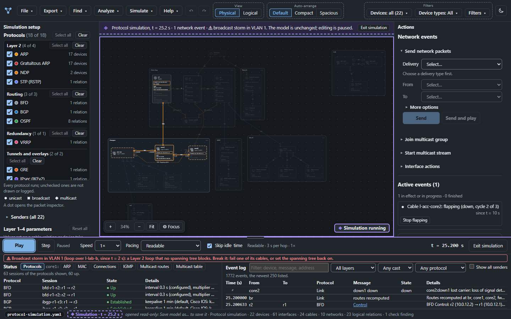
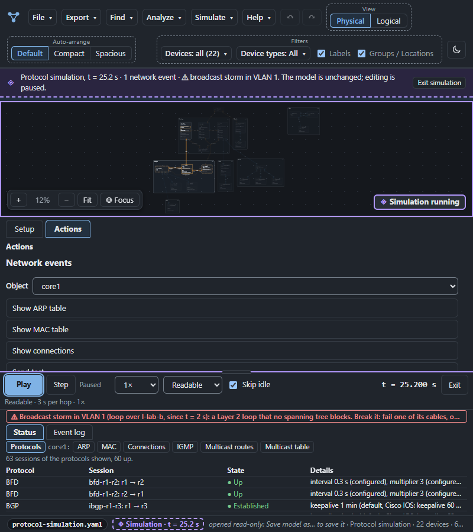
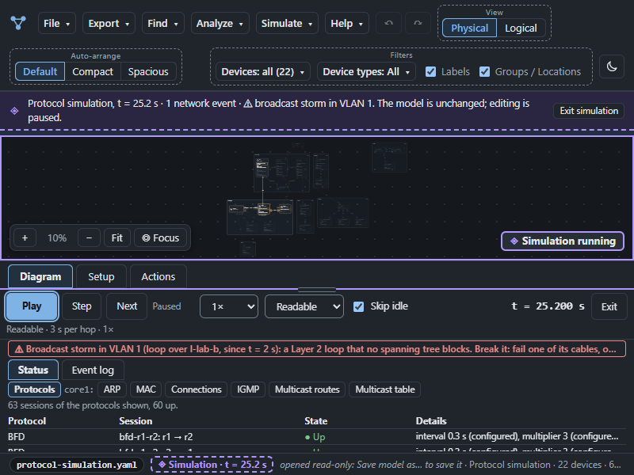

# NetAtlas

**NetAtlas — an explorable map of a network architecture.**

NetAtlas lets you create, edit and explore physical and logical network
diagrams from a single YAML file, entirely offline. The whole tool is one
self-contained HTML file, `dist/netatlas.html`, that runs in any modern
browser, including on an air-gapped machine. Start a new model or open a YAML
file, then:

* **Physical view:** devices, their ports (with interface names and each
  port's VLANs: `A 10` for an access port, `T 10,20,30–39 · N 10` for a
  trunk and its native VLAN), cabling (medium and speed), and locations such
  as sites, floors, rooms and racks, drawn as nested boxes.
* **Logical view:** IP networks with their members, device loopbacks,
  routing adjacencies, overlays, redundancy groups, services, and tunnels such
  as GRE and IPsec. Tunnels are drawn as hollow tubes; a relation carried over
  a tunnel on the same interfaces (e.g. OSPF over GRE) is drawn *inside* its
  tube.
* **Static routes:** per device and VRF, with next hops given as an address,
  an exit interface or both, blackhole routes, floating routes with a higher
  administrative distance and equal-cost routes. Each device's routes are a
  route table in its box in the logical view, with a dotted line from a route
  to the interface its next hop belongs to. A host's default gateway is a
  static default route. See [Static routes and port VLANs](#static-routes-and-port-vlans).
* **Consistency checks:** next hops that are not connected or don't resolve,
  exit interfaces that can't forward, duplicate and contradicting routes,
  VLAN mismatches between the ports of a cable (access, trunk lists, native
  VLAN), and more; each
  with a stable id, a severity and a jump to the place it is about, in the
  Problems tab.
* **Every relation and cable at its interface:** a relation starts and ends
  at the *port* of the interface it references (beside that interface's row
  in the device box), with the interface's name as an end label; a cable ends
  at the port it is plugged into. See
  [Relations and cables at their interfaces](#relations-and-cables-at-their-interfaces).
* **Every address in the diagram:** each interface's IPv4 and IPv6 addresses
  (with prefix length, secondary and dual-stack addresses together), VLAN,
  VRF, MAC address, tunnel source and destination and member ports are
  written in its device's box, next to the interface they belong to, in full;
  prefixes and VLANs on the networks, cable ids on the cables, the prefixes
  and next hops of static routes in their device's route table, the router
  ID and AS number of the protocols a device runs and the virtual addresses
  of its VRRP / HSRP groups, and addresses kept in `attrs` (NAT addresses,
  peer addresses …) next to their device, interface, network, cable or
  relation. See [Addresses and identifiers in the diagram](#addresses-and-identifiers-in-the-diagram).
* **Dark or Light theme:** Dark by default; a switch at the right end of the
  toolbar toggles between the two, and exported pictures are drawn in the
  theme you see.
* **Editor:** an object list (*Objects*) plus a property inspector. It can create,
  change and delete every part of the model: devices, their physical and
  logical interfaces (loopbacks, virtual interfaces, tunnel interfaces),
  static routes, the VLANs of ports, links, networks,
  relations and tunnels, groups, protocol definitions, free-form attributes,
  and even keys the format doesn't define. Validation
  runs as you type, and the diagram updates immediately. **Save model** and
  **Save model as…** write the model as a portable YAML file. Right-click two
  endpoints in the diagram to cable them or relate them.

There's nothing to install, no server, and no network access. YAML remains
the model: the page reads it, edits it and writes it back.

**NetAtlas 0.1.2**, a usable initial version; see the
[changelog](CHANGELOG.md) for what it covers, and
[Limitations](#limitations-honest-list) for what it doesn't.

Two version numbers are involved, and they are independent:

* **0.1.2** is the version of the application, shown next to the logo.
* **1** is the version of the YAML model format. Every model file starts
  with `netatlas: 1`, and model format 1, described in
  [docs/FORMAT.md](docs/FORMAT.md), is the only format NetAtlas reads and
  writes. A missing `netatlas:` line, another value, or a key that isn't in
  the format is reported as an error; nothing is converted or guessed.

The screenshots show both themes: **Dark**, the default, and **Light**.

| Editor: outline, inspector with the device type, loopbacks; logical view | Physical view of the same network |
|---|---|
|  |  |

| Selecting the GRE tunnel: OSPF inside it, and the IPsec it rides on, in the logical view… | …and the cables it rides on in the physical view |
|---|---|
|  |  |

| All 15 device types, each with its own icon; the legend lists them by name | Data-center fabric: spines and leaves in their rows by role, servers |
|---|---|
|  |  |

| **Auto-arrange**, physical: POP sites, customer, separate OOB island | **Auto-arrange**, logical: iBGP mesh between loopbacks, tunnels, devices kept in their groups |
|---|---|
|  |  |

| **Devices** filter, physical: six HQ devices, only their cables and frames | The same devices, logical: only the relations among them, groups framed |
|---|---|
|  |  |

| **Every address in the diagram**, physical: ports with their addresses and MACs, cable ids | The same model, logical, in the **dark theme**: interfaces, VRRP addresses, prefixes |
|---|---|
|  |  |

| **Every relation at its interface**: OSPF on `Tunnel10` selected; IPsec, OSPF and BFD leave from that port, end labels name the tunnels and their sources | Physical: the LAG `Po1` selected, its member ports in a bracket on both switches; hollow ends at the Internet cloud |
|---|---|
|  |  |

**Auto-arrange** sits in the top toolbar as three options, **Default**,
**Compact** and **Spacious**, and arranges the view on screen. The option the
view is arranged with is shown selected (and is disabled: there is nothing to
do); after manual changes none is selected and all three can be used.

## Open it, create or load a model

1. Get `netatlas.html`: attach it from the
   [GitHub release](https://github.com/hafnerst/netatlas/releases), or take
   `dist/netatlas.html` from this repository (or build it, see *Build*).
   It's the only file you need. Open it in Chrome, Edge, Firefox or Safari. Double-click
   it, drag it into a browser window, or enter its `file:///…/netatlas.html`
   path in the address bar. (Don't open `src/index.html`: that's only the
   build template.)
2. The start screen offers three ways to begin:
   * **New model** creates an empty model and opens it in the editor; add
     objects with **+ Add** in the object list (*Objects*) on the left;
   * **Open model…** lets you pick a `.yaml` / `.yml` file. You can also
     drop a file onto that card, or anywhere on the page;
   * **Load example**: choose one of the built-in examples and press
     **Load**.

   The same commands are in the **File** menu at the top left at any time.
   A file that can't be read as netatlas YAML is not opened: the page says
   which file, where and why, and lets you open another one. If the current
   model has unsaved changes, you are asked before it is replaced.
3. Switch between **Physical** and **Logical** (or press `P` / `L`).
4. Click anything in the diagram or in the object list on the left. The
   **Edit** tab on the right opens it in the inspector. With nothing
   selected, the Edit tab offers **Edit model settings** for the model as a
   whole (title, description).
5. Choose **File → Save model as…** (Ctrl+Shift+S) to save the model as a
   YAML file under a name and in a place you choose; from then on **File →
   Save model** (Ctrl+S) updates that file. See [Saving](#saving).

### The toolbar

| Control | What it does |
|---|---|
| **netatlas** logo and version | the application version (v0.1.2), not the model format version |
| **File ▾** | one menu for everything about models and their files: **New model**, **Open model…**, **Save model** (Ctrl+S), **Save model as…** (Ctrl+Shift+S), **Close model** and, under **Examples**, the built-in files. Every entry says *model*; an entry ends in “…” exactly when it asks for something before it acts (a file to open, a name and place to save to), and acts at once otherwise. *Save model* is available while the model is linked to a file it may write (see [Saving](#saving)); *Save model as…* and *Close model* whenever a model is open. *Save model* shows a small dot while there are unsaved changes. The example that is open is marked (*open*, or *open · modified*) until it is saved as a file of yours. The menu closes after a choice, with Esc, or when you click elsewhere; the arrow keys move through it. |
| **Export ▾** | One entry, **Export view as…**, which opens a submenu with **PNG** and **SVG**. Either saves the selected view (Physical or Logical) as a picture; see [Exporting pictures](#exporting-pictures). Greyed out until a model is open. The submenu opens when the entry is clicked or tapped, or with Enter, Space or the right arrow key; the left arrow key or Esc closes it. The menu works like **File**; the left and right arrow keys move between the two. |
| ↶ ↷ | undo and redo |
| **View: Physical** / **Logical** | the two views, in the group labelled *View*. The toolbar has three such groups, *View*, *Auto-arrange* and *Filters*: each has its label above its controls, inside the same dashed frame. The frame's colour has at least 3:1 contrast against the toolbar (light and dark theme), so it is clear which label and controls belong together, while staying a thin dashed line. In a very short window (400 px high or less, e.g. strongly zoomed) the labels are hidden to leave room for the diagram; the frames stay, and the labels remain the groups' accessible names. |
| **Auto-arrange: Default · Compact · Spacious** | three ways to arrange the view on screen (see [Auto-arrange and positions](#auto-arrange-and-positions)). The label *Auto-arrange* sits above the three buttons, all in one dashed frame. The one the view is arranged with is selected and disabled; the others stay available |
| **Find ▾** | **Command palette…** (`Ctrl+K`, `Cmd+K` on a Mac) searches every command and object; see [Command palette](#command-palette). **Find in diagram…** (`/`): a search bar over the top right of the diagram, by id, label, address, prefix, protocol or cable id; Enter or a click selects a match in the diagram, Esc closes it. **Filter object list…**: a filter box at the top of the object list (the model outline on the left), which stays while it holds text; × or Esc clears and closes it. It narrows the list only; the diagram is not changed. Both are greyed out until a model is open; the menu works like **File** and **Export**. |
| **Analyze ▾** | Every entry opens its own [tool window](#tool-windows): a window over the diagram that you can move, resize and fold, while the diagram and the side panel stay usable. **Addressing overview…** (`I`): the networks of each VRF with their members, gateways, use and free addresses, and the duplicate, overlapping and stray addresses; see [Addressing overview](#addressing-overview). **Focus…** (`Shift+F`): the selected object and its neighbourhood, 1–3 hops; **Exit focus** (`Esc`); see [Focus mode](#focus-mode). **Trace path…** (`T`) and **Exit path trace** (`Esc`): see [Path tracer](#path-tracer). **Single points of failure…**: a sortable table; see [Single points of failure](#single-points-of-failure). Analyze answers *what is*: everything here reads the model as written. Greyed out until a model is open (Exit: until the mode is on; the tooltip says why); the menu works like the others. |
| **Simulate ▾** | **Start simulation…** opens the [Start dialog](#starting-and-ending) (the protocols first, the parameters collapsed below) and starts the [protocol simulation](#simulation) in its own [layout](#the-simulation-layout); **Exit simulation** (`Esc`) ends it. Without a model both are greyed out (*Open or create a model first*); with a model, Start is available and Exit is not; while a simulation runs, Start is greyed out (*A simulation is already running*) and Exit is available. |
| **Help ▾** | **User Manual**: a large dialog with a short, task-by-task guide (opening and creating a model, saving and exporting, the two views, finding and filtering, selecting and editing, connecting, Auto-arrange, keyboard shortcuts) with screenshots of the application. **License**: a small dialog naming the license, the Apache License, Version 2.0, with its full text. Both are part of the file, so they work offline; both close with **×**, **Close** or Esc, and the focus returns to **Help**. Available with or without a model. |
| **Filters: Devices ▾** (right) | the first control of the group labelled *Filters*, which holds every diagram filter below (Devices, Device types, Labels, Groups / Locations, Networks, Routes and the **Filters ▾** drop-down); which devices the diagram shows; all by default. Like every diagram filter on this row (and the **Filters ▾** drop-down), it is greyed out on the start screen and becomes available, with its default, once a model is open. Opens a list with a check box per device, a filter box, **Select all** and **Clear**. See [Showing part of the network](#showing-part-of-the-network). |
| **Device types ▾** | directly next to **Devices ▾**, with the same look: which types of device the diagram shows; all by default. Its button says what is shown (*Device types: All*, *Device types: 3 of 8*). Opens a list with a check box per device type the model uses, by its display name (*Router*, *Switch*, *Firewall*, *Access point* …), each with its number of devices, and **Select all** and **Clear**; a model with Layer 2 and Layer 3 switches lists both under *Switch*. Arrow-down opens it from the keyboard, Esc closes it. See [Device types](#device-types). |
| **Labels** | cable, relation and address labels (on by default) |
| **Groups / Locations** | the frames of groups / locations, in both views (on by default). Hiding them never hides or moves a device. |
| **Networks** (logical view) | network nodes and their membership lines (on by default) |
| **Routes** (logical view) | the route tables in the device boxes and the dotted next-hop lines (on by default). Off, they are hidden and their room stays, so nothing moves; exports show what is on screen. |

| **Theme** ☾ / ☀ (right end) | the colour theme of the whole application, the diagram and exported pictures: **Dark** (the default) or **Light**. The button toggles between the two (Enter or Space from the keyboard); its icon shows the theme in effect (moon: dark, sun: light). Its tooltip (on hover and on keyboard focus) and its accessible name say the theme and what a press does, e.g. *Theme: Dark. Switch to the light theme*. The switch is a direct control, never inside a menu, and stays at the right end of the toolbar at every window width. Switching repaints at once: nothing is reloaded, and the view, selection, zoom and layout stay as they are. The choice is remembered in this browser (its local storage), never in the model file or an export, and is in effect from the first moment the page is drawn (no flash of the other theme). A stored *Light* or *Dark* is kept; anything else, including the *System* choice of earlier development versions, means Dark. Where the browser offers no storage (some `file://` set-ups, private windows) the theme is Dark and a switch lasts for the session. |
| **Filters ▾** | appears when the window is too narrow for all the switches: the diagram filters stay on one row, and the ones that don't fit (Routes first, then Networks, Groups / Locations, Labels) move into this drop-down. **Devices ▾** and **Device types ▾** always stay in the row. Its button says how many of them are off (*Filters · 1 off*). Arrow-down opens it from the keyboard, Esc closes it. In a narrow toolbar the logo drops its name. |

The bottom bar starts with the file name as a badge (a long name is shortened; hover for the whole name and how it is saved), with a small dot while the model has unsaved changes. It is followed by what the name stands for (*saved to this file*, *built-in example*, *new model*, *opened read-only*, or *copy downloaded as …, not linked to a file*), the model's title and counts, unsaved changes, problems and the filter state (*showing 12 of 22 devices*, *device types: 5 of 6 (off: Layer 2 switch)*).

### The object list (Objects)

The panel on the left is titled **Objects**: it is where you browse, select,
duplicate and delete the objects of the model and see which are related to
the selection. For screen readers it is a region named *Objects* with a
level-2 heading, and nothing else. (The panel on the right is named
*Inspector*; its tabs are its title.) During a simulation the left panel is
the **Simulation setup** and the right one **Actions**; see [The simulation
layout](#the-simulation-layout).

**Quick actions:** the row under the mouse pointer shows **Duplicate** and
**Delete** at its end. They are the Edit tab's buttons: Duplicate adds a copy
with a new ID and selects it, Delete asks first, and both can be undone. Using
them doesn't select the row they are on. Only one row shows them at a time.
From the keyboard, the row with the focus shows them (Tab moves from the entry
to Duplicate and Delete); on a touch screen, which has no hover, tap a row to
select it and its buttons appear. Each button is named for screen readers
with its action and object, e.g. *Delete device hq-fw*.

The panel on the left lists the model by section: devices, links, networks,
relations, groups and protocols. Each heading shows how many entries it has
and folds its section when clicked. **Links** and **Protocols** start folded;
**Collapse all** / **Expand all** at the top does all of them at once.
Folding only changes what is listed: a folded heading still shows the number
of problems inside the section and, when something is selected, how many of
its entries are related; the selected entry itself stays visible, the filter
(**Find → Filter object list…**) searches folded sections too, and **+ Add** opens the section it adds to.
While something is selected, the row of **Collapse all** says *▸ selected ·
• related (n)*. The list doesn't move when you select, switch or clear: every
entry keeps the place of its mark, and the panel keeps its width.

Files are read with the browser's File API, edited in memory and saved to a
file you choose (or downloaded, see [Saving](#saving)). They're never sent anywhere. The page's
Content-Security-Policy (`default-src 'none'`, `connect-src 'none'`) makes
network access impossible even in principle.

### The side panel

The panel on the right holds the tabs **Edit**, **Details**, **Legend**,
**Relations**, **Problems** and **YAML** (the analyses open in
[tool windows](#tool-windows) instead). It
is 480 px wide by default (400 px in windows of 1100 px or less) and can be
resized with the **splitter** on its left edge, a visible grip:

* drag it; a double-click resets the default width;
* or focus it with Tab (it is a *separator*: screen readers hear *Width of
  the side panel, 480 pixels wide*) and press **←** for a wider panel,
  **→** for a narrower one (**Shift** for bigger steps), **Home** / **End**
  for the narrowest (320 px) and the widest, **Enter** to reset.

The diagram always keeps at least 360 px beside the object list, also when
the window gets smaller later. The chosen width is remembered in this
browser (its local storage), never in the model or an export. The tabs wrap
onto a second row when they don't fit on one: none is ever cut off or
squeezed, and the active one is always shown. Below 860 px the panel moves
under the diagram, beside the object list, and the splitter is hidden.

## Editing

| Task | How |
|---|---|
| Add an object | **+ Add** next to a section of the Model outline (devices, links, networks, relations, groups, protocols). A new object gets only a unique ID; **nothing else is chosen for you**. A device has no type, a group no kind, a network no prefix or VLAN, a protocol no category, a relation no protocol (fields show prompts such as *Select device type*). Until you fill them in, the missing required values (a relation's protocol and endpoints, a link's ends) are reported as errors. |
| New entries are ready to fill in | Whatever you create (an object with **+ Add**, a **Duplicate**, a link or relation drawn with **Connect**, an interface, loopback, port range, route, DNS name, address, protocol, VRRP group, attribute, endpoint, member port or underlay) is selected and marked with the *▸ Selected* highlight, its card is opened and scrolled into view (smoothly, unless the system asks for reduced motion), and the cursor is in its first field in reading order with the proposed text selected, so typing replaces it. A new object is also selected in the diagram and its row in the object list is scrolled into view. Screen readers hear what was added (*Interface eth3 added to hq-rtr1.*). A value typed into an *add* field and committed with **Tab** is marked and announced, but the focus stays where Tab took it. **Ctrl+Z** right away (before typing anything into the new field) takes the creation back; after an undo the focus returns to the button that created the entry (or its card), and the selection to what it was before. |
| The header | The top of the **Edit** tab names the object's type, says whether it has problems (*No problems*, or how many errors and warnings, listed below it) and holds **Duplicate** and **Delete** (red); the object's full name is on the line below. In a narrow panel the two buttons show their icon only; their names stay in the tooltip and for screen readers. |
| Duplicate | **Duplicate** on an object copies all its values and attributes under a new ID. It is in the Edit tab's header and, as a quick action, on the object's row in the model outline (see [The model outline](#the-model-outline)). |
| The form | Below the header, the **Edit** tab groups an object's fields into titled cards: *Identity* (ID, label, and the type or kind), then what fits the object (a device: *Placement*, *Notes*, its interface sections and DNS names; a link: *Ends* and *Cable*; a network: *Addressing* and *Members*; a relation: *Protocol*, *Endpoints* and *Underlay*; a protocol: *Drawing*), and *More* for attributes and keys the format doesn't know. Every field keeps its label, help and messages; nothing is hidden. |
| Details | The **Details** tab starts with the same header as **Edit**: type, problem state, the name and, beside it when it differs, the object's ID (selectable, to copy). Its content is in the same kind of cards: *Overview*, then the object's lists (interfaces, relations, members …). It is read-only and shows what is derived; the Edit tab is where values are changed. |
| Connect two endpoints | In the diagram, **right-click** a device or an interface, then right-click a second one: a new **physical link** (physical view) or **logical relation** (logical view) between the two opens in the Edit tab. See [Connecting in the diagram](#connecting-in-the-diagram). |
| Edit fields | Type in the inspector. A change is applied when you press Enter, leave the field, or click anything else, including the diagram. |
| What is selected | The **Edit** tab marks the part of the configuration that belongs to what is selected, in the diagram (either view) or in the object list: a lightly tinted background, a thin accent bar on the left and a small *▸ Selected* tag, and `aria-current` for screen readers. It is as specific as the selection: a whole object marks its header; an interface (its port, chip or entry) its card; a line of an interface entry, a cable label, a network or a relation label marks that field: an address (that one row of the address list), the VLAN, VRF, DHCP switch, MAC address, tunnel source or destination, member ports, a network's prefix, a cable id, an attribute. The mark is never the red error mark, a hover or the focus ring, and leaves them visible. When it moves to a section that is off screen, the panel scrolls to it (smoothly, unless the system asks for reduced motion); the keyboard focus never moves. It follows edits, undo / redo, renames and view switches, and disappears when nothing is selected. Selection itself works as before. |
| Rename an ID | Edit the **ID** field. Every reference (links, endpoints, `over`, group parents, protocol names) is updated, and a notice says how many. |
| Interfaces | A device lists its interfaces in two categories. **Physical interfaces:** **+ Interface** adds a port; its **Type** is the read-only text *Physical*. **+ Port Range** next to it adds a numbered run of ports in one step (see [Port ranges](#port-ranges)). **Logical interfaces:** **+ Loopback**, **+ Virtual** and **+ Tunnel** add one of that type; the **Type** field offers exactly *Loopback*, *Virtual* and *Tunnel* (and *Virtual NIC* on a VM or a hypervisor, *Container network attachment* on a container: see [Hypervisors, VMs and containers](#hypervisors-vms-and-containers)). A VM or a container has no physical interfaces. Each entry is a collapsible card with an address list, attributes, and what uses it. A card shows only the association that fits its type: **Member ports** (a virtual interface that is a bond: pick physical interfaces of the device), **VLAN ID** and the read-only **Bridge ports** (a VLAN interface), **Tunnel source** and **Tunnel destination** (a tunnel). There is no parent field. **Network / VLAN** and **Bridge ports** are *derived*: they can't be edited and change as soon as an address, a network or a port's VLANs change. Cards are listed alphabetically within each category; the order in the YAML file is left as it is. Every card except a loopback's has a **DHCP** switch beside its addresses (see [DHCP and DNS names](#dhcp-and-dns-names)). |
| DNS names | After the two interface sections, **DNS names** lists the device's names. **+ DNS name** asks for the name and the interfaces it belongs to (by name; interfaces with DHCP on are not offered) and adds it only when both are valid. Each entry edits its name, adds interfaces from a picker and removes them (the last one can't be removed: delete the name instead). |
| Networks | A network is **one** prefix (**IP network (CIDR)**, required) and, optionally, the VLAN it lives in. **Members** is *derived*: every device with a configured interface or loopback address inside the prefix, listed once with the matching interfaces and addresses (an interface with DHCP on has no known address and counts for nothing). To add a member, give it an address in the network. The details also list the cables that carry its VLAN. |
| Port VLANs | A port's card (and an aggregate's) has **VLANs**: a multi-select combobox. Its VLANs are chips, each with a remove button; typing offers the model's VLANs with their names, and takes new IDs and ranges (`30-39`); **Enter** or a comma adds, **↑ ↓** move through the list, **Backspace** in the empty field removes the last chip. One VLAN makes an access port, several a trunk: then a **Native VLAN** picker appears (*None: every VLAN tagged*, or one of its VLANs). A Layer 3 switch's port has a **Routed port** checkbox instead. The mode is a badge in words beside the field (*Access · VLAN 10*, *Trunk · 10, 20, 30–39 (native 10)*, *Routed*), and in the card's summary, the device's port list and, per cable, the Objects list. Suggestions copy the VLANs of a neighbouring port (*Same as Gi1/0/1*) or of the port at the other end of the cable (*VLANs of the connected port*). **Assign VLANs to ports…** on a device gives a range of ports (as for **+ Port Range**) the same VLANs and native VLAN, with a preview, in one undo step. A switch port without VLANs is an error at its field (marked `*`) and in Problems, which leads back to the field. A member of an aggregate shows its aggregate's VLANs, read-only. |
| Links | A link's ends have the port settings **Speed** and **Duplex**, and show the VLANs of their ports read-only; if the two ports disagree, a note shows how (and the VLAN checks report it), and nothing is changed for you. Speed and medium of the cable are set on the link, and only there. |
| Input helpers | Next to many fields, small buttons (*chips*) offer values that fit, taken from the model as it is; each writes its value as one undo step and is validated like typing, and nothing is filled in by itself. **MTU:** *1500*, *9000 (jumbo)*, and for a tunnel *1476 (GRE)*, *1400* and its underlay's MTU less the encapsulation overhead (*1403 (underlay 1500 − 97)*, the overhead named in the tooltip). **MAC:** **Generate** writes a random, locally administered unicast address that no interface has, in the style the model's other MAC addresses are written (`00:1c:…`, `00-1C-…` or `001c.73aa.…`), from the browser's secure random source. **VRF:** a combobox of the VRFs in use, sorted, with how often each is used; ↑ / ↓, Enter and Esc work as usual, a new name can be typed, and a name that differs from one in use only in case is flagged (and reported by the check *vrf-name-case*). **VLAN ID** (virtual interfaces, networks, a link end's untagged VLAN): the next free ID and the VLANs the model defines. **Interface ID:** the name that follows the device's other names of that kind (*xe-4* after *xe-3*), as a rename. **Router ID:** the device's loopbacks (*lo0 (10.255.0.1)*). **BGP AS number:** the AS numbers the model uses; a BGP relation end's **peer AS**: the other device's AS. **IS-IS NET:** derived from the router ID or loopback (10.255.0.1 → `49.0001.0102.5500.0001.00`). **VRRP / HSRP group:** the groups on the interface's segment (*10 (join hq-core1:Vlan10)*) and the next free number; **Virtual IP:** the group's address on the other members. **Protocol parameters:** the registry's common values (OSPF area *0.0.0.0*, hello *10* …). **Routes:** *0.0.0.0/0 (default)*, *::/0*, distance *250 (floating backup)*. Speeds, media, protocols, port modes, duplex, groups, devices and interfaces were already offered as lists. The palette has *Generate a MAC address for the selected interface* and *Set the MTU of the selected interface to 1500*. A protocol defined in the model has a **Routing service** card (*Uses a router ID*; its declared parameters are listed and edited in the YAML tab). |
| Layer 3 (switches) | A switch has one checkbox in its *Identity* card, **Supports Layer 3** (tooltip *Routing, routing protocols, and gateways*; `layer3: true`, off by default). While it is off, *Enable a protocol…* lists the routing protocols disabled in a group *Requires Layer 3* with the reason, nothing of Layer 3 is suggested, relation endpoint pickers leave the switch out of relations that need Layer 3 (and say why), and the palette's *Enable a protocol* says the same. Ticked: a **Layer 3 switch**, with protocols, a router ID, addresses on several interfaces, VRRP / HSRP groups, tunnels and VRFs; it routes between its VLANs. Unticked: a **Layer 2 switch**: it forwards frames, has one management interface with addresses and static routes (e.g. a default gateway for management), and offers no protocols, router ID or groups. Unticking a configured Layer 3 switch asks first and lists what is removed (protocols, router ID, groups, the addresses of all but the management interface, other VRFs, tunnel interfaces, routes in other VRFs) and the relations that need routing (kept, and reported until changed); one undo step. The diagram, the legend, the object list (**L2** / **L3** beside the name), the details, Find (`l3`, `layer 3 switch`) and the palette say which a switch is. See [docs/FORMAT.md](docs/FORMAT.md#layer-2-and-layer-3-switches). |
| What a device is | Its *Identity* card says it in order: **Type**, **Kind** (optional, the type's kinds and *Other* with its **Kind name**; some kinds have an icon of their own), **Role** (optional: *core*, *access*, *spine*, *leaf*, *border* … or a role of your own; Auto-arrange puts a known role in its row, Find and the palette find it), **Mode** for a firewall (*Routed* / *Transparent*), an IDS/IPS (*Inline* / *Passive*) and an access point, and for a System its **Purpose** (required, nothing preselected: host, Layer 2 or Layer 3 forwarder, inline, passive monitor, pass-through, external network) and its **Icon**. Changing the type, the mode, the purpose or a Security gateway's implementation asks first when something no longer fits, lists it (and what stays but is then reported, such as guests or relations that need routing), and removes it in one undo step; nothing more permissive takes its place and nothing new is chosen. See [docs/FORMAT.md](docs/FORMAT.md#device-types). |
| VPN gateway | A VPN gateway has its built-in **VPN gateway** card (it can't be removed): **Operation** (site to site or remote access) and **Technology** (IPsec, WireGuard, OpenVPN), both unset until you choose; then its **Tunnels** (its tunnel interfaces) or its **Listener** and **Client pool**, and its **Protected networks**. What it still needs is an error at the field. It forwards only to and from its VPN. See [VPN gateway](docs/FORMAT.md#vpn-gateway). |
| Security gateway | A Security gateway's built-in **Domain separation** card: its **Implementation** (no default: filtering bridge, filtering router or protocol break, each explained), its two **domains** (a name of your own — *Red* / *Black* are only suggestions — and their interfaces), the **Permitted directions**, its **transfer profiles** (a protocol break's) and its **rules** in order (each with its id, domains, source, destination, protocol, ports and profile; ↑ checks a rule earlier). Every match is written: an empty field is never "any"; everything not permitted is denied, both ways. Its **Management interfaces** card lists the interfaces that are never forwarded. See [Security gateway](docs/FORMAT.md#security-gateway). |
| Port pairs and management | An inline device (an inline IDS/IPS, an inline System) and a pass-through System have a **Port pairs** card: each pair's two ports, its direction (both ways or one way) and its **Copy to** monitor ports (a TAP). Firewalls, IDS/IPS, Security gateways and passive monitors have **Management interfaces**. |
| Protocols (routing services) | A Layer 3+ device (router, Layer 3 switch or VM, routed firewall, load balancer, VPN gateway, a Layer 3 forwarder System) has a **Protocols** card: the routing services it runs, each a small card with its parameters, and **Enable a protocol…** (BGP, OSPF, IS-IS, EIGRP, RIP, LDP, PIM, BFD, VRRP, HSRP, GLBP, CARP, and the protocols the model defines with parameters). Static routes are not a protocol: they are configured in the device's **Static routes** section and are always in effect, whatever protocols the device enables. A protocol is enabled with its parameters empty; the mandatory ones (BGP's local AS number, OSPF's router ID, IS-IS's NET, a VRRP group's number and virtual IP) are errors at their field and in Problems until you fill them in. **Router ID** appears while an enabled protocol uses one: a loopback of the device (offered) or an IPv4 address, shared by the protocols, with **Own router ID for …** per protocol behind a disclosure. **Suggested**: one-click *Enable BGP* (or OSPF …) for a protocol the device's relations use but it doesn't enable. **Disable** on a protocol asks first when it has values and lists what goes with it (its parameters, its groups on interfaces, and the router ID when nothing else uses it); it is one undo step and nothing is kept hidden in the model. An interface of a device that runs VRRP (HSRP …) has **+ VRRP group**, then a card for the group's number, virtual IP and priority. A relation of OSPF, BGP … has a card with its per-end parameters (area, timers, cost …), a field per endpoint device. See [docs/FORMAT.md](docs/FORMAT.md#routing-services-protocols). |
| Simulation (per device) | Every device has a **Simulation** section after its protocols, collapsed until opened with its disclosure button (*Simulation (16)* on a router: the number of attributes that apply to it). Each field shows the value in effect: the device's own, or *Inherited: 4 h (default — Cisco IOS …)* / *Inherited: 60 s (simulation)*; empty means inherited. A list (listening services, what a firewall also permits, test targets) is one text, e.g. `tcp/443, udp/53`. A value is checked for its range and unit before it is written; only overrides are written, in the device's `simulation:` block, as one undo step; **Reset to inherited** removes one (an emptied block goes). During a simulation this section stays editable (the rest of the form is read-only): a change applies there at once and is logged; Undo takes it back. The ARP and NDP timers live here (one place for them). See [Parameters](#parameters). |
| Static routes | After a device's interfaces and DNS names, **Static routes** lists its routes as cards, sorted by VRF, prefix and distance (the file keeps its order). **+ Route** adds an empty one; each card edits the **Destination prefix**, a **Blackhole** switch, the **Next-hop address** (with suggestions: the neighbours' addresses in this device's networks), the **Exit interface** (picked from the device's interfaces), **Administrative distance**, **Metric**, **VRF**, **Name**, **Description** and attributes, and has **Duplicate** (⧉, e.g. to make a floating backup) and **Delete** (×). Each is one undo step. A device whose type has no routing table offers no routes. |
| Endpoints | Device and interface pickers, alphabetical. A relation endpoint can use any interface (logical ones are labelled *loopback*, *virtual* or *tunnel*); a link end offers physical interfaces only. An endpoint is only a device and an interface; anything about an endpoint's part goes into the relation's attributes. |
| Direction | A switch on a relation: **Bidirectional** (the default; nothing is written to the file) or **Unidirectional** (`direction: unidirectional`): one way, from the first endpoint to the last, drawn with an arrow. Reorder the endpoints with ↑ to turn it around. A **link** has the same switch (in its *Cable* card): one way from End A to End B, for simplex fibre, a data diode or a TAP / SPAN feed, drawn with an arrow at End B; traffic is never traced the other way. |
| Carried over (underlay, `over`) | Pick links, relations or networks from the list: what the relation rides on, e.g. GRE over IPsec over two cables, or VRRP on the users network. A relation has no separate network field. |
| Protocol-specific settings | **attrs** on a relation (and on each endpoint): an editable tree of values, groups and lists of any depth |
| Keys the format doesn't know | Shown under **Other properties**. They're kept and exported, and reported as errors. Use **→ attrs** to move one into `attrs`. |
| Delete | **Delete** on the object, in the Edit tab's header or as a quick action on its row in the model outline. The dialog says how many references will break; broken references are then listed as errors, never removed silently. |
| Undo / redo | Toolbar arrows, or Ctrl+Z / Ctrl+Y (up to 100 steps) |
| Raw YAML | The **YAML** tab shows the model exactly as it will be exported. Edit and **Apply** (text that doesn't parse is rejected with its line number; unapplied text survives tab switches). The selected object's entry is marked with a band, and the line above the text says which lines it covers; selecting another object (in the diagram or a list) keeps the YAML tab open and moves the mark, scrolling only when the entry is out of sight. The entry is found by the object's ID in the parsed text, so other places that mention the ID are never marked; while the text doesn't parse, nothing is marked. The mark is not part of the text, and the whole file stays editable. |
| Problems | The **Problems** tab lists all errors and warnings; click one to jump to the object. Objects with errors get a red badge in the outline and a dashed red outline in the diagram. The inspector shows each message under the affected field. |

### Saving

A model is saved as a YAML file. Two entries of the **File** menu do it, and
both are always there:

| Entry | What it does |
|---|---|
| **Save model** (Ctrl+S) | Writes the model to the file it is **linked** to, at once: no file name is asked and NetAtlas shows no confirmation (the browser may ask once for permission to write). Available only while the model is linked to a file the page may write. |
| **Save model as…** (Ctrl+Shift+S) | Lets you choose a file name and place, saves the model there, and **links** the model to that file, so the next *Save model* updates it. |

A model is linked to a file only when the browser gives the page a file it
may write: after **Save model as…**, or after **Open model…** or a drop in a
browser that hands the page the file itself (Chrome, Edge and other
Chromium-based browsers, through the File System Access API). A **new model**,
an **example**, and a file read in any other way (the file picker of Firefox
or Safari, most drops) are not linked: *Save model* is greyed out and says
why, and *Save model as…* saves them. Ctrl+S then does *Save model as…*.

**Browsers that can't save to a chosen file** (Firefox, Safari): *Save model
as…* says so and offers to **download a copy** as a YAML file into the
browser's downloads location, under a name you can change (an opened file is
offered as `<original>-edited.yaml`; the file on your disk is not changed).
The copy is **not linked**: *Save model* stays unavailable, and the status bar
says *copy downloaded as …, not linked to a file*. If the model has validation
errors, the dialog lists them and the button becomes **Download anyway**.

**When saving doesn't happen**, nothing is lost: closing the save picker saves
nothing and says so; a write the browser refuses (permission denied) or that
fails (a full disk, a file that went away) is reported with the reason, every
change stays in the page, and the model stays marked as modified. A refused
permission also ends the link, so *Save model* is greyed out and *Save model
as…* is offered instead.

**Unsaved changes.** The file name in the status bar gets a small dot, the
status bar says "unsaved changes", the title gets a ●, and *Save model* shows a
dot. The state is a comparison with what was opened or last saved: undoing back
to that state makes the model unmodified again, redoing modifies it. **New
model**, **Open model…**, the examples and dropping a file all ask first
(*Cancel* / *Save first* or *Save as first…* / *Discard changes*). Closing or
reloading the tab triggers the browser's own "leave page?" prompt.

**Close model** (File menu) returns to the start screen. A model without
unsaved changes closes at once. Otherwise you choose: **Save and close** (a
linked model) or **Save as and close…** saves first, **Discard changes**
closes without saving, **Cancel** keeps the model and the editor exactly as
they are; a cancelled or failed save keeps the model open. Closing also
clears the selection, the view, filters and zoom, so the next model starts
clean.

**The open example** is marked in the **File** menu (*open*, and *open ·
modified* while its model has unsaved changes). Once it is saved with *Save
model as…* to a file of yours, it is that file, no longer the example. A
downloaded copy doesn't change that: the example stays marked and the status
bar says that a copy was downloaded. Opening another example or model,
**New model** and **Close model** clear or move the mark.

### Exporting pictures

**Export → Export view as…** opens a submenu with two formats:

| Format | What you get |
|---|---|
| **PNG** | A bitmap image, drawn at twice the diagram's size so text stays sharp, on the diagram's background colour. For documents, chats and slides. |
| **SVG** | A vector drawing that stays sharp at any size and can be opened in a browser or a drawing program. |

Both are made from the same picture, so they show the same thing:

* **the view that is selected**, Physical or Logical; the other view is
  exported by switching to it first;
* **the whole diagram**, whatever part of it is on screen: zooming and
  panning don't change the export, and a margin around the content keeps
  anything from being cut off;
* **every label in full**, as on screen;
* the **legend** and the **Networks** overview of that view, beside the
  diagram ([Networks in exported pictures](#networks-in-exported-pictures));
* **the theme you selected**: with *Dark* the picture is dark, with *Light*
  it is light. It looks like the diagram on screen: background, devices, networks, cables, tunnels,
  labels, addresses, legend and the highlighting of a selection.

The SVG file carries its colours as plain values (no stylesheet, no CSS
variable, no `prefers-color-scheme` query) and an explicit background, so
it looks the same in every browser, image viewer or document editor,
whatever that program's own light or dark setting. The PNG is drawn from
the same colours on an opaque background. Switch the theme and export
again, and the new picture is in the new theme; exporting never changes the
theme, the layout or the selection on screen.

In the dark theme, the colours a model gives its cables and protocols are
drawn a little calmer (less saturated) and, where needed, lighter, so every
line has at least 3:1 contrast against the dark background; the light theme
darkens a colour only when it would be too pale on white. Hues are kept
(a red protocol stays red), and line styles, icons and labels still tell
link types, tunnels and status apart, never colour alone.

The file is named after the model and the view, for example
`enterprise-wan-logical.png`, and lands in the browser's downloads location.
A short message confirms the export. The picture is produced inside the page;
nothing is sent anywhere.

A browser can only draw images up to a certain size. A very large diagram is
therefore drawn at less than twice its size (the message says at what scale)
so that the whole picture still fits; the SVG has no such limit. If an export
fails, a dialog says which file could not be created and why, and nothing is
downloaded.

### Port ranges

**+ Port Range** in a device's *Physical interfaces* section asks for a
**From** and a **To** name and creates every port in between:

* The last number of each name is the port number; everything before it must
  be identical in both names. `ge 1/1` to `ge 1/24` gives `ge 1/1`, `ge 1/2`
  … `ge 1/24`. A number written with leading zeros keeps its width (`port01`
  … `port12`).
* The dialog shows the ports it will create while you type, and **Create**
  stays disabled until the range is valid. It is rejected as a whole, with
  the reason, if a name has no number at the end, the two prefixes differ,
  the first number isn't lower than the last, a name or id already exists on
  the device, or the range has more than 256 ports (512 interfaces per
  device in total).
* Only physical interfaces are created: no addresses, VLANs or links. An
  interface id can't contain spaces, so `ge 1/1` gets the id `ge-1/1` and
  keeps the name as typed as its label; a name that is already a valid id
  (`ge-0/0/1`) needs no label.
* The whole range is one undo step, and the new ports appear in the usual
  alphabetical order.

**Drafts are allowed.** A file with validation errors (broken references, a
loopback without an address, …) opens and is drawn as far as it's valid, so
you can repair it in the editor. Only input that isn't valid YAML in the
supported subset is refused before editing, with the line number.

### Physical and logical interfaces

A device stores each interface once, in one of two lists:

* `interfaces`: its **physical interfaces** (ports). They have no type to
  choose, and only they can be cabled. What a port carries is written on it:
  `vlans: 10` makes an access port, `vlans: [10, 20, 30-39]` a trunk (with
  `native: 10`, its untagged VLAN; without it every VLAN is tagged), and on
  a Layer 3 switch `routed: true` a routed port. A switch's port needs its
  VLANs; on a router a port without VLANs is routed; hosts are unaffected.
  A port with VLANs is a bridge port and has no address of its own.
* `logical_interfaces`: its **logical interfaces**, each with a `type`:
  `loopback`, `virtual` (a VLAN interface, a bond, a subinterface, a VTEP …)
  or `tunnel`; a VM's (or a hypervisor's host interface) `vnic`, a
  container's `veth`.

Logical interfaces are not nested under ports and have no generic "parent"
field. Each kind of association is modelled by what it means:

| Interface | What you enter | What is derived |
|---|---|---|
| Loopback | its addresses (with prefix length) | — (it has no physical parent) |
| Bond / aggregate (`virtual`) | **Member ports**: `members: [eth0, eth1]`, physical interfaces of the same device; its VLANs (`vlans`, `native`), which the members take | highlighting of the ports and their cables |
| VLAN interface (`virtual`) | its VLAN: `vlan: 10`, or nothing if its address lies in a network that defines the VLAN; once per device and VLAN | **Bridge ports**: every port and aggregate of the device whose VLANs include it, by mode (*Access: Gi1/0/1–10 · Trunk: Gi1/0/48, Po1*); highlighting both ways |
| Subinterface (`virtual`, named `<port>.<n>`) | its VLAN, or an address in a network with one | its port, which tags that VLAN (router-on-a-stick) |
| Any other `virtual` interface | nothing | nothing; no association is assumed |
| Tunnel | **Tunnel source** (any interface of the device, physical or logical, or an address) and **destination** (an address, a device or `device:interface`) | the source interface when an address is written; highlighting of source and destination |
| Virtual NIC (`vnic`) | its **port group** (of its host's virtual switches), or a **passthrough** port of its host | its virtual switch, the VLAN of its port group, the uplinks it leaves by; highlighting of all of them |
| Container network attachment (`veth`) | its **network** (of its host's container engine) | the network's driver and bridge, its host |

Relations can use any interface as an endpoint. **Every interface of a shown
device is drawn**, so it can be found, selected and connected: in the
physical view, a cabled port sits on its cable and a port without a cable is
a small chip with its full name in a strip at the bottom of its device box;
a port with addresses or identifiers also has an entry in the box (see
below). In the logical view, every loopback, virtual and tunnel interface,
and every port with an address, DHCP, a VRF or a VLAN or a relation bound
to it, is an entry in its device's box, whether or not a relation uses it.
Logical interfaces are never drawn as ports of the physical view; an
aggregate is drawn there as a bracket around its member ports. A device has no vendor, model, management-address or router-ID
field; keep such facts as free-form attributes if you need them (an address
among them is drawn too). The full rules are in [docs/FORMAT.md](docs/FORMAT.md#interfaces).

### Relations and cables at their interfaces

An endpoint such as `br-rtr:Tunnel10` binds a relation to that interface,
and the diagram shows that binding, so it never has to be guessed from where
a line happens to meet a box:

* **Ports (logical view).** Each interface a relation is bound to has a
  *port*, a solid bar on the side of its device box, beside the interface's
  row. Every relation bound to it leaves from there, and from nowhere else:
  OSPF and IPsec on `Tunnel10` both start at `Tunnel10`'s port, side by side
  in parallel lanes, never at a neighbouring row. A relation bound to the
  device as a whole (`endpoints: [fw, br-rtr]`) leaves from the
  **device-level port**, a hollow bar beside the device's name.
* **End labels.** Next to each port the interface's name is written
  (`Tunnel10`); for a tunnel the underlay it is sourced from follows on a
  second line, after `src:` (`src: Gi0/0 203.0.113.1`). The line stays at the
  overlay interface; the underlay is only named. Clicking the `src:` line
  marks the tunnel's source field in the Edit tab.
* **Routes.** A relation leaves its port at a right angle, on the side that
  faces the other end, and goes around boxes on its way: it never crosses
  another row of a device. Nested in a tunnel's tube is only what is bound
  to the same interfaces; GRE on `Tunnel10` carried over IPsec between the
  WAN ports runs from its own port and says *(over IPsec)* in its label.
* **Cables (physical view).** A cable ends at the port it names, with the
  port's name beside it; a cable to a device as a whole ends in a hollow
  square. The member ports of an aggregate are drawn side by side inside a
  bracket named by the aggregate (`Po1`). Cables don't run across other
  ports or port labels.
* **Pointing and selecting.** Pointing at an interface (its row, port or end
  label) marks it and every relation and cable attached to it; pointing at a
  relation or cable marks the interfaces at its ends. This works in the
  diagram, in the Objects list (point at a relation or link there) and on the
  endpoints in the Edit tab. Selecting a relation or link highlights both
  end interfaces, and the Edit tab marks its endpoints and says which port
  each is drawn from. The marks are outlines, heavier lines and underlined
  labels, so they don't rely on colour.

`test/examples/port-bindings.yaml` shows all of this: several tunnel interfaces
and subinterfaces per router, three relations on one tunnel interface,
tunnels sourced from an interface and from an address, device-level
relations, a LAG and a multipoint relation.

### Addresses and identifiers in the diagram

Everything a model says about addressing is written in the diagram itself,
not only in the details or the YAML, and nothing is shortened: a full IPv6
address with its prefix length is one line, in a monospace font.

| Field | Shown in | Where |
|---|---|---|
| `id` and `label` of an interface | the view it is drawn in | the name line of its entry (`ge-0/0/1 · Uplink`); also at its port (physical) or on its chip (uncabled port) |
| `ip` (one or more addresses, IPv4 and IPv6, with prefix length) | physical: the device's ports; logical: every interface | one line per address in the interface's entry, IPv4 first, then IPv6, each in numeric order: primary and secondary addresses and the two stacks together |
| the addresses inside a network | logical | on the membership line between the device and the network, every one of them |
| `dhcp: true` | both, as above | *DHCP* in the entry |
| `vrf` | both, as above | *VRF name* in the entry |
| VLAN (`vlan` of a virtual interface, or derived from its networks) | logical | *VLAN n* in the entry |
| `mac` | physical (ports), logical (the interfaces drawn there) | *MAC …* in the entry |
| `source`, `destination` of a tunnel | logical | *src …*, *dst …* in the tunnel's entry |
| `members` of an aggregate | logical | *members …* in its entry |
| `cidr`, `vlan` of a network | logical | the network node (*VLAN 10 · 10.10.10.0/24*) |
| `cable` of a link | physical | under the cable's label (*cable CID-…*) |
| a port's VLANs (`vlans`, `native`) | physical | under the port's name: `A 10`, `T 10,20,30–39 · N 10`, `R · T 10,20` (a routed port's tagged subinterfaces); a trunk is drawn larger, with a thick frame |
| static routes (`prefix`, `via`, `interface`, `distance`, `metric`) | logical | a line per route in its device's route table (*Routes*, *Routes · VRF x*): `0.0.0.0/0 via 203.0.113.5 AD 250`; hidden with **Routes** |
| `dns_names` | logical | under the device's entries, every name |
| the routing identity of a device: its `router_id` (while an enabled protocol uses it), a protocol's own router ID, BGP's (and EIGRP's) AS number, IS-IS's NET | both | an entry without a name at the top of its box: `router-id 10.255.0.1`, `AS 65010`, `OSPF router-id …` |
| a VRRP / HSRP … group of an interface (`virtual_ip`, `virtual_ipv6`) | logical | in the interface's entry: `VRRP 10 10.10.10.1` |
| addresses in `attrs` (an IPv4 / IPv6 address or prefix, or a MAC address, e.g. `nat-pool`, `peer-address`) | where the owner is drawn | device: an entry without a name in its box; interface: its entry; network: its node; link: its cable label; relation: its label; group: under its title |

An entry is a small frame in the device's box: the interface's name, then
one line per fact. Its kind shows in its frame's line as well as its colour
(loopback solid, virtual double, tunnel dashed, port dotted); like the chips,
it can be clicked, selected and used to start a connection. The boxes grow
to hold their entries, and Auto-arrange reserves that room, so no entry
covers anything; labels that float over the diagram (cable, relation and
address labels) take the nearest free place and, when they had to move away,
are tied to their place by a thin dashed line. If moving nodes by hand makes
anything overlap, a note over the diagram says how many overlaps there are
(*2 overlaps in the diagram. Auto-arrange places everything without
overlaps.*); it is never part of an export. The example
`test/examples/addressing.yaml` shows all of this on one router with many interfaces.

### DHCP and DNS names

**DHCP.** Every physical interface and every virtual or tunnel interface
has a **DHCP** switch next to its addresses. It is off for every new
interface, and an interface without addresses is *not* assumed to use DHCP:
only `dhcp: true` in the file means DHCP (omitted means off).

* A loopback can't use DHCP: its card has no switch, and `dhcp: true` on a
  loopback in a file is an error. (The switch appears on such a card only
  so that it can be turned off.)

* While DHCP is on, the address list is greyed out and can't be edited. An
  interface never has DHCP and manual addresses at the same time; a file
  that says both is reported as an error, and neither value is dropped.
* Turning DHCP on for an interface that has addresses, or DNS names, first
  shows what will be deleted. **Cancel** changes nothing; confirming deletes
  them and turns DHCP on in one undo step.
* Turning DHCP off makes the address list editable again. The deleted
  addresses do not come back (Ctrl+Z does).
* DHCP is not an address. NetAtlas does not know which address the interface
  will obtain, so the interface belongs to no network and has no derived VLAN
  until an address is written.

**DNS names.** A device's DNS names are listed after its interfaces. A name
is entered once and associated with one or more interfaces of the device,
physical or logical; the file stores the interface ids, the editor shows
their names.

* Only interfaces with DHCP off can be chosen. If turning DHCP on would
  break an association, the confirmation names it and it is removed in the
  same step; a name left without interfaces is deleted with it. Deleting an
  interface removes its associations the same way, and renaming it updates
  them, so a name never points at a missing interface.
* The association is to the interface, not to one of its addresses. When an
  interface has several addresses, the editor says so.
* A DNS server's zone that holds the name answers it: its A and AAAA
  records are derived from the name's interfaces (see below).
* Names are checked: host-name syntax, one entry per name on a device (case
  and a trailing dot don't make a different name), existing interfaces, at
  least one interface. The same name on two devices is a warning.
* The **Details** tab of a device lists its names and their interfaces.
  **Find in diagram…** finds a device by its DNS name.
* The **Logical** view writes a device's names under it (and its loopback
  chips), each name once however many interfaces it belongs to, in a dashed
  chip; long names continue on a second line, and more than two end in
  *+n more names*. They follow **Labels** and the device filters and are in
  the logical PNG and SVG exports; the legend calls them *DNS name (as
  configured, not looked up)*. The physical view doesn't show them.

### Services and Wi-Fi networks

**The service registry.** Every service a device may run — DHCP, DNS,
NTP, AAA, a syslog collector, monitoring, a proxy, load balancing, a VPN
gateway, NAT, Wireless access, a Wireless controller, the hypervisor and
the container engine, a storage service, an application, inspection and
domain separation — is described once, in the registry: its parameters,
who may run it and why not, its badge and what the simulation does with
it. A device's **Services** card lists the services it runs, each with its
fields; **Add service…** offers what the device may run and lists the rest
disabled, each with its reason (*a Layer 2 switch routes nothing: tick
Supports Layer 3 first*). Adding one writes an empty block and shows what
it still needs, as errors: nothing is chosen for you; **Remove** says what
goes (its values, and what stays and is reported — a removed Wireless
access's connections) and is one undo step. A built-in function (an
access point's Wireless access, a load balancer's Load balancing, an
IDS/IPS's Inspection, a VPN gateway's VPN, a Security gateway's Domain
separation) has its card without a Remove. A Security gateway runs nothing
else. Secrets (an AAA shared secret, a Wi-Fi passphrase) are written as
placeholders such as `"<radius-secret>"`; anything else is a warning.

**Badges.** The diagram writes a device's services in a line under its
type: at most three and how many more (*DHCP · DNS · NTP +3*); its tooltip
names them all, and the legend lists the badges in use.

**Wi-Fi networks on VLANs.** An access point (built in) and a router (a
service) have **Wireless access**: a card per Wi-Fi network with its
**Network id**, **SSID**, **VLAN** (or **Untagged**: the uplink's
untagged VLAN), **Radio**, **Security** (Open, WPA2-Personal,
WPA3-Personal, WPA2-Enterprise, WPA3-Enterprise), **Passphrase** and, on
a controller-managed access point, **Forwarding** (local or tunneled to
the controller) and its **Controller**; each card lists its clients. A
wireless connection at a radio names its network in the Cable group's
**Wi-Fi network** field (the radio takes several connections). The VLAN is
never chosen for you, and the uplink must carry it: an error says which
VLAN no wired port carries. In the physical view the radio's end of each
connection says *SSID “Guest” · A 20*.

**Analyses.** The path tracer and the simulation put a client in its
network's VLAN only: its DHCP request reaches the server of that VLAN,
Guest reaches nothing of Staff unless a routed path allows it, and the
uplink carries the frames tagged as the port says. The uplink is one
cable: *Single points of failure* lists it with every client behind it,
and failing it in the simulation cuts every network at once. A tunneled
network is reported as not simulated. The other services take part too:
NTP clients ask their upstreams, an AAA server's clients send RADIUS
requests, syslog senders log to their collector, monitoring polls its
targets by SNMP, controller-managed access points keep a CAPWAP channel to
their controller, a reverse proxy ends a connection and opens its own to
its upstream, a load balancer's backends are its pool, NAT translates
(PAT, source NAT, port forwards, noted by the tracer) and an inline IPS
blocks what its Inspection lists.

**Find** and the command palette find a Wi-Fi network by its SSID or VLAN
(*Guest*, *vlan 20*), and a device by a service (*radius*, *NTP*).

See [docs/FORMAT.md](docs/FORMAT.md#services-the-registry-and-its-catalog),
[Wireless access](docs/FORMAT.md#wireless-access-wi-fi-networks-on-vlans)
and the examples `private-house.yaml`, `enterprise-campus.yaml` and
`dmz-services.yaml` (and the test models `test/examples/multi-ssid-ap.yaml`
and `test/examples/home-network.yaml`).

### DHCP and DNS servers

**Services card.** A router, a Layer 3 switch, a routed firewall, a
server, a VM or a container may run a **DHCP server**; a router, a routed
firewall, a server, a VM or a container a **DNS server** (on a router
usually a forwarder). The **Services** card has a checkbox for each,
both off by default (a server's and a VM's also offer the Hypervisor and
the Container engine: see [Hypervisors, VMs
and containers](#hypervisors-vms-and-containers)). Ticking one writes the service and shows at once what it
still needs, as errors (nothing is chosen for you); unticking removes it in
one undo step.

* **DHCP server:** one card per scope (**+ Add scope**): its **Network**
  (a network of the model), **Address range**, **Default gateway** and
  **DNS servers** (each required; the input helpers suggest a free range,
  the network's gateway and the model's DNS servers), **Lease time**
  (default 1 day), **Excluded addresses**, **Reservations** (a MAC address
  → an address) and **Domain name**. Each scope has its collapsed
  **Simulation** subsection (offer delay, ping check).
* **DNS server:** its **Listening address** (one of its own; empty: all),
  one card per zone (**+ Add zone**) with its **Zone name**, the records
  derived from the model's DNS names in it (read-only, each with its
  device and interface), its own A, AAAA and CNAME records and its
  **Simulation** subsection (record TTL); **Forwarders** and **Reverse
  zones**.
* **Clients:** an interface with DHCP on is a DHCP client. A host's
  **Name resolution (DNS client)** card lists its static **DNS servers**
  (suggesting the model's DNS servers). A routed interface with an address
  has a **DHCP relay (helper addresses)** field, suggesting the model's DHCP
  servers.
* **Validation** reports a scope's range outside its network, containing
  the gateway or a static address, or overlapping another scope; a bad
  lease time, exclusion, reservation or record; a zone without a name; a
  relay on an interface that doesn't route. The consistency checks
  `dhcp-no-server` (*A DHCP client that reaches no DHCP server*) and
  `dhcp-relay-no-server` (*A DHCP relay to an address that is no DHCP
  server of the model*) report the rest.
* **Diagram:** the device's badge line says **DHCP** and/or **DNS**
  (explained in the legend); a DHCP client's interface says *DHCP
  client* and keeps a line for its lease, filled in during a simulation:
  *10.10.10.100/24 (DHCP lease)*.

See [docs/FORMAT.md](docs/FORMAT.md#network-services-services-dhcp-and-dns-servers)
and the example [`test/examples/campus-services.yaml`](test/examples/campus-services.yaml).

### Hypervisors, VMs and containers

A hypervisor is a **server with the Hypervisor service**, a container host
a **server or a VM with the Container engine service**; VMs and containers
are **guests** bound to their host (there is no *hypervisor* device type).

**Services card.** A server's **Services** card has, besides DHCP and DNS,
two more checkboxes: **Hypervisor** and **Container engine** (a VM's card
has Container engine). Ticking one writes the service and shows what it
still needs, as errors; its configuration is a collapsible card:

* **Hypervisor:** **Platform** (ESXi, KVM, Hyper-V, Proxmox VE, Xen,
  Other), **HA cluster**, the inventory (**CPU cores**, **RAM**), and one
  card per **virtual switch** (**+ Add virtual switch**): its **Name**,
  **Type** (Standard vSwitch, Distributed switch, Linux bridge, Open
  vSwitch), **Uplinks** (the host's ports, in teaming order, each with its
  number and a remove button; the picker offers ports no other switch
  uses), **Teaming** (Active / standby, Load-based, Source-based, LACP),
  **MTU**, its **port groups** (each a row with its name, its VLANs entered
  as on a port, a **Native VLAN** picker for a trunk, and **Guest tagging**)
  and its **Simulation** subsection (teaming failover detection). The
  service has its own (VM restart time).
* **Container engine:** **Engine** (Docker, Podman, containerd, LXC /
  Incus, Other) and one card per **container network** (**+ Add container
  network**): its **Name**, **Driver** (Bridge, Host, macvlan, ipvlan,
  Overlay, None) and what that driver needs — a bridge its **Bridge
  interface**, **Subnet**, **Gateway**, **NAT** and **Address range
  (IPAM)** (the bridge interface it creates is shown, derived); macvlan and
  ipvlan their **Parent interface** (an interface of the host; in a VM its
  vnics), **Subnet**, **Gateway** and **Mode**; an overlay its **Other
  hosts**. Each lists the containers on it. Its **Simulation**
  subsection has the container start time.
* Unticking a service its guests run on **asks first** and lists them;
  their `host` then breaks and is reported until they are moved or deleted.
  Deleting a host does the same. Renaming a host updates its guests.

**A host's guests.** A hypervisor lists its VMs (**VMs on this host**), a
container host its containers, each a link, with **+ VM** / **+ Container**:
a new guest already assigned to the host, after its other guests, in one
undo step.

**A guest.** Its first field is **Host**, a picker that offers only the
devices that can run it (a VM: servers with the Hypervisor service; a
container: servers and VMs with the Container engine). Its location is
shown read-only (its host's); a VM has **Guest OS**, **vCPUs** and **RAM**,
a container its **Image** and (in Simulation) its restart policy. A guest
has no Physical section: its interfaces are logical.

* **+ Virtual NIC** (a VM; on a hypervisor: **+ Host interface**, with its
  **Role**): its **Port group** (a picker of its host's port groups, with
  their VLANs) or **Passthrough port** (a picker of its host's ports no
  virtual switch uses, with its **SR-IOV virtual function**), its **MAC
  address** (**Generate** uses
  the platform's OUI: 00:50:56 on ESXi, 52:54:00 on KVM …), addresses as on
  any interface. On a guest-tagging or trunk port group, **+ Virtual** adds
  its VLAN subinterfaces.
* **+ Network attachment** (a container): its **Network** (its host's
  networks, with their drivers), its address (**Next free** takes the
  lowest free address of the network's range), **MAC address**, its DNS
  **Aliases** and **Published ports** (bridge networks: host port → container
  port, TCP / UDP, an optional host address).

**Connect** refuses a guest (*a guest has no cables — cable its host
instead*); relations to guests are drawn in the logical view as for any
device. **Find** finds guests by their host (*on hv1*), port group and
network, and the virtual switches, port groups and container networks
themselves; selecting one of those selects its host's card.

**In the diagram.** The **physical view** draws each guest inside its
host's box (a container in a VM inside the VM): the virtual switches and
container networks as bars with their port groups as pills, a wire from
each vnic and veth to its port group or network, the uplink wires from the
host's ports and a passthrough port's wire to its VM; nothing overlaps, and
dragging a guest moves its host. The **logical view** draws each guest as a
device whose second line names its host (*runs on esx-01*), and each bridge
or overlay container network as a network of its own host (dashed, *NAT*
when it masquerades). Both legends explain it. Related objects work both
ways: a guest marks its host, port group, virtual switch and network; a host
its guests.


See [docs/FORMAT.md](docs/FORMAT.md#virtualization-hypervisors-vms-and-containers)
and the example [`virtualization.yaml`](examples/virtualization.yaml).

### Static routes and port VLANs

**Static routes.** A device that forwards (a router, a switch, a routed
firewall, a load balancer, a VPN gateway, a filtering router, a Layer 3
forwarder System) or a host (server, VM, container, storage, endpoint, a
host System, a transparent firewall's or a Security gateway's own
address) can have static routes; an access point, an IDS/IPS, a cloud, a
pass-through System and a device without a type can't. A route has a destination prefix
(IPv4 or IPv6, `0.0.0.0/0` / `::/0` for a default route) and a next hop: an
address (`via`), an exit interface, both, or `blackhole: true`. It may have an
administrative distance (a higher one makes a **floating** backup), a metric,
a VRF, a name, a description and attributes. Several routes to one prefix are
allowed: with the same distance and metric they are **equal-cost** routes. A
host's **default gateway** is a static default route.

```yaml
  - id: br-rtr
    type: router
    routes:
      - {prefix: 0.0.0.0/0, via: 198.51.100.1, name: default via ISP A}
      - {prefix: 0.0.0.0/0, via: 203.0.113.5, distance: 250, name: floating default}
      - {prefix: 198.18.0.0/15, blackhole: true}
```

In the **logical view** each device's routes are a route table in its box
(*Routes*, or *Routes · VRF x* for a VRF), one line per route
(`0.0.0.0/0 via 203.0.113.5 AD 250`), and a dotted line with an arrow leads
from a route to the interface its next hop belongs to. The **Routes** switch
hides both without moving anything. Selecting a route highlights its device,
its exit interface and its next hop; **Find** finds routes by prefix, next
hop or name. Route selection (for the details and the next-hop line) takes
the longest matching prefix, then the lowest distance (a missing one counts
as 1), then the lowest metric, and resolves a next hop directly or through
another route, never through a default route. The consistency checks report
next hops that are the device's own address, not connected or not resolvable
(or connected only in another VRF), outside the exit interface's networks,
exit interfaces that can't forward (a loopback, a LAG member port, a port
without a cable, another VRF), the same route twice and routes that
contradict each other. See [docs/FORMAT.md](docs/FORMAT.md#static-routes).

**Port VLANs.** Each port says what it carries, by VLAN ID: one VLAN in
`vlans` makes an **access port** (untagged), several a **trunk** (tagged,
except an optional `native` VLAN, which must be one of them). An aggregate
holds the VLANs of its members. A Layer 3 switch's port may be `routed: true`
instead; a router's port without VLANs is routed, and its subinterfaces
(`ge-0/0/2.10`) tag their VLANs on it (router-on-a-stick) — a port can't be
a bridge port and a subinterface parent for the same VLAN. VLANs are
referenced by ID, as on networks and VLAN interfaces; the networks a cable
carries follow from its two ports. A **VLAN interface** is written once per
device and VLAN and binds to every bridge port of its VLAN by itself (no
member list): its **Bridge ports** are shown read-only, by mode. The
**physical view** writes each port's VLANs under its name (`A 10`, `T
10,20,30,99 · N 99`, `R · T 10,20,30`); a cable whose ports disagree is
marked ⚠ *VLANs differ*. The checks report access ports in different VLANs,
trunks with different lists, native-VLAN mismatches, an access port facing a
trunk whose native VLAN is another one, VLANs no network or VLAN interface
defines, and aggregate members whose far ends differ. **Find** finds the
ports and cables of a VLAN (`vlan 20`) and ports by mode (`trunk`). See
[docs/FORMAT.md](docs/FORMAT.md#port-vlans-access-trunk-routed).

`test/examples/branch-routing.yaml` shows both: a dual-homed branch with a
floating static default route, equal-cost routes to HQ, a blackhole, a guest
VRF, host default gateways and a router-on-a-stick: a routed router port
with subinterfaces, and the switch's trunk with a native VLAN.
`test/examples/vlan-ports.yaml` is about port VLANs: an access switch (ports 1–10
in VLAN 10, 11–20 in VLAN 20, a trunk uplink with a native VLAN), a Layer 3
core with Vlan10 and Vlan20 bound to their bridge ports, a routed uplink, a
LAG trunk, a router with a bridge port and its BVI, and two deliberate
mismatches.


### Consistency checks

Beyond the format, NetAtlas checks whether the network a model describes is
consistent, using only what the model says (a check whose values are missing
says nothing). Each check has a stable id and a severity (error, warning or
info). A finding names the objects it concerns, and it never makes the file
invalid. Besides the route and VLAN checks above, they cover:

* **cables:** MTUs that differ at the two ends, port speeds that differ
  (from each other or from the link's speed), duplex mismatches, addresses
  at the two ends in different subnets;
* **aggregates:** member links of different speeds, members ending on several
  devices without an MLAG pairing them, `min_links` larger than the cabled
  members;
* **addresses:** an IPv4 network or broadcast address on an interface (not
  for /31 and /32), a VRRP/HSRP virtual address outside its interface's
  subnet and members of one virtual address in different groups, the same
  router ID on two devices of one protocol domain, the same MAC address on
  two interfaces;
* **protocols:** a protocol a device's relations use but it doesn't enable,
  one enabled but used by no relation (info), static routes without static
  routing (info); OSPF area, network type and hello/dead timers that differ
  between the two ends; a BGP `peer-as` that isn't the other device's AS;
  iBGP between different AS numbers or eBGP within one;
* **tunnels:** a destination that isn't the peer's source; an MTU too large
  for the underlay once the encapsulation is added (the overhead assumed is
  stated in the message, e.g. 24 bytes for GRE, 73 for IPsec ESP, summed for
  GRE over IPsec); an `over:` path that doesn't connect the endpoints;
* **VRFs:** a relation between interfaces in different VRFs.

The facts they compare are fields where the format has one: an interface's
`mtu`, an aggregate's `min_links`, a link end's `speed` and `duplex`, and the
parameters of the protocols a device enables (BGP's AS number, the router
IDs). Protocol parameters of a relation are its attributes, per endpoint
where they can differ (`area: {r1: 0.0.0.0, r2: 0.0.0.1}`).

The **Problems** tab lists the file's own problems first, then the findings,
which can be narrowed to errors, warnings or info; each shows its check id,
its title, the message and the objects it concerns as links. Clicking a
finding opens its object in the Edit tab, where the message is shown at the
field. A model can switch a check off or change its severity in a top-level
`checks:` section, which **Model settings → Consistency checks** edits.
`test/examples/consistency-checks.yaml` has one deliberate inconsistency per
check. The full list, with what each check reads, is in
[docs/FORMAT.md](docs/FORMAT.md#consistency-checks).

### Addressing overview

**Analyze → Addressing overview…** (or `I`) opens a [tool window](#tool-windows)
that lists every network, grouped by VRF (the default table first) and nested under the
network whose prefix contains it. For each network it shows:

* the **prefix**, **VLAN** and **name**;
* its **members**: device, interface, address, DNS names and DHCP flag
  (opened with **▸ members**); a network nested in another counts its
  addresses there too, and lists them once, in the nested network;
* its **gateway or VIP**: the virtual addresses of VRRP, HSRP … groups (once
  per VRF, with every member interface), and the next hop of the default
  routes of devices in the network;
* **used** addresses of its **size** (IPv4: host addresses, without network
  and broadcast address except in a /31 or /32), and the **utilization**: a
  percentage for IPv4; for IPv6 the number of /64 subnets instead, since a
  percentage of 2^64 addresses means nothing;
* its **free ranges** (outside nested networks) and the **next free
  address**.

Below the tables it lists **duplicate addresses** (the same address on two
interfaces of one VRF), **overlapping prefixes** (two networks of a VRF with
the same prefix; an interface whose subnet is larger than a network that
holds its address) and **addresses in no network**. **Filter** narrows the
rows by prefix, name, VLAN, device, interface, address or DNS name (the
networks a match is nested in stay, as context); a column header sorts by
prefix (nested), VLAN, name, use or utilization, and a second press reverses.
A click on a network, device, interface or gateway selects that object in
the diagram; the window stays open beside it. **Copy CSV** and **Save CSV** give the
table (one line per network and VRF, RFC 4180) to a spreadsheet; Save
downloads `<model>-addressing.csv` like a picture export. The window never
changes the model; its filter, sort and open member lists are kept while the
page is open.

In the **Edit** tab, an interface's addresses come with **Next free
address**: the lowest free address of a network of the interface's VRF,
with the network's prefix length, the networks its cable carries or its
peer port is in first. **+ Add** adds it (one undo step).


### What round-trips

Everything the file contains survives **load → edit → export → reload**,
including attributes no diagram shows, unknown keys, nested structures,
comments, key order and quoting style. Indentation is normalized to 2 spaces
and `>` blocks become `|` blocks with the same value. The example files are
written back byte-for-byte. The details are in
[docs/YAML-SUBSET.md](docs/YAML-SUBSET.md#writing-yaml-export-from-the-editor).

## Working with the diagram

| Action | How |
|---|---|
| Pan / zoom | drag the background; mouse wheel; `+` `−` `Fit` buttons; arrow keys, `+`, `-`, `0` |
| Select | click any device, port, interface chip, loopback, cable, tunnel, hub or network. The **Edit** tab opens it (an interface opens with its card unfolded); **Details** gives a read-only summary. A left click only ever selects. |
| Connect | **right-click** a device or an interface, then a second one (or select one and press **C**): see [Connecting in the diagram](#connecting-in-the-diagram). |
| Highlight | selecting something dims everything unrelated. For a tunnel this includes its carriers, what it carries, its endpoints and, in the physical view, **the cables it rides on**. The selection is kept across views. |
| Selection context in the lists | the element lists on the left and the **Relations** tab show the same selection: the selected entry is marked **▸** (bold, with a bar), entries **directly** related to it are marked **•**, and all others are greyed out but stay readable, clickable and keyboard-focusable. Select from either list or the diagram; `Esc` clears it. See *Which entries count as related* below. |
| Hover | tooltip with a short summary; on an interface, relation or cable it also marks what it is attached to (see [Relations and cables at their interfaces](#relations-and-cables-at-their-interfaces)) |
| Rearrange | drag devices or networks. The position is stored in the model (one undo step each) and exported with it. In a [filtered view](#showing-part-of-the-network) the move is temporary and not stored. |
| Auto-arrange | **Default**, **Compact** or **Spacious** in the top toolbar (`A` is Default): recomputes the positions of the **whole model** in the view on screen. The other view is not changed. If the view has positions you set by hand, it asks before replacing them. In a filtered view it arranges the shown devices only, temporarily. The option the view is arranged with is selected; see [Auto-arrange and positions](#auto-arrange-and-positions). |
| Find | **Find → Find in diagram…** or `/`: ids, labels, IP addresses, CIDRs, protocols, cable ids, route prefixes and next hops, the VLANs of cable ends (`vlan 20`) |
| Filter | **Devices ▾** (top right): show only some devices. **Device types ▾**: hide the devices of some types. **Legend** tab (logical view): turn protocols on and off. Top-right toggles for **Labels**, **Groups / Locations** and (logical view) **Networks** and **Routes**. |
| Move between the parts | `F6` moves the keyboard focus to the next part of the window: the left panel, the diagram, the right panel, the simulation panel (during a simulation), an open tool window; `Shift+F6` back. Each part keeps where the focus was in it. |
| Command palette | `Ctrl+K` (`Cmd+K` on a Mac) or **Find → Command palette…**: run any command or select any object by typing part of its name; see [Command palette](#command-palette) |
| Focus | select something and press `Shift+F` (or **◎ Focus** under the diagram, or **Analyze → Focus…**): only it and its neighbourhood, 1–3 hops; `Esc` exits. See [Focus mode](#focus-mode) |
| Trace a path | `T` (or **Analyze → Trace path…**): the **Trace path** window asks for a source and a destination; the path is marked in both views and listed hop by hop in a table; `Esc` in the diagram removes it. See [Path tracer](#path-tracer) |
| Tool windows | every **Analyze** entry opens a window over the diagram: drag it by its title, resize it at ◢, fold it (▾) or dock it; `F6` reaches it too; `Esc` (in the window) or **×** closes it. See [Tool windows](#tool-windows) |
| Simulate | **Simulate → Start simulation…**: choose the protocols, and the network boots in the simulation layout; its protocols talk as labelled dots that travel their whole way, at a pace you can follow; click a cable or relation to fail or restore it, click a device to show its ARP (or MAC) table. See [Simulation](#simulation) |
| Export picture | **Export → Export view as… → PNG** or **SVG** in the toolbar saves the selected view (Physical or Logical) as a picture; see [Exporting pictures](#exporting-pictures). The picture always contains the **legend** of that view (device types, cable media and speed, locations; or protocols and line styles) and, in a second box beside it, a **Networks** overview. Both are drawn to the right of the diagram so they cover nothing, and the picture is enlarged to include them. They list what is drawn: protocols you have hidden are left out. See [Networks in exported pictures](#networks-in-exported-pictures). |

### Command palette

`Ctrl+K` (`Cmd+K` on a Mac), or **Find → Command palette…**, opens a search
field over the window. It finds:

* every **command** of the menus, the toolbar and the keyboard (New, Save,
  Export as PNG, Physical view, Auto-arrange, the filters, Zoom, the side
  panel's tabs, the theme, the examples …) with its shortcut, and the
  Analyze windows (Addressing overview, Focus, Trace path, Single points of
  failure);
* every **object** of the model: devices, interfaces, cables, networks,
  relations, static routes and locations, by name, id, address, prefix or
  next hop.

The match is fuzzy: every word typed must occur, in order of its letters
(`adrs ovr` finds *Addressing overview*), best when it starts a word. `↑` / `↓`
choose, `Enter` runs the command or selects the object in the diagram, `Esc`
closes and returns the focus. A command that can't run now is listed greyed
out with the reason (*Exit focus — Unavailable: Focus mode is off*); Enter on
it only announces the reason. With nothing typed, the entries used last come
first (remembered in this browser, not in the model), then every command.
Screen readers hear the number of results after each keystroke.

The menus, the keyboard shortcuts and the palette all come from **one
command registry** (`src/ui/commands.ts`): an entry's label, its shortcut,
whether it is available, and its tooltip (or the reason it is not) are
defined once, so the three can't drift apart.

### Tool windows

Every entry of **Analyze ▾** opens a **tool window**: a window of the page
(not of the browser) over the diagram, which leaves the diagram, the side
panel and the toolbar usable. A click in the diagram selects as usual while
the window stays open, and the window follows the selection where that
makes sense (Focus names the selected object).

* **One at a time.** Opening another tool window replaces the one that is
  open (the trace and the focus stay on in the diagram; their banners
  remain).
* **Move and resize.** Drag the title bar to move it and the grip at the
  bottom right corner to resize it. From the keyboard, the move button in
  the title bar and the grip take the arrow keys (16 px a press, 64 px
  with Shift). It never leaves the browser window.
* **Fold** (the ▾ button) leaves only the title bar; **Dock** puts it at
  the bottom, full width, under the diagram.
* **Remembered.** Each window's size, position, docking and folding are
  remembered in this browser (local storage, never in the model).
* **Close** with **×** or `Esc` (while the focus is in the window); the
  focus returns to where it was before the window opened.
* **`F6`** moves the keyboard focus part by part (the left panel, the
  diagram, the right panel, the window, round again), to where it was in
  each; `Shift+F6` goes back.
* **Narrow windows.** Below 860 px (and so at 200 % zoom on most screens)
  every tool window is **docked**: a full-width panel at the bottom, above
  the status bar, at most half the height; the diagram shrinks to make room
  and the page never scrolls. Wider again, it floats where it was.
* It is a non-modal dialog for screen readers (`role="dialog"`, named by its
  title, no `aria-modal`): the rest of the page stays reachable.

### Focus mode

With an object selected, **Focus** (`Shift+F`, the **◎ Focus** button under
the diagram, **Analyze → Focus…**, or the palette) shows only that object and
its neighbourhood: the devices within 1 hop of it, along **cables** in the
Physical view and along **relations** in the Logical view (a hop is a
device directly connected to one already shown; the object stands for its
devices: a cable for its two ends, a relation for its endpoints, a network
for its members, a location for its devices).

**Analyze → Focus…** (`Shift+F`) opens the **Focus** window: the selected
object, the **hops** (1, 2 or 3, a radio group), **Focus** and **Exit
focus**. With something selected it focuses at once; with nothing selected
it says to select an object first. A banner across the top of the diagram
names the object, the hops and how many devices are shown, and has **−** /
**+** and **Exit focus** (also `Esc`); closing the window keeps the focus
and its banner. The **◎ Focus** button focuses on the selection without the
window.

Focus is a [filtered view](#showing-part-of-the-network): it combines with
the Devices and Device types filters, is arranged for what it shows,
and positions changed while it is on are temporary and never saved. Changing
the hops keeps the devices that stay where they are. **Exit focus** brings
back the diagram exactly as it was before, with its zoom. Focus never changes
the model and adds no undo step. An export shows what is on screen, with a
*Focus: …* note at the top of the picture.

### Path tracer

**Trace path…** (`T`, **Analyze → Trace path…**, or the palette) opens the
**Trace path** window. Give a **From** and a **To**, each a
device (`hq-log`), an interface (`muc-rtr:lan0`) or an IP address; a
selected device or interface fills the first empty field. **VRF** chooses the
source's table (by default the source interface's VRF, else the default
table); **Service** (optional: `tcp/443`, `udp/53`, `icmp`) is what is
sent, which a Security gateway's policy decides by — without it, the
trace passes a gateway where some rule permits traffic between the two
addresses and says which; **Trace the return path too** traces the way
back as well. **Trace** (or Enter) computes the path; **⇅ Swap** exchanges
the two ends.

Along the way it follows what each device can do: a filtering bridge or
router passes what its policy permits and stops the rest with the rule or
the reason (*fbr: Lab → Office is not a permitted direction*); a protocol
break ends a transfer at its listening port and the trace lists **Leg 2**,
the gateway's own transfer to its profile's address, correlated with the
first and marked with it in the diagram; a VPN gateway forwards only to and
from its tunnels; an inline or pass-through device passes only between its
paired ports, and a TAP's copy is noted.

NetAtlas follows the forwarding decision of every device on the way, from
the model alone:

* **Routes:** the connected networks of its interfaces, its static routes,
  and the routes it learns over its **routing adjacencies** (relations of
  OSPF, IS-IS, EIGRP, RIP and BGP): every router of a protocol's adjacencies
  advertises its connected networks, and each learns them along the cheapest
  chain of adjacencies, adding the relation's `cost` (per device:
  `cost: {r1: 10}`) or, where none is written, 1 per adjacency (a hop
  count). The route is chosen by **longest prefix**, then **administrative
  distance** (connected 0, static 1 unless `distance` says otherwise, eBGP
  20, EIGRP 90, OSPF 110, IS-IS 115, RIP 120, iBGP 200, or the relation's
  `distance`), then metric; what is left is **equal-cost multipath**. A
  static route whose next hop can't be reached is not used, so a floating
  route takes over.
* **Next hops:** the device that has the next-hop address, or for the
  virtual address of a VRRP / HSRP group its active member (the one named in
  `master`, else the highest `priority`). Between two hops the **cables**
  are found through switches, access points and clouds, in the network's
  VLAN where the ports say which VLANs they carry, with all members of a
  LAG.
* **Tunnels:** a route out of a tunnel interface encapsulates the traffic.
  The **encapsulation stack** is the tunnel relation at the interface and the
  tunnel relations it is carried `over` (OSPF over **GRE over IPsec**). The
  underlay is traced as a packet from the tunnel's source to its destination
  where the routes lead there (listed under the hop); otherwise it is the
  relation's `over:` chain, down to the cables.

The result is a **hop table**, one row per hop: **#**, the **device**, the
interface the traffic comes **in** on and the one it leaves by (**out**),
the **addresses** (in, out and the next hop), the **route or relation** used
(each a link that selects the object) and the **encapsulation** (*GRE over
IPsec*). Under a row, the switches passed and the cables to the next hop,
and notes (a VRRP failover, a tunnel underlay that is declared rather than
routed). Above the table the outcome: **Reached**, **Delivered** (into a
network where no device of the model has the address), **Leaves the model**
(towards a next hop outside it) or **Stopped** and why: no route, a next hop
that can't be resolved, a missing adjacency (a routing adjacency without a
common network, or no cable way in the VLAN), a black hole, a routing loop,
or a device that does not forward. With equal-cost next hops every branch
is followed (up to 16 paths): the **Main path** and each **Alternative**
have their own labelled section and table, and so has the **Return path**
when it is traced. **Copy as text** puts the whole trace on the clipboard
(where the browser refuses, it is saved as a text file); **Save as text**
saves it.

In **both views** the path is marked: its devices, interfaces, cables,
networks, routes and relations (the adjacencies used and the tunnel stack)
with a **thick solid outline**, the equal-cost alternatives **dashed**, the
return path where it differs **dotted**, and the device where it stops with a
**dash-dot** border; everything else is dimmed. A banner says what is
traced and how it ends, and offers **Hop table** (the window again) and
**Exit trace** (also `Esc` in the diagram). The path stays marked while the
window is open and after it is closed, until the trace is ended; **×** on
the window ends it too. Exports show the marked path, with a *Path trace: …* note at the top
of the picture. A trace never changes the model and adds no undo step; after
an edit it is computed again.

**Virtual machines and containers.** A vNIC leaves its host through its
port group's virtual switch and the uplink its teaming uses (active /
standby: the first that is up; LACP: the bond), or through its passthrough
port; guests on one virtual switch (in one VLAN) or one container network
meet inside the host, without a cable. The hop's row lists what it crosses
**inside** the host (port group, virtual switch, container network: each a
link), and the diagram marks them and the uplink used. **NAT** is modelled
for container bridges only: a container host forwards its bridge networks'
traffic, with NAT as the host's address (**SNAT**, a tag on the hop); a
container behind NAT is reached from outside only at its host's address,
on a published port (**DNAT**, the last hops); without one the window says
it can't be reached. A macvlan container and its own host can't reach each
other. After a failure (the failure simulation) a VM restarted by its HA
cluster is traced from its new host.

It is a **model-based approximation**, not a simulation of the protocols:
see [Limitations](#limitations-honest-list).

### Single points of failure

**Analyze → Single points of failure…** opens a window with a table of the
cables, devices and LAGs (all member cables at once) whose failure alone
would **partition the physical network** (devices that were connected by
cables no longer are, apart from a failed device itself) or **bring down
relations without a redundant underlay** (relations that go down although
their endpoints are still up). A short explanation heads the table.

| Column | Shows |
|---|---|
| Element | the cable, device or LAG (*l-hq-isp1*, *hq-fw*, *hq-core1:Port-Channel1 (2 cables)*); a virtual switch with why (*hv1 vSwitch0 (one uplink (vmnic0))*); a passthrough port (*hv1:vmnic2*) |
| Type | *Cable*, *Device*, *LAG*, *Virtual switch* or *Passthrough port* |
| Cuts off | the devices that lose every cable way to the rest, and the guests that go down (*guests: api, cache, web*) |
| Relations down | the relations that go down with it |
| Impact | devices cut off plus relations down |

The table starts with the most impact first. A column header sorts by that
column, a second press reverses (the header says the order for screen
readers); **Filter** keeps the rows that contain every word typed. **Show
in diagram** on a row selects the element and shows it in the diagram;
the window stays open. **Copy CSV**, **Save CSV**, **Copy text** and **Save
text** give the rows as shown (filtered and sorted) as CSV (RFC 4180) or as
plain text (`<model>-single-points-of-failure.csv` / `.txt`).

It is an **Analyze** report: it reads the model as written, like the
addressing overview and the path tracer, and changes nothing. The single
points of failure are found by failing each cable, device and LAG alone
and propagating the failure through the model:

* a failed device fails its interfaces and the cables at it; a failed port
  fails its cable, and a cable that fails takes the ports at both ends down;
* a failed cable or relation fails everything that runs `over` it,
  recursively: an IPsec relation over the cable, the GRE tunnel over the
  IPsec, the OSPF adjacency over the GRE; a tunnel interface goes down with
  its source interface or its tunnel;
* a **LAG** survives partial member failure: an aggregate stays up while at
  least `min_links` members (else one) are up; a LACP or MLAG relation
  likewise, over its cables;
* a **redundancy group** (VRRP, HSRP …) that loses a member **fails over**
  instead of going down, and a relation of more than two devices (an OSPF
  area) stays up while two of them are left;
* a **host** takes its guests down (a container in a VM with the VM), unless
  it is in an **HA cluster** with a member left: then its VMs restart there
  (degraded), except one with a passthrough port; a vNIC goes down when
  every uplink of its virtual switch is down (degraded while it has failed
  over), or with its passthrough port. So a host is a single point of
  failure for the guests HA can't restart, a **virtual switch** with one
  uplink, or with every uplink to one switch, for its guests, and a
  **passthrough port** for its VM.

### Which entries count as related

The lists mark an entry as related only if the model references it directly
from the selected entry, or the other way round. Something reachable only
through another object stays greyed out. For example, the router at the other
end of a switch's cable is two steps away (switch → cable → router).

| Selected | Directly related |
|---|---|
| Device | its own group (not the enclosing ones), its cables, networks containing one of its addresses, relations with it or one of its interfaces as an endpoint |
| Port (in the diagram) | selects its device; related are the cable on that port, the networks containing an address of that interface, and the relations that name exactly that interface |
| Link (cable) | its two devices, the networks of the VLANs its ends carry, relations carried directly over it |
| Network | its member devices (derived from addresses), the cables that carry its VLAN at an end, relations carried directly over it |
| Static route | selects its device; related are the cable of its exit interface and the device its next hop belongs to. The diagram also highlights the route's line, its exit interface and the next hop's interface. |
| Relation | its endpoint devices, what it is carried `over`, relations carried over it, and its protocol if that is defined in the file's `protocols:` section |
| Group | its parent group, its sub-groups, devices placed directly in it |
| Protocol | relations using exactly that protocol id (aliases such as `ebgp` → `bgp` don't count) |

The rule is symmetric: if A is related to B, then B is related to A. The
diagram highlights at least these entries. It also highlights path context
that the lists don't count as direct:
* the devices at both ends of a highlighted cable or relation;
* the full underlay path of a tunnel, e.g. the cables under GRE-over-IPsec;
* everything inside a selected group.

Both come from the same model references, in `src/model/queries.ts`
(`selectionContext` and `relatedRefs`).

## Simulation

**Analyze** answers *what is*: the model as written. **Simulate** answers
*what if*: **Simulate → Start simulation…** runs a **protocol simulation**
of the model, a freshly booted network whose devices talk to each other,
shown as labelled moving dots in the diagram, with Layer 1–4 parameters
you choose before it starts and can change while it runs, network events
you cause (failed cables and relations, flapping, shut interfaces, devices
powered off and on) and tests you send (ping, TCP, UDP). It simulates
Layers 1 to 4: links, switching and ARP, routing with ICMP errors and
fragmentation, TCP and UDP, firewalls, load balancers and proxies,
broadcast and broadcast storms. It is a teaching and design-review simulation
of protocol behaviour, not an exact protocol implementation (see
[Limitations](#limitations-honest-list)). It never changes the model and
adds no undo step, except the documented one: a device's **Simulation**
settings (in the Edit tab, and during a simulation in the Actions panel).

### Starting and ending

| State | Start simulation… | Exit simulation |
|---|---|---|
| no model open | greyed out: *Open or create a model first* | greyed out |
| a model, nothing running | available | greyed out: *No simulation is on* |
| a simulation running | greyed out: *A simulation is already running* | available (also `Esc`) |

The menu and the command palette show the same states (one command
registry). **Start simulation…** opens a dialog that sets the simulation up
before it starts, protocols first, because the protocols are usually all
you choose:

* **Protocols**, at the top and always open: a checkbox for every protocol
  the model uses, grouped by layer (**Layer 2**, **Routing**,
  **Redundancy**, **Tunnels and overlays**, **Multicast**, **Services**,
  **Traffic**, **Custom**), each with how many devices, relations, demands
  or streams use it (*OSPF 8 relations*, *ARP 17 devices*). Each group says
  how many of its protocols are ticked (*Routing (3 of 4)*) and has
  **Select all** and **Clear**; so has the list (*Protocols (14 of 18)*).
  All are ticked by default. Only this list scrolls, when a model has many
  protocols.
* **Senders**, open: which devices you want to watch (see
  [Senders](#senders)); the diagram's selection is preselected, else every
  device.
* **Layer 1–4 parameters**, below, one disclosure button per layer,
  collapsed (see [Parameters](#parameters)): *Layer 2 – Data link (8)*; a
  layer with changed values says so while collapsed, *Layer 3 – Network
  (8) · 2 modified*, and so does its accessible name.
* **Cancel** and **Start**, the primary action. `Enter` starts (a value
  being typed is taken first), `Esc` cancels. The keyboard starts on the
  first protocol.

With every layer collapsed the dialog fits without scrolling at common
window sizes (1280 × 720 and larger). The choice of protocols and the
parameters carry over into the simulation's [setup
panel](#the-simulation-layout) and are remembered for the next start in
this browser session (session storage; never in the model).

While it runs, the window says so as for every simulation: the banner (◈
*Protocol simulation, t = 12.4 s* with **Exit simulation**), a thin solid
2 px border inside the diagram (at least 3:1 against the canvas in both
themes; it never catches a click, and every menu, popover and dialog is in
front of it), the status-bar marker and the label *◈ Simulation running*;
editing is paused. Opening, closing or replacing the model ends it.

### A fresh start

Every simulation starts like a freshly booted network: every ARP,
neighbour and MAC table is empty, every adjacency and session is down.
Every cable negotiates first: its interfaces come up after the **link-up
delay** (2 s by default; one with no cable, a loopback, at once) and
announce themselves with a gratuitous ARP or an unsolicited Neighbor
Advertisement. An interface sends nothing before its link is up.

### What waits for what (parallel exchanges)

Everything else is scheduled on the simulated clock by what it actually
depends on, and by nothing else: what doesn't depend on anything runs in
parallel. There is no order between protocols or devices; a small jitter
from a fixed seed (less than one hop's time) keeps starts and periodic
messages from falling on exactly the same moment, and events of the same
moment keep the order in which they were made, so the same model always
gives the same timeline.

| What | Waits for |
|---|---|
| Anything an interface sends | its link: up after the link-up delay; an aggregate (LAG) also for LACP to bundle a member (*Collecting / Distributing*) |
| Multicast and broadcast: OSPF and PIM Hellos, VRRP / HSRP, IGMP / MLD queries and reports, LACP, STP, LLDP | only the interface (or port): they start the moment it is up, together, in parallel with ARP |
| Unicast | ARP / neighbour discovery of **its own next hop**: packets for the same next hop wait together and go together when the reply comes; another next hop that doesn't answer delays nothing else |
| OSPF on a broadcast network | Hellos at once; DBD, LSR and LSU then wait for the neighbour's ARP like any unicast |
| BGP | a route to the peer (a session between loopbacks: the IGP's route to the peer's loopback); TCP for ARP; OPEN for the TCP connection; UPDATE for *Established* |
| IPsec and GRE | IKE_SA_INIT, then IKE_AUTH (the first Child SA, CREATE_CHILD_SA for more); ESP and a GRE tunnel inside it wait for the IPsec session; a tunnel's own keepalives run over the interface of its source; what runs inside a tunnel (OSPF, PIM, traffic) waits for the tunnel to be up |
| PIM | Hellos at once; a Join waits for a PIM neighbour on its RPF interface and the RPF route; a Register waits for a route to the RP |
| BFD | its client: it starts when a routing session to the same peer (OSPF, BGP, IS-IS …) is up |
| Traffic over a LAG or through a switch port | LACP bundling the member, the spanning tree letting the port forward (a blocked port, or one still converging in STP mode, discards) |
| The model's demands, streams and test traffic | the network's start (4 s, 3 s for test traffic), then each packet like any unicast |

What waits is said once in the event log, with its reason, as a muted
*waiting* row: *BGP OPEN to 10.0.0.2 waiting for TCP*, *OSPF DBD waiting
for ARP 10.0.12.2*, *GRE Keepalive waiting for IPsec ipsec-br*, *PIM
Register (10.30.0.30, 239.1.1.1) waiting for a route to the RP 10.255.0.1*,
*core1:ge1: OSPF, PIM wait for the link to come up*. When the condition
holds, everything that waited for it goes at that moment. A periodic
message that waits (a Hello, a keepalive) waits only with its newest copy.
The packet inspector shows for each message what it **waited for**, and
how long, and what **caused** it.

### Parameters

The start dialog and the setup panel have one section per layer, **Layer 1
– Physical (8)**, **Layer 2 – Data link (8)**, **Layer 3 – Network (8)** and
**Layer 4 – Transport (8)**, each collapsed until opened with its disclosure
button (a button with `aria-expanded`; the count, and a note such as *· 2
modified*, are part of its name):

| Layer | Parameters (default) |
|---|---|
| 1 Physical | link latency (0.1 ms, about 20 km of fibre); packet loss (0 %); loss-of-signal detection (0 ms, Junos hold-time down); link-up delay after a restore (2 s, autonegotiation); default speed for cables without one (1 Gbit/s); flapping down time (5 s), up time (10 s) and cycles (3; 0: until stopped) |
| 2 Data link | ARP timeout (4 h, Cisco IOS); ARP retransmit interval (1 s) and retries (3), RFC 4861; NDP reachable time (30 s, RFC 4861); MAC aging (300 s, IEEE 802.1D); spanning tree (RSTP; STP converges in 30–50 s; off: a loop is not blocked); IGMP / MLD snooping (on, RFC 4541); default MTU (1500 bytes, RFC 894) |
| 3 Network | default TTL / hop limit (64); send ICMP errors (on, RFC 1812 / RFC 4443); OSPF hello (10 s, dead 4×, RFC 2328); BGP keepalive (60 s, hold 3×, Cisco IOS; RFC 4271 suggests 30 / 90 s); BFD interval × multiplier (300 ms × 3); VRRP advertisement (1 s, RFC 5798); IGMP / MLD query interval (125 s, RFC 3376); route recomputation delay (200 ms, Junos SPF delay) |
| 4 Transport | TCP SYN retries (6, Linux); TCP initial retransmission timeout (1 s, doubling, RFC 6298); TCP keepalive time (2 h, RFC 1122); reply to closed ports (on: TCP RST, ICMP port unreachable); endpoint test traffic (off), its interval (5 s) and type (ICMP echo, a TCP connection, a UDP request, or multicast: UDP to the groups joined in the model); application response timeout (5 s, dig) |

Every field shows its value, its unit and a short help with the default
and its source, and checks its range (an error names the range; Start
waits until every field is valid); a changed value is marked **modified**,
and **Reset** puts a section (or **Reset all** the whole form) back. The
values are remembered for the next start in the same browser session, never
written to the model. The same sections are in the **Simulation setup**
panel during the simulation: a change there applies **at once**, at the current
simulated time (the next OSPF Hello is rescheduled, a shorter ARP timeout
expires older entries now, latency and loss act on the next frame) and is
written to the event log (*Parameter changed: ARP timeout 4 h → 60 s
(simulation)*).

**One order of precedence** decides the value in effect, and every place
that shows a value says where it comes from: **configured** on the object
in the model (a relation's OSPF timers, a cable's `simulation:` latency or
its speed), then the **object**'s own simulation attribute (an
interface's, a VLAN's, a relation's, a DHCP scope's or a DNS zone's), then
the **device**'s Simulation setting, then the **simulation**'s value, then
the built-in **default** with its source.

**Attributes at their level.** Each attribute is written where real
devices configure it: on the **device** (boot time, the spanning-tree mode
and bridge priority, a firewall's policy …), an **interface** (ARP timers,
link-up delay, a port's spanning-tree cost, port priority, edge port, BPDU
guard, root guard and link type, IGMP, PIM DR priority, a DHCP client's
retries, backoff and link-local fallback …), a **VLAN** (its network:
IGMP snooping, the snooping querier, fast leave, unknown multicast), a
**relation** (a VRRP group's advertisement interval, an IPsec tunnel's
lifetimes and DPD, a load balancer pool's health checks, a server's
response time) or a **service** (a DHCP scope's offer delay and ping
check, a DNS zone's record TTL). Some object attributes may be written on
the device as the default for its objects (`stp_edge: on` on a switch).
An attribute at the wrong level is a validation error; it is never moved
for you. Each interface card, network, relation, scope and zone has its
own collapsed **Simulation** subsection with the same inherit / override /
reset fields as the device's. See
[docs/FORMAT.md](docs/FORMAT.md#simulation-parameters-and-device-attributes)
for every parameter, attribute, range and source.

**A device's Simulation settings.** The Edit tab has a **Simulation**
section for every device (collapsed until opened; its count in its name;
during a simulation it is at the bottom of the **Actions** panel for the
selected device):
the attributes that apply to it, e.g. ARP and NDP timers, the default TTL
and the boot time for every device with an address; the route
recomputation delay and the maximum ECMP paths for routers and Layer 3
switches; the MAC aging time, the MAC table size, the spanning-tree mode,
timers and bridge priority (per VLAN for MSTP and PVST) for switches; the HA failover detection time
of a firewall; fail open / closed and the inspection latency of an IDS /
IPS; the IKE and Child SA lifetimes, rekey margin and DPD of a VPN gateway or
IPsec endpoint; the transfer delay and loss of a Security gateway; the service response time of a server, VM, container or
storage; the VM restart time of a Hypervisor service, the teaming
failover detection of a virtual switch, the container start time of a
Container engine and a container's restart policy; the SNMP polling
interval and timeout of a monitoring system; the latency and loss of a
cloud; the association time of an access point. For Layers 3 and 4: every
device with an address answers pings or not (and broadcast pings: off by
default), sends ICMP errors or not, with a rate limit (one per 500 ms),
and has its TCP SYN retries, keepalive time and reply to closed ports; a
router forwards directed broadcasts or not (off); a switch has storm
control for broadcast and multicast (frames per second); a firewall its
default action (drop or reject), what it **also permits** (`tcp/22, udp/53,
icmp, any`; the model's relations through it are its policy), stateful or
not, and its session timeouts (half-open, TCP, UDP, ICMP); a server, VM,
container, storage or load balancer its **listening services**
(else the ports of the relations it serves); a load balancer its health
checks (interval, timeout, failure threshold), persistence timeout and
algorithm; an endpoint
its test traffic, targets, interval, type and application timeout; a
monitoring system its ICMP probe interval; an access point its beacon
interval and client idle timeout. For multicast: every device with an
address its IGMP / MLD version (v3 / MLDv2, or v2 / MLDv1) and unsolicited
report interval; a router its querier (on), query and response
intervals, robustness, last member query interval, PIM DR priority and
SPT switchover (immediately or never); a switch IGMP snooping, the
snooping querier, fast leave, unknown multicast (flood or drop) and the
router port aging; a firewall multicast passthrough (off); a VPN gateway
multicast over tunnels; an access point multicast to unicast; a cloud
whether it carries multicast (off). Each field shows the value
in effect: its own, or *Inherited: 4 h (default — Cisco IOS …)* or
*Inherited: 60 s (simulation)*. Only overrides are written to the model
(a `simulation:` block on the device or object); **Reset to inherited**
removes one.
This section is the one part of the model that stays editable during a
simulation: its changes are normal edits (Undo takes them back) and apply
there at once, logged as *(device)*.

### Senders

Every device of a network talks, which makes a simulation hard to read.
**Senders** chooses the devices you want to watch:

* **What it means.** Only the senders' messages, and the exchanges they
  start, are drawn as dots and listed in the event log by default. A
  message belongs to the exchange of its **origin**: the device whose own
  action started it. A reply, an error or a forwarded copy carries the
  origin of what it answers or carries: ARP and NDP replies, a TCP
  handshake's SYN-ACK, its ACKs and RSTs, ICMP errors, a protocol's
  replies, the copies routers and switches pass on. A message is shown
  when its sender or its origin is a sender. The optional traffic, an
  endpoint's test traffic, is sent by senders only.
* **Correct and deterministic.** Every protocol still runs on every device:
  adjacencies, tables and the timeline are those of the model (OSPF
  reaches Full even when a neighbour is not a sender; the tests compare
  the protocols' states). The event log says how many messages of
  non-senders it leaves out (*214 messages from non-senders hidden*);
  **Show all senders** in the log's filters lists them.
* **Defaults.** Devices selected in the diagram when the simulation starts
  (a device, a cable's two ends, a group's devices …) are the senders;
  otherwise those remembered for this browser session; otherwise every
  device. The choice carries over from the Start dialog into the setup
  panel and is remembered for the next start in the session (session
  storage; never in the model).
* **Where.** In **Start simulation…** after the protocols, open; in the
  **Simulation setup** after the protocols, collapsed. Its heading sums
  the choice up, and is its accessible name: *Senders (3 of 23): hq-rtr1,
  muc-rtr, client-1…* (*Senders (all 23)* for every device). Under it: a
  filter box; **All**, **None**, **Selected in diagram**, **By type ▾**
  and **By group / site ▾** (a menu of the types or groups: only the devices
  of the one chosen); and a checklist grouped by **Type** or by **Group /
  site** (a switch between the two), each device with its type's icon,
  its name and, for a switch, its *L2* / *L3* badge. Each group folds (a
  button with `aria-expanded`) and says how many of its devices are chosen
  (*Routers (2 of 5)*). The list uses two or three columns where the panel
  is wide enough.
* **During the simulation** a change applies at once, without a restart,
  and is written to the event log (*Senders changed: pc1, r1*). A device's
  menu and its **Actions** offer **Use as sender** and **Stop as sender**.
* **In the diagram**, while not every device is a sender, each sender has a
  small badge on its box's top left corner: a framed ▶ (a shape, not a
  colour) named *pc1: a sender*, over no text. The badges are in exports
  too.

### Network events

During a simulation, clicking in the diagram opens a short menu at that
spot (with the keyboard in it; `Esc` closes it):

* a **cable**: **Fail link** / **Restore link**, **Start flapping** /
  **Stop flapping**, **Highlight broadcast domain** (of the VLAN it
  carries; a choice when it carries several);
* a **relation**: **Fail link** / **Restore link**;
* a **device**: **Show ARP table**, **Show MAC table**, **Show
  connections**, **Show sessions** (a firewall), **Send network
  packets…**, **Show IGMP groups** and **Show multicast routes** (a
  multicast router), **Show multicast table** (a switch), **Join multicast
  group…**, **Leave group …**, **Start multicast stream…**, **Stop stream
  …** (a host), **Highlight broadcast
  domain** (of an interface of it), **Power off** / **Power on**, **Shut
  an interface…** (a second menu of its interfaces);
* an **interface**: **Shut interface** / **No shut**, **Start flapping** /
  **Stop flapping**;
* a **dot**: the [packet inspector](#the-packet-inspector) for its frame.
  A dot opens from up to 12 screen pixels away at any zoom, and the one that
  will open is outlined (a ring, the pointer a hand). Of several in reach,
  the nearest opens; at the same distance, the earlier message. The event
  log opens the same inspector from the keyboard.

Several events can be in effect at once. The **Actions** panel's
**Network events** start packets, joins, streams, shuts and flapping from
forms that choose their own device and interface (the keyboard and
screen-reader way, with no selection needed; the *… …* entries of a
device's menu open them with that device), and **Active events** lists
everything in effect or started, each with its state and its way back
(Restore, Stop, Stop flapping, No shut, Power on, Leave group). The diagram
marks what is down.

* **Fail link / Restore**: the cable goes dark at once (what is on it is
  lost, ✕ where it was); its ports notice after the loss-of-signal
  detection time; restored, they come up after the link-up delay.
* **Flapping**: down for the flapping down time, up for the up time, for
  the configured cycles (or until **Stop flapping**). A cable with
  `simulation: {flapping: true}` in the model flaps from the start.
* **Shut interface / No shut**: a port shut takes its cable down (its own
  side knows at once, the far end after the detection time); a logical
  interface (a VLAN interface, a loopback, a tunnel) just goes down.
* **Power off / Power on**: its ports go dark, its tables and sessions are
  gone; powered on, it boots for its boot time, its ports negotiate, and
  its sessions start afresh. An inline IDS / IPS fails open (frames pass)
  or closed as its setting says. A host takes its guests down with it; a
  VM whose host is in an **HA cluster** restarts on another member that is
  on after the VM restart time (then its boot time), its virtual NICs on
  the same port groups there, and is **drawn there** for the rest of the
  simulation (what lies below the host makes room); a VM with a passthrough
  port, or without a member left, waits for its host. Powered on again, a
  host starts its VMs, and its containers as their **restart policy** says
  (*always*; *unless stopped*, unless stopped by hand; not *no* or *on
  failure*), each after the engine's container start time. A VM or a
  container is powered off and on like any device.
* **Stop container engine / Start container engine** (the menu of a server
  or VM with the Container engine): its containers stop, and its container
  networks with them; started again, the containers come back as their
  restart policy says. Listed under **Active events** with **Start engine**.
* **A host's uplink** is a port like any other: shut it, let it flap or fail
  its cable, and its virtual switch fails over after its **teaming failover
  detection** time, announcing each guest's MAC address on the new uplink
  with a **RARP** (in the event log and the packet inspector); it fails back
  when the uplink returns. Clicking a virtual switch's or container
  network's bar offers its **Show MAC table**.

### The simulation layout

While a simulation runs, the window has a layout of its own, built from the
existing panels; it appears when the simulation starts and goes when it
ends. There is no floating simulation window.

* **Left: Simulation setup** (in place of the Objects list), in the order of
  the Start dialog. At the top, open, the **Protocols** shown, grouped, with
  their counts, **Select all** and **Clear** (for the list and per group).
  They only choose what is shown as dots and in the event log, at any time:
  the simulation always computes every protocol (BGP still waits for ARP
  while ARP is hidden, and the tables keep filling), so changing them never
  restarts it, changes its time or clears a table; the log says how many
  events of hidden protocols it leaves out. Under them what the dots'
  shapes mean, then the **Senders** (collapsed, its heading summing them
  up; see [Senders](#senders)), then the **Layer 1–4 parameters**, each layer collapsed with
  its count (and *· n modified*), applied at once, with Reset; and the
  **Table timers** scale.
* **Right: Actions** (in place of the Inspector's tabs). **Network
  events**: four actions as headings that open their forms, **Send
  network packets** (open), **Join multicast group** (Device, Interface,
  Group, Sources for a source-specific group), **Start multicast stream**
  (Device, Interface, Group, UDP port, Interval, Size) and **Interface
  actions** (Device, Interface, its state marked with an icon and words,
  **Shut interface** or **Bring interface up**, **Start flapping** or
  **Stop flapping** as the interface's state calls for,
  the flapping cycle in effect); each button disabled with a short reason
  until it applies. Then **Active events** (see [Network events: direct
  actions and one event list](#layers-3-and-4-icmp-tcp-udp-firewalls-and-tests)), then the selected
  device's Simulation settings. **Send network packets**: **Delivery** first
  (Unicast, Multicast, Local broadcast, Directed broadcast; until then From
  and To are greyed), **From** (every device: one that can't send is greyed
  with a short reason), **Interface** (several: options *name - address*; one:
  shown as text), then what the delivery type uses: **To** and its
  **Interface** (unicast), **Group**, **Scope** (limited or subnet) or
  **Subnet** (directed). **Protocol** (only those the type supports),
  **Port** (TCP and UDP only), **Messages** and **Interval**, **More
  options** (data size, Don't Fragment, keep a TCP connection open), then
  **Send** (the primary action, disabled with the reason until the form is
  complete; `Enter` in a text field sends); while paused also **Send and
  play**; the latest results, a series with its counts and **Stop**.
  At the bottom, the selected device's **Simulation** settings, collapsed,
  still editable (the documented exception). The in-diagram menus are
  shortcuts to the same actions.
* **Bottom: the simulation panel**, docked under the diagram and the side
  panels, always there while the simulation runs; it cannot be closed,
  hidden or detached. Its height changes with the splitter on its top edge
  (drag it; or focus it and press `↑` / `↓`, `Shift` for bigger steps,
  `Home` / `End`, `Enter` for the default; double-click resets it). By
  default it is its header and **exactly three rows** of the status and
  three of the log, each under its column headings, and that is also its
  minimum: measured from the rows and headers as they are (the theme, the
  font and the zoom change them; its toolbar and the log's filters wrap in
  a narrow window, and in a narrow panel either tab shows three rows), so
  the diagram stays the largest part. Only a window too short for that
  (such as 720 × 450 CSS pixels, 200 % zoom of 1440 × 900) gives the
  diagram the larger share: the panel is never taller than the diagram and
  never lower than its toolbar; a broadcast storm's line takes a row too.
  It is never higher than two thirds of the space. The height you choose
  is remembered in this browser (`netatlas.simPanelHeight3` in local
  storage: a new key, so heights remembered with the earlier, taller
  default don't override the three rows). Its toolbar, in the order of
  use: **Play / Pause** (the primary action), **Step**, the **state**
  (*Playing*, *Paused*, *Paused: inspecting packet*; changes are announced
  politely), **Speed**, **Pacing** (and its scale), **Skip idle time**, what
  the pacing is (*Readable · 3 s per hop · 1×*), the **simulated time** and
  **Exit simulation**. Then a note while a message is followed, and a
  one-line warning while a **broadcast storm** goes on. Below, side by
  side: **Status** (a row per session: OSPF neighbour states with DR /
  BDR, BGP session states, IPsec SAs, the VRRP master, LACP members, BFD,
  the demands delivered or lost …; or, with the buttons above it, a table
  of the selected device: ARP, MAC, connections, sessions, IGMP,
  multicast routes, multicast table) and the **Event log** of every message
  and state change (time, source, destination, protocol, message, new
  state, the full payload), with a text filter, filters by **layer** (1
  to 4), **cast** (unicast, broadcast, multicast) and **protocol**, and
  **Show all senders**; a message's name opens the packet inspector (by
  keyboard too). Its note says how many events it lists, how many messages
  of non-senders it leaves out and how many messages on their way are not
  drawn. While the pointer is on the log or the keyboard in it, new events
  wait (the note says so), so that a row never moves away under a click.
  The tables' rows are one line each (the whole text in a tooltip, the
  packet inspector and to assistive technology), so that a low panel shows
  several rows. Together they carry everything the animation shows.



At 800 px wide, Setup and Actions are tabs under the diagram; at 800 × 600, Diagram, Setup and Actions take turns above the panel:

 

**Default sizes.** Setup 280 px, Actions 330 px, the panel 24 % of the
window's height (at least its toolbar and 3½ rows); the diagram keeps the
rest (at 1440 × 900 about 830 × 590 px). Below 1100 px the side panels narrow to 236 and 286 px. Below
860 px **Setup** and **Actions** become tabs above the simulation panel,
under the diagram; in a window that is narrow and not tall (700 px or
less: a small window, or zoomed in strongly) **Diagram**, **Setup** and
**Actions** take turns above the panel. In a narrow panel its toolbar keeps
its controls on one row (the labels *Speed* and *Pacing* stay their
accessible names), and Status and Event log become two tabs. Nothing
causes the page to scroll; the panels scroll inside.

**The keyboard.** `F6` moves the focus to the next part: the setup, the
diagram, the actions, the simulation panel (and an open tool window), each
to where the focus last was in it; `Shift+F6` back. Every control is a
native button, checkbox, select or input with a visible label or
accessible name; the disclosures are buttons with `aria-expanded`.

**Exit simulation** brings back the Objects list and the Inspector's tabs,
with the tab and the selection you had before (the last selection made
during the simulation stays selected); the panel goes; the diagram keeps
its zoom and position. It happens at once and the same way by every
route (`Esc`, the banner, the simulation panel, the Simulate menu, the
command palette), and when the model is closed or replaced: the
*Editing is paused* notice and its button are gone, the form takes input
again, and nothing of the simulation is left (the panel, the border and
its label, the banner, the device tables, the packet inspector). The
notice is shown only while a simulation runs.

### Messages in the diagram

Every message is a dot with a label of its protocol and message, e.g.
*OSPF Hello*, *BGP KEEPALIVE*, *IPsec IKE_AUTH*, *ARP Request (broadcast):
who has 10.0.0.2?*, *ARP Reply 10.0.0.2 is at 02:1a:3b:…*, *TCP SYN →
10.1.1.10:443*, *TCP RST*, *ICMP Net Unreachable from 10.0.0.1*, *ICMP TTL
exceeded from 10.0.12.2*, *UDP → 10.0.0.53:53*. Its shape says how the
frame is addressed: a circle unicast, a square broadcast, a diamond
multicast (an arrow's tail the same under reduced motion).

**Every message travels its whole way.** In the **physical view** a frame
goes hop by hop along every cable, and across a switch between two cables;
in the **logical view** a relation's messages travel the whole relation
(inside its tunnel: *OSPF Hello ‹GRE in IPsec›*), and messages without one
(ARP, routed data) go from the sender to the network and on to the
receiver along the membership lines. A dot fades in at its sender, its
label stays with it all the way, and it ends with a short pulse at the
receiver; the devices sending and receiving are marked for that moment. A
message lost to a failure or to packet loss stops where it was lost and
shows ✕ there for 1.5 s; the arrival pulse lasts 1.5 s too.

**Pacing.** Real latencies are milliseconds or microseconds, too fast to
see, so the screen gets a clock of its own:

* **Readable** (the default): each hop is on screen for about 3 seconds,
  scaled by its latency against the model's typical hop (the median of its
  cables; a relation's or network's line in the logical view counts as
  two cables, fixed for the whole simulation): 3 s × (1 + 0.6 · log10(latency ÷
  typical)), clamped to 2–6 s. A LAN cable takes 3 s, a 20 ms WAN link
  beside 0.1 ms cables 6 s; every label can be read and every dot
  followed.
* **Proportional to latency**: each hop for its simulated time times a
  scale (*1 ms = 0.1 s*, *1 ms = 1 s*, *1 ms = 10 s*), at least 0.2 s and
  at most 30 s.
* In either mode a dot **never moves faster than 70 px a second** at
  100 % zoom (70 diagram units a second): a long line takes longer, so a
  dot keeps its pace on screen however long the cable is drawn. A switch
  is crossed in 0.6 s between two cables.
* **Speed** 0.1×, 0.25×, 0.5×, 1× (the default), 2× or 4× applies on top
  of either; the panel shows what is in effect, e.g. *Readable · 3 s per
  hop · 1×*.

Why the dots were too fast before: measured in the browser, every hop took
the time the pacing gave it (the clock and the animation share one time
base, and idle skipping never shortens a dot on its way; the tests check
both). But that time did not depend on the length of the line on screen:
at 100 % zoom a 1 s hop over a long cable moved several hundred pixels a
second, the 0.6 s floor let LAN hops flash by, and the pulse (0.45 s) and
the crossing of a switch (0.25 s) were too short to notice. Hence the
slower readable time, the speed limit on screen, the 0.1× speed and the
longer pulse.

The simulated clock follows the screen: it moves through a message's
time in step with its dot and never passes a message on screen before its
dot has arrived, so nothing a message causes happens before it gets
there. **Skip idle time** (on by default): with nothing on its way, the
clock jumps to the next message that will be shown, and the panel says so
briefly (*⏩ 9.8 s skipped*); a jump that finds nothing to show goes at most
10 minutes at once, and does at most 25 ms of work per frame (with few
senders most messages are hidden, and the next one shown may be thousands
of events away: the page stays responsive and the jump goes on in the next
frame). Off, idle time passes at the speed (1 s per second at 1×). The
time shown is always the true simulated time (the log to the microsecond).

**Even pacing from the first packet.** Every hop gets the same screen
time, the first ones after the start as much as those a minute later. The
display clock starts with the first frame drawn: the time before it (the
setup of the simulation layout, the Start dialog closing, a hidden tab, a
pause) never counts. A frame counts at most 100 ms, so a stall (a busy
main thread, a slow frame in the startup burst) slows the dots for a
moment instead of making them jump. And the typical hop the readable
pacing scales by is fixed from the start (before, the logical view
learned it from its first 64 hops, so the startup burst was paced on
another scale). The pacing depends neither on how many dots are on their
way nor on the frame rate (above 10 frames a second).

**Send test runs at once.** A test is sent at the current simulated
time, in parallel with the traffic on screen, after only what it really
needs (ARP or NDP, a DNS answer, a DHCP lease, the TCP handshake), and
those go at once too. Its messages and every answer to them (replies,
ICMP errors, a RST) are always drawn, whatever the senders and the
protocols ticked, and before other dots when the dot limit is reached;
their labels and their rows in the event log say **Test**, and they draw
a trail, as with Follow message. While a test is on its way it alone sets
the pace, as a message followed does: the other dots keep moving, but no
longer hold it back. Paused, **Send** sends it at the current time (*Sent
at t = …. It starts when the simulation plays.*); **Send and play** sends
it and plays. Before, a test sent in a busy moment was not drawn at all
(the dot limit, a sender or protocol not chosen), so the simulation ran
through it unseen and only its result appeared, or its next hop waited
until every earlier message on screen had arrived.

**The packet inspector pauses while it is in use.** Clicking a dot, or a
message of the event log, opens the [packet inspector](#the-packet-inspector)
and pauses a running simulation (*Paused: inspecting packet*). It plays
again by itself as soon as the inspector is no longer in use: closed (**×**,
`Esc`); left (a click elsewhere, in the diagram, a panel or a control, or
the keyboard focus moved elsewhere); or no longer visible (out of the
window, hidden or covered, e.g. by a layout change). Only a pause the
inspector caused ends so: a pause by the user (Pause, Step), before or
while the inspector is open, stays. Play and Step act as pressed. While the
browser tab is hidden the clock stops, as before, and goes on when it is
visible again only if it was running. The state shows beside Step and is
announced politely to screen readers.

**Following messages.** **Follow message** in the packet inspector keeps
the pace for that message and its replies (its conversation: the same
protocol between the same two ends, e.g. an ARP request and its reply, a
ping and its echo, a TCP handshake): they alone hold the clock, their way
is drawn as a trail, and the other messages are drawn faint; the
simulation plays on beside the open inspector. The panel says what is
followed, with **Stop following**. **Step** moves to the next
message event: a message on its way arrives (and what it causes starts at
its sender), or, with none on its way, the next one appears at its sender.

**Readable labels.** Each direction of a line has its own lane; frames on a
cable are spaced out in time; a label is placed only where it touches no
text (an address, a name, a port label), no device box and no other label,
with a frame in the protocol's colour and the theme's text colour (the text
says what it is, not the colour); a dot whose label has no room for a
moment goes on without it until it has. At most 48 messages are on screen
at once; one beyond that is not drawn (it does not hold the clock), the
panel says how many, and the event log lists every message. The animation
runs on `requestAnimationFrame` and stops while the page is hidden.

**Determinism.** The pacing, the speed, skipping and following only change
how the simulation is shown: the engine runs the same events in the same
order whatever they are (the tests compare the event logs of every setting
with a run straight to the same time).

With **reduced motion** asked for by the system, every message is a still
arrow with its label, shown for the same paced time where its dot would
travel (its middle, or the nearest point where its label has room), and
**Step** advances one message event at a time; the event log stays
complete. **Exports** (PNG, SVG) during the simulation are a still picture
of that moment: labelled arrows where the dots are and a *Protocol
simulation, t = …* note, without the marks of the moment (sender,
receiver, pulse, trail).

### Layers 3 and 4: ICMP, TCP, UDP, firewalls and tests

* **ICMP errors** come back to a packet's sender from where it stopped:
  *Net Unreachable* (a router without a route), *Host Unreachable* (a next
  hop that does not answer ARP or neighbour discovery after its retries),
  *TTL exceeded* (a routing loop), *Fragmentation Needed* / *Packet Too
  Big* (DF set, or IPv6, and a smaller MTU on the way), *Port Unreachable*
  (a closed UDP port), *Administratively Prohibited* (a firewall that
  rejects). Never about a broadcast or multicast packet (an IPv6 Packet Too
  Big excepted) or about another ICMP error; never from a device whose
  *Send ICMP errors* is off; at most one per its rate limit (a suppressed
  one is logged). A blackhole route drops silently.
* **MTU**: an interface's `mtu`, else the default MTU. An IPv4 packet
  without DF is fragmented (each fragment a dot of its own, *(fragment
  1/2)*) and reassembled at its destination; with DF it is dropped with
  Fragmentation Needed and the sender lowers its **path MTU** (PMTUD): TCP
  sends smaller segments from then on.
* **TCP**: SYN, SYN-ACK, ACK, the request and the answer (segments that fit
  the path MTU), FIN; a SYN without an answer is sent again after the
  initial retransmission timeout, doubling (1 s, 2 s, 4 s …), until the
  SYN retries are spent: *connection timed out*; a closed port answers
  with a **RST** (*connection refused*). A connection kept open (Send
  test) is probed after the keepalive time and reset when the peer is
  gone. BGP's connection does the same before its ConnectRetry timer.
* **UDP**: a request is answered from an open port, else ICMP Port
  Unreachable comes back (not for a broadcast or multicast destination).
  Which ports are open: a device's **listening services**, else the ports
  of the relations it serves (HTTPS 443, DNS 53 …).
* **Firewalls** apply their policy to what they route: the model's
  relations through them pass (they are the design's intended flows), so
  does what their **also permits** list allows, opening a session whose
  replies pass (stateful); anything else is dropped silently, or rejected
  (TCP RST, else ICMP Administratively Prohibited), as the default action
  says. **Show sessions** lists the session table with the rule that
  permitted each session and its timeout.
* **Test traffic** (Layer 4 parameters, or an endpoint's own setting): every
  endpoint pings its gateway and tests the servers of its service relations
  on their port, every interval, or its own targets. **Send test…** runs
  one test from any device that can send one, at once (see [Even pacing and Send
  test](#messages-in-the-diagram)), marked **Test**. Each ends *answered*, *refused*, *unreachable*
  (with the ICMP error) or *timed out* (the application response timeout;
  the result says where the last of its packets was dropped, e.g. by a
  firewall's policy), in the status table and the event log.
* **Send test's sources.** Every device is offered. Whether it can send
  follows from the capability resolver (an IP stack) and the test's needs
  (an interface with an address, or a DHCP client): a Cloud, a TAP or a
  passive monitor sends nothing and says so; a device without an address
  says what it lacks. A DHCP client without its lease is a source: its test
  waits for the lease (the log says so) and is sent from the leased address
  in its network's VLAN; if DHCP gets no answer (no offer after its
  retries) the test ends *not sent: … has no DHCP lease* with the reason.
  The state is read from the simulation each time: a lease lost with its
  link is gone until the client is leased again. A missing prerequisite, a
  policy that drops the test and an unreachable destination are different
  results; none of them removes the device from **From**. Its interfaces
  are options *name - address* (a DHCP client's lease as it is now), the
  reasons short (*Cannot send IP packets*, *No IP address*, *Powered off*).
* **Network events: direct actions and one event list.** The Actions
  panel starts with four actions, each with its own form that chooses its
  device and interface: **Send network packets**, **Join multicast
  group**, **Start multicast stream** and **Interface actions** (Shut
  interface, Start flapping). Nothing has to be selected first; a device's
  menu in the diagram opens a form with that device filled in, and the
  diagram's selection never changes a form. Table viewers (Show ARP table
  …) are not among them: they are in the diagram's menus and on the
  panel's status side. Fail link and Power off stay in the diagram's
  menus. **Active events** below lists every operation of these forms (and
  of the diagram's menus) as one event (`src/analysis/sim/actions.ts`):
  its state as an icon and a word (*Queued*, *In progress*, *Completed*,
  *Failed*, *Stopped*, *Cancelled*), read from the simulation each time,
  so pausing changes nothing; its progress and outcome; its controls
  (Stop, No shut, Leave group); its details (the basis of the outcome, the
  messages, the packet inspector). A series of messages is one event.
  Completed means finished, not successful. A shut or a join completes
  when its command is done and then shows the state it left (*interface
  down (shut)*, *member of 239.1.1.1*). A join is in progress until a
  multicast router records it, or until its reports are sent. **Success
  rates** only where they mean something: unicast (answered), multicast
  (received by at least one member); a pending message is never a
  failure; a broadcast without an answer is *unknown*; joins, streams,
  shuts and flapping show a state, not a rate. The other changes in effect
  (a failed cable, a device off) are listed with their way back. Finished
  events stay, up to 50 (the oldest finished go first), until **Clear
  finished**; exiting the simulation discards them.
* **Send test's delivery types.** One shared definition
  (`src/analysis/sim/test-plan.ts`) says what the form offers, what blocks
  Send and what the simulation sends. **Unicast**: a destination device and
  one of its addresses (several: chosen; a DHCP lease: as it is when each
  message leaves), or an address or host name written in; ICMP, TCP or UDP.
  **Multicast**: a group (224.0.0.0/4, ff00::/8), UDP; the membership and
  multicast routing decide who receives it. **Local broadcast**: the
  source interface's broadcast domain, to 255.255.255.255 or its subnet
  broadcast; ICMP or UDP; IPv4 only. **Directed broadcast**: a subnet of
  the model written explicitly (not the source's own); routed, then sent
  out as a broadcast only by a router whose interface forwards directed
  broadcasts (off by default, never switched on by a test). Ports apply to
  TCP and UDP only and have no default; a field that stops applying is
  cleared. **Messages and interval:** message *n* is sent at the start plus
  (*n* − 1) intervals of simulated time, on the engine's timeline,
  independently of the replies; paused, nothing more is sent; **Stop** ends
  a series; at most 1000 messages, 0.01–3600 s apart. One message is one
  test: an echo request, a UDP datagram or a TCP connection attempt (its
  handshake, request, answer and close are part of it). **Show connections** lists a
  device's open ports and connections (LISTEN, SYN_SENT, ESTABLISHED,
  TIME_WAIT …) with their timers.
* **Load balancers** check their pool (the servers of their own service
  relations) every health-check interval and take a member out after the
  failure threshold; a client's connection to them goes on to a healthy
  member by their algorithm (round robin, least connections, source
  hash), the same member again within the persistence timeout. A
  **Security gateway** transfers only what its policy permits: a
  filtering bridge or router passes a permitted transfer and its replies
  and says why it denies the rest (*fbr: Lab → Office is not a permitted
  direction*); a protocol break ends the request at its listening port
  (leg 1), opens a connection of its own to its transfer profile's address
  (leg 2) and answers on leg 1 — both legs in the timeline. A **VPN
  Gateway** forwards only to and from its VPN. An inline device or a
  pass-through System passes frames only between its paired ports (one way
  if a pair says so); a TAP's copy port gets a copy, and a passive IDS/IPS
  or monitor reports what it observes and forwards nothing. A **Cloud** is
  one Layer 3 hop: a packet crosses it with its TTL one lower, and a
  routing protocol's hellos (TTL 1) do not cross it. A **monitoring system** pings the devices it polls by
  SNMP every ICMP probe interval and says which are unreachable.

### Multicast

Hosts join groups and send streams (an interface's `multicast:` block in
the model, or **Join multicast group** / **Start multicast stream** during the simulation);
routers that run PIM carry them.

* **IGMP / MLD** (v2 / v3, MLDv1 / v2 by device): the routers of a subnet
  elect a querier (the lowest address; another takes over when it falls
  silent), which asks every query interval; hosts report at once when they
  join, and answer a query after a random delay (v2 hosts that heard
  another member's report keep quiet); after a leave the querier asks with
  group-specific queries and drops the group when nobody answers;
  memberships not reported in time expire. **Show IGMP groups** lists a
  router's groups with their last reporter, version, sources and expiry.
* **Snooping**: switches learn router ports (queries, PIM Hellos) and
  member ports (reports) per VLAN, send a group's data to those ports only,
  and reports to the router ports only; fast leave, the snooping querier
  for a VLAN without a router, flooding of unknown groups (or not), and
  everything flooded when snooping is off. **Show multicast table**.
* **PIM**: the designated router joins the shared tree to the rendezvous
  point (sparse mode) or the source's tree (SSM, 232.0.0.0/8) hop by hop;
  the source's first router registers with the RP until a Register-Stop;
  the last router switches to the source's tree at the first packet; data
  on the wrong interface fails the RPF check; a failed link moves the tree
  (RPF change, new joins, prunes) and the receivers miss the stream
  meanwhile. Dense mode floods and prunes. **Show multicast routes** lists
  (*, G) and (S, G) with their incoming and outgoing interfaces.
* Streams are dots shaped as diamonds that split where a router or switch
  replicates them (*UDP → 239.1.1.1:5004*); the status table shows each
  stream and each member (*Receiving*, *Lost*), the packet inspector the
  group's MAC (01:00:5e + the low 23 bits) and IGMP's message, group and
  sources. TTL 1 and link-local groups are never routed; firewalls, clouds
  and tunnels carry multicast only where their settings say so.

The consistency checks find receivers in a subnet without a querier,
sparse-mode groups without an RP and a router whose route towards a
source leaves through an interface without PIM. See
[docs/FORMAT.md](docs/FORMAT.md#multicast).

### Broadcast and storms

* A **broadcast** frame is flooded to every port of its VLAN but the one
  it came in on (trunks included) and never crosses a router: a router
  takes 255.255.255.255 itself; a packet to a subnet's broadcast address
  from elsewhere goes out there as a broadcast only where the router
  forwards directed broadcasts (off by default). A host answers a
  broadcast ping only when it responds to broadcast pings (off by
  default). **Highlight broadcast domain** marks the devices, ports and
  cables a broadcast reaches now (the rest dimmed; again to clear it).
* A **broadcast storm**: switches whose spanning tree is **off** block no
  port, so a loop between them stays open; the first broadcast comes back,
  circulates and multiplies, and MAC addresses move between ports. The
  banner and the simulation panel warn of it; each frame is followed for 6 rounds.
  **Storm control** on a switch drops the looping frames at its ports;
  breaking the loop (failing a cable of it) or turning a spanning tree
  back on ends the storm.

### The packet inspector

Clicking a dot (or the message of a row in the event log) opens the
**packet inspector**: a panel like the tables with the frame layer by
layer. **Layer 2**: source and destination MAC, what the destination is
(broadcast; an IPv4 group's multicast MAC 01:00:5e + its low 23 bits, an
IPv6 one's 33:33 + its low 32 bits; a bridge group never forwarded), the
VLAN tag on that cable, the EtherType and the frame's size. **ARP**: the
operation, sender and target. **Layer 3**: source and destination, TTL /
hop limit, Don't Fragment, protocol, length and fragment, for each header
of an encapsulation (outer first). **Layer 4**: ports and TCP flags; ICMP
type and code with the quoted header of the packet an error is about. And
what it carries. **Timing**: what caused it (the message it answers or
carries on, with its sender and when it was received; none for a timer or
a start) and what it waited for, and how long (*ARP 10.0.12.2: 0.2 ms*,
*TCP connection to 10.255.0.3:179: 400 µs*, *a route to the RP
10.255.0.1: 8.2 s*). A dot shows the frame on its cable (the MACs and TTL of
that hop); a log row the frame as its sender sent it.

### Layer 2: ARP, NDP and switching

* **Address resolution before unicast IP.** Before a device sends a unicast
  IPv4 packet (BGP's TCP handshake, IKE, OSPF's DBD, a service request,
  routed traffic towards its next hop) it resolves the next hop's MAC
  address: an **ARP Request** is broadcast in the VLAN, the owner answers
  with a unicast **ARP Reply**, the requester stores the entry, and only
  then the waiting packet leaves. For IPv6, a **Neighbor Solicitation** to
  the solicited-node multicast address (33:33:ff:…) and a **Neighbor
  Advertisement** with the MAC address. Multicast (OSPF Hello, PIM, VRRP)
  needs no resolution: it goes to the group's multicast MAC (01:00:5e:… /
  33:33:…), shown in the event log.
* **Gratuitous ARP** when an interface comes up and when a VRRP / HSRP
  master changes (with the virtual MAC 00:00:5e:00:01:xx). It updates
  entries the receivers already have (it creates none).
* **Switching.** Switches learn source MAC addresses per port and VLAN,
  flood broadcast, multicast and unknown unicast within the VLAN to every
  other port carrying it, and send known unicast only to the learned port.
  The ports' VLANs decide what a port carries: an access port sends and
  takes its VLAN untagged; a trunk tags every VLAN but its native one (the
  packet inspector shows the 802.1Q tag on each cable). A VLAN interface is
  reached through any bridge port of its VLAN and answers ARP there; the MAC
  tables learn per VLAN. A frame of a VLAN that a port doesn't allow is
  dropped (*VLAN 30 is not allowed on the port (trunk of VLANs 10,20 (native
  10))*), and an untagged frame between ports whose native or access VLANs
  differ arrives in the other VLAN (*VLAN mismatch … it leaks from VLAN 10
  into VLAN 20*), both in the log. A frame never leaves its VLAN on a Layer
  2 switch; routed ports act at Layer 3. Loops are broken by a spanning tree
  per VLAN, on the bridge ports, unless every switch on the loop has its spanning tree off (a
  storm, see above); STP BPDUs, LLDP and CDP are shown only where the
  model has their relations; LACP runs on every aggregate's members.
* **Routing.** Routers and Layer 3 switches route between subnets and
  VLANs: they resolve the next hop, rewrite the source and destination MAC
  and decrement the TTL (hop limit), hop by hop in the event log (*core1
  routes 10.10.10.21 → 10.30.0.10: in Vlan10 (src … dst …), out Vlan20 (src
  … dst …), next hop …, TTL 64 → 63*). A Layer 2 switch never routes (its
  management address is a host).
* **Generated MAC addresses.** An interface without a MAC address gets a
  generated one: locally administered unicast, unique in the model, derived
  from a fixed seed, never written to the model, marked *(simulated)* in
  labels, tables and the event log.

### ARP, neighbour and MAC tables

Every device that sends or receives IP keeps an **ARP table** (IPv4) and a
**neighbour table** (IPv6), and every switch a **MAC table**, filled only
as the simulation resolves and learns. They are shown on request: during a
simulation, clicking a device opens a short menu at that spot with **Show
ARP table** (and **Show MAC table** for a switch); the **Actions** panel
offers the same for the selected device. The table shows on the **Status**
side of the simulation panel, and the device becomes the selected one;
the buttons above it switch between the protocols' status and the
selected device's tables (*core1: ARP · MAC · Connections · IGMP …*). It
updates with the simulated time; changes are announced politely, at most
every few seconds. Only the packet inspector is a panel of its own (movable
by its title bar or its move button and the arrow keys, closed by `Esc`).

* **ARP / neighbour table:** IP address, MAC address (*(simulated)* when
  generated), interface, VLAN, type (*dynamic*, *incomplete* while a request
  is pending, *gratuitous*, *virtual* for a VRRP / HSRP virtual MAC), state
  (IPv6: INCOMPLETE, REACHABLE, STALE, DELAY, PROBE), age and the time until
  it expires.
* **MAC table:** MAC, VLAN, port, type (*dynamic*, *static* for the
  switch's own interfaces), age, time until it ages out.
* **Timers** head each table: the ARP timeout, the NDP reachable time, the
  retransmit interval and the number of retries (a MAC table: the aging
  time and the table size), each with where it comes from in the
  [order of precedence](#parameters): *device*, *simulation* or *default*
  with its source (ARP 4 h, the Cisco IOS default; NDP 30 s, RFC 4861; MAC
  aging 300 s, IEEE 802.1D; see
  [docs/FORMAT.md](docs/FORMAT.md#arp-and-neighbour-timers)). The **timer
  scale** (1:1 to 1:3600) makes them run faster in the simulation only,
  so that a 4-hour ARP timeout can run out in a demonstration; it is shown
  in every table and never changes the values shown as configured.
* Entries update with the simulated time: added when a reply or a
  gratuitous ARP arrives, refreshed while they are used (an entry in use is
  refreshed with a unicast ARP Request when its timeout ends), removed when
  they expire, when a refresh goes unanswered, or at once when their own
  interface goes down. MAC entries learned on a failed port are removed
  and learned again on the new path; a topology change flushes the VLAN's
  MAC tables.

The tables use table markup with column headers, announce changes
politely (at most every few seconds), and never change the simulation or
the model.

### How failures play out

The reaction to a network event is the protocols' own:

* frames on a cable that went down, and those that would still cross it,
  are dropped and marked ✕ where they were lost;
* the ports at a cable that went down notice after the loss-of-signal
  detection time (their ARP entries and the MAC entries learned on them
  go); a device further away notices only when its timers expire: the OSPF
  dead interval, the BGP hold time, BFD detection, IPsec Dead Peer
  Detection, the VRRP master-down timer;
* neighbour and session states go down, reconvergence messages follow (LSU
  flooding, BGP UPDATE withdrawals, EIGRP queries), each router recomputes
  its routes after its route recomputation delay, the spanning tree
  converges as its mode says, VRRP fails over with a gratuitous ARP, and
  traffic takes the way routing takes now, or is lost where it stops;
* after a restore (or a power-on) the adjacencies form again with their
  full handshake (OSPF Init, 2-Way, ExStart, Exchange, Loading, Full; BGP's
  TCP handshake, OPEN, KEEPALIVE, UPDATE …).

### Protocol profiles

Every built-in protocol has a profile in the protocol registry
(`src/model/sim-profiles.ts`): its message types, its transport, its
timers with their standard defaults and their source, its states, and
what it does when a peer or link fails and after a restore. Devices that
are endpoints of a relation of the protocol take part, with the values
the model configures (timers, areas, AS numbers, priorities); where one is
missing, the default is used and marked *default* in the event log.

| Protocol | Messages | States | Default timers |
|---|---|---|---|
| OSPF | Hello, DBD, LSR, LSU, LSAck; DR / BDR on a segment | Down, Init, 2-Way, ExStart, Exchange, Loading, Full | hello 10 s, dead 40 s (RFC 2328) |
| IS-IS | IIH, CSNP, PSNP, LSP | Down, Initializing, Up | hello 10 s, hold 30 s |
| EIGRP | Hello, Update, Query, Reply, ACK | Pending, Up | hello 5 s, hold 15 s (RFC 7868) |
| RIP | Request, Response (periodic and triggered) | Heard | update 30 s, timeout 180 s (RFC 2453) |
| BGP, EVPN, L3VPN | TCP SYN / SYN-ACK / ACK, OPEN, KEEPALIVE, UPDATE, NOTIFICATION | Idle … Established | hold 90 s, keepalive 30 s, connect retry 120 s (RFC 4271) |
| BFD | Control | Down, Init, Up | 1 s × 3 (RFC 5880's slow rate) |
| LDP, pseudowire, VPLS | Hello / Targeted Hello, Initialization, Keepalive, Address, Label Mapping | … Operational | hello 5 s / hold 15 s (targeted 15 s / 45 s) |
| PIM, IGMP / MLD | Hello, Join/Prune, Register, Register-Stop, Bootstrap; Query, Report | Neighbour, Joined; Members | hello 30 s (RFC 7761), query 125 s (RFC 3376) |
| VRRP, HSRP, GLBP, CARP | Advertisement / Hello from the master; gratuitous ARP on failover | Initialize, Backup, Master (Standby, Active) | VRRP 1 s, master down 3 × + skew (RFC 5798); HSRP 3 s / 10 s |
| IPsec (IKEv2) | IKE_SA_INIT, IKE_AUTH, CREATE_CHILD_SA, INFORMATIONAL (DPD), ESP | Idle … Established | DPD 10 s, Child SA 1 h |
| GRE, WireGuard, OpenVPN, L2TP, DMVPN, GTP, RSVP-TE, SSL VPN, OTV, SD-WAN, MLAG, HA sync | each its own handshake and keepalives | Down … Up | each its common defaults |
| VXLAN, Geneve, IP-in-IP, SR-TE | encapsulated data | Up | — |
| LACP, STP, LLDP, CDP, ARP, NDP | LACPDU, BPDU, LLDPDU, CDP advertisement, ARP, NS / NA | per member, per port | slow 30 s; hello 2 s; 30 s / TTL 120 s; 60 s / 180 s |
| NTP, syslog, SNMP, RADIUS / TACACS+, HTTPS, NetFlow; a DNS relation | request and response, or one way (syslog, NetFlow); HTTPS after TCP and TLS | Answered, Sending | a fixed demonstration interval (their real traffic is on demand) |
| DHCP and DNS servers of the model (`services:`) | DORA (through relays), renew, rebind, expiry; DNS queries and answers, NXDOMAIN, forwarding, the resolver's cache | per client: Bound, Renewed, Lease expired, DHCPNAK, no DHCP server; link-local | the scope's lease (default 1 day), the zone's record TTL (1 h) |

Messages carried over tunnels travel inside them (an OSPF Hello inside GRE
inside ESP). A protocol the model defines itself sends **dummy packets**
labelled with its name between its endpoints, in the relation's direction
(one way for a unidirectional relation; between devices without addresses
as frames over their cable). The model's **demands** send data packets from
their source to their destination: rerouted when a link fails, lost where
they stop.

Try it with `test/examples/protocol-simulation.yaml`: Start simulation (perhaps with a
longer loss-of-signal detection), watch ARP resolve and OSPF reach Full
while acc-sw's second uplink flaps, open the ARP tables of core1 and r1 and
the MAC table of acc-sw, then fail the cable *l-carrier-r3*: r3 notices at
once, r1 when its dead interval expires, and the users' traffic moves via
r2. Power r2 off and on, or change the OSPF hello in the setup, and
follow the event log. pc1 sends test traffic every 5 s: HTTPS to srv is
answered, SSH to srv refused (RST), DNS to the DMZ server is rejected by
fw1 (ICMP Administratively Prohibited), a ping to 203.0.113.80 gets Net
Unreachable; srv's first full-size answer over the carrier path (MTU 1400)
gets Fragmentation Needed. The lab's two switches with their spanning tree
off storm from the start: fail *l-lab-b*. Click a dot to inspect it, and
use Send network packets… from a device's menu. mcsrc streams to 239.1.1.1 and
232.1.1.1: pc1 and pc2 receive them through acc-sw's snooping (pc3 in VLAN
30 has no querier and gets nothing); open core1's IGMP groups and r1's
multicast routes, then fail *l-core1-r1* and watch the tree move via core2.

## Connecting in the diagram

Two endpoints are connected with the right mouse button; the left button only
selects.

1. **Right-click** a device or an interface: a port (cabled or a chip) in the
   physical view, a loopback row or interface chip in the logical view. That
   endpoint is marked, a dashed line follows the pointer, and the endpoints it
   can be connected to are marked (green, dashed outline); the others are
   faded. Endpoints that can start a connection show a context-menu pointer
   and say so in their tooltip.
2. **Right-click** a second, marked endpoint: a new **physical link**
   (physical view) or **logical relation** (logical view) opens in the
   **Edit** tab with both endpoints filled in and the cursor in its **ID**
   (a suggestion, selected). It is **not in the model yet**: fill in what is
   required (a relation's **protocol**), optionally a label, medium and speed,
   or direction, and press **Create link** / **Create relation** (or Enter).
   Create stays disabled, with the reason under the field, while something is
   missing or invalid. **Cancel** (or Esc, or selecting another object)
   discards it.

A right-click on an endpoint that can't be used creates nothing: a short
message says why, and the first endpoint stays chosen. **Esc** cancels an
unfinished connection; switching views, opening, creating or closing a model
cancels it too. A right-click anywhere else (the background, a cable, a label)
keeps the browser's own menu.

**From the keyboard:** select a device or an interface (in the diagram, a list
or with Find) and press **C**. A bar over the diagram lists the compatible
endpoints that are shown; pick one and press Enter (or **Use endpoint**). Esc
or **Cancel** stops.

**What can be connected** follows the format's rules:

| | Physical view: link | Logical view: relation |
|---|---|---|
| An endpoint | a device (the whole device: no port is chosen for it) or one of its **physical** interfaces | a device or one of its **logical** interfaces (loopback, virtual, tunnel) |
| Not offered | logical interfaces; a port that **already has a cable** (one cable per port) | physical interfaces (they aren't drawn there) |
| The pair | two different endpoints; on one device only two of its ports (never a device to itself or to its own port) | endpoints on two different devices |
| Repeats | several cables between the same two devices are fine | an interface may take part in **any number of relations**; only a relation that repeats an existing one is refused: same endpoints (in order, if unidirectional), protocol, label and direction, and the existing one has no underlay or attributes of its own. Another label, protocol or direction makes it a different relation. |

The new object uses stable references (`"device:interface"`, or the device id
for a device end), is validated like everything else, is one undo step, marks
the model as modified, and is part of exports. Every relation is drawn as its
own lane and can be selected on its own, also when several share the same
endpoints.

## Auto-arrange and positions

**Auto-arrange** sits in the top toolbar, next to *Physical* / *Logical*, as
three options: **Default**, **Compact** and **Spacious** (`A` is Default).
Each lays out the entire model **in the view on screen**, not just what is
visible or selected; it includes objects hidden by the Legend's protocol
switches. The other view keeps its positions; to arrange it, switch to it and
choose an option there. The result is one undo step (Ctrl+Z). It never runs by
itself. In a view filtered to some devices it does something else: see
[Showing part of the network](#showing-part-of-the-network).

| Option | What it does | Good for | Trade-off |
|---|---|---|---|
| **Default** | The layout described below: tiers and groups by cabling (physical), evenly spaced relations (logical). The initial layout of every model. | most diagrams | — |
| **Compact** | The Default layout with the empty space taken out: shrunk towards its middle, then pushed apart again just enough that no two devices, networks or group frames (with their titles) overlap. Each group is compacted as a whole, so frames stay intact and rows and stacks keep their order. | small architectures that should fit one screen or slide | cable and relation labels have less room and sit closer to their lines |
| **Spacious** | The Default layout spread out from its middle (by 1.4). Distances only grow, so nothing comes to overlap. | dense architectures with many labels and parallel lines | a larger picture; more zooming |

In the logical view, every option keeps the devices of each group / location
together and draws the group's frame around them, as in the physical view;
networks and multipoint hubs are placed around the groups.

**Which option is selected** is decided by the positions, not by the last
button pressed: the option whose result the view on screen shows is selected
(`aria-pressed`) and disabled, as there is nothing to do; the others stay
available. When two options give exactly the same positions for a model (a
single device, for example), the first of Default, Compact, Spacious is the
selected one, and the others are disabled too and say that they give the same
positions. After manual moves or edits, none is selected and all three can be
used. A message (the group's hover text and accessible description) says
which applies.

There is no dialog unless something of yours would be lost:

* If the view only differs because the model was edited after arranging, it
  is arranged at once.
* If the view has **positions that were set by hand**, a confirmation names
  the objects concerned, says that they move to the calculated layout, that
  the other view is not changed, and that the step can be undone. **Cancel**
  leaves both views exactly as they are.

| Status | Message | Meaning |
|---|---|---|
| an option is selected | *The physical view is arranged with Compact.* | **Auto-arranged.** Every object is exactly where that option puts it for the current model. |
| none selected | *This view has manually adjusted positions. Each Auto-arrange option replaces them after a confirmation.* | **Manually adjusted.** Some objects were dragged away from their calculated positions. |
| none selected | *This view no longer matches an Auto-arrange option: the model was edited after it was arranged.* | **Edited since arranged.** The model changed after arranging (e.g. a device was added). Existing objects kept their positions and new ones were placed next to their neighbors. Nothing was moved by hand. |

The status is **derived from the document every time**: it compares the
current positions with the deterministic result of each option for the
current model. So it's correct after undo/redo, after export and reload, and
when objects are back at their calculated positions. Physical and logical
views are tracked separately. Ordinary model edits never count as manual
adjustments.

The Default layout:

* **Physical view:** sites, racks and other groups become nested boxes;
  devices sit in rows by tier (WAN/cloud on top, then routers, firewalls,
  core, access, servers). Groups are placed by their cabling: a group lies
  one layer below the block it is cabled to and as close as possible to the
  point under the devices it connects, so its cables are short and steep.
  A provider group between a cloud and the routers it feeds ends up between
  them; no group kind or name decides this. Disconnected parts are kept
  apart, and rows are ordered to reduce crossings: by where their
  neighbours are, then by trying exchanges of two devices of a row (as of
  two blocks of a layer), kept when the cabling gets shorter and less
  crossed. The measure also counts a cable whose straight line runs
  through a third device (it would have to go around it). Every strategy
  starts from this ordering; Compact and Spacious only change the spacing.
  Cables between ports that face each other are straight, parallel cables
  stay parallel, and a cable bends around a device instead of crossing it.
  Where it can go around on either side, it takes the side that crosses no
  other cable (each cable is routed once alone, then again knowing where the
  others run), else the shorter.
* **Logical view:** each connected part of the logical graph is laid out
  with evenly spaced graph distances. Crossings, and lines passing through
  devices, are reduced. Devices keep room for parallel relation lanes and
  their labels, and separate components are packed apart. Tunnels (tubes),
  adjacencies, overlays and cables remain visually distinct.
* **Sized for the text:** nothing is shortened with "…". Labels wrap (line
  breaks in a label are kept), boxes grow to fit them, and Auto-arrange
  leaves room for port labels, cable labels and relation labels. Every label
  gets its own free place. The rules and their limits are in
  [docs/FORMAT.md](docs/FORMAT.md#sizes-labels-and-routes).
* **Deterministic:** the same model gives the same positions with each
  option, whatever you loaded, selected or moved before. YAML key order and
  list order don't matter, and arranging twice with the same option moves
  nothing the second time. Compact and Spacious are computed from the Default
  result, so they are just as reproducible.
  "Equivalent input" is defined exactly in
  [docs/FORMAT.md](docs/FORMAT.md#auto-arrange).

**Positions live in the YAML**, in an optional `layout:` section
(`id: [x, y]` per view). It's presentation only: it never changes the
network, and a broken entry is only a warning.

* **Exported YAML stores the coordinates** once there are any to store.
  Opening a file never writes positions: without a `layout` section the
  diagram shows the auto-arranged layout (*Auto-arranged*).
* When you drag a node, or make the first edit that changes the geometry
  (adding, removing or renaming objects, changing labels, groups, cables or
  relations), the positions currently shown are stored. From then on nothing
  moves by itself; new objects are placed next to their neighbors.
* Dragged nodes are also listed in `layout.manual`, which is how
  *Manually adjusted* is told apart from *Edited since arranged* after a
  reload. Auto-arrange clears that list for the arranged view, and a node
  dropped exactly on the position an option gives it leaves it.
* Load → Auto-arrange → export → reload shows exactly the same diagram with
  the same status.

The complete rules are in [docs/FORMAT.md](docs/FORMAT.md#layout-diagram-positions).

## Showing part of the network

**Devices ▾** at the top right of both views chooses which devices the
diagram shows; every device is selected by default. Use it to look at, or
export, one site, one rack or one service without changing the model.

* **Select or deselect** devices with their check boxes (the filter box
  narrows the list, it doesn't change the selection). **Select all** returns
  to the complete diagram; **Clear** deselects everything. The button shows
  *Devices: 6 of 15* while a filter is active, and so does the status bar.
* **What is shown:** the selected devices; cables whose two ends are
  selected; relations whose every endpoint is selected (a relation that also
  reaches a hidden device is left out, never drawn as if it were complete);
  networks that a selected device has an address in, plus networks whose
  VLAN a shown cable carries (physical view) or that a shown relation names
  (logical view); only their selected members; groups that contain a
  selected device, framing only those; protocols that a shown relation uses.
  The full rules are in [docs/FORMAT.md](docs/FORMAT.md#filtered-views).
* **Layout:** a filtered view is auto-arranged for the selected devices. The
  result depends only on the model and the selected devices, not on the
  order you picked them in or on earlier moves. It is not re-arranged when
  you change Labels, select something or switch views.
* **Positions are temporary.** A note above the diagram says so:
  *Filtered-view positions are temporary and are not saved in YAML.* You can
  drag nodes to tidy a picture for export; that changes nothing in the
  model, adds no undo step, and each view keeps its own moves. **Select
  all** brings back the complete diagram with its saved positions,
  unchanged. Only the complete diagrams' positions are ever saved.
* **Auto-arrange** (any of its three options) in a filtered view re-arranges
  the shown devices at once (no confirmation: the positions are temporary);
  the saved layout is not touched. The option the filtered view is arranged
  with is selected and disabled, as in the complete view.
* **Export** saves what the filtered view shows: the selected devices and
  what belongs to them, with the current Labels / Groups / Networks
  settings, the whole filtered diagram (not just the part on screen), a
  legend of what is drawn and a Networks overview of the networks relevant
  to it. The note about temporary positions is not in the picture.

### Device types

**Device types ▾**, directly next to **Devices ▾** and with the same look,
hides the devices of some types in both views and in their exports. Every
type is shown for every model you open.

* **The list** has a check box per device type **the model uses**, by its
  display name (*Router*, *Switch*, *Firewall*, *Access point*, *Server*,
  *Endpoint* …, in the order of the format's 15 types), each with its
  number of devices. Types the model does not use are **left out** rather
  than listed with 0: they could not hide anything, and a short list is
  quicker to read. **Select all** and **Clear** tick or untick every type.
* **Switches** are one entry, *Switch*; when the model has both kinds, it
  has **Layer 2** and **Layer 3** under it (each with its count), so the
  access layer can be hidden while the routing switches stay. Switch then
  shows a mixed state while one of them is off, and ticking it shows both.
* **Servers** likewise: with more than one kind, *Server* has
  **Hypervisor**, **Container host** and **Other** under it (a server with
  both services counts as a hypervisor). *Virtual machine* and *Container*
  are entries of their own.
* **Guests in the physical view** are drawn inside their host, so they are
  shown only with it: when a host is hidden (by its type, the device
  selection or focus), its guests leave the physical view too, and the hint
  under the toolbar says so (*3 guests are not shown: their hosts are
  hidden*). The logical view shows them as devices of their own.
* **The button and the status bar** say what is shown: *Device types: All*,
  or *Device types: 3 of 8* (types wholly shown, of the types listed), and
  the status bar adds *device types: 3 of 8 (off: Server, Endpoint)*. The
  button's accessible name and tooltip name the types that are off.
* **Hiding a type** works like deselecting its devices: their cables and the
  relations that reach them go too, by the same rules as above. Nothing is
  deleted, and nothing else moves: the other devices stay where they are.
* **With Devices ▾**: the diagram shows the selected devices whose type is
  ticked. The selection itself is not changed; the **Devices** list still
  ticks a device hidden by its type and says *hidden: type Server off*, and
  the counts (*Devices: 2 of 17*, status bar) say what is shown.
* **Back again:** ticking the type again brings back exactly the earlier
  view, with its devices in their places; when that is every device, the
  complete diagram returns with its saved positions. Nothing is written to
  the model or the YAML file.
* **The keyboard:** Arrow Down on the button opens the list with the focus
  on the first type; Tab and Space work through it; `Esc` closes it and
  returns to the button.

## Networks in exported pictures

Every exported SVG has, next to the legend, a box titled **Networks —
physical view** or **Networks — logical view**, in the legend's style. It
lists the networks that are relevant to that picture: each with its name,
its prefix and, if it has one, its VLAN (and its id when two listed
networks share a name). Entries are sorted by name. Long names wrap, a long list continues in further columns, and a picture
without relevant networks says so.

Relevance comes from what the picture actually shows, not from the list of
networks in the file:

| Drawn in the picture | Networks it brings in |
|---|---|
| a network node (logical view, *Networks* switched on) | that network |
| a port on a cable (physical view) | networks containing an address of that physical interface, of an aggregate it is a member of, or of a virtual interface whose VLAN it carries |
| a cable (physical view) | the networks assigned to either of the cable's ends |
| a device with loopbacks (logical view) | networks containing an address of those loopbacks |
| a relation (logical view; hidden protocols don't count) | the networks in its `over`, and the networks containing an address of its endpoint interfaces |

So the physical picture doesn't list a network that is only reached through
loopbacks, tunnel interfaces or an uncabled interface, and a logical picture
with *Networks* switched off lists only what its relations and loopbacks
use. The chips of interfaces without a line of their own (uncabled ports,
virtual and tunnel interfaces) are in the picture, but they name an
interface only and bring no networks in. The box is not drawn on screen; the **Networks** section of the model
panel and the details show the networks there.

## The YAML model in brief

```yaml
netatlas: 1
title: Minimal example
devices:
  - id: r1
    type: router
    interfaces:                          # physical interfaces (ports)
      - {id: eth0, ip: 192.0.2.1/30}
    logical_interfaces:                  # loopback, virtual and tunnel interfaces
      - {id: lo0, type: loopback, label: Router ID, ip: [10.255.0.1/32, 2001:db8:ffff::1/128]}
      - {id: tun0, type: tunnel, source: eth0, destination: r2:eth0}
  - id: r2
    type: router
    interfaces:
      - {id: eth0, ip: 192.0.2.2/30}
    logical_interfaces:
      - {id: tun0, type: tunnel, source: eth0, destination: 192.0.2.1}
links:                                   # physical cabling only; speed and medium live here
  - {id: cable-1, a: "r1:eth0", b: "r2:eth0", medium: copper, speed: 1G}
networks:                                # IP networks; r1 and r2 are members through their addresses
  - {id: transfer, cidr: 192.0.2.0/30}
relations:                               # everything logical
  - {id: gre-1,  protocol: gre,  endpoints: ["r1:tun0", "r2:tun0"], over: cable-1}
  - {id: ospf-1, protocol: ospf, endpoints: ["r1:tun0", "r2:tun0"], over: gre-1}
```

* **Stable identifiers.** Groups, devices, links, networks and relations have
  ids that are unique across the file. Every interface is addressed as
  `device:interface`.
* **Two categories of interfaces.** `interfaces` holds the physical ones,
  `logical_interfaces` the loopback, virtual and tunnel interfaces. A bond
  lists its `members`, a VLAN interface names its `vlan` (its bridge ports
  are derived from the ports' VLANs), a tunnel names its `source` and
  `destination`.
* **Physical vs logical is explicit.** `links` are cables between ports.
  Logical interfaces can't be cabled.
  `relations` are protocol sessions, tunnels, overlays, redundancy groups and
  service dependencies. `over:` says what a relation rides on.
* **Configure once, derive elsewhere.** A network has one prefix and,
  optionally, a VLAN; its members are whoever has a configured address
  inside (IP containment). An interface's VLAN is the VLAN of the network
  containing its address. Speed and medium belong to the link. Each port
  has its VLANs (`vlans`, `native`, or `routed: true`, by VLAN ID); the
  networks a cable carries follow from its two ports. A relation's `over`
  names what it depends on. A device's static routes are `routes` on the
  device. Derived values are shown read-only and are never written to
  the file. The
  [table of sources](docs/FORMAT.md#configure-once-derive-elsewhere) has the
  details.
* **Open protocol set.** `protocol:` accepts any name. About 40 common
  protocols are built in. New ones can be styled in a `protocols:` section.
  Protocol-specific settings go in free-form `attrs`.
* **Six drawing categories:** `tunnel` (tube), `adjacency` (solid),
  `overlay` (dashed), `redundancy` (dotted), `service` (dash-dot), `other`.

The complete reference is **[docs/FORMAT.md](docs/FORMAT.md)**, and the exact
YAML that is read and written is in
**[docs/YAML-SUBSET.md](docs/YAML-SUBSET.md)**.

### Examples

The **File** menu offers nine examples: one representative model for each
kind of network NetAtlas is meant for, each a coherent architecture rather
than a list of features. They are in [`examples/`](examples/) and are the
only models built into `dist/netatlas.html`.

| File | Architecture | Why it is in the catalog |
|---|---|---|
| [`enterprise-wan.yaml`](examples/enterprise-wan.yaml) | **Enterprise WAN.** HQ with two ISPs and two branches; IPsec → GRE → OSPF over the internet uplinks, eBGP and BFD to the providers, a WireGuard backup over LTE, VRRP, LACP and routing services per device. | Overlay tunnels on an underlay, dynamic routing and redundancy: how a WAN with VPNs is drawn in both views and traced through its tunnels. |
| [`enterprise-campus.yaml`](examples/enterprise-campus.yaml) | **Enterprise campus.** Core, distribution and access switches by role; two controller-managed access points with Staff and Guest on VLANs; a services server with DHCP (through the core's relays), DNS, NTP, AAA, syslog and monitoring. | A three-tier campus with VLAN-backed Wi-Fi and the services that run it; the simulation shows the leases, CAPWAP, RADIUS and the rest. |
| [`datacenter-evpn.yaml`](examples/datacenter-evpn.yaml) | **Data center.** A spine/leaf fabric in racks: an eBGP underlay, EVPN between loopbacks, a VXLAN VNI, MLAG and a tenant VRF. | A routed fabric with an overlay: the physical racks and the logical sessions apart. |
| [`virtualization.yaml`](examples/virtualization.yaml) | **Virtualized servers.** Two hypervisors in an HA cluster with teamed uplinks, VMs on port groups, a virtual router, a container host with a NAT bridge and macvlan. | Hosts with their guests and virtual switches; in the simulation an HA restart, an uplink failover and NAT. |
| [`private-house.yaml`](examples/private-house.yaml) | **Private house.** Three floors; a DSL modem/router with NAT and a firewall; a Layer 3 switch in the basement as the core; a distribution switch on the second floor; an access point on every floor with Internal, IoT and Guest on VLANs 10, 20 and 30 over one uplink. | The smallest complete network: floors as groups, several Wi-Fi networks per access point, zones with a policy point, and a shared uplink as a single point of failure. See [the private house](#the-private-house-example). |
| [`dmz-services.yaml`](examples/dmz-services.yaml) | **Internet edge.** A firewall with a site-to-site VPN and NAT (PAT, a port forward), an inline IPS, a reverse proxy in front of a load balancer with two application servers, a NAS reached over the VPN. | The services of a perimeter, end to end: a request through DNAT, the proxy and the pool, and what the IPS blocks. |
| [`hybrid-cloud.yaml`](examples/hybrid-cloud.yaml) | **Hybrid cloud.** A data centre joined over a private interconnect to an AWS VPC and an Azure VNet, each with a cloud gateway and cloud instances. | Public cloud as groups (region, VPC, VNet) and instances without a host of their own. |
| [`ot-network.yaml`](examples/ot-network.yaml) | **OT cell.** A PLC and an HMI behind a protocol gateway, a pass-through TAP feeding a passive IDS. | Industrial devices, port pairs and a monitoring copy that forwards nothing. |
| [`cross-domain.yaml`](examples/cross-domain.yaml) | **Cross-domain boundary.** Red and Black domains joined by a Security gateway that breaks the protocol: one permitted web transfer in two legs, one denied transfer, a management network apart. | A separation boundary with an explicit policy, traced with a service. |

#### The private-house example

The floors are groups in the house: **Basement**, **First floor (above the
basement)** and **Second floor (top)**; every device is in the floor where it
stands, also when its cable runs to a switch on another floor. The physical
view draws the house as a cross-section (each device's `tier`).

* **WAN edge.** NetAtlas has no DSL or PPPoE model, so the modem is a
  **combined DSL modem/router**, and says so: its type is *Firewall* (the
  type whose policy NetAtlas enforces) with the kind *DSL modem/router*. It
  terminates the line to the provider (a Cloud, one Layer 3 hop; the cable's
  label says *VDSL2 (PPPoE)*), translates the house's addresses (its NAT
  service, PAT), filters, and answers DNS for `home.arpa`. The Layer 3 switch
  only routes: no NAT, no firewall, no DSL.
* **Inside.** The Layer 3 switch *core* in the basement is the gateway of
  every VLAN and the DHCP server of all three Wi-Fi networks. The distribution
  switch *dist* on the second floor feeds the first- and second-floor access
  points; the basement access point is on the core.

  | Wi-Fi network | SSID | VLAN | Subnet | VRF on the core |
  |---|---|---|---|---|
  | Internal | Home | 10 | 192.168.10.0/24 | default |
  | IoT | Home-IoT | 20 | 192.168.20.0/24 | `iot` |
  | Guest | Home-Guest | 30 | 192.168.30.0/24 | `guest` |
  | management | – | 99 | 192.168.99.0/24 | default |

  Every access point has the same three networks on its radio and one wired
  uplink, a trunk with VLANs 10, 20, 30 and 99, all tagged, the same at the
  switch end; the riser cable between the core and *dist* carries the same.
  The core's trunk to the DSL router carries three transit VLANs (110, 120,
  130), one per VRF.
* **Policy.** The core routes inside each VRF only; traffic between the
  zones, and to the Internet, goes to the DSL router, whose policy is the
  relations through it: each zone's devices may open HTTPS to the Internet,
  nothing else crosses between zones (default action: drop). So Internal
  reaches the NAS directly, IoT and Guest reach the Internet but not the NAS,
  and management (VLAN 99) is routed with Internal only.
* **What to try.** Start a simulation: each client is leased in its
  network's VLAN; the laptop finds the NAS by name and opens it; the TV's and
  the guest phone's attempts at the NAS are dropped by the DSL router. Trace
  path from `core:Vlan30` to `192.168.10.20` with the service `tcp/445`: it
  stops at the DSL router's policy. Fail `l-core-dist`: both upper-floor
  access points lose their uplink; *Single points of failure* lists it.
* **Limits.** The policy has no zones or directions (see
  [Limitations](#limitations-honest-list)): "Internal may open IoT, IoT may
  not open Internal" can't be written, so nothing is permitted between the
  zones. There is no radio or roaming model.

#### Internal test examples

[`test/examples/`](test/examples/) holds sixteen more models. They are test
scenarios, not architectures: each exercises a feature, an edge case,
validation, layout or the simulation (`addressing.yaml`, `long-labels.yaml`,
`consistency-checks.yaml`, `protocol-simulation.yaml`, `metro-ring.yaml`,
`vlan-ports.yaml` …), and several were examples of the File menu before the
catalog was curated. `test/examples/broken/errors-demo.yaml` is
intentionally invalid. The tests read them, and the **test build**
(`build/netatlas-test.html`, written by `npm run build` next to the release)
can load them by name for the in-browser self-test, the viewport check and
the screenshots; `dist/netatlas.html` does not contain them. Any of them
opens with **Open model…**.

Three more files, in `test/fixtures/`, are generated test data:
`editor-new-network.yaml` (a model built from *New model* with the editor's
operations), `minimal-edited.yaml` (`test/examples/minimal.yaml` imported and
edited) and `metro-ring-arranged.yaml` (`test/examples/metro-ring.yaml` after
Auto-arrange in both views). `scripts/make-fixtures.mjs` produces them with
the same editing core the page uses; tests check that they're up to date,
and the in-browser self-test checks that the browser computes the same
positions. The browser self-test (below) also builds a model and edits an
imported one through the real UI. It saves the files it "downloaded" in
`dist/selftest-downloads/`.

How the two kinds are kept apart is described in
[examples/README.md](examples/README.md).

## Supported YAML (summary)

Supported: block mappings and sequences, plain and quoted scalars, `|` and `>`
block scalars, single-line flow `[…]` / `{…}`, comments, and one document.
Scalars follow the YAML 1.2 core schema; `yes`/`no` are strings.

**Rejected with a line-numbered error, before editing:** anchors and aliases,
merge keys, tags, directives, multiple documents, complex keys, multi-line
plain or quoted scalars, multi-line flow collections, tabs in indentation,
and duplicate keys. Input is limited to 2 MiB, 100k lines, depth 32 and 250k
nodes. Details are in [docs/YAML-SUBSET.md](docs/YAML-SUBSET.md).

## Build

Requirements: Node.js ≥ 18. The only dependency is the TypeScript compiler
(a devDependency). There are no runtime or application-library dependencies.

```sh
npm install        # installs typescript only
npm run build      # -> dist/netatlas.html (and the test build, build/netatlas-test.html)
```

`npm run build` does four things:

1. `scripts/gen-examples.mjs` embeds the public examples (`examples/*.yaml`,
   in the order of its `CATALOG`) into `src/generated/examples.ts` for the
   **File** menu, and the internal test examples and fixtures
   (`test/examples/*.yaml`, `test/fixtures/*.yaml`) into
   `src/generated/test-examples.ts`, which only the test build imports.
2. `scripts/gen-help.mjs` embeds `LICENSE` and the manual's screenshots
   (`docs/img/manual/*.webp`) into `src/generated/help-assets.ts` for the
   **Help** menu, the images as `data:` URLs (the page may load nothing else).
3. `tsc` compiles `src/**/*.ts` to CommonJS JavaScript in `build/js/`.
4. `scripts/build.mjs` bundles those modules into one inline `<script>`. It's
   a small wrapper that refuses any non-relative `require`. It then inlines
   `src/styles.css` into `src/index.html` and writes two pages:
   * **`dist/netatlas.html`**, the released application, from
     `src/app/main.ts`: the public examples only. The build fails if it would
     contain a test-only module (the internal examples and fixtures, the full
     self-test, the viewport check).
   * **`build/netatlas-test.html`**, the test build, from
     `src/app/main-test.ts`: the same application plus the internal examples
     and fixtures (loadable by name, never in the File menu), the full
     in-browser self-test and the viewport check. It is never committed or
     shipped; the browser tests, the screenshots and the manual cross-browser
     check use it.

   The browser never sees or compiles TypeScript.

To regenerate the test fixtures after changing the editing core, run
`node scripts/make-fixtures.mjs`. Use `--check` to only verify them.

To retake the screenshots of **Help → User Manual** after a UI change, run
`npm run build && npm run screenshots:manual && npm run build`.
`scripts/manual-screenshots.mjs` drives the built page in headless Chrome, Edge
or Chromium through the DevTools protocol (`scripts/cdp.mjs`, over a pipe:
no network port, no extra package) with real pointer and keyboard input, and
writes cropped WebP images to `docs/img/manual/`; the second build embeds them.

To retake the README screenshots in `docs/img/` after a UI change, run
`node scripts/readme-screenshots.mjs` after `npm run build`. It needs Chrome,
Edge or Chromium and uses the test build's deep links
(`#example=<n or file name>&view=<physical|logical>&select=<ref>&devices=<id,…>`;
a file name also opens an internal example there).

To add an example, put it in `examples/` and add it to `CATALOG` in
`scripts/gen-examples.mjs` (the build refuses a file in `examples/` that is
not in the catalog), or put a test scenario in `test/examples/`. See
[examples/README.md](examples/README.md).

### Is the checked-in HTML current?

`dist/netatlas.html` is committed so that it can be used without building.
To confirm that it was generated from the current source:

```sh
git status --short        # 1. clean working tree (no local edits)
npm ci                    # 2. the pinned TypeScript version
npm run check:dist        # 3. rebuild in memory and compare byte-for-byte
```

`check:dist` regenerates `src/generated/examples.ts` and the bundle in memory
and writes neither file. It prints the sha256 of the result, and exits with
status 1 if either committed file differs. The build is deterministic, so the
same source always gives the same file. `npm test` checks this too.

## Verification

```sh
npm test                    # build + all automated tests (Node + headless browser)
npm run check:dist          # is dist/netatlas.html generated from the current source?
npm run selftest:browser    # only the full in-browser self-test, on the test build (verbose)
npm run selftest:public     # only the released application's own self-test, dist/netatlas.html#selftest (verbose)
npm run selftest:viewport   # only the viewport check, on the test build at ten window sizes (verbose)
node scripts/browser-selftest.mjs --shot   # also writes screenshots of the release to dist/screenshots/
```

| Area | Where | What is checked |
|---|---|---|
| Parsing | `test/yaml.test.mjs` (19 tests) | Every supported construct; rejection (with line numbers) of anchors, aliases, tags, merge keys, directives, multiple documents, multi-line scalars and flow, tabs, duplicate keys and bad escapes; all resource limits; `__proto__` safety; all examples conform to the subset |
| Validation | `test/validate.test.mjs` (18 tests) | Examples valid; unknown keys, ids and references reported with suggestions; one cable per port; logical interfaces can't be cabled; `over` cycles; protocols; groups; limits; the broken demo file's exact errors |
| **Editor core and round trips** | `test/editor.test.mjs` (22 tests) | **Example files written back byte-for-byte.** A torture document and 400 random trees round-trip. **Create → export → reload.** **Import → edit → export → reload** (untouched text identical). **Attributes no diagram shows, and unknown keys, survive.** Renames update every kind of reference. Deletes report broken references; undo/redo; shorthand expansion; canonical key order. **Multiple IPv4/IPv6 loopbacks.** Every class of invalid loopback address, with the error located at the exact address. a router ID that names a loopback, renamed with it; duplicate-address warnings; loopback display in both views and details; drafts with errors still draw; the editor examples are reproducible. |
| **Auto-arrange** | `test/layout.test.mjs` (20 tests) | **Repeatability** (fresh documents give identical integer positions). **Order independence:** every example with shuffled keys, sections and lists and swapped cable ends, 3 seeds each, gives the same canonical input and identical positions in both views; fields that don't affect geometry don't matter. **Idempotence:** a second arrange changes nothing and adds no undo step. **Load → arrange → export → reload:** same positions and same rendered scene, and re-arranging after reload is a no-op; the arranged example is reproducible. **Manual moves:** only the moved node changes; the other view is untouched; arrange ignores manual positions; undo restores them. **Edits never re-arrange:** the first geometric edit freezes the shown positions; new nodes go next to their neighbors without overlap; renames carry positions; deletes drop them. The YAML tab is taken literally. **Semantics:** the model is identical with and without `layout`, and bad entries are warnings only. **Disconnected components** of different sizes: no overlaps in either view, and component bounding boxes are disjoint. **Dense relationships:** a 12-router full mesh with tunnels has no overlaps and gets a lane per relation. No overlaps for any example. **Static determinism guard:** no `Math.random`, time, `localeCompare`, `hypot`/`sin`/`cos`/`pow` or DOM measurement in layout code. Large-model runtime. **Layout status:** the Auto-arrange option the view matches is selected and disabled, the others available; none is selected while the view matches none (both views, filtered views too); a disabled option does nothing by click, pointer, keyboard or `A`. *auto / manual / edited* for each view after load, non-geometric edits, drags, undo/redo, a node moved back to its calculated position, export → reload, Auto-arrange and its repetition, model edits (never "manual"), renames and deletes; bad `layout.manual` entries are warnings only. |
| **Group placement** | `test/group-placement.test.mjs` (8 tests) | **enterprise-wan:** the provider group lies under the Internet and above the HQ routers it feeds, over them; cabling is under 60 % of the previous length, with no crossing and no bend around a device (previously 16 and 6), and shorter than the same picture with the group moved back to the bottom. Same result with other ids and another kind; the layout code contains no group kind or name. A provider group cabled only to an access switch is placed *below* its site. Data centre: spines above and between the leaf racks. Hub and spokes with groups of different sizes, a block with links to two others, a rack two layers down, a disconnected group and a loose device: layers, order, no overlapping groups, deterministic, idempotent, order-independent, manual moves kept until Auto-arrange. Every example in both views: no overlaps, clipped text or cables through devices; SVG legend clear of the diagram. Logical view: edges are relations and memberships, not cables. |
| **Relations and cables at their interfaces** | `test/ports.test.mjs` (12 tests), the browser self-test and the viewport check | **Logical view, every example and every Auto-arrange option:** each end of each lane (and each hub spoke) lies in the *port area* of the interface it references (the side of the box beside that interface's row, or beside the name part for a device-level endpoint), at a port of the right kind; no lane crosses a box, so none crosses another row; every port lies beside its own row; every end label names its interface, is beside its port, overlaps no text and is crossed by no line. `test/examples/long-labels.yaml`: GRE and OSPF of the branch router end beside `Tunnel10` and well clear of `Tunnel20`, which has no port; the file's bindings are checked as written (IPsec is bound to the devices). The stress example `test/examples/port-bindings.yaml`: three lanes from one tunnel interface, OSPF inside the IPsec tube there, `src:` end labels, subinterface and device-level ports, the LAG. **After dragging** devices to free places, with **labels off** and **protocols hidden**: the same bindings. **Deterministic**, and independent of the order of relations in the file. A reference to a missing interface is an error and nothing is attached in its place. **Physical view, every example and option, and after dragging:** each cable ends at the port of the interface it names (hollow at a device), on its device's side, across no other port or port label; LAG brackets hold member ports only. Pointing marks (`attachedRefs`) and the selection highlight of both end interfaces. **In the browser** (real fonts): the `test/examples/long-labels.yaml` bindings, no end label over text or under a line in both examples, contrast of ports, end labels, LAG marks and device-level ends in the light and dark theme (3:1 for marks, 4.5:1 for text), the bindings and the theme's colours in the exported SVG of both themes, pointing in the diagram and in the Objects list, and the endpoint marks of the Edit tab. **At every window size of the viewport check** (narrow layouts and pages zoomed to 150–300 %): every line of the stress example at a port, every port drawn, no end label or LAG name over other text. |
| **Sizing and readability** | `test/readability.test.mjs` (13 tests) | Text wrapping: explicit line breaks kept, wrap at spaces, long words broken after punctuation, nothing dropped, width bounded (also for 200 unbroken characters and CJK). Element sizes follow text within bounds. **Every example, both views:** no "…", device, network and group labels complete, every cable and relation labelled, text inside its box, no overlapping labels, no label on a node, no cable through a device. `test/examples/long-labels.yaml`: multi-line labels, differing node sizes, three parallel straight cables with their own labels, a cable that bends around a device, five labelled lanes between the same two devices (distinct labels, a nested relation named in its carrier's label, a carrier on other interfaces named as *over*). **Determinism:** drag + select + arrange one view at a time gives the same positions *and the same drawn picture* as a fresh arrange; arranging again moves nothing; same picture after export and reload; drawn text is part of the layout input, undrawn text is not. Labels and cable bends lie inside the exported picture's bounds. |
| **Physical and logical interfaces** | `test/interfaces.test.mjs` (16 tests) | **Two categories** stored once per device, zero or more of either; a physical interface has no type, a logical one requires `loopback`, `virtual` or `tunnel`; one id namespace per device; a cable ends on a physical interface only. **Loopbacks:** addresses, no parent, no other type's keys. **Aggregates:** several member ports; unknown, non-physical, duplicate and foreign-device members are errors at the entry; a port in two aggregates is a warning. **VLAN interfaces:** `vlan` or the VLAN of the address's network; *ports carrying VLAN* derived from link ends, following every link change, never stored; nothing assumed for other virtual interfaces. **Tunnels:** source is a port, a loopback or an address (its interface derived), destination an address, device or interface; invalid ones are errors. **Diagrams and selection** follow each association in both directions; details show only the association that applies. **Alphabetical display** in both categories with the file untouched. **Structures outside the format:** `children` and `loopbacks` are errors, not read, not dropped from the file. **Editing and export → reload**, renames across members, sources and destinations; every example. |
| **DHCP and DNS names** | `test/dhcp-dns.test.mjs` (15 tests), and the browser self-test | **DHCP:** off by default for new physical and logical interfaces and for interfaces without addresses; `dhcp: true` on both categories; only true/false; not on a loopback (an error that keeps the flag, refused by the editor, no switch on the card, repairable by turning it off); DHCP together with addresses is an error that keeps both values; a DHCP interface is in no network; `ip: dhcp` points to the flag. Turning it on lists the addresses and DNS associations it deletes, then deletes them in one undo step; turning it off doesn't bring them back. **DNS names:** syntax; one name with several interfaces of both categories; duplicates, unknown and DHCP interfaces, repeated interfaces and an empty list are errors; a name on two devices warns; adding is checked first; enabling DHCP, deleting an interface and renaming it keep every association valid. Details, tooltips and search; nothing in the diagrams; export → reload. **In the browser:** the switch on every card except the loopback's, Cancel changes nothing, confirming greys the field out, no question when nothing is lost, the *+ DNS name* dialog (eligible interfaces by name, excluded DHCP interfaces, the several-addresses note), deleting an associated interface. |
| **Filtered views** | `test/filter.test.mjs` (10 tests), and the browser self-test | **Relevance**, both views, on a model with a group and a network that have members on both sides, a cable, a relation and a multipoint relation crossing the boundary, `over` / `network` references and a tunnel destination on the hidden side: only links and relations entirely among the selected devices; networks by membership, cable VLAN (physical) or relation (logical); only included members; groups with their parents; protocols from shown relations only; the complete model unchanged. **Layout:** no filter = stored positions; a subset is auto-arranged for itself, the same for any selection order and after earlier moves and filters; moves are temporary, per view, never in the document (no undo step, YAML and stored layout unchanged, export → reload identical); unrelated actions don't re-arrange; Auto-arrange restores the subset's layout; Select all restores the complete positions; edits keep a filtered layout stable. **Export** of a subset: devices, links, relations, legend and Networks overview of the subset only, no hint. **Groups / Locations** off hides frames, never devices, in both views; **logical clustering**: no frame covers a device of another group, sibling frames never overlap (every example). **In the browser:** the top-right controls (Devices, Labels, Groups / Locations; Networks in the logical view; no Underlay), the panel, the hint (outside the SVG), a temporary drag, view switching, Auto-arrange, Select all, and PNG + SVG of a filtered view in both views. |
| **DNS names in the logical view, Details header, filters, Find menu** | `test/dns-logical.test.mjs`, `test/dhcp-dns.test.mjs`, and the browser self-test | Each name once per device (not per interface), sorted; long names broken after a dot and never shortened; more than two names end in *+n more names*; the node is sized for them (no overlaps, text inside its chip); Labels off hides them; a filtered-out device takes its names along; the physical view has none; the logical SVG and PNG carry them and the legend names them only when they are drawn. **In the browser:** the same on screen and in both exports; editor hints no longer than 90 characters; the physical legend shows ports and ⚠ as symbols; Details and Edit have the same header (kind, name, ID beside it, problem state, also with an error) and Details has no *id* row; the toolbar filters on one row in a narrow toolbar, the Filters drop-down by keyboard with its *off* count, state kept when widening again; the file-name badge with a long name; Find → Find in diagram… / `/` / Esc, Find → Filter object list… / Esc (the diagram unchanged), both disabled without a model; on the start screen every diagram filter disabled and inert (inline and in a disabled Filters drop-down), enabled with its defaults once a model is open. |
| **Device types filter** | `test/type-filter.test.mjs` (6 tests), and the browser self-test | **Markup:** **Device types ▾** right after **Devices ▾** (a dialog button like it), the Endpoints and Servers switches gone, every type shown for a new model. **Rules:** hiding a type removes its devices, cables and relations in both views and in the export; the other devices keep their places; on again restores the complete diagram and its stored positions exactly, with the document, YAML and undo history unchanged. Switches by kind: Layer 2 and Layer 3 hidden apart, both hiding every switch. **With a device selection:** shown = selected and of a shown type, the selection is kept, and on again restores it with its positions; Select all while a type is off; a selection of hidden devices only. Moves and edits while a type is off stay temporary. **In the browser:** one row per type the model uses (display names, the format's order, the counts; absent types left out), *Device types: All* / *14 of 15* on the button and in the status bar with the types off named; Arrow Down opens it at the first type, Esc closes it; both views, SVG and PNG exports; Clear (*0 of N*) and Select all; Switch with Layer 2 and Layer 3 under it (a mixed state while one is off); combined with a device selection (*hidden: type Server off* in the Devices list, the counts). |
| **YAML mark, edit header, help, outline geometry** | `test/yaml-block.test.mjs` (4 tests), `test/menu.test.mjs`, and the browser self-test | **Locating an entry** by structure: an id that also appears as a title, label, quoted text, comment, reference, interface id and as `- id:` inside another entry's block text is marked only at its entry; interfaces in either list; `-` alone on its line, a list at its key's indentation, CRLF, quoted ids; nothing for invalid YAML, duplicate ids, flow lists or unknown ids. **In the browser:** the band lies exactly behind the entry; selecting from the diagram and the lists keeps the YAML tab, the text, focus, caret and text selection; typing, invalid text, Apply, undo and renaming; a newly selected entry is scrolled into view once and a later re-render keeps the reader's scroll position. **Edit header** with a 64-character id, a long label and an error: one row with type, state and actions, accessible names, tooltips, a red Delete, nothing clipped and no page or panel scrolling at 410, 300 and 240 px panel widths. **Help:** two labelled groups with every documented action, readable, side by side or stacked, foldable. **Outline:** selecting, switching and clearing leave every entry, its label and the panel width in place. |
| **Auto-arrange: current view, confirmation** | `test/arrange.test.mjs` (6 tests) | Arranging one view leaves the other's displayed positions, stored positions, hand-placed list and YAML untouched (both directions, also without stored positions). What would be overwritten: hand-placed nodes that differ from the auto layout, none for an auto-arranged or merely edited view; asking changes nothing (what Cancel relies on). Deterministic and idempotent per view, status follows. The UI has no "both views" choice and calls arrange with the current view (and the chosen strategy) only. |
| **Auto-arrange strategies** | `test/strategies.test.mjs` (8 tests), and the browser self-test | **Default** is exactly the existing Auto-arrange. **Every strategy, every example (small and dense), both views:** deterministic integer positions, no overlapping nodes, no device inside the frame of a group it doesn't belong to. **Compact** takes less room than Default and keeps rows and stacks in order; **Spacious** takes clearly more. **Arranging:** one undo step with the strategy in its name, idempotent, recognised from the positions after undo, export → reload and manual moves (none matches; every strategy reports the hand-placed node; a node put back where a strategy places it is no longer hand-placed). **Ties:** a one-device model matches all three, Default first. **Filtered views:** each strategy arranges the shown devices only, temporarily, deterministically for any selection order, without overlaps. Disconnected components, a long group title, long labels and many ports. **In the browser:** the three options in the toolbar (labelled group, no icons), Compact / Spacious arrange the physical view only, the selected option follows undo, a manual move enables all three and replacing it asks first, a filtered view, and identical results (Default selected, the others disabled and saying so). |
| **Crossings** | `test/arrange-crossings.test.mjs` (7 tests) | The crossing measure on the drawn routes (a shared end or a common port is no crossing); the private house with Default and Spacious: the core's cables to the DSL router and to the NAS don't cross, nothing crosses, every device in its floor and inside its frame, every cable from a port of its own device to one of the other, through no third device, no label conflicts; the data center's border leaf placed so its uplink crosses nothing (only the six crossings two spines and four leaves always have); no public example with more crossings than its topology leaves, and fewer in all the examples than before (Default 26 → 15, Spacious 24 → 14); the same positions and routes every time, and arranging again changes nothing; 300 devices in sites arranged in a few seconds. |
| **Connecting endpoints** | `test/connect.test.mjs` (8 tests), and the browser self-test | **Rules:** physical view — devices and uncabled physical interfaces; not logical interfaces, not a cabled port; a device can't be cabled to itself or its own port, two ports of one device can; parallel device-to-device cables are allowed. Logical view — devices and logical interfaces, on different devices; physical interfaces are not offered; an interface already in a relation stays available. **Duplicates** only for the same endpoints (ordered when unidirectional), protocol (normalised), label and direction, and no underlay or attributes on the existing relation. **Creating:** one undo step, stable `"device:interface"` references, a device end stays the whole device, valid, modified, undone cleanly. **Two distinct relations on the same logical interfaces:** created, three separate lanes, each selectable and highlighted, edited independently, exported and reloaded identically. **Interfaces in the diagrams:** uncabled ports as chips (physical), loopbacks and the other logical interfaces (logical), every endpoint element tagged, following adds, deletions, new cables and filters; chip texts with a shared prefix, nothing shortened, devices sized for their chips. **In the browser:** left click selects an interface (Edit tab, card open) and never connects; right-click starts (browser menu suppressed only there), marks the source, compatible and incompatible endpoints, draws the line; an incompatible endpoint is refused with a message and the first kept; Esc and switching views cancel; the second right-click opens the draft with the ID focused; invalid IDs keep Create disabled; Create adds the link, Undo removes it; C + the connect bar + Enter, Esc discards the draft; the logical view's chips, a same-device pair refused, a duplicate relation refused until its label differs, both relations drawn, edited, in the SVG and reloaded. |
| **Saving** | `test/save.test.mjs` (6 tests), and the browser self-test | **File menu wording:** *model* in every entry, "…" exactly on *Open model…* and *Save model as…*, no *Download model*. **Capabilities** detected, never assumed (no picker without the API or a secure context); only a writable file handle links a model, never a plain file or a drop without one. **Writing:** granted, asked for and refused permission, a failed write — reported, never thrown, nothing written on a refusal. **Modified state** is a comparison with what was opened or saved: undo and redo, saving, an edit during a write. Save model shows no dialog and keeps the unsaved state when it fails; the download fallback never links. **In the browser** (with stand-ins for the browser's file handles): a cancelled picker saves nothing; Save model as… writes, links, stops marking the example and downloads nothing; Save model (Ctrl+S) writes at once without a dialog; undo / redo after saving; a failed write and a refused permission (Save model then unavailable); Open model… with the picker links the file and asks for write permission on the first save; a file from the file input is not linked and Ctrl+S then opens Save model as…; the example mark moves and clears; without a picker the download copy keeps the example marked and says so. |
| **Networks box in exported SVG** | `test/networks-box.test.mjs` (9 tests) | **Relevance per view**, from the drawn elements: ports, the aggregates and virtual interfaces that use them, the networks the cable ends carry (physical); network nodes, relations' `over`/endpoint interfaces, loopbacks (logical); hidden protocols and switched-off network nodes excluded; not every network of the file. Content: title per view, name, prefix, VLAN, id for equal names, sorted. Empty states. **Every example, both views:** beside the legend, no overlap with diagram or legend, inside the viewBox with margins, every line inside the frame. Long names wrap without being shortened; 150 networks flow into columns without overlap. Deterministic. |
| Rendering | `test/render.test.mjs` (12 tests) | Physical view: devices, cables and ports, no relations. Logical view: relations, no cables; tunnels as tubes; GRE inside IPsec; parallel lanes; protocol matrix; hostile labels stay text; deterministic layout |
| **Legend in exported SVG** | `test/legend.test.mjs` (5 tests) | For every example and both views: the legend lies to the right of everything drawn, inside the enlarged viewBox, with margins; every label fits its frame; a short diagram grows to the legend's height and a large one with many disconnected components keeps its size. Content: device types, media, speed, ports, locations, the VLAN-mismatch symbol only when used; protocols with their line styles, without the ones that are hidden; no references outside the file. The Legend tab and the SVG legend come from the same entries. |
| View switching | `test/state.test.mjs` (8 tests) | Physical ↔ logical switching keeps the selection and positions; highlight sets; search, details and legend |
| **Toolbar and outline** | `test/menu.test.mjs` (18 tests), and the browser self-test | The toolbar markup: logo and version, one **File** menu holding New, Open, Save, Save as, Close and the examples (each entry says *model*, "…" only where input follows), the **Export** menu with *Export view as…* and its PNG / SVG submenu, the **Find** menu with *Find in diagram…* (/) and *Filter object list…* (their only place), the **Help** menu right after it with *User Manual* and *License* (never disabled), the License dialog's name matching `LICENSE` and `package.json` and its embedded text equal to `LICENSE`, every screenshot the manual names embedded as a `data:` image, the toolbar groups' frame colour at least 3:1 against the toolbar in both themes, undo/redo, views and the three Auto-arrange options as direct controls, and the diagram filters as one group with a **Filters** drop-down; no "document" wording in the interface. In the browser: the menu opens, names its entries, closes with Esc and on an outside click, works with arrow keys, and loads an example; there is no **Current model** button, the model panel stays visible and **Edit model settings** in the Edit tab opens the whole model's edit view, where the title is edited and undone; outline sections fold and unfold, Links and Protocols start folded, a folded section keeps its count, its problems, the selected entry and the number of related entries, the filter looks inside, **+ Add** opens it, and folding never changes the model. **Start screen:** name, logo and one sentence; New model, Open model… (file picker and drop target) and Load example (picker filled with the six examples by title, then *Load* or Enter); no link row, file names or long text; keyboard order; drops anywhere are taken over by the page, valid files open, invalid and non-YAML files give a "Could not open" page with a way back, non-file drops change nothing, and a drop onto unsaved work asks first. **Export menu:** next to File, same behaviour, arrow keys between the menus, disabled without a diagram, exports the selected view with its legend and Networks box; no Save SVG button. **Close model:** after *Save model as…*, disabled without a model; a clean new model, opened file and example close at once; with unsaved changes the prompt offers Cancel (model, view, selection, tab and form untouched; Esc too), Discard changes (nothing exported) and Save and close / Save as and close… (without a save picker: a downloaded copy under the new-copy name, then the start screen); the wording never claims to overwrite the original; the open example is marked in the File menu, modified or not, also after undo and redo; closing clears selection, view, filters, folding and search. **+ Port Range** through the dialog: live preview, disabled Create and errors for invalid ranges, Cancel, creation of 24 ports, duplicate rejection, undo, export → reload. |
| **Picture export** | `test/menu.test.mjs` (scale and file names), and the browser self-test | **Both formats, both views**, through the menu, for enterprise-wan (zoomed in and panned first), long-labels, a fixture with a loopback-only network and a generated **large model** (96 devices, 8 groups, 9 networks): the file is named `<model>-<view>.png` / `.svg`; the picture covers the diagram's bounds, not the part on screen, and carries no pan or zoom; every device is in it and no text is shortened; the **legend** and the **Networks** box of that view lie inside the picture with a margin. The PNG has a valid signature and header, the size of the SVG times the scale, is not blank in the legend and Networks areas, and matches the downloaded SVG drawn at the same size pixel for pixel (one picture, two formats). The Networks box differs by view (the loopback-only network only in the logical pictures). PNG scale: 2×, reduced for very large diagrams (the large logical view is drawn below 2×). **Menu:** disabled without a model; the submenu opens on a press, not on hover, with arrow right / Enter / Space, closes with arrow left / Esc. **Failures:** a PNG that can't be encoded and an SVG that can't be serialised open a dialog naming the file and the reason; nothing is downloaded. |
| **New entries ready to fill in (real input)** | `test/create-focus.test.mjs` (6 tests), through the DevTools protocol | Every create path, with the keyboard: **+ Add** for each kind of object (device, link, network, relation, group, protocol), **Duplicate** (Edit tab and outline), **+ Interface**, **+ Loopback**, virtual and tunnel interfaces, **+ Port Range**, **+ Route** and a route's duplicate, **+ DNS name**, an address typed into *add* (Enter, and Tab, which keeps the focus where Tab put it), the next free address, an attribute, a protocol from *Enable a protocol…* and from a suggestion chip, a VRRP group, an endpoint, an underlay, a member port and **Connect** (the draft, then the new link); `X` no longer does anything. Each time: the entry is selected and marked, in view in the Edit tab, the cursor in its first field with the proposed text selected, the announcement's wording, a new object selected in the diagram with its outline row in view. Undo: the entry gone, the focus on the button that created it, the selection back to what it was; Ctrl+Z in the untouched new field undoes the create, after typing it undoes the text. Reduced motion: no smooth scrolling. |
| **Side panel (real input)** | `test/side-panel.test.mjs` (4 tests), through the DevTools protocol | The limits (320 px, the diagram's 360 px, stored values checked); the splitter as a separator with name and value, ← → with and without Shift, Home, End, Enter, a drag, a double-click, the width remembered over a reload in local storage and never in the model; at 1440 … 600 px wide and 100 / 150 / 200 % zoom, with the default and the widest width, on every tab: no tab cut off or squeezed, the active one shown, the splitter shown only beside the diagram, the diagram's room, no sideways page scrolling; a growing tab label wraps; a very short window keeps one row with the rest in **More ▾** (the active tab never in it; ↓, Enter, Esc). |
| **Quick actions (real input)** | `test/quick-actions.test.mjs` (3 tests), through the DevTools protocol (`scripts/cdp.mjs`) | **Pointer:** with nothing hovered no row shows Duplicate and Delete, not even the selected one; moving from row to row shows them on exactly the row under the pointer, inside it, the label still readable; Duplicate on another row adds and selects the copy without selecting that row; Ctrl+Z / Ctrl+Y; Delete asks, Cancel keeps model and selection, Delete deletes. **Keyboard:** Tab through the list: the focused row (and only it) shows its buttons, Tab reaches them, Enter duplicates and the cursor moves to the copy's ID in the Edit tab (its row selected and in view), Delete asks and Esc returns the focus to the button, with a visible focus ring. **Touch** (hover: none): a tap selects a row and shows its buttons; Delete asks first. The browser self-test adds: every row has the pair, named with action and object; quick Duplicate and Delete on every kind of object (device, link, network, relation, group, protocol) export exactly what the Edit tab's buttons export. |
| **Help** | `test/menu.test.mjs`, the browser self-test and the viewport check | The menu by arrow keys from Find; User Manual: title, ×, Close, Esc, focus on its text and back on **Help** afterwards, a section per basic task, the contents list moving to a section without changing the page address, every screenshot a decodable embedded image with alt text and caption, shortcuts of the page off while it is open; License: names the Apache License, Version 2.0 (SPDX Apache-2.0), the full text embedded and scrolling in place, no links; both without a model. |
| **Viewport** | `test/viewport.test.mjs` (12 tests) → the test build's `build/netatlas-test.html#viewportcheck` (44 states per window size: the Objects list's headings in both themes, including every tool window docked or floating, the start dialog with every section open, the simulation layout (setup, diagram, actions and the panel each whole and inside the window, none over another, nothing wider than its panel; below 860 px the Setup and Actions tabs, and in a narrow, not tall window the Diagram, Setup and Actions tabs, each tried; a table, the packet inspector, a parameter layer and Send test's options open; at 300 % zoom the clock and Exit reachable; Exit bringing back the Objects list), and the ports of `test/examples/port-bindings.yaml` in both views, the start screen's actions, the open File, Export, Find and Help menus, Help → User Manual and Help → License with its full text (inside the window, × and Close reachable, the text scrolling inside the dialog), the open PNG / SVG submenu, the Find bar with its results, the diagram filters on one row with the Filters drop-down and its "off" count in both views, and a long file name in the status bar) | Stylesheet: the shell is sized by the viewport (`100dvh`, shrinkable middle row), the document is clipped, no fixed pixel heights, the panels are the scrolling regions and positioned. **In a real browser at ten window sizes** (maximized, not maximized, short and wide, both narrow layouts, and the viewports of pages zoomed to 150 %, 200 % and 300 %): with a long device form, its last field focused, both views, every tab, long lists and a dialog, the document has nothing to scroll and cannot be scrolled; toolbar controls, diagram controls, tabs and status bar are inside the window; the side panel ends at the status bar; long panels scroll to their end inside themselves. |
| **Themes and theme-aware export** | `test/theme.test.mjs` (11 tests), through the DevTools protocol for the browser part | **Tokens:** one set of names for both themes, the dark ones the default (`:root`), no colour outside them, nothing picks the theme from the system; WCAG 2.2 AA pairs (text and muted text 4.5:1 on every surface and on the selection tint, control borders, focus ring, selection, selection bar and diagram lines 3:1). **Diagram colours:** every medium and protocol colour 3:1 on each surface in both themes. **Start-up:** a fresh profile opens in Dark; a stored Light stays Light, Dark stays Dark, a stored *system*, an invalid or an empty value becomes Dark (and is removed), with the OS set to light and to dark; the theme is already set when the page body is created (no flash). **The toggle:** right end of the toolbar at 1440, 1024, 720 and 390 px, never in a menu; name, tooltip (hover and keyboard focus) and icon; Dark ⇄ Light by mouse, Enter and Space, keeping view, selection, zoom and layout. **Storage:** the choice survives a reload; without storage the theme is Dark and switching still works. **Exports:** Light and Dark (with the OS light and dark) × both views × PNG and SVG: background and colours as on screen, no stylesheet, variable or media query in the SVG, opaque PNG; exporting changes nothing on screen. **An exported SVG opened on its own in a browser with the other colour scheme** keeps its theme. **Automated contrast check** of the rendered application in both themes. |
| **Selection in the Edit tab** | `test/edit-highlight.test.mjs` (4 tests), through the DevTools protocol | In both themes, clicked in the physical view, the logical view and the object list: a device, a port (link end), an address of a port and of a loopback, a VRF, a VLAN, a MAC address, a DHCP switch, tunnel source and destination, member ports, a tunnel interface, a device's, a group's and a relation's address attribute, a VRRP virtual address, a network and its prefix, a link and its cable id, a relation: exactly the matching section is marked (aria-current, tag, visible). The bar has 3:1 against the panel and the tint, the tag is readable, the focus ring inside a mark shows. Scrolled only when off screen, smoothly or (reduced motion) at once; the focus stays where it was, typing is not interrupted. The mark follows an edited address, undo, redo, a view switch and a renamed interface; Duplicate marks the copy; Delete, Esc and loading a model clear it. |
| **Segment borders** | `test/segments.test.mjs` (2 tests), through the DevTools protocol | Every segment of **View** and **Auto-arrange** and every button of **Filters**: in both themes, at 1440 and 800 px, at 100, 125, 150 and 200 % zoom, disabled, normal, selected, hovered, pressed and keyboard-focused: at each of its four edges it is on top, or the neighbour there draws its border and is in a state at least as prominent (DOM, `elementFromPoint`); the right border of a hovered segment shows its hover colour in the screenshot's pixels; nothing moves or changes size on hover. Without the fix the test reports the hovered segment's right edge covered by its neighbour. |
| **Addresses in the diagram** | `test/addresses.test.mjs` (8 tests), and the browser self-test | **Inventory:** every address and identifier field of every example (`ip`, `mac`, `vrf`, `vlan`, tunnel `source` / `destination`, `members`, network `cidr` and `vlan`, `cable`, DNS names, address-like `attrs`) is drawn as text in its view, whole; no "+N", no "…". **Order:** IPv4 then IPv6, numeric, secondary and dual-stack together. **No overlaps:** no text over other text, no label over a node, entries inside their boxes, for every example, both views and all three Auto-arrange strategies (the self-test measures the same with the browser's fonts). **Determinism** with the room addresses need. **Dragging:** entries move with their device; an overlap made by hand is counted and shown; Auto-arrange removes it. |
| **Objects title** | `test/objects-title.test.mjs` (2 tests), through the DevTools protocol for the browser part | The left panel is a complementary region named *Objects* by its level-2 heading, with no subtitle and **no description** (read from the browser's accessibility tree); the right panel is the region *Inspector*. The title is one compact row above the list at 1440, 1024 and 800 px. |
| Offline / artifact | `test/build.test.mjs` (8 tests) | One inline script; no external references or remote URLs (the only exception: the two `apache.org` addresses quoted in the embedded license text, shown as plain text, never as a link); the manual's screenshots embedded as `data:` images, under 704 KiB together; the page under 3.5 MiB; no `fetch`, XHR, WebSocket, `eval`, `innerHTML` …; strict CSP before the script; compiled JavaScript only; every module comes from `src/`; one version in `package.json`, `package-lock.json`, the HTML (meta and UI) and `CHANGELOG.md` |
| Device types | `test/device-types.test.mjs` (6 tests) | Exactly the 15 specified types with their display names; each is accepted, has its own icon and a default tier; no type is allowed (generic icon); any other value (old names such as `l3switch`, `hypervisor`, `host`, `leaf`, `spine`, wrong case, hostile text) is an error at the type line with a suggestion or the list of types; display names in subtitles, details and the legend; the examples use only these types |
| **Device model** | `test/device-model.test.mjs` (21 tests), `test/device-model-doc.test.mjs` (2 tests), and the browser self-test | **Capabilities** of every type, mode, Supports Layer 3, System purpose and separation implementation; roles' rows and the deterministic fallback; **validation** of kinds (Other with its name), roles, modes, purposes and icons, port pairs, the removed types; the VPN gateway's conditional configuration (site to site, remote access, an unsupported technology) and the Security gateway's (no default implementation, exactly two domains, directions, every match written, profiles only in a protocol break, an unsupported transfer); **policy semantics** (rule order, default deny, an empty policy, management interfaces, no reverse initiation); the **tracer and the simulation** through a filtering bridge, a filtering router and a protocol break (both legs, over TCP and UDP), a VPN gateway's tunnels only, port pairs (one way, a TAP's copy, a passive monitor), a Cloud as one Layer 3 hop; **single points of failure** by what a device joins; cloud groups and cloud instances; port role labels and the legend; the editor's **change plan** (what goes, one undo step, nothing chosen); the examples converted by behaviour; the capability matrix in docs/FORMAT.md equals the resolver's. **In the browser, both themes:** the Security gateway's Edit cards, its ports' domain labels, no overlaps; Trace path with a service and its Leg 2; a type change's confirmation (Cancel, confirm, one undo); a System's purpose. |
| **Services and Wi-Fi** | `test/services.test.mjs` (13 tests), and the browser self-test | **The registry:** every service with its badge and help, who may run it and the reason when not (a Layer 2 switch, a transparent firewall, a System that is not a host; nothing on a Security gateway but its separation), the built-in functions, the schema's keys equal the registry's, the service matrix in docs/FORMAT.md equals the registry's. **Validation:** required parameters (always or by the others), parameters that don't apply, placeholder secrets, references; Wi-Fi networks (VLAN or untagged, radio, security, passphrase, one SSID per radio, the uplink carries the VLAN, a router's VLAN interfaces), wireless connections (their network, several per radio), the controller and its access points. **Analyses:** several networks over one uplink (each client's lease in its own VLAN, Guest isolated, the shared uplink a single point of failure and its failure in the simulation), a tunneled network reported, NTP, RADIUS, syslog, SNMP and CAPWAP exchanges and the services' listening ports, DNAT, a reverse proxy, a load balancer's own backends and algorithm, an IPS block, a VPN on a firewall and a router, PAT in the simulation and as the tracer's note. **Diagram and editor:** badges (three and a count, the tooltip, the legend), Find by SSID, VLAN and service, removing a service (its change plan, one undo step), adding one (nothing chosen). **In the browser, both themes:** the Services card, Add service… with its disabled entries and their reasons, the Wireless access card, the badge line and its tooltip. |
| **The example catalog and packaging** | `test/menu.test.mjs`, `test/browser.test.mjs` | The File menu's nine public examples in their order, each with a title and a description, valid, without warnings and without consistency findings but the one `virtualization.yaml` shows on purpose; `examples/` holds exactly the catalog, `test/examples/` the internal examples, no name in both; only the test build's entry and the full self-test import the internal examples and fixtures; **every internal example and fixture is absent from `dist/netatlas.html`** (by a long, distinctive part of each file) and present in the test build, as are the public ones; the release contains neither the full self-test nor the viewport check, and the build refuses one that would. |
| **The private house** | `test/house.test.mjs` (9 tests) | Valid, no warnings or findings; the floors and where each device stands; the DSL modem/router (Firewall, kind *DSL modem/router*: PAT, policy, DNS) and a Layer 3 switch that only routes, its gateways and VRFs; the wiring (the basement AP and the distributor on the core, the upper-floor APs on the distributor), one uplink per AP, the VLANs carried and tagged alike at both ends; three access points with the same three SSIDs and VLANs, each client on a network of its access point in its VLAN; in the simulation each lease in its VLAN, HTTPS from every zone through PAT, the NAS by name from Internal, IoT and Guest dropped by the DSL router (by IoT's own VRF), the relations' HTTPS answered through the NAT; a Guest broadcast domain without Internal or IoT; the tracer stopping at the policy; the riser cable as the upper floors' single point of failure, its failure cutting both upper-floor access points, one cable event and one carrier loss per end. |
| **Device type names** | `test/naming.test.mjs` (4 tests) | *VPN gateway* / *VPN gateways* from the registry with the identifier `vpn_gateway`; every type in sentence case, acronyms kept in running text; the old capitalised spelling nowhere in the code, the manual, the documentation or the examples (the change log names it once); the device box, the legend, the Device types filter, Find, validation, the tracer and the simulation say *VPN gateway*; a label a user wrote with the old spelling in it, and the file, are unchanged. |
| **The Objects list's headings** | `test/outline-layout.test.mjs` (3 tests), and in the browser: the self-test, the released application's self-test and the viewport check (`src/app/outline-check.ts`) | The rules that keep a heading still: one spacing for open and folded sections, one caret glyph turned by a transform, one line box, focus as an outline, the list's scrollbar room kept; in the browser, at every window size and in both themes, each section (empty, populated, with a problem badge) folded and unfolded by a click and by the keyboard and all at once: the toggled heading and those above it keep position, height, width, padding, caret, title and count, those below move only up or down, `aria-expanded` follows, the focus stays on the heading and its outline takes no room. |
| New elements | `test/creation-defaults.test.mjs` (7 tests) | **New** is empty and valid; each new object gets only an ID (no type, kind, prefix, VLAN, protocol or category); missing required values are errors located at the object, optional ones stay unset; choosing a value saves exactly it and clearing removes the key; an empty group kind is not drawn as a site; **Duplicate** keeps all values; every example imports and exports byte-for-byte, with model values taken only from the file |
| **Derived values and unknown keys** | `test/derive.test.mjs` (19 tests) | **Membership** from addresses: one entry per device with every match; a DHCP interface makes no member; the network prefix is the authority (the interface's own prefix length is ignored); IPv4 and IPv6 boundaries and prefix lengths (`/0`, `/30`, `/31`, `/32`, `/52`, `/128`); no matching across families; overlapping networks (every containing network, same prefix twice warns); invalid and incomplete addresses match nothing. **One prefix per network:** missing, empty, a list (even of one) and invalid prefixes are errors that keep the value in the file. **Interface VLAN:** derived per address; none when no network matches or no VLAN is defined; several addresses give several VLANs; conflicting networks give an explicit ambiguity and a warning. Derived values follow every edit and undo, and are **never written to YAML**. Membership drives highlighting, selection context, search and the layout input. **Keys outside the format** are unknown keys, located at the key; nothing is converted; the file is written back unchanged. Each fact has one key in the schema; `vrf` on interfaces; loopbacks have no physical-link properties. |
| **Analysis: address math and routing** | `test/analysis.test.mjs` (9 tests) | **Address math** for IPv4 and IPv6: integers, canonical text (RFC 5952), networks of prefixes, sizes (up to `::/0`), ranges, containment and overlap, host counts (network and broadcast address, `/31`, `/32`, IPv6), free ranges and the next free address, `/64` counts, ordering. **Routing:** connected networks per VRF, static routes (a missing distance counts as 1), longest-prefix match, distance, metric, **equal-cost multipath**, blackholes, VRF tables, local addresses; next hops directly connected, **recursive**, through an exit interface, the device's own address, a loop, never through a default route; **interfaces that are down** remove their networks and routes and let a **floating** route take over; results independent of the order of the file; the targets of next-hop lines and the editor's next-hop suggestions. |
| **Static routes** | `test/routes.test.mjs` (14 tests) | The format (prefix, `via`, `interface`, `blackhole`, distance, metric, VRF, name, attrs; IPv4 and IPv6), written back exactly; **which device types may have routes** (Layer 3+ and hosts; not AP, IDS/IPS, cloud, untyped) and a host's default gateway; every validation error at its field; **each route check positive and negative** (`route-nexthop-self`, `-unresolved` incl. another VRF, `-recursive`, `-interface`, `route-exit-interface` for a loopback, an uncabled port, a LAG member and another VRF, `route-duplicate`, `route-conflict`); findings at their field, never invalidating, order-independent; **editing** (add, duplicate, delete, blackhole, undo; renaming an exit interface); the **route tables and next-hop lines** of the logical view, the **Routes** switch (nothing moves), the address inventory; related objects, details, tooltip, Find; filtered views. |
| **Port VLANs** | `test/port-vlans.test.mjs` (19 tests) | **The port model:** access, trunk with and without a native VLAN, routed (a Layer 3 switch's, a router's), hosts unaffected, LAG members taking the aggregate's VLANs, subinterfaces by name; badges and diagram tags; **validation** (a switch port's mandatory VLANs at the field, a switch's aggregate, members with their own VLANs, native VLANs, routed ports, IDs 1–4094, ranges, repeats, an address on a bridge port, the old link-end keys); router-on-a-stick against a bridge port; **VLAN interfaces** bound to every bridge port of their VLAN (access, trunk, LAG), following the ports, the bridge-port runs, two for a VLAN, none of its ports, one on a Layer 2 switch; **each VLAN check positive and negative** (`vlan-access-mismatch`, `vlan-trunk-mismatch`, `vlan-native-mismatch`, `vlan-access-trunk`, `vlan-unknown`, `lag-member-vlans`); editing (merged ranges, native, routed, one undo step each; a native VLAN that no longer fits goes), **Assign VLANs to ports…** in one undo step, making a switch Layer 2; the diagram's tags, trunk ports, the *VLANs differ* mark, details, tooltips, Find by VLAN and mode, highlighting both ways, membership. |
| **Port VLANs in the simulation** | `test/sim-vlans.test.mjs` (6 tests) | Access ports untagged and trunks tagged except the native VLAN (the frame headers), inter-VLAN routing on the VLAN interfaces (TTL), a VLAN interface through any bridge port, ARP on it, MAC tables per VLAN, a routed port without VLANs, a disallowed VLAN dropped with the port's VLANs in the log, a native mismatch leaking with its explanation, the spanning tree on the bridge ports. |
| **Virtualization: the format and editing** | `test/virtual.test.mjs` (20 tests), and the browser self-test | **Guests:** a host required, of the right kind (a VM: a server with the Hypervisor; a container: a server or VM with the Container engine); no ports, cables or location of their own; no hypervisor type (its error says what to do). **The services:** what they need as errors, virtual switches (uplinks, teaming, port groups), vnics (port group or passthrough, exclusive, never an uplink; guest tagging), container networks of every driver and their attachments (subnet, published ports). **Checks:** the five virtualization checks. **Related objects and Find** both ways. **Editing:** renaming a host (and a host port), deleting a host or unticking its service (guests named, references reported), + VM / + Container, port group VLANs, guest tagging, NAT, the next free address. **Connect** refuses a guest. |
| **Virtualization in the Edit tab (real input)** | `test/virtual-ui.test.mjs` (1 test), through the DevTools protocol | A hypervisor's Services card; **+ VM** on a host, the new VM's **Host** picker offering the hypervisors only; **+ Virtual NIC** with its host's port groups; the port group of its address's VLAN suggested and set by its chip; unticking the Hypervisor of a host with guests asks first and names them, Cancel keeps it; **+ Container** with its network picker (its host's networks) and the next free address of the range; every step undone to the file as it was. |
| **Virtualization in the diagrams** | `test/virtual-diagram.test.mjs` (7 tests), and the browser self-test | **Physical:** each guest inside its host (a container in a VM inside the VM), bars and port groups inside, nothing overlapping, deterministic; the wires from vnics and veths to their port groups or networks, uplinks from the host's ports, passthrough. **Logical:** *runs on*, bridge and overlay networks of their own host (the same subnet behind two hosts: two networks), selecting one selects its container network, its place stored as `host/name` and accepted on reload. **Filter:** servers by service, guests only with their host (with the hint), focus keeps a host's guests. **Legends.** **The simulation's HA restarts** drawn in the new host, what lies below making room. |
| **Virtualization in the analyses** | `test/virtual-analysis.test.mjs` (7 tests) | **Path tracer:** through the port group's virtual switch and the active uplink, inside a host without a cable, guest tagging, passthrough, different VLANs on one switch; teaming failover; SNAT out of a container host (and out of a VM), DNAT to a published port, no way in without one, macvlan, a container's implicit default route. **Failures:** a host's guests down, HA restarts (not with passthrough) followed by the tracer. **Single points of failure:** a host for its guests, a passthrough port, a virtual switch with one uplink or uplinks to one switch. |
| **Virtualization in the simulation** | `test/sim-virtual.test.mjs` (7 tests) | **The network:** a bridge per virtual switch and container network, virtual links, the uplinks' and the passthrough port's cables moved, HA standby links parked, none in the spanning tree. **Forwarding:** across hosts and inside one, nothing learned on uplinks, split horizon. **Teaming:** failover after the detection time with a RARP per guest, failback. **HA:** a host's VMs restart on the other member after the VM restart time (not with passthrough), a container with its VM. **Containers:** SNAT and the reply, published ports (DNAT and back), refused and unreachable otherwise, macvlan (and its host that can't reach it). **The engine:** stop and start, restart policies, start time. |
| **Command registry and palette** | `test/palette.test.mjs` (6 tests) | The registry: unique ids, every command with label, group, state and action, no shortcut used twice, the commands the palette must offer and one per example. **The menus are the registry:** every menu entry names a command and shows its label and shortcut; no entry is wired by hand; the keyboard dispatches through the registry. Shortcut labels (Ctrl, or Cmd on a Mac) and matching (Ctrl/Cmd, Shift, never Alt). Fuzzy matching (word starts, subsequences, every word), ranking (recent first, unavailable entries with their reason, keywords), the results count; the objects (devices, interfaces, links, networks, relations, routes, groups), each once and selectable, found by address and next hop. |
| **Focus mode** | `test/focus.test.mjs` (7 tests) | The devices an object stands for (device, interface, link, relation, hub, group, protocol; none for a network without members); hops along cables (physical) and relations (logical), 1 to 3; the same neighbourhood for a file in another order. The session: each view shows its neighbourhood with temporary positions, more hops keep the devices that stay in place, ending gives back the complete diagrams exactly; focus combined with a type filter, and the filtered view with a hand-moved node given back as it was; an edit deleting the focused object ends focus; focusing every device of three examples and ending restores the stored positions. |
| **Simulated traffic (for the protocol simulation)** | `test/traffic.test.mjs` (8 tests) | The flows per protocol (OSPF and BFD both ways, VRRP from its active member, syslog one way, a bidirectional service with replies, a hub group per member) with their lanes and cables; demands traced through networks and relations, the rate growing with the bandwidth; equal-cost paths sharing a demand; a one-way cable never used backwards by the tracer, and its format; `test/examples/ospf-reroute.yaml` with the primary link failed, then w1's LAN too, then both back (rerouted, VRRP failing over, the camera lost where it stops, restored exactly) and the changes from one state to the next; cables oriented by walking (LAG members the same way, unknown order both ways); determinism (file order, repeated runs, failure order); the `demands:` section's form and warnings. |
| **Analyze windows and what was removed** | `test/windows.test.mjs` (5 tests) | **Single points of failure:** a row per point with element, type, what it cuts off, the relations down and the impact, most impact first; sorting by every column both ways (ties in the report's order); filtering by words; CSV (header, quoting) and text. **Trace path:** the hop table's columns. The windows' commands (`F6` also while typing, the Analyze entries ending in “…”, their keys). **Removed:** a `scenarios:` section and `risk_groups:` are unknown keys; the scenario, template and traffic modules are gone; no `X`, `[`, `]`, no Analysis or Simulation tab; no example writes them. |
| **Tool windows (real input)** | `test/toolwindow.test.mjs` (4 tests), through the DevTools protocol | `F6` with real keys region by region (the left panel, the diagram, the right panel, the window, round again), into the window where its focus was, `Shift+F6` back, `Esc` closing it and the focus returning to the diagram; `Shift+F` opening the Focus window and focusing at once with the keyboard on the hops in effect, `Esc` closing the window and keeping the focus, a second `Esc` exiting it; dragging the title bar (exact offset) and the grip (exact size), a drag far away stopped at the browser window's edge; size and position remembered over a reload; at 800 and 600 px and at 200 % zoom every window (Single points of failure, Trace path, Addressing overview, Focus) docked full width above the status bar, at most half the height, the page not scrolling, Dock unavailable; wide again it floats. |
| **Protocol simulation (engine)** | `test/sim.test.mjs` (61 tests) | **Fresh start:** empty ARP, neighbour and MAC tables, every session down, the interfaces up at t = 0. **ARP before the first unicast packet:** the broadcast request (*ARP Who has 10.0.1.2? Tell 10.0.1.1*), the reply with the MAC, the entry, then the waiting packet. **NDP:** a Neighbor Solicitation to the solicited-node address (33:33:ff:00:00:01), the advertisement, REACHABLE. **Multicast MACs** (01:00:5e…, 33:33…) and virtual MACs; OSPF Hellos without ARP. **VRRP failover** after the master-down interval with a gratuitous ARP for the VIP with the virtual MAC; the host's entry *virtual*; the switch learns its new port. **Tables:** configured and default timers, the timer scale, refresh while in use, removal when unanswered, the entries of an interface that goes down. **Switching:** learning per port and VLAN, flooding within the VLAN only, known unicast to the learned port, VLAN separation; aging, flushing on a failed port, relearning on the new path; static entries. **Routing** between VLANs on a Layer 3 switch (the MACs rewritten, TTL 64 → 63, in the log) and none on a Layer 2 switch. **Generated MACs:** locally administered, unique, the same in any order, marked simulated. **Determinism**; a failure (dropped frames where they were, the dead interval, LSU flooding, the reroute, the full handshake after the restore); tunnels (OSPF in GRE in ESP); custom protocols one way and both ways, and as frames between devices without addresses. **Every built-in protocol has a profile** (messages, transport, timers with sources, states, failure, restore), and for 41 protocols a two-router model shows its message sequence and the state it reaches, with its timers logged (defaults marked); configured timers; LACP, STP, LLDP, CDP, PIM and IGMP; the protocols of a model for the window. |
| **Layer 2 and Layer 3 switches** | `test/l3switch.test.mjs` (5 tests) | `layer3` on switches only; the role rule; a Layer 2 switch's management interface, VRF and routes allowed, every kind of Layer 3 configuration reported (protocols, router ID, a second addressed interface, tunnels, groups, VRFs, routes in other VRFs, routing relations); the path tracer stops at a Layer 2 switch and passes a Layer 3 one; making a Layer 3 switch Layer 2: the list of what goes and the relations that stay, one undo step, and back; the L2 / L3 badge and glyph in both views, the legend, Find and the palette. |
| **Simulation parameters and network events** | `test/sim-params.test.mjs` (16 tests) | **The registry:** the layers' sections (8, 6 and 6 rows, at most 8), every parameter with a default in its range, a unit, a short help and a source, the defaults and their sources. **Values:** durations with a unit or in the parameter's own, percentages, speeds, choices; range and unit errors. **Precedence:** configured, device, simulation, default, and the source labels (*5 s (configured on cable x)*, *1 min (device)*, *10 min (simulation)*, *4 h (default)*); the values remembered for the session (only known, valid ones). **Device attributes:** every device type has its own (boot time at least), narrowed by what the model gives the device; the `simulation:` blocks of devices and cables validated (unknown key with a suggestion, not for this type, range, unit); the old `arp_timeout` key is an error; the Edit tab writes only overrides as one undo step that the simulation's lock allows. **Layer 1:** latency = propagation + serialization (64 bytes at 1 Mbit/s plus 2 ms), a cloud's latency on its cables, packet loss (100 %, and deterministic below), loss-of-signal detection, the link-up delay, a loss too short to notice. **Network events:** a failed relation, flapping for its cycles and continuous until stopped, shut and no shut (a port, a VLAN interface), power off (tables and sessions gone, the neighbour notices) and on (boot time, sessions afresh), several at once and ending them; an IPS failing open or closed; a VM restarted on another server. **Live changes:** a shorter ARP timeout expiring entries at once, the next OSPF Hello rescheduled, every change logged; a device's attributes changed in the model applying at once (*device*); the route recomputation delay; RSTP vs STP convergence; a full MAC table; the default TTL; **determinism** with parameter changes and events at the same simulated times. |
| **Pacing** | `test/sim-pacing.test.mjs` (15 tests) | **Readable:** 3 s for a typical hop, monotonic in the latency, clamped to 2 and 6 s; the speeds 0.1× … 4× with 1× the default; the pulse and the ✕ 1.5 s; **Proportional:** the scale, at least 0.2 s and at most 30 s; the descriptions (*Readable · 3 s per hop · 1×*). **Speed limit:** at most 70 px a second at 100 % zoom (700 px: 10 s), in both modes, for every hop of a run. **The cause:** a hop shown keeps exactly its paced time on screen (to the frame) whatever the simulation does meanwhile; a jump through hidden traffic does a bounded amount of work per frame. **Full path:** every hop of a frame shown for its paced time, a continuing hop starting when the one before it arrived, crossing the switch first; in the logical view along relations and network lines; the simulated clock never past a hop on screen. **Speed, skipping, Step, a lost message, Follow, the dot limit, a jump, determinism** as before. |
| **Senders** | `test/sim-senders.test.mjs` (3 tests), `test/sim-senders-browser.test.mjs` (2 tests, through the DevTools protocol) | **Engine:** every message and dot has its sender and origin; an ARP reply, srv's SYN-ACK and RST to pc1, a router's ICMP error about pc1's packet carry pc1's exchange; a forwarded frame keeps its sender; with pc1 the only sender no other endpoint sends test traffic, pc1 still does, and every protocol's sessions reach the same states (OSPF Full); the change logged; deterministic. **On screen:** nothing selected: every device (*Senders (all 22)*, its accessible name); the dialog's order (protocols, senders open, parameters collapsed); the groups by type with counts (*Routers (4 of 4)*), None, By type ▾ → Routers (*Senders (4 of 22): branch router, r1, r2…*), the icons and L2 / L3 badges, a group folded, by group / site, the filter, All; pc1 selected in the diagram: preselected, Selected in diagram available; the setup panel's order with Senders collapsed and its summary; remembered for the next start. Running with pc1: only its exchanges in the log (replies by others among them) and as dots, the others counted (*… messages from non-senders hidden*), Show all senders listing them; OSPF Full; the badge on pc1 only (named, in the export); r1's menu: Use as sender (logged, the summary, both badges, Stop as sender in Actions); All in the panel: no badges, nothing hidden; the model unchanged. |
| **Panel, inspector, tab, pace** | `test/sim-pause.test.mjs` (4 tests, through the DevTools protocol) | **The panel:** heights remembered under the old keys ignored; its three-row minimum, the diagram more than twice as high, 3 rows of log and status, the toolbar in view; dragged 80 px up (exact, stored under `netatlas.simPanelHeight3`), ↓ with the keyboard, remembered over Exit and Start, a double-click resets it and removes the key; at 800 × 640 and 800 × 450 (200 % zoom) the toolbar in view and no page scroll. **The inspector:** a log message opens it and pauses (*Paused: inspecting packet*, announced); × resumes (*Playing*), Esc too, a click in the diagram too (the inspector stays open), the focus to another control too, out of sight too; paused by the user first: stays paused after closing; Play while inspecting plays, Pause then stays paused after closing; Follow message plays beside the open inspector. **A hidden tab:** the clock stops, still meant to play, goes on when visible; paused before: stays paused. **The pace measured:** with real frames over 16 s every hop took at least 2 s of real time, and no line is crossed faster than 70 px a second. |
| **Parallel exchanges** | `test/sim-parallel.test.mjs` (11 tests) | **Startup:** nothing is sent before the links are up (the link-up delay); ARP, OSPF and PIM Hellos, VRRP and IGMP then start together, their simulated intervals overlapping. **Unicast:** waits only for its own next hop (the packet via the gateway answered at once while another next hop is unresolved; each says *waiting for ARP x*; packets for one next hop leave together). **BGP:** ARP → SYN → SYN-ACK → OPEN → Established → UPDATE, *OPEN waiting for TCP*, the OPEN's *waited* and *caused by*. **Tunnels:** the link, IKE_SA_INIT, IKE_AUTH, Established, GRE up, the tunnel up, OSPF inside, in that order; the GRE keepalive waits for IPsec, nothing dropped as *not up*. **PIM:** Hellos at once; the Join waits for its RPF route, the Register for a route to the RP and goes with it (its wait recorded); no *cannot join*. **Independence:** two islands go through the same steps at the same moments, their first hops overlapping; restored together they reconverge together. **Determinism:** the same events at the same times twice; the jitter under its share of a hop; ties in sequence order; another model jitters differently. **Pacing:** a dot limit of 1 or 48 and both modes give the same simulated times (the hops not drawn still sent); several protocols on screen at once at the start. **The log:** waiting rows with their reason; the events of one moment adjacent. |
| **Parallel on screen, three-row panel** | `test/sim-parallel-browser.test.mjs` (5 tests, through the DevTools protocol) | **Dots:** at the start dots of at least 4 protocols in flight at once. **The log:** same-moment groups (a ditto mark hidden from assistive technology, the time for a screen reader), *waiting* rows with their reasons found by the filter; the packet inspector's *Timing* (a BGP OPEN waited for its TCP connection, caused by the SYN-ACK). **The panel**, light and dark: at 1920 × 1080 at 100 %, 150 % and 200 % and at 800 × 640 (tabs) exactly 3 status and 3 log rows in view, the default equal to the minimum, the diagram larger, no page scroll. **Height:** the old key's value ignored and left alone, stored under `netatlas.simPanelHeight3`, never lower than three rows, a double-click and Enter reset it and remove the key. |
| **Send test at once** | `test/sim-send-test.test.mjs` (5 tests), `test/sim-send-test-browser.test.mjs` (3 tests, through the DevTools protocol) | A test starts at the current simulated time while other traffic is in flight, its first message leaving at once; its waits are only ARP / NDP, DNS and a DHCP lease (a test by name from a client without its lease: the lease, then DNS, then the SYN). **Marked:** its packets, their ARP, the replies, a RST, an ICMP error, its state line; no routing protocol or other traffic. **Pacing:** at the dot limit its hops are drawn at once and, while it runs, it alone holds the clock, answered without waiting behind the dots on screen. **Deterministic** with tests at given times, however the time is advanced. **On screen:** drawn and listed despite the senders and the protocols, *Test ·* in the label and **Test** in the log, a trail; during the startup burst drawn at once; paused, *Sent at t = … It starts when the simulation plays.* (the time unchanged) and **Send and play**; a series of four 0.5 s apart: paused, nothing more sent; played at 1× and 4×, the same simulated times (fewer frames at 4×). |
| **Send test's sources** | `test/send-test.test.mjs` (6 tests) | Every device a source (guest-phone among them), the others listed with the reason from the capability resolver (a Cloud, a TAP, a passive IDS: no IP stack; a switch without an address); a DHCP client before its lease (the test waits, nothing invented) and after it (lease, server, gateway, DNS, Wi-Fi network and VLAN; the test from the leased address); DHCP without an answer (the waiting test ends with the reason, the device stays a source); no stale lease after its link went down; an interface chosen as the source (its address and VRF, an unknown one refused); a policy-denied Guest test sent and ending where the DSL router dropped it, an unreachable one ending otherwise. |
| **Send test's plan** | `test/send-test-plan.test.mjs` (12 tests) | **Shared rules:** the protocols of each delivery type (no TCP for multicast or broadcast), ports for TCP and UDP only (none while the protocol is unselected, an ICMP plan with a port refused), what is missing named in the form's order; counts (0, 1.5, 1001, NaN refused) and intervals (0, negative, NaN, ∞, above 3600, below 0.01 refused; none needed for one message). **Labels:** *name - address* per interface, a DHCP lease before and after, two addresses of one interface as two destinations, the ISP *Cannot send IP packets*. **Unicast:** the destination interface chosen is the target (a DHCP lease found when sent; the DSL router's *wan*); several need a choice; an address that interface lacks refused. **Ports:** an ICMP test's packets carry none. **100 messages at 1 s:** exactly 100 originating echo requests at t0 … t0 + 99 s, deterministic, under 5 s; a series not waiting for replies; **Stop** (nothing more sent, those on their way finish), stopping all; the clock run in small steps or at once giving the same times. **Multicast:** members receive it, a group without members nobody; IPv6 groups need an IPv6 address. **Local broadcast:** limited and subnet scope, never past the router, not into another VLAN of the house. **Directed broadcast:** a subnet of the model and not the source's own; dropped where off, answered where on. |
| **Multicast drawn, interface states** | `test/mcast-actions.test.mjs` (4 tests), `test/mcast-iface-browser.test.mjs` (2 tests, through the DevTools protocol, both themes) | **Multicast:** the house has no multicast protocol to tick; a join's two reports from tv's Wi-Fi interface carry its event's id (never a test's), no datagram among them; a stream's datagrams from nas, copies on the VLAN 10 path, none towards another VLAN or past the core; 3 datagrams sent counted apart from their copies; the event says it stops at core (no PIM); the first datagram in the log for the inspector. With a router and a member: the copies reach the member, not a host that is none; Stop: no datagram after it; the join recorded; the model's own reports not marked, the join's later answers not either, its leave report marked. The same times whether run in steps or at once, nothing while the clock stands. **Interfaces:** administrative and operational state apart; Shut interface during flapping stops it first and stays down 60 s later; a shut interface can't flap; one flapping per cable from either end; Bring interface up; Stop flapping in the down phase brings the cable up, no later transition; the peer off said so. **On screen:** the join's and the stream's dots drawn at once while paused, the clock still; their copies when playing; a stream dot opening the inspector (UDP to the group); Stop: nothing after; the form marked *↯ Flapping* with Stop flapping, a quick second press not stopping it, another interface unmarked, the flap's transition followed; Shut stopping the flapping (both events), *⏻ Shut* with Bring interface up, flapping disabled with the reason; Bring interface up by Enter, the focus kept, the link up later; changes from the diagram's menu and Active events followed; the peer off; a bar and bold words, not colour alone; a new simulation without any of it. |
| **Network events** | `test/network-events.test.mjs` (10 tests), `test/network-events-browser.test.mjs` (3 tests, through the DevTools protocol: light and dark at 1440 px, light at 640 px) | **Lifecycle:** every operation one event with a stable id, refused ones *Failed* with the simulation's reason, the older programmatic send listed too; a series of 20 one event with *sent of requested*, pending never failed, completed with its last answer's time; a series with failures still *Completed*; a broadcast without answers *unknown* and no rate; a group's members apart from its messages; a DHCP client's send *Queued* until its lease, Stop then *Cancelled* with nothing on the wire; a join *In progress* until q1 records it, then *Completed* with its membership and Leave group (completed 2 min later too), without a router completed after its reports; a stream's datagrams and each member's count, stopped; a shut *Completed* at once with the interface down and No shut, not listed twice; flapping's cycles (3 by 35 s), stopped part way; a failed cable and a device off in the list; the same states whether run in steps or at once; at most 50 kept, those in progress never dropped, Clear finished. **On screen:** the four actions in order as headings with their forms (no object list, no Show …), Active events after them; the tables in the device's menu and the status side; each form's device and interface (Select…, disabled until a device), its reason; the diagram's selection not changing the join form; a join, a stream, flapping (not twice), a shut and a series listed newest first with their states (icon and word), a named progress bar, paused without moving on; details open and the focus kept over four updates; the inspector from the details; Stop keeping the focus in its event; No shut; the outcome bar named; a failed cable with Restore; Clear finished keeping the flapping, the cable and the membership, the focus on the heading; nothing wider than the panel, no sideways scrolling, every control named. |
| **Send test's form** | `test/send-test-form-browser.test.mjs` (2 tests, through the DevTools protocol, both themes) | Nothing chosen: From and To disabled and greyed, Send disabled, the hint once; unicast: every device in From (the ISP disabled, *Cannot send IP packets*), the guest phone's one interface as text before and after its lease, the core's interfaces as options with *Chosen by routing*, the destination's interface (one shown, four a choice, cleared with another device); a port only for TCP and UDP and empty, cleared when ICMP is chosen; the interval greyed for one message; another delivery type clearing what doesn't fit (TCP and the destination for a group) and keeping what does (UDP and its port for a broadcast); the subnet scope's address; a directed broadcast to a subnet outside the model blocked; a Guest test dropped by the policy; a series as one event of Active events with its progress (*1/3 sent*, *1 pending*, then *3 answered* and its named outcome bar) and Stop, stopped where it was; every control named, nothing wider than the panel; Send network packets… from the ISP's menu. |
| **Packet hit area** | `test/sim-packet-hit.test.mjs` (1 test), `test/sim-packet-hit-browser.test.mjs` (2 tests, through the DevTools protocol, both themes) | The nearest dot within 12 screen pixels at 50 %, 100 % and 200 % zoom, ties to the earlier message, none beyond. **On screen:** 9 px beside a dot it is outlined (a ring of the same size at every zoom, the hand) and a click opens that packet; 20 px away neither; the inspector keeps its packet while the simulation moves on; the outline gone when the pointer leaves; a device clicked away from the dots selected; the event log opening a packet by the keyboard. |
| **Even pacing from the first packet** | `test/sim-pacing-browser.test.mjs` (1 test, through the DevTools protocol) | In a real browser, the screen time of every hop (moving to arrival) ÷ its configured time is 0.95–1.06 for the first packets after the start, with the main thread blocked 400 ms before the first frame and the startup burst beyond the dot limit, and for messages a minute later; the first frame counts 0, no frame more than 100 ms; a hidden tab stops the clock and nothing jumps after it; the same hop is given the same time early and late. |
| **Exit simulation** | `test/sim-exit.test.mjs` (2 tests, through the DevTools protocol) | By `Esc`, the banner, the simulation panel, the Simulate menu and the palette, from the Edit, Details and YAML tabs: no *Editing is paused* notice or disabled Exit button, no read-only form, the outline's Add buttons enabled, an edit applied at once; the tab and the selection back; no panel, setup, actions, banner, border label, table, packet inspector or dot. Closing or replacing the model during a simulation: the same. |
| **Layer order and the simulation indicator** | `test/zorder.test.mjs` (4 tests, through the DevTools protocol) | **The token scale** in `:root` (diagram < overlays < panels < toolbar < menus / popovers < tooltips < dialogs < announcements) and every `z-index` of the stylesheet on it. **During a simulation, in both themes:** `elementFromPoint` at the edges and corners of every top-bar menu that reaches the diagram, the palette, the in-diagram menu and the packet inspector finds the menu itself, never the border or the simulation panel; the border is a solid 2 px inset `box-shadow` with `pointer-events: none` and at least 3:1 against the canvas; the label reads *◈ Simulation running*. |
| **Attributes at their level** | `test/sim-levels.test.mjs` (8 tests) | **The audit:** every attribute's level (device, interface, VLAN, relation, service). **Precedence** configured → object → device → simulation → default, *Inherited: device* on an object. **Wrong level:** a port's attribute on the device, a device's on a port, a VLAN attribute without a VLAN, one that doesn't apply: errors that say where it belongs, never moved. **Per-port spanning tree in the simulation:** bridge priority elects the root, port cost picks the root port, root guard blocks a port with a better root behind it; PVST and MSTP priorities per VLAN; an edge port forwarding at once with STP while a host port without it waits 2 × forward delay; BPDU guard err-disabling a port; a shared link waiting like STP; storm control and the link-up delay per port. **The Edit tab:** an interface's attribute written in its `simulation:` block, one undo step, Reset removing it. |
| **Supports Layer 3** | `test/layer3-ui.test.mjs` (1 test, through the DevTools protocol) | The checkbox and its tooltip, no help text; on a Layer 2 switch the routing protocols listed disabled in *Requires Layer 3* with the reason, nothing suggested, a scripted choice changing nothing; the palette's reason; the endpoint pickers leaving the switch out (and saying why) of relations that need Layer 3; a new relation proposing no Layer 3 protocol and reporting one typed in; ticking makes them available; unticking a configured switch confirms the list of what goes, one undo step. |
| **DHCP and DNS (engine)** | `test/sim-dhcp-dns.test.mjs` (10 tests) | **The model:** services off by default, what they need as errors, only on servers, VMs and containers; scopes against the model (the range inside the network, without the gateway or a static address, no overlaps; exclusions and reservations); zones (records inside the zone, no duplicates, no CNAME beside another record, the listening address, the records the DNS names give); the checks `dhcp-no-server` (same broadcast domain or through a relay) and `dhcp-relay-no-server`. **The simulation:** DORA at the start, every client in parallel, one through the relay (giaddr), the reservation and the exclusion; everything a client sends waits for its lease, its relations' sessions start with it; renew at T1 (unicast), rebind at T2 (broadcast), the end of the lease; an exhausted pool not answering, retries with backoff (4, 8, 16, 32 s), the pause and the link-local fallback; DNS answered from the zone (a CNAME followed), NXDOMAIN, a timeout with retries, the cache for the record TTL, the zone and cache tables; a deterministic timeline. |
| **DHCP and DNS (editing, diagram)** | `test/netservices-ui.test.mjs` (2 tests, through the DevTools protocol) | The Services card off by default on a server; ticking DHCP or DNS shows what is missing as errors; **+ Add scope** with its required fields and suggestions; a zone with its derived records (read-only); unticking both restores the model, one undo brings a service back; no card on a switch; a host's DNS servers; a VLAN interface's DHCP relay. **Diagram:** the DHCP and DNS badges inside the box, apart from the label and each other; the reserved lease lines filled in a simulation without changing any entry's size. |
| **Simulation UI** | `test/sim-ui.test.mjs` (2 tests), `test/sim-browser.test.mjs` (8 tests, through the DevTools protocol) | Start simulation… and Exit simulation in their three states with the reasons (one registry for the menu and the palette); label placement (never on a text, a box or another label). **The Start dialog with real keys:** Simulate ▾ → Start; the protocols first (groups *Layer 2 (4 of 4)* … *Custom (1 of 1)*, every protocol ticked, *OSPF 8 relations*, *(18 of 18)*), the keyboard on the first protocol, Space unticking it, a group's Clear and its count; the layers collapsed with *(8)*, a changed TTL making Layer 3 say *· 1 modified* while collapsed (in its accessible name too); no scrolling at 1366 × 768; Start primary and last; Esc cancelling, the protocols open and all ticked again on reopening; Enter on a checkbox starting; the choice in the setup panel (*(14 of 18)*, Traffic *(0 of 4)*, every layer collapsed) and on the next start. **The layout:** setup and actions in place of the Objects list and the Inspector (named *Simulation setup* and *Actions*), the panel under them, no tool window, nothing to detach it, the page not scrolling; the four actions of Network events whatever is selected; the splitter (↑ twice: 40 px taller, stored, `aria-valuenow`; never below 150 px; Enter: the default); `F6` / `Shift+F6` through setup, diagram, actions and panel; Exit bringing back the Objects list, the Legend tab, the selection and the zoom. **Menus and actions:** a click on a cable opens Fail link, Start flapping and Highlight broadcast domain at that spot with the keyboard in it; Enter fails it, Restore from the Active events; a switch's menu by arrow keys; its ARP and MAC tables in the panel's status side (no floating table), Protocols again; unticking OSPF in the setup keeps the time and is remembered. **Pacing:** *Readable · 1 s per hop · 1×*, every hop 0.6–3 s; a dot clicked: the packet inspector with Follow message, the simulation paused (also when it was playing); Follow and Stop following; Step; the speed 0.25×–4×, Proportional with its scale, skipping off and on; *⏩ … skipped* reported. **Reduced motion:** still arrows with labels for the first message at once with Step, arrows that do not move while playing, Step one event at a time, the export a still picture without the moment's marks. **A device's Simulation section** in the Actions panel (once; collapsed; own and inherited values with their sources), an override written as `simulation: {arp_timeout: 45}` and logged as *(device)*, Undo taking it back; the setup's parameters applied at once, remembered, *· 1 modified*. **Layers 3 and 4, multicast:** the storm warning, a log message in the inspector by keyboard, the log by cast, layer and protocol; Send test from the Actions panel (Enter in Port) and from a device's menu; a broadcast domain; connections and sessions; Join multicast group… from a host's menu (the form open with the host, kept after the join), the join completed with its membership recorded, Leave group; the IGMP, multicast-table and multicast-route tables; IGMP in the inspector. |
| **Failure simulation** | `test/failure.test.mjs` (9 tests) | A failed device (its interfaces and cables down, neighbours degraded, relations at it down, a VRRP group failing over, networks degraded or down, the routing context); a failed port (its cable, the far port) and a LAG degraded or down by `min_links`, and its LACP relation; a cable or relation failing what runs over it, recursively (OSPF over GRE over IPsec), with tunnels listed apart; a relation of three devices; static routes failing and the floating route taking over, with the path tracer following it; a VRRP failover in the tracer; device pairs losing reachability in full or in part; the single points of failure (partitioning cables and devices, a LAG listed once, relations without a redundant underlay, none in a ring, the enterprise WAN); only cables, ports, devices and relations can fail; the same result for another order of the failed objects and of the file. |
| **Path tracer** | `test/trace.test.mjs` (14 tests) | A static path hop by hop (longest prefix match, interfaces, addresses, routes, cables, the refs it marks; ends given as device, interface or address); a floating route taking over when the better next hop's interface is down; where a trace stops and why (black hole, no route, an unresolved next hop, a loop, a host that does not forward); a destination outside the model (leaves it, or delivered into a network); bad requests; equal-cost multipath (every branch, the main path and the alternatives); routes learned over OSPF (hop count, a per-device cost, a static route beating OSPF, a failed adjacency); an adjacency without a common network; a GRE-over-IPsec tunnel with OSPF over it (the stack, the declared underlay, a routed underlay traced nested) and a VLAN missing from a trunk; a VRRP gateway and its failover; VRFs; the return path and asymmetric routing; the same text for files in another order; the paths of the enterprise WAN and branch examples. |
| **Addressing overview** | `test/addressing.test.mjs` (11 tests) | VRF groups (default table first) from the members' VRFs, the supernet tree; members with DNS names and loopbacks, DHCP clients on cables carrying the network, nested members counted, not repeated; gateways (VRRP / interface VIPs, default-route next hops), not repeated on a supernet; used, size and utilization (IPv4 percent, IPv6 /64 count, 2^64 as text); free ranges without reserved, used and nested addresses, the next free address (IPv6 after the subnet-router anycast address), a full network; duplicates per VRF (not across VRFs), same-prefix networks and interface subnets larger than their network, addresses in no network; the same result for a file with every list reversed; filter with context rows, flat sorts; CSV (header, quoting, CRLF, exact counts); the Inspector's next-free choices (VRF, networks on the cable first); every example builds and lists every network. |
| **Input helpers** | `test/helpers.test.mjs` (7 tests) | MTU suggestions (1500, 9000; for tunnels 1476, 1400 and the underlay's MTU less the encapsulation overhead, for GRE and for GRE over IPsec, with the overhead named); MAC generation (the locally administered and unicast bits over 200 draws, a colliding draw drawn again, the model's style: colons, upper-case hyphens, Cisco dots; valid once written); the VRFs in use sorted and counted, case-only variants and the `vrf-name-case` check; VLAN IDs (next free, defined); redundancy groups to join or the next free one, and the group's virtual IP; AS numbers in use; router IDs from loopbacks; IS-IS NET from the router ID; a BGP end's peer AS; interface names after a device's pattern; route prefixes and distances; a helper applied is one undo step and validated. |
| **Routing services (protocols)** | `test/protocols.test.mjs` (8 tests) | The registry (every built-in protocol's parameters with type, scope and range or values, suggestions that are valid values, which use the router ID; no `static`, which is reported as an unknown protocol); applicability (a router ID without a protocol that uses one is not applicable; `asn` on a device names BGP; misplaced parameters; Layer 3+ devices only, the same list as for routers among static routes; unknown protocols; interface groups need the protocol on the device); mandatory parameters and typed values; a protocol's own router ID and the shared one from a loopback; protocols of the model with their own parameters; the suggestions from relations and the two checks (static routes need no protocol); enabling and disabling (the values listed first, the router ID going with the last protocol that uses it, one undo step each, back to the file exactly); the path tracer only over enabled protocols, iBGP / eBGP from the local AS numbers; the identity lines of the diagram; Find by protocol, AS, router ID and virtual address; the examples. |
| **Consistency checks** | `test/checks.test.mjs` (16 tests) | The registry (unique ids, severity, title, what each check reads); a consistent model on which **every check is silent**; **for every check a positive case** (it finds the mistake, with its message, severity and place) **and negative cases** (equal values written differently, `1000M` = `1G`, area `0` = `0.0.0.0`; missing values; a single shared value; an MLAG pairing the peers; a /31; a VRF facing no VRF); the tunnel-MTU overheads summed over GRE over IPsec, and unknown encapsulations skipped; the new fields validated and written back exactly; the `checks:` section (off, other severities, unknown ids and values with suggestions, editing as one undo step); the demo example finds every check and downgrades one; router ID and AS drawn in both views and in the details. |
| Selection context | `test/selection-context.test.mjs` (6 tests) | Each element type (device, port, link, network, relation, group, protocol) gives the documented direct relationships; indirect ones (a cable's far end, a sub-group's devices, the cables under a tunnel's carrier, built-in protocols) are excluded; symmetric and a subset of the diagram highlight in every example; view-independent; protocols can be selected; the Relations list shows the same states with screen-reader text |
| Architecture | `test/architecture.test.mjs` (5 tests) | Every module lives in a layer folder; imports follow the allowed dependency direction (docs/ARCHITECTURE.md); the diagram, layout and UI layers never import the YAML layer; **no module compares a device's type with a type name** outside the registry, the capability resolver, the icon lookup and the self-test (the guard is tested against a sample) |
| **Port ranges** | `test/port-range.test.mjs` (7 tests) | The final number is the port number (also with leading zeros and multi-part names); ids follow the model's convention, with the typed name as label when it isn't a valid id. Rejected with a clear reason: missing number, different prefixes, first not lower than last, more than 256 ports, names that can't become ids. Duplicate names or ids on the device (ids and labels, physical and logical) reject the whole range; other devices don't count. Creation is all or nothing, one undo step, physical interfaces only (no addresses, VLANs, links); alphabetical display; **export → reload** of generated ports. |
| Module APIs | `test/modules.test.mjs` (10 tests) | Document editing operations (typed values, lists, endpoints, attrs, key order, one undo step each); the format schema is the single source of allowed keys; model queries; export file names; `check:dist` accepts the current build and rejects a stale HTML file |
| **End-to-end in a real browser** | `test/browser.test.mjs` → the test build's `build/netatlas-test.html#selftest` (991 in-page checks, every public and internal example), and the released application's own `dist/netatlas.html#selftest` (63 checks: the nine public examples in both views and both themes, the type names, the Objects list's headings, offline) at a desktop size, a narrow window and a page zoomed to 200 % | Headless Chrome, Edge or Chromium opens the file from `file://` **with DNS resolution disabled** and drives the real UI. **Viewer:** every example loads through the File API path, both views are drawn, loopback chips appear only in the logical view, interaction works. **New model:** New is empty; a new device shows *Select device type* and saves no type until one is chosen; a new relation has no protocol and reports its missing protocol and endpoints (saving then needs "Download anyway" in the download fallback); a new network is only an ID; add a device, **add two loopbacks, type IPv4/IPv6 addresses, see the error for an address without a prefix and fix it**, add physical interfaces (type shown as read-only *Physical*), **a bond with two member ports, a VLAN interface whose *Ports carrying its VLAN* follow the tagging of the cable ends, and a tunnel sourced from a loopback, an address and a port (an unknown source is an error)**, all listed alphabetically while the file keeps its order, a cable (link ends offer physical interfaces only), a GRE tunnel between loopbacks with nested attrs, then **VLAN tagging on the link ends** (a trunk with tagged VLANs and a range on one end, the other untouched; a difference shown in the editor, in Problems and on the cable, and not synchronized; the same VLANs in another order agree), **save (download a copy) and reload** the file. **Static routes:** the route tables and next-hop lines of `test/examples/branch-routing.yaml`, the **Routes** switch (nothing moves) and its effect on the SVG export, selecting a route (its card opens and is marked), Duplicate and undo, **+ Route** on a host with a next hop that a check reports at its field and in Problems, and the jump from Problems to the route. **Command palette:** `Ctrl+K` opens it with a combobox and a listbox (a live count), fuzzy matching, an unavailable command listed with its reason and not run, an object selected with Enter, recent entries first, a command run (Logical view), Esc returning the focus, the Find menu entry, no change to the model. **Input helpers:** the MTU chips under their field in a labelled group with accessible names, a chip writing its value in one undo step, **Generate** for a MAC (named for its interface, locally administered unicast, unique, one undo step), the VRF combobox (ARIA roles, typing opens the VRFs in use with their counts, ↓ to an option, Enter picks it, a case-only variant flagged in a live region, Esc closes and keeps the selection), naming a new port after the device's pattern as a rename, the chips readable in both themes, and the palette's MAC and MTU commands. **Routing services:** a device's Protocols section with one-click suggestions (accessible names), the findings in Problems, enabling OSPF (one undo step) with its required router ID as an error until filled in, *Enable a protocol* as a labelled choice, IS-IS's required NET and its level choice, undo back to the file, *Disable* asking first with the list of what goes, undo, the chips readable in both themes, the palette command. **Scenario templates:** the Simulate entry (a dialog), the eleven templates with one that doesn't apply greyed out and its reason (aria-describedby), the review (the editable name focused, the steps, the notes, nothing saved yet), Save and play (a saved scenario, one undo step, played: both uplinks of a shared duct fail), undo, the palette's template entries. **Simulated traffic:** `test/examples/ospf-reroute.yaml` played step by step in both themes: the animation on by default in its own layer under the boxes; the baseline on the preferred path with dots on its cables; the primary link failing (rerouted, said in the tab, the old way faded and the new one emphasized, no dots on the failed cable); the second failure (VRRP failing over to w2, the camera lost with a marker at w-cam); the logical view; both links restored; Pause stopping the dots; the export with arrows, no dots and the Simulation note; switching it off; no change to the model and no undo step. **Simulation:** the Analyze menu without simulation entries and the Simulate menu with them; the Simulation tab of its own; unavailable without a selection or for a network (with the reason), `X` starting an ad-hoc scenario with the mode indicators (banner with scenario and step, the solid 2 px border, status-bar marker, *◈ Simulation running* label), the results (relations, tunnels, networks, routes, the device pairs that lose reachability), the cable drawn dotted and what runs over it marked down in both views; the edit lock (the Edit tab read-only with its Exit simulation button, the outline's Add buttons, the YAML text, the editing core refusing any edit); a trace in the simulated state saying so; `[` / `]` playing back and forward with the same results (deterministic), Restore and Remove steps; playing changing nothing and adding no undo step; Save scenario… (a labelled dialog, one undo step), a step added to a saved scenario as an undoable edit, undoing the save; replaying a saved scenario step by step; the palette's *Play scenario*; the Single points of failure report in Analyze and the Analysis tab (an entry's name only selects; **Simulate this failure** starts a scenario; unavailable during another simulation; Close report); Focus counting hops over what is up; exports with the frame and a *Simulation: scenario …* note in both themes; `Esc`. **DHCP and DNS (`test/examples/campus-services.yaml`, both themes):** no problem; the server's DHCP and DNS badges with tooltips, the clients' reserved lease lines and the legend entries; the Services card with both boxes ticked, two scopes and the zone with its derived records; in the simulation the leases written into the reserved lines with *(DHCP lease)* (the reservation, the relayed client), DORA in parallel and through the relay, DNS by name before the connection; *Show DHCP leases*, *Show DNS zone* and *Show DNS cache*; the indicator (a solid 2 px inset border that catches no click, the label); the lines restored after Exit. **Path tracer:** `T` opening the Analysis tab with the selection in From and the keyboard in To, an unknown end refused at its field, a trace with its return path (the banner with the hops, the equal-cost alternative and the return path), the hop list (interfaces, addresses, the OSPF route, GRE over IPsec, the cables), the path's devices and cables marked in the physical view down to the internet underneath the tunnel, the alternative marked apart (dashed, not by colour alone), the relations in the logical view, exports with the marked path and a *Path trace* note in both themes, the text copy, no change to the model and no undo step, the trace computed again after an edit, `Esc` ending it, the Analyze menu entries. **Focus mode:** unavailable without a selection (with the reason), `Shift+F` showing one hop with the banner (object, hops, count, temporary positions), the banner's controls, `+` for 2 hops, relations in the logical view, an export with exactly the focused part and a *Focus* note, both themes, no change to the model and no undo step, `Esc` restoring every device at its position, Focus / Exit focus as commands. **Addressing overview:** opened from Analyze and with `I`, every network listed per VRF with its columns, utilization as text, the filter (with the focus kept and a live count), sorting by a header (aria-sort, reversed on a second press), a network's members opened and closed (aria-expanded), the duplicate / overlap / no-network lists, no sideways page scrolling, the CSV, a click selecting the network in the diagram, Esc closing it without changing the model or adding an undo step, both themes, and the Edit tab's **Next free address** adding an address (and undo). **Consistency checks:** the Problems tab of `test/examples/consistency-checks.yaml` in two parts with a finding of every check (id, title, severity as a word, the objects as links), the severity filter (aria-pressed, focus kept), the checks the model changes, an object link selecting it, a finding opening its field with the message, an MTU fix removing the finding, the model settings' check table writing `checks:` (off, another severity, undo), and a link end's speed and duplex. **Imported model:** rename a device (every reference follows), edit, add an IPv6 loopback, save as a downloaded `…-edited.yaml`, **reload, and check that edits, hidden attributes and comments survived**. **Guards:** unsaved-changes dialog on replace; `beforeunload`; Ctrl+Z/Y; deleting a referenced device reports broken references; **exporting an invalid model requires "Download anyway"**; YAML-tab apply/reject; unknown keys kept and movable into attrs; typed text is committed before a button acts; **selection context in the lists:** selecting from the diagram, the left list and the right-hand Relations list keeps lists and diagram consistent for every element type (direct entries related, indirect ones dimmed), unrelated entries stay focusable and selectable, view switches leave no stale highlighting, and `Esc` clears everything; the device type is chosen from the 15 types by display name. **Auto-arrange:** the three options are in the top toolbar, visible and labelled (disabled until a model is open); the status reads *Auto-arranged* / *Manually adjusted* / *Edited since arranged* after loading, dragging, undo, switching views (the shown view is highlighted), Auto-arrange, moving a node back to its calculated position, export → reload of arranged and of manually adjusted layouts, a model edit, and New; loading stores nothing; the dialog shows the scope; arranging an automatic layout stores it without moving anything; repeating it is a no-op; a manual move changes only that node and is undone by arrange (and restored by undo); **arrange → export → reload is pixel-identical in both views**; a file with every list and key reversed arranges identically; **the browser reproduces the build-time positions of `metro-ring-arranged.yaml`** (a cross-engine determinism check when run in Firefox or Safari). **Safety:** hostile labels create no elements; YAML syntax errors are refused with the current model kept; **no network requests, no CSP violations**. The test is skipped if no Chromium-based browser is installed; set `NETATLAS_BROWSER` to choose one. |

### Manual check (any browser, e.g. Firefox or Safari)

1. Disconnect the network, or use an air-gapped machine. Run `npm run build`
   first: the steps below use the test build, `build/netatlas-test.html`
   (the application plus the internal test models), except where they say
   `dist/netatlas.html`.
2. Open `build/netatlas-test.html#selftest`. A result panel appears;
   `"pass": true` means all in-page checks passed. Open
   `dist/netatlas.html#selftest` too: the released application's own
   self-test (`"scope": "public"`: its examples in both themes, the Objects
   list, offline).
3. Open `dist/netatlas.html` with the developer tools' *Network* tab open.
   Choose **File → New model**: the model is empty. Press **+ Add** next to Devices: the
   new `device1` shows *Select device type*, and the YAML tab shows no
   `type:`. Choose *Router*: `type: router` appears. Press **+ Add** next to
   Relations: the protocol field is empty with a prompt, and Problems lists
   the missing protocol and endpoints. Select `device1` again, press
   **+ Loopback**, and type `10.255.0.9` into the address field. An error asks for a prefix length;
   change it to `10.255.0.9/32` and the error disappears. Switch to
   **Logical**: the loopback chip is under the device. Press **+ Interface**
   twice: each card says *Type: Physical* as plain text. Press **+ Virtual**
   and pick both ports under **Member ports**; press **+ Tunnel** and choose
   `lo0` as **Tunnel source**. The cards are in alphabetical order, the only
   logical types offered are *Loopback*, *Virtual* and *Tunnel*, and no card
   has a parent field. The YAML tab shows `interfaces:` and
   `logical_interfaces:`. No request appears in the Network tab.
4. **File → Open model…** → `examples/enterprise-wan.yaml`. The page asks about the
   unsaved new model first. Rename `hq-rtr1` in the Edit tab and choose
   **File → Save model as…**. In Chrome or Edge, pick a new file name: the
   status bar now names that file, *Save model* is available, and Ctrl+S
   after another edit updates the file without asking. In Firefox or Safari,
   the dialog says that a copy is downloaded and proposes
   `enterprise-wan-edited.yaml`; *Save model* stays unavailable. Open the
   saved file: the rename, all comments and all other content are there.
5. Open `test/examples/broken/errors-demo.yaml`. It opens as a draft with twelve
   errors (among them `vendor`, which is not a device key, the `loopbacks:` and
   `children:` keys, a member that isn't a port and an unknown tunnel
   source), each shown next to its field and listed in **Problems**.
6. **Auto-arrange:** open `test/examples/metro-ring.yaml`. *Auto-arrange* is in
   the top toolbar, next to **Physical** / **Logical**, with three options:
   **Default** is selected (and disabled), **Compact** and **Spacious** are
   available; there are no icons. Hover over the group: *The physical view is
   arranged with Default.* A screen reader reads the same sentence.
   * Press **Compact**: the diagram gets tighter, Compact is now the selected
     one, Default and Spacious are available. Press **Spacious**: it spreads
     out. Ctrl+Z: Compact is selected again. Switch to **Logical**: that view
     is still arranged with Default.
   * Back in **Physical**, drag `pe3` somewhere else: no option is selected,
     all three can be pressed, and the hover text reads *This view has
     manually adjusted positions. Each Auto-arrange option replaces them after
     a confirmation.*
   * Press **Default**: a dialog asks *Replace manual positions in the
     physical view?*, names `pe3`, and says the logical view is not changed.
     **Cancel**: nothing moves in either view.
   * Press **Default** again and confirm: `pe3` returns, the toast reports
     what moved, and Default is selected. Pressing it or `A` now does
     nothing.
   * Choose **File → New model**, add one device: Default is selected and
     Compact and Spacious are disabled too; their hover text says they give
     the same positions.
   * Open the metro ring again, drag `pe3`, save it, then open the saved
     file: both views look exactly the same and show the same status
     (Physical: none selected, Logical: Default). After Default in both views
     and another save, its `layout:` section matches the one in
     `test/fixtures/metro-ring-arranged.yaml`.
   * **Connecting:** open `test/examples/device-types.yaml`. `acc-sw1` shows its
     free ports as chips (*Et ▸ 3 4 5 6 7 8*). Click a chip: the port opens in
     the Edit tab. Right-click chip *3*: it is marked, a dashed line follows
     the pointer, compatible endpoints get a green dashed outline and the
     cabled ports are faded. Right-click a cabled port: a message says why
     not, and the first endpoint stays. Right-click `nms`: the Edit tab shows
     *New physical link* with both ends and the ID selected; press **Create
     physical link**: the cable is drawn, Ctrl+Z removes it. Select a device,
     press **C**, pick an endpoint in the bar and press Enter; Esc in the
     form discards it. Right-clicking the background still opens the
     browser's menu.
7. **Selection context:** open `examples/enterprise-wan.yaml`.
   * Click `muc-sw` in the diagram. In the left list, `muc-sw` is marked ▸.
     Its two cables and the group *Branch Munich* are marked •. Everything
     else, including the router `muc-rtr` at the far end of a cable, is grey
     but readable.
   * Tab to a grey entry and press Enter: it becomes the selection.
   * Select `gre-muc` in the **Relations** tab. Both lists mark `ipsec-muc`
     and `ospf-muc` as related. The physical diagram still shows the cables
     the tunnel rides on.
   * Switch views: the markings stay the same.
   * Press `Esc`: all entries return to normal.

8. **Derived values and port VLANs.** Keep the **YAML**
   tab in mind: at every step it must show only what you typed.
   * Choose **File → New model**. Add two devices; on each, press **+ Interface** (`eth0`).
     Add a link and choose `device1`/`eth0` for End A and `device2`/`eth0`
     for End B.
   * **Network membership, live.** Add a network: **IP network (CIDR)** is one
     field and Problems says the network needs it. Enter `10.77.0.0/24` and
     VLAN ID `77`. **Members (0)** is marked *derived* and has no input.
     Select `device1`, open `eth0`: there is no VLAN, speed or media field,
     and **Network / VLAN** (*derived*) says there is no address. Type
     `10.77.0.1/24` into Addresses: the line `10.77.0.1/24 → net1 · VLAN 77`
     appears at once. On `device2`/`eth0` type `10.77.0.2/16` (a different
     prefix length on purpose). Select the network: **Members (2)** lists both
     devices with interface and address. In the **Logical** view both are
     connected to the network.
   * **The network is the source.** Change the network's VLAN ID to `78`:
     both interfaces now show VLAN 78.
   * **Ambiguity is shown, not resolved.** Add a second network with prefix
     `10.77.0.0/25` and VLAN ID `99`. `device1`/`eth0` shows
     *VLAN ambiguous: VLAN 78 (net1) or VLAN 99 (net2) — none is chosen*,
     and **Problems** lists a warning. Change the second network's prefix to
     `10.99.0.0/24`: the interface shows VLAN 78 again.
   * **Port VLANs.** (The ports' VLANs are tried on `test/examples/vlan-ports.yaml`, step
     22.) Select the link: its ends have **Speed** and **Duplex**, and say
     their ports have no VLANs (two router ports: routed).
   * **Export and reload.** The YAML tab shows one `cidr` value per network,
     and neither `members` nor a `vlan` on any physical interface. **File →
     Save model as…**, then **File → Open model…** the saved file: the
     members, the interface VLANs and both views are the same as before.
   * **Keys outside the format.** In the YAML tab, add `speed: 1G` to an
     interface and `members: [device1]` to a network, and **Apply**.
     Problems lists one error for each of the two keys (*unknown key*); the
     keys are shown
     under **Other properties** on the interface and the network, and the
     YAML tab still contains them unchanged.

9. **Model panel, SVG legend and Networks box.**
   * The model panel (the lists of devices, links, networks …) is always on
     the left; no toolbar button hides it. Switch between **Physical**
     and **Logical**, click objects in the diagram and entries in the
     lists, open the other tabs on the right: the panel stays where it is.
   * Make the window narrower than 1100 px, then narrower than 860 px: the
     panel is still there (narrower, then below the diagram next to the side
     panel) and never lies on top of the diagram, the zoom bar or the
     toolbar.
   * Open `examples/enterprise-wan.yaml`, choose **Physical**, press
     **Export → Export view as… → SVG**. Open the saved file by itself in a browser (offline is
     fine): right of the diagram is a box *Legend — physical view* with
     device icons, cable colours, the two line widths and the location
     boxes. It doesn't overlap anything and nothing is cut off.
   * Choose **Logical**, untick one protocol in the **Legend** tab, press
     export again: the file's legend reads *Legend — logical view*, lists the
     protocols with their line styles, and omits the one you unticked.
   * Repeat with `test/examples/metro-ring.yaml` (several separate components and
     an unconnected router): the legend is to the right of all of them.
   * In each of these files, right of the legend, is a second box *Networks —
     physical view* / *Networks — logical view* with the name, prefix and
     VLAN of each network. Open `test/fixtures/editor-new-network.yaml` with **File → Open model…**
     and save both views: the physical picture lists *Core link* and
     *Management* ("2 of 3 in the model"), the logical one also *Router
     loopbacks*. Untick **Networks** in the logical view and save again: only
     *Router loopbacks* is listed. `test/examples/minimal.yaml` gives a box that says *The
     model defines no networks.*

10. **Sizing and readability.** Open `test/examples/long-labels.yaml` with **Open model…**.
    * **Physical:** `core-a` shows three lines (as written in the YAML), the
      firewall's long label is wrapped over several lines, the storage host
      name is broken after a `-` or `.`, and the one-letter server `s` has the
      smallest box. No text ends in "…" and none leaves its box. The group
      title at the top is written out in full. The three cables between
      `core-a` and `core-b` are parallel straight lines, each with its own
      label (*peer link 1*, *peer link 2*, *keepalive*); the cable to `s`
      carries a long label, wrapped, and its port on `core-a` reads `A 10`.
    * **Logical:** between the firewall and the branch router there are five
      labels that don't overlap; one names the stack bound to the tunnel
      interfaces (*GRE · primary › OSPF · area 0.0.0.10 (over IPsec)*). GRE
      and OSPF start at the port beside the branch router's `Tunnel10` row
      (end label *Tunnel10 / src: GigabitEthernet0/0/0*); nothing starts
      beside `Tunnel20`. IPsec, eBGP, BFD and syslog, bound to the devices,
      start at the hollow device-level ports beside the device names. The
      server segment is three networks, each with its prefix.
    * Drag the firewall far away, click another device, then
      **Auto-arrange** and confirm: the picture is exactly as before the
      drag. **Default** is selected and disabled (still readable).
    * Select the device `s`, type a second line into **Label** (Enter makes a
      new line; click elsewhere to apply): the box grows and shows two lines.
    * Export both views (**Export → Export view as… → SVG**) and open the files on their own: the same
      full text, the same label places, and the legend beside the diagram.
    * Open `enterprise-wan.yaml`: in the physical view the two peer links
      between `hq-core1` and `hq-core2` are straight, every cable has its
      label, and the long uplinks bend around devices instead of crossing
      them.

11. **Start screen and Export menu.** Open `dist/netatlas.html` freshly.
    * The page shows the NetAtlas name and logo, one sentence, and three
      cards: **New model**, **Open model…** (dashed: the drop target)
      and **Load example** with a list and a **Load** button. There are no
      example links and no long text. Tab reaches all four controls in order.
    * Drag a YAML file over the window: the *Open model…* card lights up.
      Drop it anywhere: the model opens and the address bar still shows
      `netatlas.html`. Reload, then drop a picture or a broken YAML file:
      the page says *Could not open …* with the reason and offers to open
      another file, start a new model or go back.
    * **Export** next to **File** lists *Export view as…*, greyed out on
      the start screen. With a model open, click it: **PNG** and **SVG**
      appear under it (nothing opens by hovering). Try it with the keyboard
      too: arrow-down to the entry, arrow-right into the submenu, arrow-left
      or Esc back.
    * Zoom far into the diagram, then export **PNG** and **SVG** in the
      Physical and in the Logical view: four files named `…-physical.png`,
      `…-physical.svg`, `…-logical.png`, `…-logical.svg`. Each shows the
      whole diagram (not the zoomed part) with its legend and Networks box,
      and the PNG looks like the SVG. The zoom bar at the bottom of the
      diagram has only **+**, **−** and **Fit**.
    * Change something in the model, then drop another file: you are asked
      before the unsaved model is replaced.

12. **Close model and port ranges.**
    * On the start screen **File → Close model** is greyed out. Load an
      example and choose it: the start screen returns without a question.
    * Load an example, change a label, choose **File → Close model**: a
      dialog offers **Cancel**, **Discard changes** and **Save as and
      close…**. *Cancel* (or Esc) leaves everything as it was. *Save as and
      close…* saves a YAML file (Chrome, Edge: to a file you choose; Firefox,
      Safari: as a downloaded copy, the dialog says so) and then shows the
      start screen; cancelling the save keeps the model open. *Discard
      changes* shows the start screen without saving a file.
    * Do the same with a file you saved with *Save model as…* (Chrome, Edge):
      the button now reads **Save and close** and writes that file at once.
    * **File → New model**, add a device, press **+ Port Range**. Type
      `ge 1/1` and `ge 1/24`: the preview lists 24 ports and the button reads
      *Create 24 ports*. Change *To* to `ge 2/24`: an error appears and the
      button is disabled. Set it back and create: 24 cards in order
      `ge-1/1`, `ge-1/2` … `ge-1/24`, none with an address. Ctrl+Z removes
      all 24. Create them again and try the same range once more: *Already
      on this device*. **+ Interface** still adds a single `eth0`.

13. **Toolbar and outline.** Open `enterprise-wan.yaml`.
    * The toolbar reads, from the left: logo and version, **File**,
      **Export**, **Find**, **Help**, undo and redo, **Physical** / **Logical**,
      **Auto-arrange** (*Default*, *Compact*, *Spacious*), then the diagram
      filters on the right.
    * **File** opens a menu with *New model*, *Open model…*, *Save model*,
      *Save model as…*, *Close model* and the examples; the open example is
      marked *open* (*open · modified* after an edit, *open* again after
      Ctrl+Z). Esc or a click elsewhere closes it; with the
      keyboard, arrow-down opens it and moves through the entries.
    * There is no **Current model** button. The model panel on the left and
      the diagram are there as before. Click an empty spot of the diagram,
      open the **Edit** tab and press **Edit model settings**: the model's
      title and description can be edited. There is no "Document" entry in
      the panel on the left.
    * In the left panel **Links** and **Protocols** are folded. Click a
      heading to fold or unfold it; **Collapse all** leaves six headings.
      Select a device in the diagram: its entry appears under the folded
      **Devices** heading and **Links** shows "• n" related entries. Choose
      **Find → Filter object list…** and type: matches from folded sections are listed.

14. **Fitting the window.** Open `enterprise-wan.yaml`, make the browser
    window clearly smaller than the screen and select a device with many
    interfaces (`hq-core1`); open several interface cards.
    * The page has no scrollbar of its own, vertical or horizontal. The
      editor scrolls inside the right-hand panel, down to its last field,
      and the panel ends at the status bar.
    * Tab through the form to the last field, switch **Physical** /
      **Logical**, and open each tab on the right: still no page scrollbar,
      and the toolbar, the zoom bar and the status bar stay where they are.
    * Drag the window smaller and larger, and zoom the page (Ctrl `+` to
      200 % or more): the shell follows the window. Below 1100 px the panels
      get narrower, below 860 px they move under the diagram; the toolbar
      wraps onto more rows.
    * Select an entry far down in the **Relations** list, then open the
      **YAML** tab: nothing appears below the status bar.

15. **Group placement.** Open `enterprise-wan.yaml`, **Physical** view (if
    *Default* isn't the selected Auto-arrange option, press it first).
    * *Internet* is at the top. *Service providers* is directly under it and
      above *HQ Berlin*; each ISP router is over the HQ router it connects
      to, and the two uplinks run almost straight down. The branches hang
      under the Internet as well. No two cables cross.
    * Drag *ISP-1 PE* to the bottom of the diagram: its cables get long and
      no Auto-arrange option is selected. **Default** (after the confirmation) puts it back exactly
      where it was.
    * Open `datacenter-evpn.yaml`: the spine rack is above and between the
      two leaf racks. Open `test/examples/metro-ring.yaml`: the out-of-band group and the
      spare router, which are cabled to nothing else, are beside the ring.
    * Export the view as SVG and open the file: the same arrangement, with the legend
      beside it.

16. **DHCP and DNS names.** Open `enterprise-wan.yaml` and select *hq-rtr1*.
    * Each interface card has a **DHCP off** switch beside *Addresses*,
      except the loopback *lo0*.
      Below the logical interfaces, **DNS names (2)** shows
      *hq-rtr1.acme.example* with *lo0* and *ge-0/0/1*.
    * Switch DHCP on for *ge-0/0/1*: the dialog lists *10.0.0.2/28* and the
      DNS name. **Cancel**: nothing changed. Again, and confirm: the address
      list is greyed out, the name keeps only *lo0*, Ctrl+Z restores both.
    * **+ DNS name**: the dialog lists the interfaces by name; type
      `api.acme.example`, tick two interfaces, add. Delete one of those
      interfaces: the dialog says the association goes, and the name keeps
      the other one.
    * *ham-rtr* → *wan1* shows **DHCP on**; its **Details** say the address
      is obtained by DHCP.

17. **Showing part of the network.** Open `enterprise-wan.yaml`.
    * Top right: **Devices: all (15)**, **Labels** and **Groups /
      Locations** (both on); in the Logical view also **Networks**; no
      Underlay.
    * Open **Devices** and leave only *Internet*, *ISP-1 PE*, *hq-rtr1*,
      *hq-rtr2*, *hq-fw* and *hq-core1* ticked. The Physical view shows
      those six, the cables between them only, and the HQ frames around
      just them; the note *Filtered-view positions are temporary and are not
      saved in YAML* appears above the diagram.
    * Drag *hq-fw*: Ctrl+Z has nothing to undo and the file is not marked
      unsaved. Switch to Logical: only eBGP, BFD and iBGP among those
      routers, no GRE or IPsec; back in Physical, *hq-fw* is where you put
      it. **Auto-arrange** puts it back without asking.
    * Export the view as SVG and PNG: only the six devices, a legend and
      Networks box for them, no note.
    * **Select all**: the complete diagram returns exactly as before.

18. **Device types, the outline, the edit header, the help, the YAML
    mark.** Open `test/examples/device-types.yaml`.
    * Top right, next to **Devices ▾**: **Device types: All**. Open it (a
      click, or Arrow Down on the button): one row per type the model has,
      by name, with its number of devices; all ticked. Untick **Endpoint**:
      *laptop-042* and *pc-017* disappear with their cables, the other
      devices don't move, the button says *Device types: 14 of 15*, the
      status bar *device types: 14 of 15 (off: Endpoint)*, and the note
      about temporary positions appears. Export the view as SVG and PNG: no
      endpoints in either. Untick **Server** too, then tick both: the
      diagram is as before, the file isn't marked unsaved and Ctrl+Z has
      nothing to undo. **Clear**: an empty diagram, *0 of 15*; **Select
      all**: everything back. Repeat in the Logical view. Esc closes the
      list and returns to the button.
    * **Devices**: keep only *edge-rtr*, *laptop-042* and *esx-01*. Untick
      **Server**: *esx-01* leaves the diagram, its row in the Devices list
      stays ticked with *hidden: type Server off*, the button says *Devices:
      2 of 17*. Server on: the three devices are back where they were.
    * Open `test/examples/protocol-simulation.yaml`: **Switch** has **Layer 2** and
      **Layer 3** under it. Untick Layer 2: only the access switches go;
      Switch shows a mixed state.
    * Click devices one after another in the diagram, then press Esc: the
      entries of the left list and their names don't move sideways or down.
    * Select *esx-01*: the Edit tab starts with *DEVICE*, *No problems* and
      **Duplicate** / **Delete** (red), the name below. Make the window
      narrow (under 1100 px): the two buttons show only their icons, with
      tooltips; nothing is cut off and no scrollbar appears.
    * Bottom right, **Mouse & keyboard** shows a *Pointer* and a *Keyboard*
      group; it folds with a click. In a window under 560 px of height it
      starts folded.
    * Open the **YAML** tab and click *core-sw* in the diagram: the tab stays
      open, the *core-sw* entry is marked and scrolled into view, and the line
      above the text names its lines; the places where *core* appears inside
      other entries are not marked. Type a comment line at the top: the mark
      moves down one line. Type `&x ` right after the `- ` of any entry: the mark disappears;
      remove it: it comes back. **Apply**, Ctrl+Z: the mark follows.

19. **DNS names in the logical view, short help, Details, filters, file
    name, Find menu.** Open `enterprise-wan.yaml`.
    * **Logical** view: *hq-rtr1* has *hq-rtr1.acme.example* once (it
      belongs to two interfaces) and *vpn1.acme.example* in dashed chips
      under its loopback; *hq-log* has *syslog.acme.example*. Switch
      **Labels** off: the names go, nothing moves. Export SVG and PNG: the
      names and a legend entry *DNS name (as configured, not looked up)*.
    * Select *hq-rtr1*: the Label hint says only *Line breaks are kept.*;
      the Legend tab (Physical) shows *Port* and the port VLANs as
      symbols, without a paragraph.
    * Switch between **Edit** and **Details**: the same header (type, *No
      problems*, name). Select *hq-log*: the header shows *hq-log (syslog)*
      with *(hq-log)* beside it; Details has no *id* row.
    * Make the window narrower (or zoom in): the filters stay on one row,
      **Devices ▾** and **Device types ▾** stay, and **Filters ▾** appears;
      switch *Routes* off inside it (Logical view): the button says
      *Filters · 1 off*. Widen the window: *Routes* is back on the toolbar,
      unchecked.
    * Open a file with a very long name: the badge at the start of the
      bottom bar is shortened with "…", hover shows the whole name.
    * **Find → Find in diagram…** and `/` open the Find bar; Esc closes it.
      **Find → Filter object list…** shows the filter in the outline; the
      diagram does not change; Esc removes it. With no model open both
      entries are greyed out.
    * On the start screen Devices, Device types, Labels, Groups / Locations
      (and the Filters drop-down in a narrow window) are greyed out
      and can't be clicked, focused or switched with the keyboard. Open an
      example: they are enabled again, all on.

20. **Help, quick actions, toolbar groups.** Open the file **without a
    network connection** (or with the network switched off).
    * **Help → User Manual**: a large dialog with a contents list and a
      section per task; every screenshot shows. Scroll with the keyboard
      (the text has the focus). Esc closes it; the focus is on **Help**.
      Make the window narrow or zoom to 200 %: the dialog still fits, the
      page itself does not scroll.
    * **Help → License**: *Apache License, Version 2.0*; **Full license
      text** opens the complete text in place. **×** closes it.
    * Open `enterprise-wan.yaml`. Move the pointer over the rows of the
      object list: only the row under the pointer shows Duplicate and
      Delete. Duplicate *hq-fw* from its row: *hq-fw2* is added and
      selected; Ctrl+Z removes it. Delete *hq-rtr2* from its row: the dialog
      asks; Cancel keeps it.
    * Tab into the object list: the focused row shows its two buttons and
      Tab reaches them; Enter on Delete asks, Esc returns to the button.
    * On a touch screen (or the browser's device emulation): tap a row; its
      buttons appear.
    * The **View**, **Auto-arrange** and **Filters** groups have clearly
      visible dashed frames of the same look, in the light and the dark theme
      and in both views.

21. **Themes, theme-aware export, addresses, Objects.** Open
    `test/examples/addressing.yaml` with **Open model…**.
    * The theme switch is at the right end of the toolbar. Hover it, or
      reach it with Tab: the tooltip says *Theme: Dark. Switch to the light
      theme*. Press it (or Enter / Space): Light; again: Dark. Every
      panel, menu, dialog (**Help → User Manual**, **License**), the toolbar
      frames, form fields, scrollbars and the diagram follow at once; the
      selection and zoom stay. Reload the page: the choice is kept, and the
      page never shows the other theme first. In a fresh browser profile (or
      after clearing the site's data) NetAtlas opens in Dark.
    * Hover, Tab to and press each segment of **View** and **Auto-arrange**
      (also at 125 %, 150 % and 200 % zoom, and in a narrow window): every
      segment keeps a complete border on all four sides.
    * Click an address line of *core-rtr-01* in the diagram: the Edit tab
      scrolls to that address and marks it (*▸ Selected*); click the VLAN
      line of *ge-0/0/2.10*: its VLAN field is marked; click a device in the
      object list: its header is marked. Esc clears the mark.
    * In both themes, export both views as PNG and SVG: each picture is in
      the theme on screen. Open an exported dark SVG in a browser or viewer
      set to light (and a light one in a dark viewer): it keeps its theme.
    * In both views, every address of *core-rtr-01* is in its box, next to
      its interface's name, in full (also
      `2001:0db8:85a3:0000:0000:8a2e:0370:7334/127`); the VRRP virtual
      addresses are on the *VRRP* label, the cable ids under the cables, the
      prefixes on the networks. Nothing overlaps; after **Compact** and
      **Spacious** neither. Drag *core-rtr-01* onto *dist-sw-01*: a note
      over the diagram says there are overlaps; **Default** removes them.
    * The left panel is titled **Objects**, nothing else beside it; a
      screen reader announces the region *Objects* with no description.

22. **Static routes and port VLANs.** Open `test/examples/branch-routing.yaml` from the
    **File** menu.
    * **Physical** view: the cable between the branch router and the access
      switch reads `R · T 10,20,30` at the router (its subinterfaces) and `T
      10,20,30,99 · N 99` at the switch; the access ports read `A 10` and `A
      20`; nothing overlaps.
    * **Logical** view: the branch router's box has a *Routes* table (the
      default route, the floating default `… AD 250`, two equal-cost routes
      to `10.10.0.0/16`, a blackhole) and a *Routes · VRF GUEST* table;
      dotted lines with arrows lead from the routes to the ISP edges' ports.
      The hosts' default gateways point at the router's subinterfaces.
      Switch **Routes** off: tables and lines go, no box moves; on again.
      Export SVG and PNG in both themes: tables, lines and the legend
      entries *Static routes …* and *Route → next hop …* are in the picture.
    * Click the floating default route's line: it is marked, as are the
      router and the ISP B port its next hop belongs to; the Edit tab opens
      its card, marked *▸ Selected*. Press ⧉ (Duplicate) and change the
      copy's distance; Ctrl+Z twice restores the file. **Find** `vlan 20`
      lists the trunk, the access port and their cables; **Find**
      `203.0.113.5` lists the routes via ISP B.
    * Select *Office PC*, press **+ Route**, enter `10.30.0.0/16` and
      `10.99.0.1`: the card and **Problems** report that the next hop is not
      in a network connected to *pc1* (check `route-nexthop-unresolved`);
      clicking the problem opens the route. Undo.
    * On the switch's trunk Gi1/0/1, remove VLAN 30 (its chip's ×): Problems
      reports that the trunks carry different VLANs and the cable is marked
      ⚠ *VLANs differ*. Undo.
    * Open `test/examples/vlan-ports.yaml`, in both themes and at 200 % zoom. Problems
      lists the two deliberate mistakes (acc3's native VLAN, VLAN 30 that
      acc1 doesn't allow); the cable *wrong-native* is marked ⚠, also in the
      Objects list. Select *acc1:Gi1/0/1*: its card reads *Access · VLAN 10*.
      Tab into **VLANs**, type `2`, press ↓ and Enter: VLAN 20 is added, the
      badge reads *Trunk · 10, 20* and a **Native VLAN** picker appears; a
      screen reader announces the combobox and its options. Press Backspace:
      VLAN 20 goes. Remove VLAN 10: the field shows the error *needs its
      VLANs* and Problems lists it; clicking it puts the cursor back in the
      field; **Same as Gi1/0/2** fills it in. Select *acc1* and press
      **Assign VLANs to ports…**: from `Gi1/0/5` to `Gi1/0/14`, VLANs `30`:
      the preview lists 10 ports; **Assign**, then one Ctrl+Z restores them.
      Select *core1:Vlan10*: **Bridge ports** lists *Trunk: Gi1/0/1, Po1*,
      read-only, and the diagram highlights those ports and their cables,
      Po1's members included. Start the simulation and ping from *pc1* to
      *pc2* (answered: routed by core1) and from *pc4* to *pc1* (not
      answered); the log shows *VLAN mismatch* notes on *wrong-native* and
      VLAN 30 dropped at acc1:Gi1/0/47; the packet inspector shows the
      802.1Q tag of a frame on a trunk.
23. **Consistency checks.** Open `test/examples/consistency-checks.yaml` with **Open model…** and the **Problems** tab, in both themes and at 200 % zoom.
    * *The file* reports no problems; *Consistency checks* lists 34
      findings, at least one of every check, each with its severity as a
      word, its check id, its title, the message and *Concerns:* links.
      Nothing overlaps; the list scrolls.
    * Tab to **Warnings** and press Space: the warnings go and the button
      reads ☐ and is announced as not pressed; Space again brings them back.
    * Click *r2* in the `duplicate-router-id` finding: r2 is selected. Click
      the `link-mtu-mismatch` finding: r1's port e0 opens in the Edit tab
      with the message under **MTU (bytes)**. Change 9000 to 1500: the
      finding goes; Ctrl+Z brings it back.
    * Press **Change in the model settings**: **Consistency checks** lists
      every check; `duplicate-mac` reads *Info*. Set `lag-min-links` to
      *Off*: its finding goes and the YAML tab shows `lag-min-links: off`
      under `checks:`. Undo.
    * Select link `t4`: End B shows **Port speed** `100M` and **Duplex**
      *Half*; set them to `1G` and *Full*: the speed and duplex findings go.
      Undo twice.
    * Physical and logical view, all three Auto-arrange options: nothing
      overlaps, the r1 box reads `router-id 10.255.0.1` and `AS 65001`.
24. **Addressing overview.** Open `test/examples/addressing.yaml`, press `I` (or Analyze →
    Addressing overview…), in both themes, at 200 % zoom and in a window
    about 600 px wide.
    * *Default table* lists *Campus* `10.10.0.0/16` with *Corporate* and
      *Voice* nested under it (└); *VRF CORP* and *VRF MGMT* follow. The
      Corporate row shows the VIP `10.10.10.1`, `2 / 254`, `0.8 %` with a
      bar, next free `10.10.10.2/24` and its free ranges; IPv6 rows show
      `1 × /64` instead of a percentage. Nothing overlaps; a wide table
      scrolls sideways inside its frame, never the page.
    * Press **▸ 1 member** on Corporate: *dist*, *Vlan10*, `10.10.10.3/24`,
      DHCP *no*. Type `srv` in Filter: only *Management* stays, and the line
      under the filter says *1 of 14*. Clear it; press **Utilization**
      twice: the list is flat, fullest first.
    * Below: *Addresses in no network* lists the loopbacks and the IPsec
      tunnel addresses. **Copy CSV**, paste into a text editor: a header
      and a line per network. **Save CSV** downloads
      `addressing-addressing.csv`.
    * Click *Corporate*: the network is selected in the diagram and the
      window stays open. Esc closes it; press `I` again: filter, sort and
      open members are as you left them. Ctrl+Z has nothing new to undo.
    * Select *srv*'s interface *eth0*, Edit tab: **Next free address**
      offers `10.20.0.1/24` for *Management*; **+ Add** adds it, Ctrl+Z
      removes it.

37. **Multicast drawn, interface states.** Open `private-house.yaml`, start
    the simulation, in both themes, at 200 % zoom and in a window about
    600 px wide.
    * Join multicast group: *tv*, *239.1.1.1*: its IGMP reports are dots
      from the TV's Wi-Fi link (paused: there at once). Start multicast
      stream: *nas*, *239.1.1.1*, port 5004: its datagrams leave the NAS and
      spread through VLAN 10; the event says *stops at core*. Click a dot:
      the inspector shows the UDP datagram to 239.1.1.1. **Stop stream**:
      no new dots.
    * Interface actions: *core*, *wan*, **Start flapping**: the form is
      marked *↯ Flapping …*, the button says **Stop flapping**. Choose
      *nas*: unmarked; *wan* again: marked. **Shut interface**: the
      flapping stops (its event *Stopped*), *⏻ Shut*, **Bring interface
      up**, Start flapping greyed with *bring it up first*. Tab to it and
      press Enter: administratively up, the link up after a moment.
    * Power off *dsl-router*: *Administratively up · link down
      (dsl-router is off)*.
36. **Network events and Active events.** Open `private-house.yaml`, start
    the simulation, in both themes, at 200 % zoom and in a window about
    600 px wide.
    * The Actions panel: **Network events** with *Send network packets*
      (open), *Join multicast group*, *Start multicast stream*, *Interface
      actions*; no Object list, no *Show …*; **Active events** below:
      *None yet*.
    * Join: Device *tv* (its one interface shown), Group *239.1.1.1*: the
      event *In progress*, then *Completed · no multicast router recorded
      it … · member of 239.1.1.1* with **Leave group**. Click *nas* in the
      diagram: the form still says *tv*.
    * Stream from *nas* (UDP port empty: *Enter the UDP port.*; 5004): *In
      progress*, datagrams counted, **Stop stream**: *Stopped*.
    * Interface actions: *core*, *wan*: the flapping cycle is shown;
      **Start flapping**: the button greys (*is flapping*), the event counts
      cycles to *3/3* and *Completed*. *dist*, *ap1*: **Shut interface**:
      *Completed · interface down (shut)*, **No shut**.
    * Send laptop → nas, ICMP, 10 messages: one event, *1/10 sent*, the
      bar filling; **Details**: the basis and the messages, **Inspect the
      first message**. Pause: nothing changes. Tab to *Details* and let it
      play: the focus stays there.
    * Fail a cable from the diagram: listed with **Restore**. **Clear
      finished**: the events still in progress and the states in effect
      stay; the keyboard is on the heading.
35. **Send test's delivery types, series and packet hit area.** Open
    `private-house.yaml`, start the simulation, in both themes, at 200 % zoom
    and in a window about 600 px wide.
    * Send test: only **Delivery** is active, From and To are greyed with
      *Choose a delivery type first.*; Send is disabled.
    * **Unicast**, From *isp*: greyed, *isp — Cannot send IP packets*. From
      *core*: **Interface** lists *Vlan10 - 192.168.10.1* … and *Chosen by
      routing*, no summary line under it. From *guest-phone*: its one
      interface as text, *wlan0 - No DHCP lease*, then its lease.
    * To *dsl-router*: four interfaces, one must be chosen; To *nas*: *eth0 -
      192.168.10.20* shown. Protocol empty, no Port; TCP: Port empty, Send
      says *Enter the destination port.*; ICMP: Port gone.
    * **Multicast**: only UDP offered, the destination and TCP cleared.
      **Local broadcast** from *laptop*: Scope *Subnet (192.168.10.255)*.
      **Directed broadcast** *10.9.9.0/24*: *not the broadcast address of a
      subnet of the model*.
    * Unicast laptop → nas, ICMP, Messages 100, Interval 1: the list counts
      the messages; the event log's echo requests are 1 s apart in
      simulated time; Pause: none is added; **Stop**: the count stays.
    * Point near a moving dot (not on it): a ring outlines it and the
      pointer is a hand; click: the inspector opens for that packet and
      stays on it while the simulation goes on. Zoom in and out: the same
      reach on screen.
34. **Send test, pacing, exit.** Open `test/examples/protocol-simulation.yaml`, in both
    themes, at 200 % zoom and in a window about 600 px wide.
    * Start the simulation: the first dots move as slowly as those a minute
      later (about 3 s a hop).
    * During the burst (more than 48 dots), Send test from pc1 to core1: its
      ARP request and echo appear at once, labelled *Test ·*, with a trail;
      the log marks them **Test**. In the setup untick every protocol and
      choose srv as the only sender: a test from pc1 is still drawn.
    * Pause, Send: *Sent at t = … It starts when the simulation plays.*;
      the time stands; **Send and play** sends and plays.
    * Select a device, Edit tab, start, then exit by `Esc`, the banner, the
      panel's Exit, Simulate → Exit simulation and the palette: each time
      the Edit tab is editable at once, with no notice and no greyed-out
      Exit simulation.
33. **DHCP and DNS servers, levels, the indicator.** Open
    `test/examples/campus-services.yaml`, in both themes, at 200 % zoom and in a window
    about 600 px wide.
    * *srv* carries **DHCP** and **DNS** badges, the PCs' interfaces say
      *DHCP client* with a line *lease: assigned in a simulation*; the
      legend lists the DHCP and the DNS server.
    * Select *srv*, Edit tab: **Services (DHCP, DNS)** with both boxes
      ticked, two scopes and the zone *campus.example* with the records of
      *core*, *srv* and *web* (read-only) and the CNAME *www*. Select *web*:
      tick **DHCP server**: *needs a scope* is an error; **+ Add scope**: the
      four required fields are errors, the network chosen, the gateway and
      *srv* are suggested; untick it: the model is as before.
    * Select *acc*, open the interface *u2*: its **Simulation** subsection
      shows *Port path cost* 200000, the others *Inherited*; *p1* shows
      **Edge port** and **BPDU guard** on.
    * Start the simulation: the DISCOVERs of *pc1*, *lap1* and *pc2* start
      together; *core* relays *pc2*'s; the leases appear in the diagram as
      *10.10.10.21/24 (DHCP lease)* … Then *DNS A? web.campus.example* and
      the HTTPS connection. Click *srv*: **Show DHCP leases**, **Show DNS
      zone**; *pc1*: **Show DNS cache**. The thin border and *◈ Simulation
      running*; open every menu: each lies in front of the border.
32. **Layer 2 and Layer 3 switches.** Open `enterprise-wan.yaml`, in both
    themes, at 200 % zoom and in a window about 600 px wide.
    * hq-core1 and hq-core2 carry an **L3** badge (and the Layer 3 glyph),
      hq-acc1 an **L2** badge, in both views (muc-sw and ham-sw, which have
      no addresses, in the physical view); the badge
      touches no label; the legend explains both; the object list shows
      L2 / L3 beside the names; Find `l3` finds the core switches.
    * Select hq-core1, Edit tab: **Supports Layer 3** is ticked (hover:
      *Routing, routing protocols, and gateways*). Untick it: a dialog
      lists what goes (OSPF, VRRP, the router ID, the VRRP group, the
      addresses of Vlan20 …) and the relations that stay; **Make it
      Layer 2**: the Protocols card disappears, the relations are reported
      in Problems; Ctrl+Z brings everything back in one step.
    * Select hq-acc1: Supports Layer 3 is not ticked; *Enable a protocol…*
      lists the routing protocols greyed out under *Requires Layer 3*, with
      the reason under it, and nothing is suggested; *Enable a protocol…*
      in the palette says why. Select the OSPF relation *ospf-hq-area0*:
      hq-acc1 is not offered as an endpoint, and the note says why.
31. **Protocol simulation.** Open `test/examples/protocol-simulation.yaml`, in both
    themes, at 200 % zoom and in a window about 600 px wide, then about
    1400 px wide.
    * **Simulate ▾**: *Start simulation…* available, *Exit simulation*
      greyed out. Select core2 and open the **Details** tab first. Start
      simulation…: the dialog opens with **Protocols** at the top, all
      ticked, grouped (*Layer 2 (4 of 4)*, *Routing (3 of 3)* …), each with
      its devices or relations, and the keyboard on *ARP*; below, *Layer 1
      – Physical (8)* … *Layer 4 – Transport (8)*, collapsed. It does not
      scroll at 1280 × 720. **Clear** under *Traffic*: *Traffic (0 of 4)*.
      Open Layer 3, set *Default TTL* to 32, close it: *Layer 3 – Network
      (8) · 1 modified*; a screen reader reads that as the button's name,
      with *collapsed*. Esc: nothing starts. Open it again (the protocols
      open and all ticked again), clear Traffic, press **Enter**: it starts.
    * The layout: **Simulation setup** on the left (Traffic unticked,
      every layer collapsed), **Actions** on the right (core2's events),
      the simulation panel under them; the banner, the thin 2 px border
      and *◈ Simulation running*; open the File menu: it lies in front of
      the border, which never catches a click; now
      *Start simulation…* is greyed out (*A simulation is already
      running*) and *Exit simulation* available; the palette says the
      same. Drag the line above the panel, then focus it and press ↑, ↓,
      Enter. `F6` goes setup → diagram → actions → panel; `Shift+F6` back.
    * The panel under the diagram shows its header and exactly three rows
      of the status and three of the log, in both themes and at 100 %,
      150 % and 200 % zoom; it can't be made lower. Drag it taller, then
      double-click the line above it: back to three rows.
    * At the start, several dots of different protocols (ARP, OSPF and PIM
      Hellos, IGMP, STP, IPsec) travel at the same time, once the links
      are up after 2 s; none waits for another to arrive. In the event
      log, events of the same moment are one group (a ditto mark instead
      of the repeated time), and muted *waiting* rows say what waits for
      what. Open a BGP OPEN in the packet inspector: *Waited for* names
      its TCP connection, *Caused by* the SYN-ACK.
    * Labelled dots travel their whole way, cable by cable and across the
      switches, about three seconds per cable (longer on the WAN links and
      on long lines: never faster than about 70 px a second at 100 %
      zoom), fading in at the sender with a pulse at the receiver: *ARP Who
      has …? Tell …*, *ARP Reply … is at …*, *OSPF Hello*, later *BGP
      KEEPALIVE*, *IPsec IKE_AUTH*, *OSPF Hello ‹GRE in IPsec (IKEv2)›*. Each
      label can be read in time. No label covers an address or another
      label. *⏩ … skipped* appears between bursts. Speed 4×, then 0.1×;
      Pacing *Proportional*, *1 ms = 0.1 s*; back to Readable and 1×.
    * Click a dot: *Paused: inspecting packet*, the packet inspector opens.
      Close it: *Playing*. Click a log message, then click in the diagram:
      *Playing*, the inspector stays open. Press **Pause**, open the
      inspector and close it: still *Paused*. Open it and press **Follow
      message**: its replies follow with a trail beside the open
      inspector, the rest faint; **Step** a few times; **Stop following**.
      Switch to another browser tab and back: the clock stood still, then
      goes on.
    * **Senders** in the setup (collapsed: *Senders (all 22)*): open it,
      **None**, then tick *User PC*: the summary says *Senders (1 of 22):
      User PC*, pc1 gets a ▶ badge, only pc1's exchanges (with the replies
      of others) move and are logged; the log says how many messages of
      non-senders it hides; **Show all senders** lists them. Click r1:
      **Use as sender**; the log says *Senders changed: pc1, r1*. OSPF
      stays Full. **All** again: no badges.
    * Click core1: *Show ARP table*, *Show MAC table*, *Power off*, *Shut an
      interface…*; the same buttons in Actions. Show core1's ARP table:
      the panel's Status side shows it (*core1: ARP* pressed), with
      *(simulated)* MACs and the timers (core1: 5 min *device*); then its
      MAC table; then *Protocols*.
    * Actions of core1, at the bottom: its **Simulation** section; open
      it, set *MAC aging time* to 60: the YAML gets `mac_aging: 60`, the
      log *Parameter changed: … (device)*; Ctrl+Z takes it back.
    * The setup's Layer 3: OSPF hello 2: the next Hellos come every 2 s at
      once; the log says so, and Layer 3 says *· 1 modified*.
    * Untick ARP in the setup: the ARP dots and log lines go, the time and
      the tables stay. Select all.
    * Click r2: **Power off**, then **Power on** in **Active events**: r2
      boots for 1 min, then its sessions start again. **Interface actions**:
      choose an end of the cable *l-rx*, **Start flapping**: it goes down
      and up three times; its event counts the cycles, then says
      *Completed*.
    * Click the cable *l-carrier-r3*: **Fail link**. r3's OSPF goes Down
      at once, r1's after its dead interval; the users' data goes via r2;
      the cable is drawn down. Table timers 1:60: entries age, r1's entry
      for r3 is refreshed in vain and removed. Fail *l-acc-core1*: acc-sw's
      MAC entries move from up1 to up2 (both failures in Active events).
      **Restore**: OSPF forms again (Init … Full).
    * Make the window 1000 px wide, then 800 px (Setup / Actions tabs over
      the panel), then 800 × 600 (Diagram / Setup / Actions tabs): nothing
      overlaps, the page doesn't scroll. Zoom to 200 %: the same.
    * Turn on *reduce motion* in the system: still arrows with labels
      instead of moving dots, each for its paced time; Step one message at
      a time. Export SVG: arrows and the *Protocol simulation, t = …* note.
      **Exit simulation**: the Objects list and the Details tab are back,
      with the last selection; the zoom is as it was; the model is
      unchanged, Ctrl+Z has nothing new to undo.
30. **New entries and the side panel.** Open `enterprise-wan.yaml`, in both
    themes, at 200 % zoom and in a window about 600 px wide.
    * Select *hq-rtr1*, press **+ Interface**: the new interface's card is
      open, marked *▸ Selected* and in view, the cursor in its ID with the
      proposed name selected; type a name, Enter. Ctrl+Z, Ctrl+Z: the
      interface is gone and the focus is on **+ Interface**.
    * **+ Add** under Devices: the new device is selected in the diagram, its
      row in the object list in view, the cursor in its ID.
    * Tab to the splitter on the side panel's left edge (a screen reader says
      *Width of the side panel, 480 pixels wide*), press ← a few times, then
      reload the page: the width is kept. Double-click the grip: 480 px.
    * Make the window 400 px high or less: the tabs stay on one row and the
      others are under **More ▾**; pick one with the keyboard.
29. **Input helpers.** Open `test/examples/addressing.yaml`, in both themes, at 200 % zoom
    and in a window about 600 px wide, and use only the keyboard.
    * Select *core:ge-0/0/9*: under **MTU**, *1500* and *9000 (jumbo)*. Tab
      to *1500*, Enter: the MTU is written; Ctrl+Z.
    * Select *core:ge-0/0/4*: **Generate** under **MAC** writes an address
      like `0a:…` (locally administered, unicast), in the style of the
      model's other MAC addresses; Ctrl+Z.
    * Select *core:ge-0/0/3*, go to **VRF**: type `c`: the list shows
      *CORP · 2 uses*; ↓ and Enter take it; type `corp`: *differs from “CORP”
      only in case*; Esc closes the list.
    * Open `enterprise-wan.yaml`, select *hq-rtr1:st0.10*: the MTU chips
      include *1403 (underlay 1500 − 97)*; its tooltip names GRE and IPsec.
28. **Routing services.** Open `test/examples/consistency-checks.yaml`, in both themes, at
    200 % zoom and in a window about 600 px wide.
    * Select *r3*: its **Protocols** card offers *Enable OSPF · used by
      ospf-13* (its static route needs no protocol); Problems lists it, and
      **Enable a protocol…** offers no static routing. Press Tab to the first chip and Enter: OSPF is enabled, and
      *OSPF needs a router ID* shows at the new **Router ID** field and in
      Problems. Type `10.255.0.3`, Enter: the error is gone. Ctrl+Z twice.
    * Choose **Enable a protocol… → IS-IS**: *NET (system ID) (required)* is
      an error until filled in; **Level** offers the three levels.
    * Select *r1*, **Disable** on VRRP: the dialog lists `e0: {group: 12,
      virtual_ip: 10.9.9.9, priority: 200}`. Confirm: gone from the YAML;
      Ctrl+Z brings it back.
    * Open `enterprise-wan.yaml`: hq-rtr1's box shows `router-id 10.255.0.1`
      and `AS 65010`; hq-acc1 (a switch without routing protocols) shows
      neither; hq-core1's Vlan10 entry shows `VRRP 10 10.10.10.1`.
27. **Analyze windows.** Open `enterprise-wan.yaml`, in both themes, at
    200 % zoom and in a window about 600 px wide, then about 1400 px wide.
    * **Analyze ▾**: *Addressing overview…*, *Focus…*, *Exit focus*, *Trace
      path…*, *Exit path trace*, *Single points of failure…*. **Simulate ▾**:
      *Start simulation…* available, *Exit simulation* greyed out with its
      reason.
      The side panel has six tabs (no Analysis, no Simulation). `X`, `[` and
      `]` do nothing.
    * **Single points of failure…**: a window (in the narrow window docked
      at the bottom, full width, the diagram above it; the page does not
      scroll). *inet* first (impact 13). Press **Element** twice, **Impact**
      again; type `cable` in Filter: only cables, *n of m shown*. **Show in
      diagram** on *l-hq-isp1*: the cable is selected, the window stays.
      **Copy CSV**, paste: the header and the rows shown.
    * Wide window: drag the title bar and the ◢ grip; the window never
      leaves the browser window. Reload the page and open it again: same
      place, same size. ▾ folds it to its title bar; **Dock** docks it.
    * `F6` from the window: the focus moves to the left panel, then the
      diagram, the side panel and back into the window, where it was;
      `Shift+F6` goes back. `Esc` in the window closes it; the focus is
      where it was before it opened. A screen reader announces a dialog
      named *Single points of failure*, and the rest of the page stays
      reachable.
    * **Addressing overview…** while the SPOF window is open: it replaces
      it. Click a network: it is selected, the window stays.
26. **Path tracer.** Open `enterprise-wan.yaml`, in both themes, at 200 %
    zoom and in a window about 600 px wide.
    * Select *muc-rtr* and press `T`: the Trace path window opens with
      *muc-rtr* in From and the keyboard in To. Type `nowhere`, Enter: the field says
      why and nothing is traced.
    * From `muc-rtr:lan0` to `hq-log`, tick *Trace the return path too*,
      **Trace**: the banner reads *Reached hq-log:eno1 in 4 hops · 2
      equal-cost paths*; the hop table shows muc-rtr leaving by *Tunnel10*
      into *GRE over IPsec* over the internet cables, hq-rtr1, hq-fw (in by
      *vlan5*), hq-core1 and hq-log, a row each, with the columns Device,
      In, Out, Addresses, Route or relation and Encapsulation. The
      **Alternative 1** section lists the way over hq-core2. The return path goes through the VRRP address of the
      servers to hq-core1.
    * In the physical view the path is drawn with thick solid outlines, the
      hq-core2 alternative dashed, the rest dimmed; in the logical view the
      OSPF, GRE and IPsec relations are marked. Export SVG and PNG: the
      marked path with the *Path trace* note.
    * **Copy as text**, paste it into an editor. Close the window with **×**:
      nothing is marked; Ctrl+Z has nothing to undo.
25. **Command palette and focus mode.** Open `enterprise-wan.yaml`, in both
    themes, at 200 % zoom and in a window about 600 px wide.
    * Press `Ctrl+K` (`Cmd+K` on a Mac): the palette opens with the focus in
      it; a screen reader says how many results there are. Type `adrs ovr`:
      *Addressing overview…* is first. Type `exit focus`: it is greyed out,
      *Unavailable: Focus mode is off*; Enter does nothing but say so. Type
      `hq-rtr1`, Enter: the router is selected. `Ctrl+K` again: *Recent*
      lists it first. Esc closes and the focus is back where it was.
    * With *hq-fw* selected in the physical view, press `Shift+F`: the Focus
      window opens (*Object: hq-fw*, *1 hop* checked) and only the
      firewall, the two routers and the two core switches are drawn; the
      banner reads *Focus: hq-fw and what is within 1 hop (cables) · 5 of 15
      devices* with **−**, **+** and **Exit focus**. Press **+**: more
      devices, the ones already there stay where they were. Switch to the
      logical view: the banner says *(relations)*. Export SVG and PNG: only
      what is drawn, with the *Focus* note on top.
    * Close the window (the focus stays on, with its banner), then
      **Exit focus**: the whole diagram is back as before, at the same zoom;
      the selection stays; Ctrl+Z has nothing to undo.
## Security model

* Input is untrusted. Everything user-supplied (from files or typed into the
  editor) reaches the page only as text nodes, form-field values, or validated
  attribute values. Elements are only created with `createElement[NS]` and
  `setAttribute`; attribute names come from code and are filtered (no `on*`,
  `href`, `src`, `style`). Colours must match `#rgb`/`#rrggbb`. Class names
  derived from input are reduced to `[a-z0-9_-]`. The bundle contains no
  `innerHTML`, `eval` or `Function`.
* There is no network at all: a CSP with `default-src 'none'`, no external
  resources, and no network APIs. Saving writes to a file the user chose
  (File System Access API, Chromium-based browsers) or uses a local Blob
  download; the page never gets access to any other file.
* Input size and complexity are bounded at every stage: file size, YAML
  lines/depth/nodes/scalar length, entity counts, error count, layout
  iterations, and the undo history (100 steps).

## Limitations (honest list)

* **YAML subset, not full YAML.** Files that use anchors or aliases, or
  multi-line plain scalars, must be rewritten before they can be opened.
  The error message says so and points to the line.
* **Formatting is normalized on export.** Indentation, flow spacing,
  `>` blocks and runs of blank lines change (see above); comments and key
  order are kept. A comment attached to something you delete is moved to the
  next item or dropped with it. Comments can only be added or edited in the
  YAML tab.
* **Saving to a file depends on the browser.** Chrome, Edge and other
  Chromium-based browsers let *Save model as…* write to a file you choose,
  and *Save model* then updates it (the browser may ask for permission once
  per session). Firefox and Safari can't: there *Save model as…* downloads a
  copy, which is not linked to the model, and where it goes depends on the
  browser's download settings. A file opened through Firefox's or Safari's
  file picker, or dropped onto the page, is never linked. The
  `beforeunload` prompt is the browser's generic one, and some browsers limit
  when it's shown.
* **Virtualization is a model of the network side.** No Kubernetes (pods,
  services, CNI plugins, ingress: a Kubernetes node is a container host with
  its networks, its pods containers), no nested virtualization (a VM can't
  have the Hypervisor service), no vMotion (a VM moves only by an HA restart
  in the simulation), no distributed switch spanning hosts (each host's
  switch is its own), no overlay tunnel between container hosts (an overlay
  is one network). **NAT is modelled for container bridges and the NAT
  service only:** SNAT to the host's address and DNAT for published ports; the path tracer names the
  published ports but doesn't check port numbers, and the simulation keeps
  one translation per flow (no port exhaustion, no hairpin NAT). HA restarts
  a VM on the first member (by id) that is on, without admission control
  or resources; a host's inventory (CPU, RAM) is only compared, never
  enforced. A VM drawn in another host during the simulation makes room
  below that host; the stored layout never changes.
* **Connecting in the diagram** creates two-endpoint links and relations
  only; a relation with more endpoints, an underlay (`over`) or attributes is
  completed in the Edit tab afterwards. A device with very many uncabled
  ports gets a tall strip of chips, and one with many addressed interfaces a
  tall box: every address is written out.
* **Interface actions follow the interface's state.** Shut, its button is
  **Bring interface up** and the form is marked *⏻ Shut* (a bar, a tint,
  the words); flapping, **Stop flapping** and *↯ Flapping* with its cycle.
  It follows whatever changed the interface: the form, the diagram's
  menus, Active events, a flap's own transitions; another interface chosen
  shows its own state. The administrative state and the link are said
  apart (*Administratively up · link down (dsl-router is off)*). **Conflict
  rule:** Shut interface ends the interface's flapping first (its later
  transitions are cancelled, so none can bring the interface up); a shut
  interface can't start flapping; one flapping per cable. **Stop
  flapping** cancels the flap's later transitions and leaves the cable as
  it would be without it (up again unless a shut, a failed cable or a
  device off holds it down). A second press within half a second counts as
  the same press. Simulation only: the model is not changed.
* **Multicast from Network events is drawn.** A join's IGMP / MLD reports
  (its unsolicited ones and its leave, with what they cause at once: a
  router's PIM Join upstream, its group-specific query after the leave)
  and a stream's datagrams carry
  their event's id, as a send's messages do: drawn whatever protocols and
  senders are ticked, marked **Test** in the log, opened from the event's
  details and by their dots. They follow the simulation's own forwarding
  (the copies the switches and routers make; flooded in a VLAN where
  snooping knows no member, as the switches do), and a stream's event
  says where its copies stop. The datagrams sent are counted apart from
  their copies and from what each member received.
* **Network events' limits.** Fail link and Power off have no form of
  their own (the diagram's menus start them; they are listed). Flapping
  uses the Layer 1 parameters for every flap (no per-flap timing); a
  stream runs until stopped (no count or duration). A join's outcome is
  what a multicast router of its segment records; receipt by snooping
  switches is not part of it. A join's answers to later queries belong to
  its membership, not to the join: they are drawn only when IGMP / MLD is
  ticked (a model with multicast). At most 50 finished events are kept.
* **Send test's limits.** A series plays at the animation's pace: in
  *Readable* pacing every message's hops are drawn, so 100 messages take
  as long on screen as their hops do, while their simulated times stay one
  interval apart (the event log shows them). Multicast tests are UDP only
  (no echo to a group); a directed broadcast must name a subnet of the
  model; the source port is always an ephemeral one (no source port field);
  Stop ends a series but not the messages already on their way.
* **Auto-arrange is heuristic.** It reduces crossings and overlaps but
  doesn't minimize them, so dense meshes (e.g. a full iBGP mesh) still cross,
  and some cabling can't be drawn without crossings at all (two spines to
  four leaves: six). The exchanges make arranging a model of a few hundred
  devices slower (about 1 s for 300 devices in Node, 0.7 s before); above
  400 devices they are skipped.
  Cables and relations are routed around boxes with a few bends, not
  orthogonally routed. Ports, stubs and end labels need room: logical
  diagrams are somewhat larger than they were without them (8–35 % per
  side for the examples). Network membership lines still end at the border
  of the device box, not at the port of the interface holding the address
  (the address is written on the line and in the entry). Positions
  are deterministic within one netatlas version; a future version may
  arrange differently, which only matters when you press Auto-arrange again.
  Stored positions are never changed by an upgrade. Determinism across
  engines relies on the ECMAScript arithmetic guarantees; it was verified in
  V8 (Node, Chrome, Edge). Firefox and Safari can run the same check with
  `#selftest`.
* **Performance** (measured in Node on a generated model with 1000 devices
  in 20 sites): Auto-arrange took 73 ms for the physical view and 170 ms for
  the logical view; an edit, including validation and position upkeep, took
  35–65 ms. Browser rendering comes on top. The logical layout grows with
  the square of the largest connected component (stress layout up to 300
  nodes, a cheaper force layout above that).
* **Before anything is stored**, the diagram shows the auto-arranged layout,
  which follows the model. Once positions are stored (after the first move,
  geometric edit or arrange), nothing moves by itself: new objects are
  placed next to their neighbors, which can be less tidy than a fresh
  Auto-arrange.
* **Network semantics are only partly checked.** netatlas validates address
  and prefix syntax, duplicate addresses and prefixes and VLAN IDs, and its
  consistency checks compare what the model writes down (see [Consistency
  checks](#consistency-checks)). They don't read device configurations, so
  they find contradictions in the model, not in the network. It doesn't
  compare the VLANs a port carries with the addresses behind it (carriage
  and membership are separate facts).
* **The Addressing overview derives what the format doesn't say.** A
  network has no VRF of its own: it is listed in the VRFs of the interfaces
  that have addresses in it (and of DHCP clients on cables carrying its
  VLAN), and in the default table when it has none, so a network meant for
  a VRF but without members is listed in the default table. Membership is by
  address alone, as everywhere in NetAtlas. A DHCP client is listed in the
  networks whose VLAN its cable carries; it has no address, so it isn't
  counted as used. Gateways are found where the model writes them (virtual
  addresses, default routes); a gateway configured only on the hosts isn't
  known. IPv6 free ranges include a subnet's first address (the
  subnet-router anycast address), but it is never offered as the next free
  address. Large IPv6 networks list their free ranges as ranges, never
  address by address.
* **Focus mode counts hops between devices.** A hop follows a cable
  (Physical view) or a relation (Logical view) from one device to another; a
  network, a location or a protocol is not a step of its own, and an object
  without a device (a network without members) can't be focused. Networks
  and relations are shown where the [filtered view](#showing-part-of-the-network)
  shows them for the focused devices. The neighbourhood is computed on the
  complete model, then narrowed by the other filters, so a device hidden by
  a filter can still be the way to one that is shown.
* **Input helpers only suggest.** They are computed from the model as it
  is (a VRRP group number is free on the interface's segment as the model
  describes it, not on the real network); the underlay-derived tunnel MTU
  uses the same fixed overheads as the tunnel-MTU check. A generated MAC
  address is unique in the model only. The VRF combobox lists the VRFs of
  interfaces and routes; the VRF case check compares names exactly
  otherwise.
* **Routing services describe configuration, they don't run it.** Each
  protocol has a fixed set of parameters (a protocol of the model may
  declare its own); there are no per-interface OSPF or IS-IS settings
  (areas, costs and timers are per relation end), no route maps, no
  redistribution, no BGP address families or neighbour settings beyond
  `peer-as`, and one router ID per protocol (no per-VRF instances). A
  router ID or AS number is not invented: enabling a protocol leaves its
  mandatory parameters empty and reported. Duplicate router IDs are looked
  for within the devices one protocol's relations join, not across
  protocols. A VRRP / HSRP group's members are found by its virtual
  address; the group's relation (`vrrp-users`) is drawn as before but no
  longer holds the address.
* **The protocol simulation is a teaching and design-review simulation of
  protocol behaviour, not an exact protocol implementation.** There is no
  real timing jitter (only a small fixed-seed jitter of starts and timers, under a hop's time), no
  vendor-specific behaviour beyond the parameters, no queuing beyond each cable's serialization
  (one frame after the other) and no CPU limits; packet loss is a share of
  frames from a fixed seed. TCP has no congestion control, windows or
  delayed acknowledgements (a request and an answer, each acknowledged);
  UDP and TCP tests stand for applications (fixed sizes: a 120-byte
  request, a 1460-byte answer); DHCP is IPv4 only (no DHCPv6), one lease
  per interface, without DECLINE, RELEASE, INFORM or option 82; DNS has no
  negative caching, DNSSEC or TCP fallback and recurses only through the
  model's DNS servers (a DHCP client without a DHCP server in the model
  gets no address, or a link-local one with its fallback on); a
  firewall's policy is the model's relations plus its `allow` list (no
  rule base, NAT or application identification); load balancers and
  proxies relay TCP only (UDP to them is answered by themselves); a
  broadcast storm follows each frame for 6 rounds instead of forever.
  Multicast: no MSDP or inter-domain multicast, no PIM Assert (two routers
  forwarding onto one LAN both do until one prunes), no Bidir-PIM, no
  embedded or anycast RP; the bootstrap router announces the RP but RP
  election is the highest candidate's router ID (not RFC 7761's hash); an
  RPT prune acts at the next router up only; register suppression lasts
  while the source sends (no null registers); IGMPv3 / MLDv2 source lists
  are kept per group, not per filter-mode transition. The pacing shows
  each hop for its paced time and holds the simulated clock back until a
  message on screen has arrived; a busy model (BFD every 300 ms, streams,
  storms) therefore runs slower than real time in the Readable pacing,
  and skipping idle time only helps where there is idle time. Messages
  beyond the 48 on screen are not drawn and do not hold the clock, so a
  hop of a message that was not drawn may be followed by one that is.
  Senders choose what is shown, not what runs: every device's protocols
  are computed, so a model with few senders still costs the whole
  simulation's work, and between two shown messages the clock may jump
  through many hidden ones (at most 25 ms of work a frame). A message's
  origin follows what a device handles at once: a reply sent after a
  delay of its own (a service response time, an ARP retransmission)
  counts as the replier's.
  Following a message holds the clock for its conversation only (the same
  protocol between the same two ends); the other messages go on at their
  own pace, faint, and may arrive before their dots do. The time shown
  is always the true simulated time; what happens is never affected.
  The spanning tree is converged at the start; its convergence after a
  change uses the mode's timer (RSTP at once at the change or after 3
  hellos, STP 30 or 50 s), not BPDU-by-BPDU proposal and agreement. A
  device's boot is one wait (its boot time); a VM can only restart on a
  server it is cabled to. Changing a dead or hold interval during a
  simulation applies from the next message heard. Routing is the path
  tracer's (connected networks, static routes, the relations of enabled
  protocols as their adjacencies come up), not real link-state or
  path-vector computation: OSPF areas, LSA types, BGP attributes and
  policies are not modelled; an LSU or UPDATE stands for what changed.
  Service traffic (DNS, NTP, syslog …) is sent at a fixed demonstration
  interval. A frame's way through the switches is decided when it is sent.
  Loops are broken by a spanning tree per VLAN whether or not the model
  has an STP relation (BPDUs are shown only where it does), unless the
  switches' spanning tree is set off; a topology change flushes
  the VLAN's MAC tables. A gratuitous ARP updates entries but creates
  none. A tunnel's outer packet that the model's routing does not carry
  (an internet the model leaves out) follows the cables its relations are
  declared `over`, as Trace path does, without ARP there. Large models: at most 48 dots are drawn at
  once and the event log keeps the last 20 000 events; the simulation
  itself runs every protocol of the model, which may slow the page for
  models with many hundreds of sessions.
* **Layer 2 switches** have one management interface with addresses; a
  model that routes on a switch must say `layer3: true` (earlier files
  without it are reported, not converted).
* **The single points of failure follow what the model writes.** A relation goes
  down when anything it runs `over` goes down: `over` is read as a chain,
  so a relation that could take another way (a routed tunnel over a
  redundant internet) is only as redundant as its `over:` list says; a LACP
  or MLAG relation's cables count side by side. A relation without `over` is
  affected only through its endpoints. A VLAN interface goes down only when
  every port carrying its VLAN does; partial capacity loss is not modelled
  (a degraded LAG has no less bandwidth in the model). Device pairs are
  checked by tracing between devices (each to the other's first address
  that is still up), for at most 40 devices; the single points of failure
  are found by failing each cable, device and LAG alone, never
  combinations.
* **The path tracer is a model-based approximation, not a simulation of
  real protocols.** Every router of a routing protocol's adjacencies
  advertises all its connected networks and passes on what it learns;
  static routes are not advertised, nothing is redistributed between
  protocols, and areas, route maps, prefix lists, AS paths, BGP attributes,
  summarisation and timers are not considered (BGP is treated like the
  other protocols, by hop count unless a `cost` is written). An adjacency
  forms only where the two have a network in common (a BGP session may also
  run between loopbacks). ACLs, firewall policies, NAT (but for container
  bridges and the NAT service), policy-based routing, multicast and MPLS label
  switching are out of scope: the model
  doesn't describe them. Between two hops the cable way is the shortest one
  through layer-2 devices (as a spanning tree might leave it), not a
  simulation of spanning tree; an interface without a cable in the model is
  taken as connected. Equal-cost paths are all listed (up to 16), with no
  hashing. A tunnel's underlay is traced only when the routes of the model
  lead to its destination; otherwise its `over:` chain is shown as written.
  The return path starts at the destination's own address (the interface
  traced to).
* **The command palette's shortcuts are the page's own.** `Ctrl+K` / `Cmd+K`
  is taken from the browser (in some browsers it focuses the address or
  search bar) while NetAtlas has the focus. The palette searches the open
  model only; the recent list is kept per browser and lists objects only
  while they exist.
* **The consistency checks are approximations.** The tunnel-MTU check
  assumes a fixed overhead per encapsulation with an IPv4 outer header
  (IPsec: the worst case of ESP tunnel mode; an IPv6 outer header, GRE keys
  and sequence numbers, or IPsec NAT traversal add more) and skips protocols
  it has no figure for. The underlay check only asks whether the links,
  networks and relations in `over:` connect the endpoints as a graph; it
  doesn't route over them. OSPF and BGP parameters are read from relation
  attributes with fixed names (`area`, `network-type`, `hello`, `dead`,
  `peer-as`), so a model that spells them otherwise isn't checked; a single
  value for both ends is taken as agreement. A multi-chassis aggregate is
  accepted when an `mlag`/`vpc` relation includes all its peer devices,
  without checking the MLAG's own configuration. A VRF mismatch is reported
  only where both interfaces name a VRF, since VRF names are local to a
  device.
* **Static routes are a model, not a router.** Route selection is longest
  prefix, then distance (a missing one counts as 1), then metric; next hops
  resolve directly or recursively, never through a default route. Vendor
  specifics (route tags, tracking objects, permanent routes, resolution
  through a default route where a vendor allows it, BFD for static routes,
  per-VRF next hops into another VRF) are not modelled. Routes are drawn in
  the logical view only; the next-hop line points at the interface that has
  the next-hop address, not along the path. A device of type access point,
  IDS/IPS or cloud, or without a type, can't have routes; there is no
  separate default-gateway field (a gateway is a static default route).
* **Port VLANs are 802.1Q access and trunk ports, by VLAN ID.** There is
  no list of VLANs with names of their own: a VLAN exists in the model when
  a network or a VLAN interface names it (VLAN 1, the default VLAN, always
  does). A trunk's VLANs are its allowed list, pruned by nothing else.
  Q-in-Q, VLAN translation, private VLANs, voice VLANs on access ports,
  dynamic VLAN assignment (802.1X, VTP, MVRP) and per-VLAN port costs are
  not modelled. A routed port with subinterfaces is compared with a trunk
  on its tagged VLANs only; its untagged traffic is not a native VLAN.
* **A relation names only its underlay.** A network a relation carries or
  serves (the VNI of a VXLAN, the customer networks of an L3VPN) has no
  field of its own; keep it in the relation's `attrs`. Endpoints carry no
  role, address or attributes; those go into the relation's `attrs` too.
* **Membership is by address only.** VRFs are names on interfaces and don't
  separate address spaces: the same prefix used in two VRFs is one network
  with members from both. A device without addresses (an unmanaged switch, an
  access point in bridge mode) can't be shown as a member of a network.
* **One prefix per network.** A segment with an IPv4 and an IPv6 prefix is
  two networks (they may share a VLAN).
* **Text measurement is estimated** (no font metrics, which keeps
  Auto-arrange identical in every browser). Boxes therefore have a little
  spare room, and with an unusually wide font a very long line can touch the
  edge of its box.
* **Label placement has limits.** Labels keep clear of nodes, of group
  titles and of each other, not of lines, so a label can lie on a cable or
  relation line that isn't its own (it has a halo that keeps it readable).
  The addresses of a membership line are written on that line. A label that
  finds no free place next to its line takes the nearest free place further
  away, tied to its line by a dashed leader; only when there is none (after
  dragging nodes close together) is it put where it overlaps least, and the
  overlap is reported over the diagram (it is never dropped).
* **Addresses in `attrs`** are recognised by their value (an IPv4 / IPv6
  address or prefix, or a MAC address) and drawn with their key; other
  identifiers kept there (a route target, a VNI, an AS number) are not
  addresses and stay in the details. Descriptions are free text and are not
  searched for addresses.
* **Themes:** Dark and Light only; the operating system's light or dark
  setting is not followed. While a dialog is open the page behind it can't
  be used (the dialog is modal), so the theme is switched before or after. Colours of custom protocols are adjusted per
  theme like the built-in ones (darker on light only when too pale, calmer
  and lighter on dark).
* **Group placement is a heuristic.** It follows the cabling layer by layer
  and tries a bounded number of alternatives. It gives short, mostly
  uncrossed cabling for trees and hub-and-spoke shapes; rings and meshes
  between groups still cross somewhere. The diagram's shape follows the
  topology (a chain of groups is tall, many siblings are wide).
* **Routing is simple.** Cables bend around devices, not around group boxes,
  titles or other cables; relation lines in the logical view are always
  straight. Crossings are reduced, not eliminated.
* **Stored layouts and application versions:** a stored layout keeps its
  positions in every NetAtlas version. If a version arranges differently,
  the view shows *edited since arranged* until you use Auto-arrange again.
* **Keyboard access:** forms and panels are keyboard-operable, but diagram
  elements aren't individually focusable.
* **Small windows:** the application always fits the browser viewport and
  the page itself never scrolls; each panel scrolls on its own. The model
  panel is always shown. Below 1100 px it and the side panel get narrower
  (the side panel can be resized, but the diagram keeps at least 360 px);
  below 860 px both move under the diagram, side by side. In windows under
  560 px of height the mouse and keyboard help starts folded. Very small windows (or a
  strongly zoomed page) leave little room for the diagram, because the
  toolbar wraps onto more rows there. In the simulation layout the side
  panels have fixed widths (no splitter); below 860 px Setup and Actions
  are tabs, and in a window that is also 700 px high or less the diagram
  takes turns with them above the simulation panel. At 300 % zoom on a
  1080p screen only the toolbar and the simulation panel's controls fit.
* **The SVG legend is a single column** to the right of the diagram, in the
  diagram's own units. A model with very many protocols or device types
  gives a tall legend, and the picture is made as tall as the legend. It
  doesn't repeat the explanatory paragraphs of the Legend tab.
* **The Networks box makes exported pictures wider.** It stands to the right
  of the legend and continues in further columns when the list is long, so a
  model with hundreds of relevant networks gives a wide picture. In the
  logical view with network nodes switched on, every network is drawn and
  therefore listed.
* **Device types are a fixed list** of 15 (see [docs/FORMAT.md](docs/FORMAT.md));
  a kind (with *Other* and a name of your own) and a role say more.
* **A Security gateway is a model of a boundary**, not of a product: it
  shows how a filtering bridge, a filtering router or a protocol break
  behaves with an explicit policy, and gives no assurance of a real
  device's separation. A protocol break models HTTPS requests, DNS queries
  and syslog messages only; anything else is reported as a limitation.
  Router ACLs are not part of the path tracer (a Security gateway's
  policy, a firewall's policy, a VPN gateway's tunnels and port pairs are).
* **A firewall's policy has no zones or directions:** it is the model's
  relations through it (each permits its protocol's port between its
  devices, both ways) and its `allow` list (a service from anywhere to
  anywhere), with stateful replies and a default action. A rule base with
  zones, directions and address objects ("Internal may open IoT, IoT may
  not open Internal") is not modelled; `private-house.yaml` therefore
  permits only each zone's HTTPS to the Internet and nothing between zones.
  The path tracer applies the policy when you give a service.
* **A Cloud is opaque:** one Layer 3 hop with its latency and loss; its
  internals, and a public cloud's hosts behind its cloud instances, are not
  modelled.
* **Services are modelled by their exchanges, not their software.** NTP,
  RADIUS / TACACS+, syslog, SNMP and CAPWAP are simulated as their
  request / answer messages (no clock discipline, no EAP, no MIB, no
  CAPWAP join or image download); a storage service and an application
  listen on their ports and answer. A forward proxy without a parent is
  reported as a limitation (its destinations are outside the model); a
  reverse proxy and a load balancer relay one connection each way. NAT is
  one translation per flow (PAT and source NAT inside → outside, port
  forwards outside → in; no port exhaustion, no hairpin NAT). An IDS/IPS's
  Inspection matches protocols and ports only. Router ACLs are not
  modelled.
* **Wi-Fi without radio.** There is no radio-frequency model: no channels,
  coverage, interference, rates or roaming; a client is associated with
  the network its connection names. A network tunneled to its controller
  is not simulated (the simulation and the tracer say so); a controller's
  own forwarding of client traffic is not modelled. WPA security is a
  label: no 4-way handshake or 802.1X exchange is simulated.
* **Associations of logical interfaces are limited to a few kinds:**
  member ports, a VLAN (with its derived bridge ports), a subinterface's
  port (by its name, `<port>.<n>`) and a tunnel's source and destination.
  A VLAN interface's *Bridge ports* are the ports of its own device only.
* **DNS names and DHCP outside a simulation.** A name belongs to whole
  interfaces; it can't be tied to one address of an interface. A DNS
  server's zone derives its A and AAAA records from the names in it; names
  of devices not in any zone are not checked against anything. A DHCP
  client's address is unknown outside a simulation (it is in no network
  and has no derived VLAN); the lease a simulation gives it is shown, not
  written to the model. DHCP is not available on loopbacks; a server's
  scopes are IPv4 only.
* **Filtered views are not saved.** The device selection and the positions
  of a filtered view last until the model is closed or reloaded; only the
  complete diagrams' positions are stored in the YAML file.
* **Logical group frames can be crossed by relation lines.** Devices of a
  group are kept together, but a relation between two groups is drawn
  straight and may pass over a third group's frame.
* **Alphabetical means natural order:** letters ignore case and digit runs
  compare by value (`eth2` before `eth10`); it is not locale-aware.
* **No other import or export formats** (only YAML in; YAML, PNG and SVG
  out), no printing layout, and no multi-user editing.
* **Very large PNGs:** the PNG is drawn by the browser at twice the
  diagram's size, less for very large diagrams. A diagram too large for the
  browser to draw as one image can't be exported as PNG (the dialog says
  so); the SVG export has no such limit.
* The automated browser test needs a Chromium-based browser. Firefox and
  Safari are covered by the manual `#selftest` procedure.

## License

NetAtlas is licensed under the [Apache License, Version 2.0](LICENSE)
(SPDX: `Apache-2.0`). The full text is also embedded in `netatlas.html`:
**Help → License** shows it, offline.

## Contributing

Work happens on short-lived branches with pull requests into `dev`; releases are pull requests from `dev` into `main`. See [CONTRIBUTING.md](CONTRIBUTING.md) and, for the GitHub rules that enforce it, [docs/REPOSITORY-SETTINGS.md](docs/REPOSITORY-SETTINGS.md).

## Project layout

The source is split into layers. Each layer imports only the layers below
it, and `test/architecture.test.mjs` enforces this. See
[docs/ARCHITECTURE.md](docs/ARCHITECTURE.md) for the responsibilities, the
allowed dependencies and the trade-offs.

```
src/
  model/        Network model: types, protocol registry, IP handling, queries (refs, search)
  analysis/     Network logic: address math, routing, consistency checks (pure, deterministic)
  yaml/         YAML boundary: subset parser, serializer, format schema (keys + order)
  validation/   Parsed tree -> model + errors/warnings (and check findings) located at YAML nodes
  layout/       Deterministic auto-arrange for both views, stored vs automatic positions
  diagram/      Model + positions -> virtual SVG tree; DOM-free view session
  editor/       Editable document: editing operations, undo/redo, renames, layout section
  ui/           Browser: app shell, inspector, panels, dialogs, file I/O, VNode -> DOM
  app/          Entry points: main.ts (the release) and main-test.ts (the test build); the in-browser
                self-tests (selftest.ts: full, test build only; public-selftest.ts: the release's own)
                and the viewport check (test build only)
  generated/    The public examples (examples.ts), the internal examples and fixtures (test-examples.ts,
                test build only), the license text and the manual's screenshots, embedded at build time (do not edit)
  index.html, styles.css
scripts/        build.mjs, gen-examples.mjs, gen-help.mjs, make-fixtures.mjs, browser-selftest.mjs,
                cdp.mjs, manual-screenshots.mjs, readme-screenshots.mjs
test/           node:test suites; test/examples/: the internal test examples; test/fixtures/: generated test data
examples/       The public examples: the File menu's catalog (see examples/README.md)
docs/           ARCHITECTURE.md, FORMAT.md, YAML-SUBSET.md, repository settings, screenshots
                (docs/img/manual/: the screenshots of Help → User Manual)
dist/netatlas.html   The deliverable (checked in; see "Is the checked-in HTML current?")
build/          tsc output and the test build build/netatlas-test.html (not committed)
CHANGELOG.md    Release notes per version
CONTRIBUTING.md Branch workflow and release procedure
```
