# NetAtlas

**NetAtlas — an explorable map of a network architecture.**

NetAtlas lets you create, edit and explore physical and logical network
diagrams from a single YAML file, entirely offline. The whole tool is one
self-contained HTML file, `dist/netatlas.html`, that runs in any modern
browser, including on an air-gapped machine. Start a new model or open a YAML
file, then:

* **Physical view:** devices, their ports (with interface names and the VLAN
  tagging of each cable end: `U 10 · T 20,30,100-199`), cabling (medium and
  speed), and locations such as sites, floors, rooms and racks, drawn as
  nested boxes.
* **Logical view:** IP networks with their members, device loopbacks,
  routing adjacencies, overlays, redundancy groups, services, and tunnels such
  as GRE and IPsec. Tunnels are drawn as hollow tubes; a relation carried over
  a tunnel on the same interfaces (e.g. OSPF over GRE) is drawn *inside* its
  tube.
* **Static routes:** per device and VRF, with next hops given as an address,
  an exit interface or both, blackhole routes, floating routes with a higher
  administrative distance and equal-cost routes. Each device's routes are a
  route table in its box in the logical view, with a dotted line from a route
  to the interface its next hop belongs to. A host's default gateway is a
  static default route. See [Static routes and VLAN tagging](#static-routes-and-vlan-tagging).
* **Consistency checks:** next hops that are not connected or don't resolve,
  exit interfaces that can't forward, duplicate and contradicting routes,
  native-VLAN and tagged-VLAN mismatches between cable ends, and more; each
  with a stable id, a severity and a jump to the place it is about, in the
  Problems tab.
* **Every relation and cable at its interface:** a relation starts and ends
  at the *port* of the interface it references (beside that interface's row
  in the device box), with the interface's name as an end label; a cable ends
  at the port it is plugged into. See
  [Relations and cables at their interfaces](#relations-and-cables-at-their-interfaces).
* **Every address in the diagram:** each interface's IPv4 and IPv6 addresses
  (with prefix length, secondary and dual-stack addresses together), VLAN,
  VRF, MAC address, tunnel source and destination and member ports are
  written in its device's box, next to the interface they belong to, in full;
  prefixes and VLANs on the networks, cable ids on the cables, the prefixes
  and next hops of static routes in their device's route table, the router
  ID and AS number of the protocols a device runs and the virtual addresses
  of its VRRP / HSRP groups, and addresses kept in `attrs` (NAT addresses,
  peer addresses …) next to their device, interface, network, cable or
  relation. See [Addresses and identifiers in the diagram](#addresses-and-identifiers-in-the-diagram).
* **Dark or Light theme:** Dark by default; a switch at the right end of the
  toolbar toggles between the two, and exported pictures are drawn in the
  theme you see.
* **Editor:** an object list (*Objects*) plus a property inspector. It can create,
  change and delete every part of the model: devices, their physical and
  logical interfaces (loopbacks, virtual interfaces, tunnel interfaces),
  static routes, links and the VLAN tagging of their ends, networks,
  relations and tunnels, groups, protocol definitions, free-form attributes,
  and even keys the format doesn't define. Validation
  runs as you type, and the diagram updates immediately. **Save model** and
  **Save model as…** write the model as a portable YAML file. Right-click two
  endpoints in the diagram to cable them or relate them.

There's nothing to install, no server, and no network access. YAML remains
the model: the page reads it, edits it and writes it back.

**NetAtlas 0.1.2**, a usable initial version; see the
[changelog](CHANGELOG.md) for what it covers, and
[Limitations](#limitations-honest-list) for what it doesn't.

Two version numbers are involved, and they are independent:

* **0.1.2** is the version of the application, shown next to the logo.
* **1** is the version of the YAML model format. Every model file starts
  with `netatlas: 1`, and model format 1, described in
  [docs/FORMAT.md](docs/FORMAT.md), is the only format NetAtlas reads and
  writes. A missing `netatlas:` line, another value, or a key that isn't in
  the format is reported as an error; nothing is converted or guessed.

The screenshots show both themes: **Dark**, the default, and **Light**.

| Editor: outline, inspector with the device type, loopbacks; logical view | Physical view of the same network |
|---|---|
| 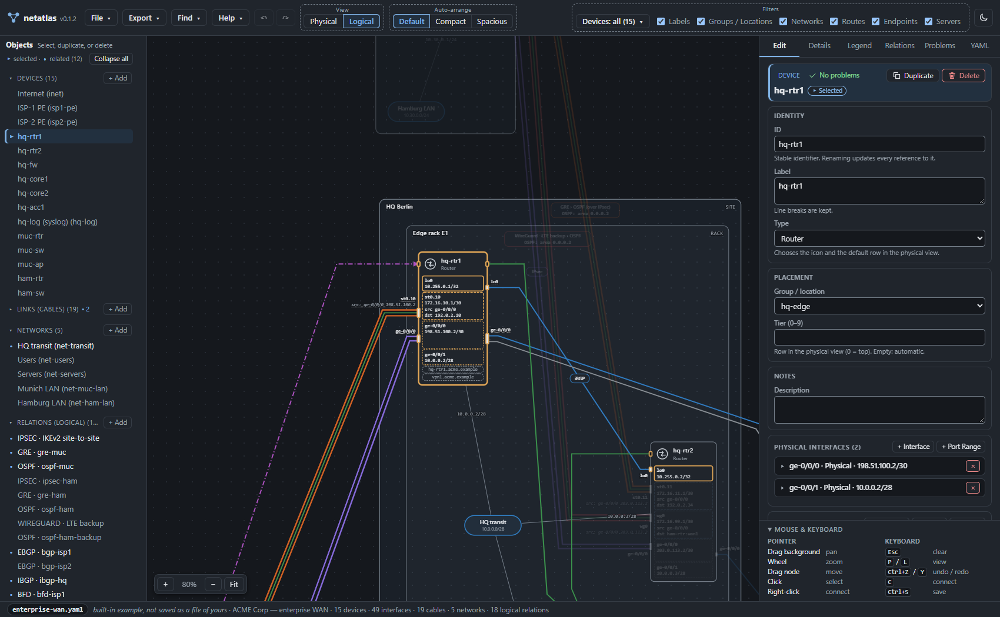 | 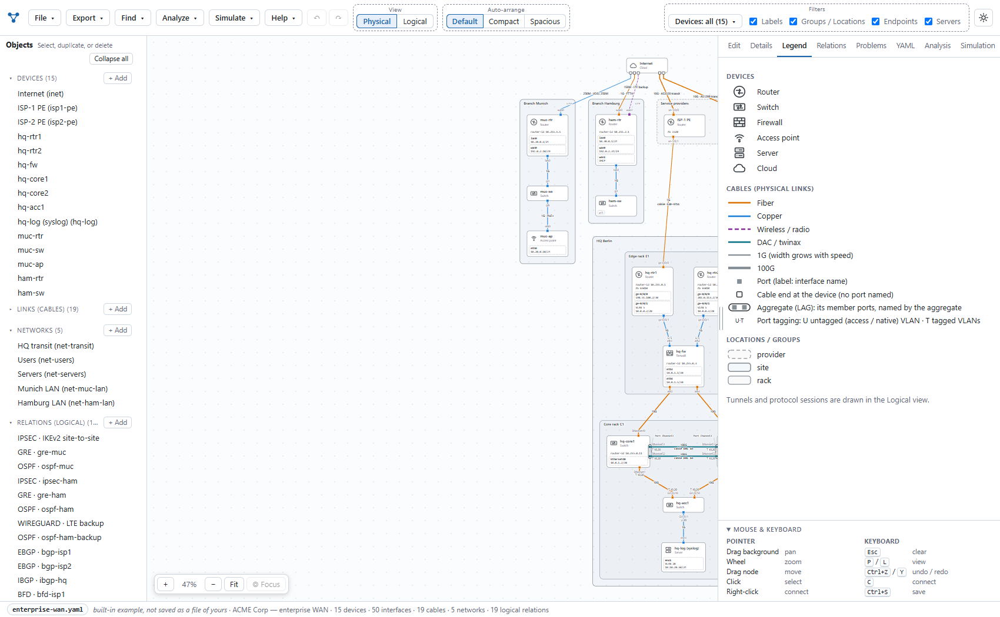 |

| Selecting the GRE tunnel: OSPF inside it, and the IPsec it rides on, in the logical view… | …and the cables it rides on in the physical view |
|---|---|
| 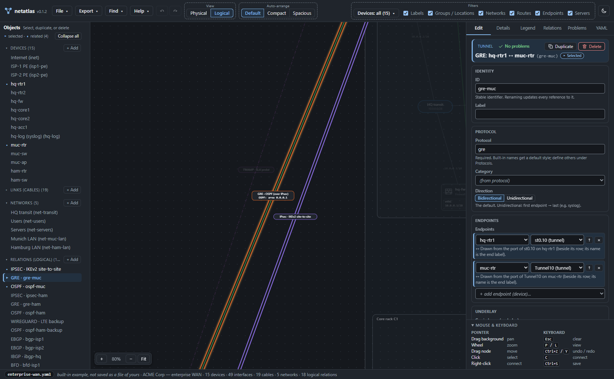 | 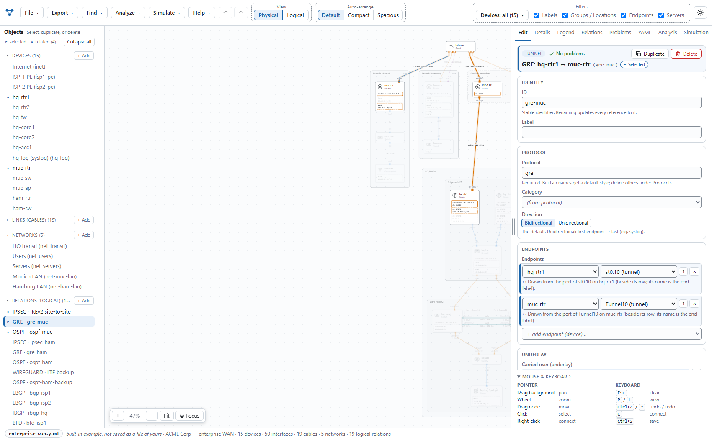 |

| All 15 device types, each with its own icon; the legend lists them by name | Data-center fabric: spines raised with `tier`, leaves, servers |
|---|---|
| 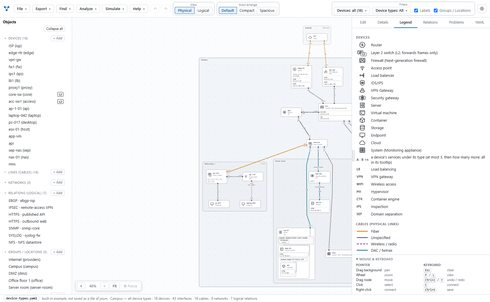 | 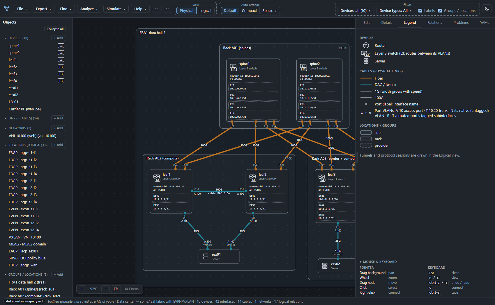 |

| **Auto-arrange**, physical: POP sites, customer, separate OOB island | **Auto-arrange**, logical: iBGP mesh between loopbacks, tunnels, devices kept in their groups |
|---|---|
| 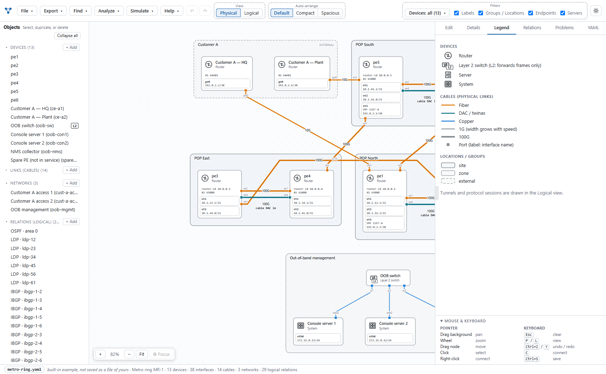 | 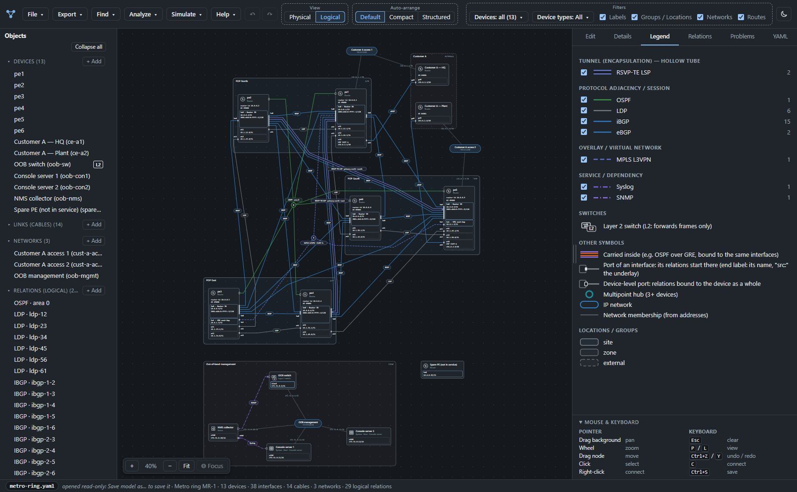 |

| **Devices** filter, physical: six HQ devices, only their cables and frames | The same devices, logical: only the relations among them, groups framed |
|---|---|
| 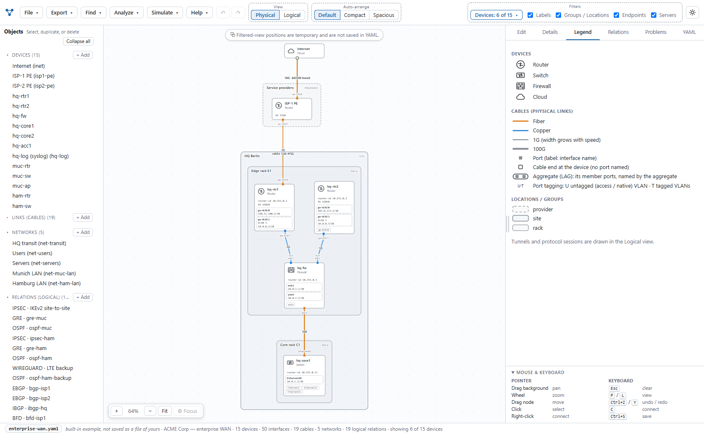 | 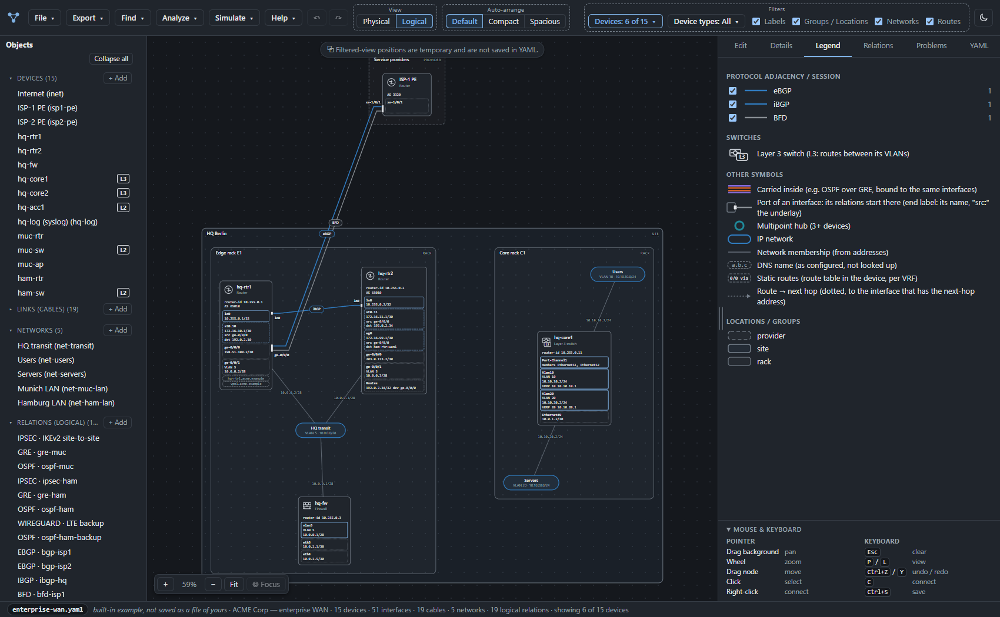 |

| **Every address in the diagram**, physical: ports with their addresses and MACs, cable ids | The same model, logical, in the **dark theme**: interfaces, VRRP addresses, prefixes |
|---|---|
| 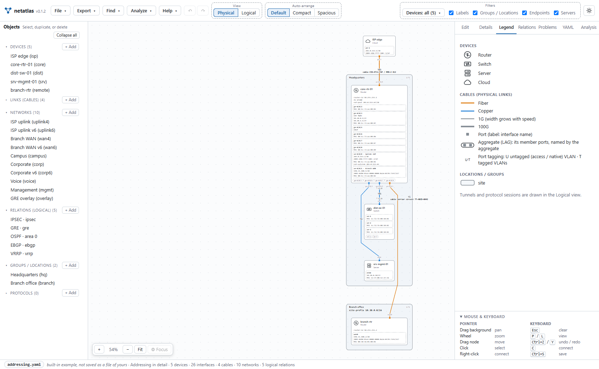 | 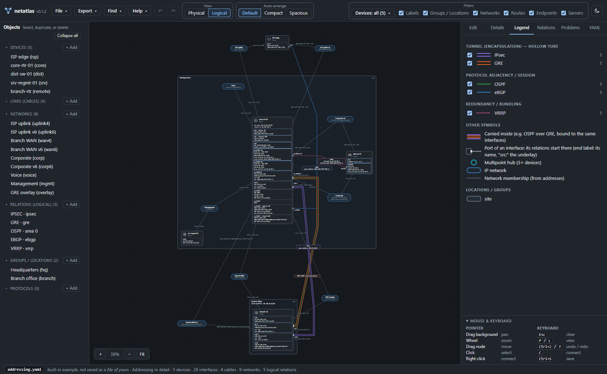 |

| **Every relation at its interface**: OSPF on `Tunnel10` selected; IPsec, OSPF and BFD leave from that port, end labels name the tunnels and their sources | Physical: the LAG `Po1` selected, its member ports in a bracket on both switches; hollow ends at the Internet cloud |
|---|---|
| 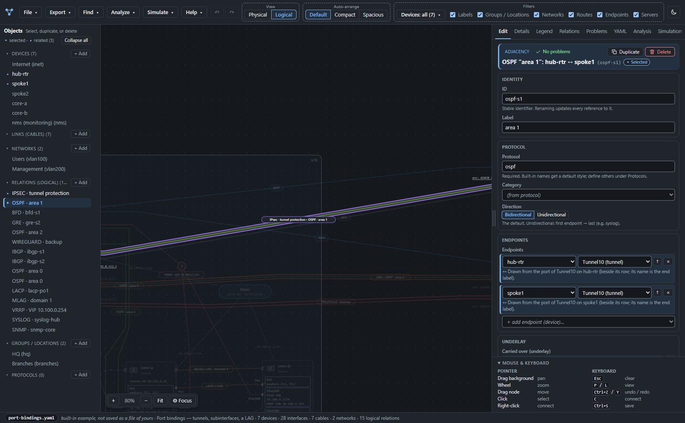 | 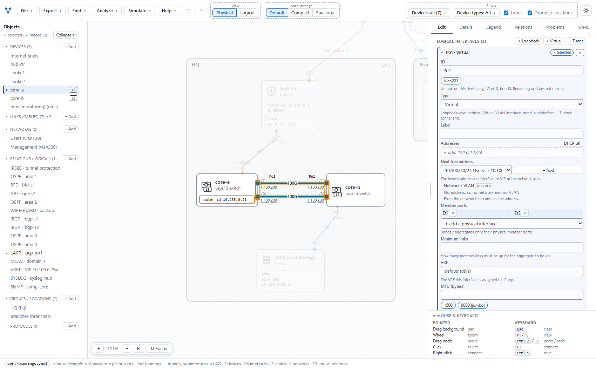 |

**Auto-arrange** sits in the top toolbar as three options, **Default**,
**Compact** and **Spacious**, and arranges the view on screen. The option the
view is arranged with is shown selected (and is disabled: there is nothing to
do); after manual changes none is selected and all three can be used.

## Open it, create or load a model

1. Get `netatlas.html`: attach it from the
   [GitHub release](https://github.com/hafnerst/netatlas/releases), or take
   `dist/netatlas.html` from this repository (or build it, see *Build*).
   It's the only file you need. Open it in Chrome, Edge, Firefox or Safari. Double-click
   it, drag it into a browser window, or enter its `file:///…/netatlas.html`
   path in the address bar. (Don't open `src/index.html`: that's only the
   build template.)
2. The start screen offers three ways to begin:
   * **New model** creates an empty model and opens it in the editor; add
     objects with **+ Add** in the object list (*Objects*) on the left;
   * **Open model…** lets you pick a `.yaml` / `.yml` file. You can also
     drop a file onto that card, or anywhere on the page;
   * **Load example**: choose one of the built-in examples and press
     **Load**.

   The same commands are in the **File** menu at the top left at any time.
   A file that can't be read as netatlas YAML is not opened: the page says
   which file, where and why, and lets you open another one. If the current
   model has unsaved changes, you are asked before it is replaced.
3. Switch between **Physical** and **Logical** (or press `P` / `L`).
4. Click anything in the diagram or in the object list on the left. The
   **Edit** tab on the right opens it in the inspector. With nothing
   selected, the Edit tab offers **Edit model settings** for the model as a
   whole (title, description).
5. Choose **File → Save model as…** (Ctrl+Shift+S) to save the model as a
   YAML file under a name and in a place you choose; from then on **File →
   Save model** (Ctrl+S) updates that file. See [Saving](#saving).

### The toolbar

| Control | What it does |
|---|---|
| **netatlas** logo and version | the application version (v0.1.2), not the model format version |
| **File ▾** | one menu for everything about models and their files: **New model**, **Open model…**, **Save model** (Ctrl+S), **Save model as…** (Ctrl+Shift+S), **Close model** and, under **Examples**, the built-in files. Every entry says *model*; an entry ends in “…” exactly when it asks for something before it acts (a file to open, a name and place to save to), and acts at once otherwise. *Save model* is available while the model is linked to a file it may write (see [Saving](#saving)); *Save model as…* and *Close model* whenever a model is open. *Save model* shows a small dot while there are unsaved changes. The example that is open is marked (*open*, or *open · modified*) until it is saved as a file of yours. The menu closes after a choice, with Esc, or when you click elsewhere; the arrow keys move through it. |
| **Export ▾** | One entry, **Export view as…**, which opens a submenu with **PNG** and **SVG**. Either saves the selected view (Physical or Logical) as a picture; see [Exporting pictures](#exporting-pictures). Greyed out until a model is open. The submenu opens when the entry is clicked or tapped, or with Enter, Space or the right arrow key; the left arrow key or Esc closes it. The menu works like **File**; the left and right arrow keys move between the two. |
| ↶ ↷ | undo and redo |
| **View: Physical** / **Logical** | the two views, in the group labelled *View*. The toolbar has three such groups, *View*, *Auto-arrange* and *Filters*: each has its label above its controls, inside the same dashed frame. The frame's colour has at least 3:1 contrast against the toolbar (light and dark theme), so it is clear which label and controls belong together, while staying a thin dashed line. In a very short window (400 px high or less, e.g. strongly zoomed) the labels are hidden to leave room for the diagram; the frames stay, and the labels remain the groups' accessible names. |
| **Auto-arrange: Default · Compact · Spacious** | three ways to arrange the view on screen (see [Auto-arrange and positions](#auto-arrange-and-positions)). The label *Auto-arrange* sits above the three buttons, all in one dashed frame. The one the view is arranged with is selected and disabled; the others stay available |
| **Find ▾** | **Command palette…** (`Ctrl+K`, `Cmd+K` on a Mac) searches every command and object; see [Command palette](#command-palette). **Find in diagram…** (`/`): a search bar over the top right of the diagram, by id, label, address, prefix, protocol or cable id; Enter or a click selects a match in the diagram, Esc closes it. **Filter object list…**: a filter box at the top of the object list (the model outline on the left), which stays while it holds text; × or Esc clears and closes it. It narrows the list only; the diagram is not changed. Both are greyed out until a model is open; the menu works like **File** and **Export**. |
| **Analyze ▾** | **Addressing overview…** (`I`): the networks of each VRF with their members, gateways, use and free addresses, and the duplicate, overlapping and stray addresses; see [Addressing overview](#addressing-overview). **Focus on selection** (`Shift+F`) and **Exit focus** (`Esc`): see [Focus mode](#focus-mode). **Trace path…** (`T`) and **Exit path trace** (`Esc`): see [Path tracer](#path-tracer). **Single points of failure**: a report in the Analysis tab; see [Single points of failure](#single-points-of-failure). Analyze answers *what is*: everything here reads the model as written (or, during a simulation, the simulated state, and says so). Greyed out until a model is open (Focus: until something is selected; Exit: until one is on; the tooltip says why); the menu works like the others. |
| **Simulate ▾** | answers *what if*, for a hypothetical state that never changes the model: **Simulate failure of selection** (`X`) starts a scenario (or adds a step to the one played), **Scenarios** opens the **Simulation** tab with the saved scenarios, **Previous step** (`[`), **Next step** (`]`), **Save scenario…** and **Exit simulation** (`Esc`). See [Simulation](#simulation). Greyed out until a model is open (the step and exit entries: until a simulation is on; the tooltip says why). |
| **Help ▾** | **User Manual**: a large dialog with a short, task-by-task guide (opening and creating a model, saving and exporting, the two views, finding and filtering, selecting and editing, connecting, Auto-arrange, keyboard shortcuts) with screenshots of the application. **License**: a small dialog naming the license, the Apache License, Version 2.0, with its full text. Both are part of the file, so they work offline; both close with **×**, **Close** or Esc, and the focus returns to **Help**. Available with or without a model. |
| **Filters: Devices ▾** (right) | the first control of the group labelled *Filters*, which holds every diagram filter below (Devices, Labels, Groups / Locations, Networks, Routes, Endpoints, Servers and the **Filters ▾** drop-down); which devices the diagram shows; all by default. Like every diagram filter on this row (and the **Filters ▾** drop-down), it is greyed out on the start screen and becomes available, with its default, once a model is open. Opens a list with a check box per device, a filter box, **Select all** and **Clear**. See [Showing part of the network](#showing-part-of-the-network). |
| **Labels** | cable, relation and address labels (on by default) |
| **Groups / Locations** | the frames of groups / locations, in both views (on by default). Hiding them never hides or moves a device. |
| **Networks** (logical view) | network nodes and their membership lines (on by default) |
| **Routes** (logical view) | the route tables in the device boxes and the dotted next-hop lines (on by default). Off, they are hidden and their room stays, so nothing moves; exports show what is on screen. |
| **Endpoints** / **Servers** | devices of type *Endpoint* (`endpoint`) and *Server* (`server`), in both views (on by default). Switching one off hides those devices and what only they connect, like deselecting them under **Devices**; see [Showing part of the network](#showing-part-of-the-network). Nothing is deleted. |
| **Theme** ☾ / ☀ (right end) | the colour theme of the whole application, the diagram and exported pictures: **Dark** (the default) or **Light**. The button toggles between the two (Enter or Space from the keyboard); its icon shows the theme in effect (moon: dark, sun: light). Its tooltip (on hover and on keyboard focus) and its accessible name say the theme and what a press does, e.g. *Theme: Dark. Switch to the light theme*. The switch is a direct control, never inside a menu, and stays at the right end of the toolbar at every window width. Switching repaints at once: nothing is reloaded, and the view, selection, zoom and layout stay as they are. The choice is remembered in this browser (its local storage), never in the model file or an export, and is in effect from the first moment the page is drawn (no flash of the other theme). A stored *Light* or *Dark* is kept; anything else, including the *System* choice of earlier development versions, means Dark. Where the browser offers no storage (some `file://` set-ups, private windows) the theme is Dark and a switch lasts for the session. |
| **Filters ▾** | appears when the window is too narrow for all the switches: the diagram filters stay on one row, and the ones that don't fit (Servers first, then Endpoints, Routes, Networks, Groups / Locations, Labels) move into this drop-down. Its button says how many of them are off (*Filters · 1 off*). Arrow-down opens it from the keyboard, Esc closes it. In a narrow toolbar the logo drops its name. |

The bottom bar starts with the file name as a badge (a long name is shortened; hover for the whole name and how it is saved), with a small dot while the model has unsaved changes. It is followed by what the name stands for (*saved to this file*, *built-in example*, *new model*, *opened read-only*, or *copy downloaded as …, not linked to a file*), the model's title and counts, unsaved changes, problems and the filter state.

### The object list (Objects)

The panel on the left is titled **Objects**, with *Select, duplicate, or
delete* beside it: it is where you browse and select the objects of the model
and see which are related to the selection. For screen readers it is a
region named *Objects* with a level-2 heading. (The panel on the right is
named *Inspector*; its tabs are its title.)

**Quick actions:** the row under the mouse pointer shows **Duplicate** and
**Delete** at its end. They are the Edit tab's buttons: Duplicate adds a copy
with a new ID and selects it, Delete asks first, and both can be undone. Using
them doesn't select the row they are on. Only one row shows them at a time.
From the keyboard, the row with the focus shows them (Tab moves from the entry
to Duplicate and Delete); on a touch screen, which has no hover, tap a row to
select it and its buttons appear. Each button is named for screen readers
with its action and object, e.g. *Delete device hq-fw*.

The panel on the left lists the model by section: devices, links, networks,
relations, groups and protocols. Each heading shows how many entries it has
and folds its section when clicked. **Links** and **Protocols** start folded;
**Collapse all** / **Expand all** at the top does all of them at once.
Folding only changes what is listed: a folded heading still shows the number
of problems inside the section and, when something is selected, how many of
its entries are related; the selected entry itself stays visible, the filter
(**Find → Filter object list…**) searches folded sections too, and **+ Add** opens the section it adds to.
While something is selected, the row of **Collapse all** says *▸ selected ·
• related (n)*. The list doesn't move when you select, switch or clear: every
entry keeps the place of its mark, and the panel keeps its width.

Files are read with the browser's File API, edited in memory and saved to a
file you choose (or downloaded, see [Saving](#saving)). They're never sent anywhere. The page's
Content-Security-Policy (`default-src 'none'`, `connect-src 'none'`) makes
network access impossible even in principle.

### The side panel

The panel on the right holds the tabs **Edit**, **Details**, **Legend**,
**Relations**, **Problems**, **YAML**, **Analysis** and **Simulation**. It
is 480 px wide by default (400 px in windows of 1100 px or less) and can be
resized with the **splitter** on its left edge, a visible grip:

* drag it; a double-click resets the default width;
* or focus it with Tab (it is a *separator*: screen readers hear *Width of
  the side panel, 480 pixels wide*) and press **←** for a wider panel,
  **→** for a narrower one (**Shift** for bigger steps), **Home** / **End**
  for the narrowest (320 px) and the widest, **Enter** to reset.

The diagram always keeps at least 360 px beside the object list, also when
the window gets smaller later. The chosen width is remembered in this
browser (its local storage), never in the model or an export. The tabs wrap
onto a second row when they don't fit on one: none is ever cut off or
squeezed, and the active one is always shown. Below 860 px the panel moves
under the diagram, beside the object list, and the splitter is hidden.

## Editing

| Task | How |
|---|---|
| Add an object | **+ Add** next to a section of the Model outline (devices, links, networks, relations, groups, protocols). A new object gets only a unique ID; **nothing else is chosen for you**. A device has no type, a group no kind, a network no prefix or VLAN, a protocol no category, a relation no protocol (fields show prompts such as *Select device type*). Until you fill them in, the missing required values (a relation's protocol and endpoints, a link's ends) are reported as errors. |
| New entries are ready to fill in | Whatever you create (an object with **+ Add**, a **Duplicate**, a link or relation drawn with **Connect**, an interface, loopback, port range, route, DNS name, address, protocol, VRRP group, attribute, endpoint, member port, underlay, or a scenario step) is selected and marked with the *▸ Selected* highlight, its card is opened and scrolled into view (smoothly, unless the system asks for reduced motion), and the cursor is in its first field in reading order with the proposed text selected, so typing replaces it. A new object is also selected in the diagram and its row in the object list is scrolled into view. Screen readers hear what was added (*Interface eth3 added to hq-rtr1.*). A value typed into an *add* field and committed with **Tab** is marked and announced, but the focus stays where Tab took it. **Ctrl+Z** right away (before typing anything into the new field) takes the creation back; after an undo the focus returns to the button that created the entry (or its card), and the selection to what it was before. |
| The header | The top of the **Edit** tab names the object's type, says whether it has problems (*No problems*, or how many errors and warnings, listed below it) and holds **Duplicate** and **Delete** (red); the object's full name is on the line below. In a narrow panel the two buttons show their icon only; their names stay in the tooltip and for screen readers. |
| Duplicate | **Duplicate** on an object copies all its values and attributes under a new ID. It is in the Edit tab's header and, as a quick action, on the object's row in the model outline (see [The model outline](#the-model-outline)). |
| The form | Below the header, the **Edit** tab groups an object's fields into titled cards: *Identity* (ID, label, and the type or kind), then what fits the object (a device: *Placement*, *Notes*, its interface sections and DNS names; a link: *Ends* and *Cable*; a network: *Addressing* and *Members*; a relation: *Protocol*, *Endpoints* and *Underlay*; a protocol: *Drawing*), and *More* for attributes and keys the format doesn't know. Every field keeps its label, help and messages; nothing is hidden. |
| Details | The **Details** tab starts with the same header as **Edit**: type, problem state, the name and, beside it when it differs, the object's ID (selectable, to copy). Its content is in the same kind of cards: *Overview*, then the object's lists (interfaces, relations, members …). It is read-only and shows what is derived; the Edit tab is where values are changed. |
| Connect two endpoints | In the diagram, **right-click** a device or an interface, then right-click a second one: a new **physical link** (physical view) or **logical relation** (logical view) between the two opens in the Edit tab. See [Connecting in the diagram](#connecting-in-the-diagram). |
| Edit fields | Type in the inspector. A change is applied when you press Enter, leave the field, or click anything else, including the diagram. |
| What is selected | The **Edit** tab marks the part of the configuration that belongs to what is selected, in the diagram (either view) or in the object list: a lightly tinted background, a thin accent bar on the left and a small *▸ Selected* tag, and `aria-current` for screen readers. It is as specific as the selection: a whole object marks its header; an interface (its port, chip or entry) its card; a line of an interface entry, a cable label, a network or a relation label marks that field: an address (that one row of the address list), the VLAN, VRF, DHCP switch, MAC address, tunnel source or destination, member ports, a network's prefix, a cable id, an attribute. The mark is never the red error mark, a hover or the focus ring, and leaves them visible. When it moves to a section that is off screen, the panel scrolls to it (smoothly, unless the system asks for reduced motion); the keyboard focus never moves. It follows edits, undo / redo, renames and view switches, and disappears when nothing is selected. Selection itself works as before. |
| Rename an ID | Edit the **ID** field. Every reference (links, endpoints, `over`, group parents, protocol names) is updated, and a notice says how many. |
| Interfaces | A device lists its interfaces in two categories. **Physical interfaces:** **+ Interface** adds a port; its **Type** is the read-only text *Physical*. **+ Port Range** next to it adds a numbered run of ports in one step (see [Port ranges](#port-ranges)). **Logical interfaces:** **+ Loopback**, **+ Virtual** and **+ Tunnel** add one of that type; the **Type** field offers exactly *Loopback*, *Virtual* and *Tunnel*. Each entry is a collapsible card with an address list, attributes, and what uses it. A card shows only the association that fits its type: **Member ports** (a virtual interface that is a bond: pick physical interfaces of the device), **VLAN ID** and the read-only **Ports carrying VLAN** (a VLAN interface), **Tunnel source** and **Tunnel destination** (a tunnel). There is no parent field. **Network / VLAN** and **Ports carrying VLAN** are *derived*: they can't be edited and change as soon as an address, a network or a link end changes. Cards are listed alphabetically within each category; the order in the YAML file is left as it is. Every card except a loopback's has a **DHCP** switch beside its addresses (see [DHCP and DNS names](#dhcp-and-dns-names)). |
| DNS names | After the two interface sections, **DNS names** lists the device's names. **+ DNS name** asks for the name and the interfaces it belongs to (by name; interfaces with DHCP on are not offered) and adds it only when both are valid. Each entry edits its name, adds interfaces from a picker and removes them (the last one can't be removed: delete the name instead). |
| Networks | A network is **one** prefix (**IP network (CIDR)**, required) and, optionally, the VLAN it lives in. **Members** is *derived*: every device with a configured interface or loopback address inside the prefix, listed once with the matching interfaces and addresses (an interface with DHCP on has no known address and counts for nothing). To add a member, give it an address in the network. The details also list the cables that carry its VLAN. |
| Link-end tagging | On a link, **End A: layer 2** and **End B: layer 2** each have a **Mode** (*No layer-2 tagging*, *Access*, *Trunk*), the **Untagged VLAN** (an access port's VLAN; a trunk's **Native VLAN**) and, for a trunk, the **Tagged VLANs** as IDs and ranges (`10, 20, 100-199`). The networks of those VLANs are shown, derived. Each end is stored separately; if they disagree, a note shows how (and the VLAN checks report it), and nothing is changed for you. Speed and medium are set here too, and only here. |
| Input helpers | Next to many fields, small buttons (*chips*) offer values that fit, taken from the model as it is; each writes its value as one undo step and is validated like typing, and nothing is filled in by itself. **MTU:** *1500*, *9000 (jumbo)*, and for a tunnel *1476 (GRE)*, *1400* and its underlay's MTU less the encapsulation overhead (*1403 (underlay 1500 − 97)*, the overhead named in the tooltip). **MAC:** **Generate** writes a random, locally administered unicast address that no interface has, in the style the model's other MAC addresses are written (`00:1c:…`, `00-1C-…` or `001c.73aa.…`), from the browser's secure random source. **VRF:** a combobox of the VRFs in use, sorted, with how often each is used; ↑ / ↓, Enter and Esc work as usual, a new name can be typed, and a name that differs from one in use only in case is flagged (and reported by the check *vrf-name-case*). **VLAN ID** (virtual interfaces, networks, a link end's untagged VLAN): the next free ID and the VLANs the model defines. **Interface ID:** the name that follows the device's other names of that kind (*xe-4* after *xe-3*), as a rename. **Router ID:** the device's loopbacks (*lo0 (10.255.0.1)*). **BGP AS number:** the AS numbers the model uses; a BGP relation end's **peer AS**: the other device's AS. **IS-IS NET:** derived from the router ID or loopback (10.255.0.1 → `49.0001.0102.5500.0001.00`). **VRRP / HSRP group:** the groups on the interface's segment (*10 (join hq-core1:Vlan10)*) and the next free number; **Virtual IP:** the group's address on the other members. **Protocol parameters:** the registry's common values (OSPF area *0.0.0.0*, hello *10* …). **Routes:** *0.0.0.0/0 (default)*, *::/0*, distance *250 (floating backup)*. Speeds, media, protocols, port modes, duplex, groups, devices and interfaces were already offered as lists. The palette has *Generate a MAC address for the selected interface* and *Set the MTU of the selected interface to 1500*. A protocol defined in the model has a **Routing service** card (*Uses a router ID*; its declared parameters are listed and edited in the YAML tab). |
| Protocols (routing services) | A Layer 3+ device (router, switch, firewall, load balancer, proxy, gateway) has a **Protocols** card: the routing services it runs, each a small card with its parameters, and **Enable a protocol…** (BGP, OSPF, IS-IS, EIGRP, RIP, LDP, PIM, BFD, VRRP, HSRP, GLBP, CARP, and the protocols the model defines with parameters). Static routes are not a protocol: they are configured in the device's **Static routes** section and are always in effect, whatever protocols the device enables. A protocol is enabled with its parameters empty; the mandatory ones (BGP's local AS number, OSPF's router ID, IS-IS's NET, a VRRP group's number and virtual IP) are errors at their field and in Problems until you fill them in. **Router ID** appears while an enabled protocol uses one: a loopback of the device (offered) or an IPv4 address, shared by the protocols, with **Own router ID for …** per protocol behind a disclosure. **Suggested**: one-click *Enable BGP* (or OSPF …) for a protocol the device's relations use but it doesn't enable. **Disable** on a protocol asks first when it has values and lists what goes with it (its parameters, its groups on interfaces, and the router ID when nothing else uses it); it is one undo step and nothing is kept hidden in the model. An interface of a device that runs VRRP (HSRP …) has **+ VRRP group**, then a card for the group's number, virtual IP and priority. A relation of OSPF, BGP … has a card with its per-end parameters (area, timers, cost …), a field per endpoint device. See [docs/FORMAT.md](docs/FORMAT.md#routing-services-protocols). |
| Static routes | After a device's interfaces and DNS names, **Static routes** lists its routes as cards, sorted by VRF, prefix and distance (the file keeps its order). **+ Route** adds an empty one; each card edits the **Destination prefix**, a **Blackhole** switch, the **Next-hop address** (with suggestions: the neighbours' addresses in this device's networks), the **Exit interface** (picked from the device's interfaces), **Administrative distance**, **Metric**, **VRF**, **Name**, **Description** and attributes, and has **Duplicate** (⧉, e.g. to make a floating backup) and **Delete** (×). Each is one undo step. A device whose type has no routing table offers no routes. |
| Endpoints | Device and interface pickers, alphabetical. A relation endpoint can use any interface (logical ones are labelled *loopback*, *virtual* or *tunnel*); a link end offers physical interfaces only. An endpoint is only a device and an interface; anything about an endpoint's part goes into the relation's attributes. |
| Direction | A switch on a relation: **Bidirectional** (the default; nothing is written to the file) or **Unidirectional** (`direction: unidirectional`): one way, from the first endpoint to the last, drawn with an arrow. Reorder the endpoints with ↑ to turn it around. |
| Carried over (underlay, `over`) | Pick links, relations or networks from the list: what the relation rides on, e.g. GRE over IPsec over two cables, or VRRP on the users network. A relation has no separate network field. |
| Protocol-specific settings | **attrs** on a relation (and on each endpoint): an editable tree of values, groups and lists of any depth |
| Keys the format doesn't know | Shown under **Other properties**. They're kept and exported, and reported as errors. Use **→ attrs** to move one into `attrs`. |
| Delete | **Delete** on the object, in the Edit tab's header or as a quick action on its row in the model outline. The dialog says how many references will break; broken references are then listed as errors, never removed silently. |
| Undo / redo | Toolbar arrows, or Ctrl+Z / Ctrl+Y (up to 100 steps) |
| Raw YAML | The **YAML** tab shows the model exactly as it will be exported. Edit and **Apply** (text that doesn't parse is rejected with its line number; unapplied text survives tab switches). The selected object's entry is marked with a band, and the line above the text says which lines it covers; selecting another object (in the diagram or a list) keeps the YAML tab open and moves the mark, scrolling only when the entry is out of sight. The entry is found by the object's ID in the parsed text, so other places that mention the ID are never marked; while the text doesn't parse, nothing is marked. The mark is not part of the text, and the whole file stays editable. |
| Problems | The **Problems** tab lists all errors and warnings; click one to jump to the object. Objects with errors get a red badge in the outline and a dashed red outline in the diagram. The inspector shows each message under the affected field. |

### Saving

A model is saved as a YAML file. Two entries of the **File** menu do it, and
both are always there:

| Entry | What it does |
|---|---|
| **Save model** (Ctrl+S) | Writes the model to the file it is **linked** to, at once: no file name is asked and NetAtlas shows no confirmation (the browser may ask once for permission to write). Available only while the model is linked to a file the page may write. |
| **Save model as…** (Ctrl+Shift+S) | Lets you choose a file name and place, saves the model there, and **links** the model to that file, so the next *Save model* updates it. |

A model is linked to a file only when the browser gives the page a file it
may write: after **Save model as…**, or after **Open model…** or a drop in a
browser that hands the page the file itself (Chrome, Edge and other
Chromium-based browsers, through the File System Access API). A **new model**,
an **example**, and a file read in any other way (the file picker of Firefox
or Safari, most drops) are not linked: *Save model* is greyed out and says
why, and *Save model as…* saves them. Ctrl+S then does *Save model as…*.

**Browsers that can't save to a chosen file** (Firefox, Safari): *Save model
as…* says so and offers to **download a copy** as a YAML file into the
browser's downloads location, under a name you can change (an opened file is
offered as `<original>-edited.yaml`; the file on your disk is not changed).
The copy is **not linked**: *Save model* stays unavailable, and the status bar
says *copy downloaded as …, not linked to a file*. If the model has validation
errors, the dialog lists them and the button becomes **Download anyway**.

**When saving doesn't happen**, nothing is lost: closing the save picker saves
nothing and says so; a write the browser refuses (permission denied) or that
fails (a full disk, a file that went away) is reported with the reason, every
change stays in the page, and the model stays marked as modified. A refused
permission also ends the link, so *Save model* is greyed out and *Save model
as…* is offered instead.

**Unsaved changes.** The file name in the status bar gets a small dot, the
status bar says "unsaved changes", the title gets a ●, and *Save model* shows a
dot. The state is a comparison with what was opened or last saved: undoing back
to that state makes the model unmodified again, redoing modifies it. **New
model**, **Open model…**, the examples and dropping a file all ask first
(*Cancel* / *Save first* or *Save as first…* / *Discard changes*). Closing or
reloading the tab triggers the browser's own "leave page?" prompt.

**Close model** (File menu) returns to the start screen. A model without
unsaved changes closes at once. Otherwise you choose: **Save and close** (a
linked model) or **Save as and close…** saves first, **Discard changes**
closes without saving, **Cancel** keeps the model and the editor exactly as
they are; a cancelled or failed save keeps the model open. Closing also
clears the selection, the view, filters and zoom, so the next model starts
clean.

**The open example** is marked in the **File** menu (*open*, and *open ·
modified* while its model has unsaved changes). Once it is saved with *Save
model as…* to a file of yours, it is that file, no longer the example. A
downloaded copy doesn't change that: the example stays marked and the status
bar says that a copy was downloaded. Opening another example or model,
**New model** and **Close model** clear or move the mark.

### Exporting pictures

**Export → Export view as…** opens a submenu with two formats:

| Format | What you get |
|---|---|
| **PNG** | A bitmap image, drawn at twice the diagram's size so text stays sharp, on the diagram's background colour. For documents, chats and slides. |
| **SVG** | A vector drawing that stays sharp at any size and can be opened in a browser or a drawing program. |

Both are made from the same picture, so they show the same thing:

* **the view that is selected**, Physical or Logical; the other view is
  exported by switching to it first;
* **the whole diagram**, whatever part of it is on screen: zooming and
  panning don't change the export, and a margin around the content keeps
  anything from being cut off;
* **every label in full**, as on screen;
* the **legend** and the **Networks** overview of that view, beside the
  diagram ([Networks in exported pictures](#networks-in-exported-pictures));
* **the theme you selected**: with *Dark* the picture is dark, with *Light*
  it is light. It looks like the diagram on screen: background, devices, networks, cables, tunnels,
  labels, addresses, legend and the highlighting of a selection.

The SVG file carries its colours as plain values (no stylesheet, no CSS
variable, no `prefers-color-scheme` query) and an explicit background, so
it looks the same in every browser, image viewer or document editor,
whatever that program's own light or dark setting. The PNG is drawn from
the same colours on an opaque background. Switch the theme and export
again, and the new picture is in the new theme; exporting never changes the
theme, the layout or the selection on screen.

In the dark theme, the colours a model gives its cables and protocols are
drawn a little calmer (less saturated) and, where needed, lighter, so every
line has at least 3:1 contrast against the dark background; the light theme
darkens a colour only when it would be too pale on white. Hues are kept
(a red protocol stays red), and line styles, icons and labels still tell
link types, tunnels and status apart, never colour alone.

The file is named after the model and the view, for example
`enterprise-wan-logical.png`, and lands in the browser's downloads location.
A short message confirms the export. The picture is produced inside the page;
nothing is sent anywhere.

A browser can only draw images up to a certain size. A very large diagram is
therefore drawn at less than twice its size (the message says at what scale)
so that the whole picture still fits; the SVG has no such limit. If an export
fails, a dialog says which file could not be created and why, and nothing is
downloaded.

### Port ranges

**+ Port Range** in a device's *Physical interfaces* section asks for a
**From** and a **To** name and creates every port in between:

* The last number of each name is the port number; everything before it must
  be identical in both names. `ge 1/1` to `ge 1/24` gives `ge 1/1`, `ge 1/2`
  … `ge 1/24`. A number written with leading zeros keeps its width (`port01`
  … `port12`).
* The dialog shows the ports it will create while you type, and **Create**
  stays disabled until the range is valid. It is rejected as a whole, with
  the reason, if a name has no number at the end, the two prefixes differ,
  the first number isn't lower than the last, a name or id already exists on
  the device, or the range has more than 256 ports (512 interfaces per
  device in total).
* Only physical interfaces are created: no addresses, VLANs or links. An
  interface id can't contain spaces, so `ge 1/1` gets the id `ge-1/1` and
  keeps the name as typed as its label; a name that is already a valid id
  (`ge-0/0/1`) needs no label.
* The whole range is one undo step, and the new ports appear in the usual
  alphabetical order.

**Drafts are allowed.** A file with validation errors (broken references, a
loopback without an address, …) opens and is drawn as far as it's valid, so
you can repair it in the editor. Only input that isn't valid YAML in the
supported subset is refused before editing, with the line number.

### Physical and logical interfaces

A device stores each interface once, in one of two lists:

* `interfaces`: its **physical interfaces** (ports). They have no type to
  choose, and only they can be cabled.
* `logical_interfaces`: its **logical interfaces**, each with a `type`:
  `loopback`, `virtual` (a VLAN interface, a bond, a subinterface, a VTEP …)
  or `tunnel`.

Logical interfaces are not nested under ports and have no generic "parent"
field. Each kind of association is modelled by what it means:

| Interface | What you enter | What is derived |
|---|---|---|
| Loopback | its addresses (with prefix length) | — (it has no physical parent) |
| Bond / aggregate (`virtual`) | **Member ports**: `members: [eth0, eth1]`, physical interfaces of the same device | highlighting of the ports and their cables |
| VLAN interface (`virtual`) | its VLAN: `vlan: 10`, or nothing if its address lies in a network that defines the VLAN | **Ports carrying VLAN**: the device's ports whose link end permits that VLAN |
| Any other `virtual` interface | nothing | nothing; no association is assumed |
| Tunnel | **Tunnel source** (any interface of the device, physical or logical, or an address) and **destination** (an address, a device or `device:interface`) | the source interface when an address is written; highlighting of source and destination |

Relations can use any interface as an endpoint. **Every interface of a shown
device is drawn**, so it can be found, selected and connected: in the
physical view, a cabled port sits on its cable and a port without a cable is
a small chip with its full name in a strip at the bottom of its device box;
a port with addresses or identifiers also has an entry in the box (see
below). In the logical view, every loopback, virtual and tunnel interface,
and every port with an address, DHCP, a VRF or a VLAN or a relation bound
to it, is an entry in its device's box, whether or not a relation uses it.
Logical interfaces are never drawn as ports of the physical view; an
aggregate is drawn there as a bracket around its member ports. A device has no vendor, model, role, management-address or router-ID
field; keep such facts as free-form attributes if you need them (an address
among them is drawn too). The full rules are in [docs/FORMAT.md](docs/FORMAT.md#interfaces).

### Relations and cables at their interfaces

An endpoint such as `br-rtr:Tunnel10` binds a relation to that interface,
and the diagram shows that binding, so it never has to be guessed from where
a line happens to meet a box:

* **Ports (logical view).** Each interface a relation is bound to has a
  *port*, a solid bar on the side of its device box, beside the interface's
  row. Every relation bound to it leaves from there, and from nowhere else:
  OSPF and IPsec on `Tunnel10` both start at `Tunnel10`'s port, side by side
  in parallel lanes, never at a neighbouring row. A relation bound to the
  device as a whole (`endpoints: [fw, br-rtr]`) leaves from the
  **device-level port**, a hollow bar beside the device's name.
* **End labels.** Next to each port the interface's name is written
  (`Tunnel10`); for a tunnel the underlay it is sourced from follows on a
  second line, after `src:` (`src: Gi0/0 203.0.113.1`). The line stays at the
  overlay interface; the underlay is only named. Clicking the `src:` line
  marks the tunnel's source field in the Edit tab.
* **Routes.** A relation leaves its port at a right angle, on the side that
  faces the other end, and goes around boxes on its way: it never crosses
  another row of a device. Nested in a tunnel's tube is only what is bound
  to the same interfaces; GRE on `Tunnel10` carried over IPsec between the
  WAN ports runs from its own port and says *(over IPsec)* in its label.
* **Cables (physical view).** A cable ends at the port it names, with the
  port's name beside it; a cable to a device as a whole ends in a hollow
  square. The member ports of an aggregate are drawn side by side inside a
  bracket named by the aggregate (`Po1`). Cables don't run across other
  ports or port labels.
* **Pointing and selecting.** Pointing at an interface (its row, port or end
  label) marks it and every relation and cable attached to it; pointing at a
  relation or cable marks the interfaces at its ends. This works in the
  diagram, in the Objects list (point at a relation or link there) and on the
  endpoints in the Edit tab. Selecting a relation or link highlights both
  end interfaces, and the Edit tab marks its endpoints and says which port
  each is drawn from. The marks are outlines, heavier lines and underlined
  labels, so they don't rely on colour.

`examples/port-bindings.yaml` shows all of this: several tunnel interfaces
and subinterfaces per router, three relations on one tunnel interface,
tunnels sourced from an interface and from an address, device-level
relations, a LAG and a multipoint relation.

### Addresses and identifiers in the diagram

Everything a model says about addressing is written in the diagram itself,
not only in the details or the YAML, and nothing is shortened: a full IPv6
address with its prefix length is one line, in a monospace font.

| Field | Shown in | Where |
|---|---|---|
| `id` and `label` of an interface | the view it is drawn in | the name line of its entry (`ge-0/0/1 · Uplink`); also at its port (physical) or on its chip (uncabled port) |
| `ip` (one or more addresses, IPv4 and IPv6, with prefix length) | physical: the device's ports; logical: every interface | one line per address in the interface's entry, IPv4 first, then IPv6, each in numeric order: primary and secondary addresses and the two stacks together |
| the addresses inside a network | logical | on the membership line between the device and the network, every one of them |
| `dhcp: true` | both, as above | *DHCP* in the entry |
| `vrf` | both, as above | *VRF name* in the entry |
| VLAN (`vlan` of a virtual interface, or derived from its networks) | logical | *VLAN n* in the entry |
| `mac` | physical (ports), logical (the interfaces drawn there) | *MAC …* in the entry |
| `source`, `destination` of a tunnel | logical | *src …*, *dst …* in the tunnel's entry |
| `members` of an aggregate | logical | *members …* in its entry |
| `cidr`, `vlan` of a network | logical | the network node (*VLAN 10 · 10.10.10.0/24*) |
| `cable` of a link | physical | under the cable's label (*cable CID-…*) |
| the tagging of a link end (`mode`, `untagged`, `tagged`) | physical | under the port's name: `U 10 · T 20,30,100-199` |
| static routes (`prefix`, `via`, `interface`, `distance`, `metric`) | logical | a line per route in its device's route table (*Routes*, *Routes · VRF x*): `0.0.0.0/0 via 203.0.113.5 AD 250`; hidden with **Routes** |
| `dns_names` | logical | under the device's entries, every name |
| the routing identity of a device: its `router_id` (while an enabled protocol uses it), a protocol's own router ID, BGP's (and EIGRP's) AS number, IS-IS's NET | both | an entry without a name at the top of its box: `router-id 10.255.0.1`, `AS 65010`, `OSPF router-id …` |
| a VRRP / HSRP … group of an interface (`virtual_ip`, `virtual_ipv6`) | logical | in the interface's entry: `VRRP 10 10.10.10.1` |
| addresses in `attrs` (an IPv4 / IPv6 address or prefix, or a MAC address, e.g. `nat-pool`, `peer-address`) | where the owner is drawn | device: an entry without a name in its box; interface: its entry; network: its node; link: its cable label; relation: its label; group: under its title |

An entry is a small frame in the device's box: the interface's name, then
one line per fact. Its kind shows in its frame's line as well as its colour
(loopback solid, virtual double, tunnel dashed, port dotted); like the chips,
it can be clicked, selected and used to start a connection. The boxes grow
to hold their entries, and Auto-arrange reserves that room, so no entry
covers anything; labels that float over the diagram (cable, relation and
address labels) take the nearest free place and, when they had to move away,
are tied to their place by a thin dashed line. If moving nodes by hand makes
anything overlap, a note over the diagram says how many overlaps there are
(*2 overlaps in the diagram. Auto-arrange places everything without
overlaps.*); it is never part of an export. The example
`addressing.yaml` shows all of this on one router with many interfaces.

### DHCP and DNS names

**DHCP.** Every physical interface and every virtual or tunnel interface
has a **DHCP** switch next to its addresses. It is off for every new
interface, and an interface without addresses is *not* assumed to use DHCP:
only `dhcp: true` in the file means DHCP (omitted means off).

* A loopback can't use DHCP: its card has no switch, and `dhcp: true` on a
  loopback in a file is an error. (The switch appears on such a card only
  so that it can be turned off.)

* While DHCP is on, the address list is greyed out and can't be edited. An
  interface never has DHCP and manual addresses at the same time; a file
  that says both is reported as an error, and neither value is dropped.
* Turning DHCP on for an interface that has addresses, or DNS names, first
  shows what will be deleted. **Cancel** changes nothing; confirming deletes
  them and turns DHCP on in one undo step.
* Turning DHCP off makes the address list editable again. The deleted
  addresses do not come back (Ctrl+Z does).
* DHCP is not an address. NetAtlas does not know which address the interface
  will obtain, so the interface belongs to no network and has no derived VLAN
  until an address is written.

**DNS names.** A device's DNS names are listed after its interfaces. A name
is entered once and associated with one or more interfaces of the device,
physical or logical; the file stores the interface ids, the editor shows
their names.

* Only interfaces with DHCP off can be chosen. If turning DHCP on would
  break an association, the confirmation names it and it is removed in the
  same step; a name left without interfaces is deleted with it. Deleting an
  interface removes its associations the same way, and renaming it updates
  them, so a name never points at a missing interface.
* The association is to the interface, not to one of its addresses. When an
  interface has several addresses, the editor says so.
* Only the name is configured: no A or AAAA record is derived or created.
* Names are checked: host-name syntax, one entry per name on a device (case
  and a trailing dot don't make a different name), existing interfaces, at
  least one interface. The same name on two devices is a warning.
* The **Details** tab of a device lists its names and their interfaces.
  **Find in diagram…** finds a device by its DNS name.
* The **Logical** view writes a device's names under it (and its loopback
  chips), each name once however many interfaces it belongs to, in a dashed
  chip; long names continue on a second line, and more than two end in
  *+n more names*. They follow **Labels** and the device filters and are in
  the logical PNG and SVG exports; the legend calls them *DNS name (as
  configured, not looked up)*. The physical view doesn't show them.

### Static routes and VLAN tagging

**Static routes.** A device of a Layer 3+ type (router, switch, firewall,
load balancer, proxy, gateway) or a host (server, VM, container, storage,
endpoint, system) can have static routes; an access point, an IDS/IPS, a
cloud and a device without a type can't. A route has a destination prefix
(IPv4 or IPv6, `0.0.0.0/0` / `::/0` for a default route) and a next hop: an
address (`via`), an exit interface, both, or `blackhole: true`. It may have an
administrative distance (a higher one makes a **floating** backup), a metric,
a VRF, a name, a description and attributes. Several routes to one prefix are
allowed: with the same distance and metric they are **equal-cost** routes. A
host's **default gateway** is a static default route.

```yaml
  - id: br-rtr
    type: router
    routes:
      - {prefix: 0.0.0.0/0, via: 198.51.100.1, name: default via ISP A}
      - {prefix: 0.0.0.0/0, via: 203.0.113.5, distance: 250, name: floating default}
      - {prefix: 198.18.0.0/15, blackhole: true}
```

In the **logical view** each device's routes are a route table in its box
(*Routes*, or *Routes · VRF x* for a VRF), one line per route
(`0.0.0.0/0 via 203.0.113.5 AD 250`), and a dotted line with an arrow leads
from a route to the interface its next hop belongs to. The **Routes** switch
hides both without moving anything. Selecting a route highlights its device,
its exit interface and its next hop; **Find** finds routes by prefix, next
hop or name. Route selection (for the details and the next-hop line) takes
the longest matching prefix, then the lowest distance (a missing one counts
as 1), then the lowest metric, and resolves a next hop directly or through
another route, never through a default route. The consistency checks report
next hops that are the device's own address, not connected or not resolvable
(or connected only in another VRF), outside the exit interface's networks,
exit interfaces that can't forward (a loopback, a LAG member port, a port
without a cable, another VRF), the same route twice and routes that
contradict each other. See [docs/FORMAT.md](docs/FORMAT.md#static-routes).

**VLAN tagging.** Each end of a cable says how its port carries VLANs:
`mode: access` with one `untagged` VLAN, or `mode: trunk` with `tagged` VLANs
(IDs and ranges such as `100-199`) and an untagged native VLAN. VLANs are
referenced by ID, as on networks and VLAN interfaces; the networks a cable
carries follow from them. An end without a mode says nothing about layer 2,
and nothing is assumed for it. The **physical view** writes the tagging under
each port's name (`U 99 · T 10,20,30`); a cable whose ends disagree is marked
⚠ *VLANs differ*. The checks report native-VLAN mismatches, trunks that tag
different VLANs, access ports with tagged VLANs, VLANs untagged at one end and
tagged at the other, and VLANs no network or VLAN interface defines. **Find**
finds the cables carrying a VLAN (`vlan 20`). See
[docs/FORMAT.md](docs/FORMAT.md#vlan-tagging-on-a-link-end).

`examples/branch-routing.yaml` shows both: a dual-homed branch with a
floating static default route, equal-cost routes to HQ, a blackhole, a guest
VRF, host default gateways and a router-on-a-stick trunk with a native VLAN.

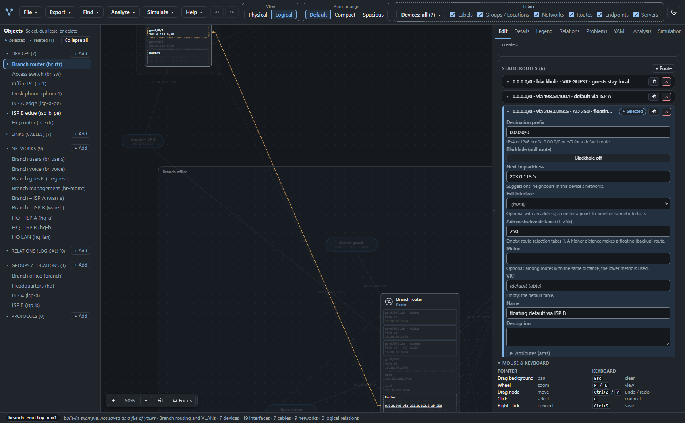

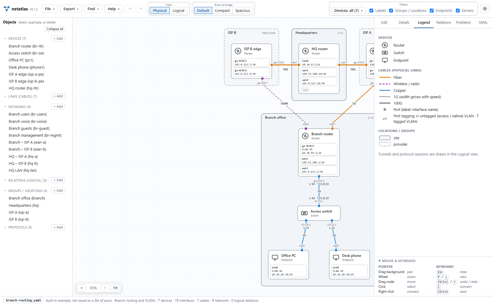

### Consistency checks

Beyond the format, NetAtlas checks whether the network a model describes is
consistent, using only what the model says (a check whose values are missing
says nothing). Each check has a stable id and a severity (error, warning or
info). A finding names the objects it concerns, and it never makes the file
invalid. Besides the route and VLAN checks above, they cover:

* **cables:** MTUs that differ at the two ends, port speeds that differ
  (from each other or from the link's speed), duplex mismatches, addresses
  at the two ends in different subnets;
* **aggregates:** member links of different speeds, members ending on several
  devices without an MLAG pairing them, `min_links` larger than the cabled
  members;
* **addresses:** an IPv4 network or broadcast address on an interface (not
  for /31 and /32), a VRRP/HSRP virtual address outside its interface's
  subnet and members of one virtual address in different groups, the same
  router ID on two devices of one protocol domain, the same MAC address on
  two interfaces;
* **protocols:** a protocol a device's relations use but it doesn't enable,
  one enabled but used by no relation (info), static routes without static
  routing (info); OSPF area, network type and hello/dead timers that differ
  between the two ends; a BGP `peer-as` that isn't the other device's AS;
  iBGP between different AS numbers or eBGP within one;
* **tunnels:** a destination that isn't the peer's source; an MTU too large
  for the underlay once the encapsulation is added (the overhead assumed is
  stated in the message, e.g. 24 bytes for GRE, 73 for IPsec ESP, summed for
  GRE over IPsec); an `over:` path that doesn't connect the endpoints;
* **VRFs:** a relation between interfaces in different VRFs.

The facts they compare are fields where the format has one: an interface's
`mtu`, an aggregate's `min_links`, a link end's `speed` and `duplex`, and the
parameters of the protocols a device enables (BGP's AS number, the router
IDs). Protocol parameters of a relation are its attributes, per endpoint
where they can differ (`area: {r1: 0.0.0.0, r2: 0.0.0.1}`).

The **Problems** tab lists the file's own problems first, then the findings,
which can be narrowed to errors, warnings or info; each shows its check id,
its title, the message and the objects it concerns as links. Clicking a
finding opens its object in the Edit tab, where the message is shown at the
field. A model can switch a check off or change its severity in a top-level
`checks:` section, which **Model settings → Consistency checks** edits.
`examples/consistency-checks.yaml` has one deliberate inconsistency per
check. The full list, with what each check reads, is in
[docs/FORMAT.md](docs/FORMAT.md#consistency-checks).

### Addressing overview

**Analyze → Addressing overview…** (or `I`) opens a large dialog that lists
every network, grouped by VRF (the default table first) and nested under the
network whose prefix contains it. For each network it shows:

* the **prefix**, **VLAN** and **name**;
* its **members**: device, interface, address, DNS names and DHCP flag
  (opened with **▸ members**); a network nested in another counts its
  addresses there too, and lists them once, in the nested network;
* its **gateway or VIP**: the virtual addresses of VRRP, HSRP … groups (once
  per VRF, with every member interface), and the next hop of the default
  routes of devices in the network;
* **used** addresses of its **size** (IPv4: host addresses, without network
  and broadcast address except in a /31 or /32), and the **utilization**: a
  percentage for IPv4; for IPv6 the number of /64 subnets instead, since a
  percentage of 2^64 addresses means nothing;
* its **free ranges** (outside nested networks) and the **next free
  address**.

Below the tables it lists **duplicate addresses** (the same address on two
interfaces of one VRF), **overlapping prefixes** (two networks of a VRF with
the same prefix; an interface whose subnet is larger than a network that
holds its address) and **addresses in no network**. **Filter** narrows the
rows by prefix, name, VLAN, device, interface, address or DNS name (the
networks a match is nested in stay, as context); a column header sorts by
prefix (nested), VLAN, name, use or utilization, and a second press reverses.
A click on a network, device, interface or gateway closes the dialog and
selects that object in the diagram. **Copy CSV** and **Save CSV** give the
table (one line per network and VRF, RFC 4180) to a spreadsheet; Save
downloads `<model>-addressing.csv` like a picture export. The dialog never
changes the model; its filter, sort and open member lists are kept while the
page is open.

In the **Edit** tab, an interface's addresses come with **Next free
address**: the lowest free address of a network of the interface's VRF,
with the network's prefix length, the networks its cable carries or its
peer port is in first. **+ Add** adds it (one undo step).

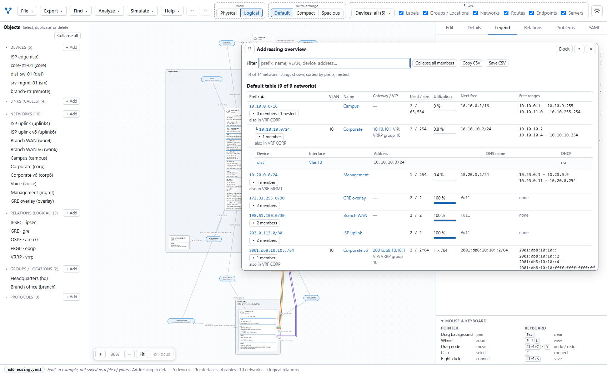

### What round-trips

Everything the file contains survives **load → edit → export → reload**,
including attributes no diagram shows, unknown keys, nested structures,
comments, key order and quoting style. Indentation is normalized to 2 spaces
and `>` blocks become `|` blocks with the same value. The example files are
written back byte-for-byte. The details are in
[docs/YAML-SUBSET.md](docs/YAML-SUBSET.md#writing-yaml-export-from-the-editor).

## Working with the diagram

| Action | How |
|---|---|
| Pan / zoom | drag the background; mouse wheel; `+` `−` `Fit` buttons; arrow keys, `+`, `-`, `0` |
| Select | click any device, port, interface chip, loopback, cable, tunnel, hub or network. The **Edit** tab opens it (an interface opens with its card unfolded); **Details** gives a read-only summary. A left click only ever selects. |
| Connect | **right-click** a device or an interface, then a second one (or select one and press **C**): see [Connecting in the diagram](#connecting-in-the-diagram). |
| Highlight | selecting something dims everything unrelated. For a tunnel this includes its carriers, what it carries, its endpoints and, in the physical view, **the cables it rides on**. The selection is kept across views. |
| Selection context in the lists | the element lists on the left and the **Relations** tab show the same selection: the selected entry is marked **▸** (bold, with a bar), entries **directly** related to it are marked **•**, and all others are greyed out but stay readable, clickable and keyboard-focusable. Select from either list or the diagram; `Esc` clears it. See *Which entries count as related* below. |
| Hover | tooltip with a short summary; on an interface, relation or cable it also marks what it is attached to (see [Relations and cables at their interfaces](#relations-and-cables-at-their-interfaces)) |
| Rearrange | drag devices or networks. The position is stored in the model (one undo step each) and exported with it. In a [filtered view](#showing-part-of-the-network) the move is temporary and not stored. |
| Auto-arrange | **Default**, **Compact** or **Spacious** in the top toolbar (`A` is Default): recomputes the positions of the **whole model** in the view on screen. The other view is not changed. If the view has positions you set by hand, it asks before replacing them. In a filtered view it arranges the shown devices only, temporarily. The option the view is arranged with is selected; see [Auto-arrange and positions](#auto-arrange-and-positions). |
| Find | **Find → Find in diagram…** or `/`: ids, labels, IP addresses, CIDRs, protocols, cable ids, route prefixes and next hops, the VLANs of cable ends (`vlan 20`) |
| Filter | **Devices** (top right): show only some devices. **Endpoints** / **Servers**: hide the devices of that type. **Legend** tab (logical view): turn protocols on and off. Top-right toggles for **Labels**, **Groups / Locations** and (logical view) **Networks** and **Routes**. |
| Command palette | `Ctrl+K` (`Cmd+K` on a Mac) or **Find → Command palette…**: run any command or select any object by typing part of its name; see [Command palette](#command-palette) |
| Focus | select something and press `Shift+F` (or **◎ Focus** under the diagram, or **Analyze → Focus on selection**): only it and its neighbourhood, 1–3 hops; `Esc` exits. See [Focus mode](#focus-mode) |
| Simulate a failure | select a cable, port, device or relation and press `X` (or **Simulate → Simulate failure of selection**): an ad-hoc scenario starts at once; what goes down or degrades is marked in both views and listed in the **Simulation** tab; `X` on more objects adds steps; `[` and `]` step back and forward; `Esc` ends it. See [Simulation](#simulation) |
| Replay a scenario | **Simulate → Scenarios** (or the palette: *Play scenario: …*): the scenarios saved in the model, each with **Play**. See [Scenarios](#scenarios) |
| Trace a path | `T` (or **Analyze → Trace path…**): the **Analysis** tab asks for a source and a destination; the path is marked in both views and listed hop by hop; `Esc` removes it. See [Path tracer](#path-tracer) |
| Export picture | **Export → Export view as… → PNG** or **SVG** in the toolbar saves the selected view (Physical or Logical) as a picture; see [Exporting pictures](#exporting-pictures). The picture always contains the **legend** of that view (device types, cable media and speed, locations; or protocols and line styles) and, in a second box beside it, a **Networks** overview. Both are drawn to the right of the diagram so they cover nothing, and the picture is enlarged to include them. They list what is drawn: protocols you have hidden are left out. See [Networks in exported pictures](#networks-in-exported-pictures). |

### Command palette

`Ctrl+K` (`Cmd+K` on a Mac), or **Find → Command palette…**, opens a search
field over the window. It finds:

* every **command** of the menus, the toolbar and the keyboard (New, Save,
  Export as PNG, Physical view, Auto-arrange, the filters, Zoom, the side
  panel's tabs, the theme, the examples …) with its shortcut, and the
  analysis modes (Addressing overview, Focus);
* every **object** of the model: devices, interfaces, cables, networks,
  relations, static routes and locations, by name, id, address, prefix or
  next hop;
* every **saved scenario** (*Play scenario: ISP 1 outage*), which plays it.

The match is fuzzy: every word typed must occur, in order of its letters
(`adrs ovr` finds *Addressing overview*), best when it starts a word. `↑` / `↓`
choose, `Enter` runs the command or selects the object in the diagram, `Esc`
closes and returns the focus. A command that can't run now is listed greyed
out with the reason (*Exit focus — Unavailable: Focus mode is off*); Enter on
it only announces the reason. With nothing typed, the entries used last come
first (remembered in this browser, not in the model), then every command.
Screen readers hear the number of results after each keystroke.

The menus, the keyboard shortcuts and the palette all come from **one
command registry** (`src/ui/commands.ts`): an entry's label, its shortcut,
whether it is available, and its tooltip (or the reason it is not) are
defined once, so the three can't drift apart.

### Focus mode

With an object selected, **Focus** (`Shift+F`, the **◎ Focus** button under
the diagram, **Analyze → Focus on selection**, or the palette) shows only that
object and its neighbourhood: the devices within 1 hop of it, along **cables**
in the Physical view and along **relations** in the Logical view (a hop is a
device directly connected to one already shown; the object stands for its
devices: a cable for its two ends, a relation for its endpoints, a network
for its members, a location for its devices). A banner across the top of the
diagram names the object, the hops and how many devices are shown, and has
**−** / **+** for 1 to 3 hops and **Exit focus** (also `Esc`).

Focus is a [filtered view](#showing-part-of-the-network): it combines with
the Devices, Endpoints and Servers filters, is arranged for what it shows,
and positions changed while it is on are temporary and never saved. Changing
the hops keeps the devices that stay where they are. **Exit focus** brings
back the diagram exactly as it was before, with its zoom. Focus never changes
the model and adds no undo step. An export shows what is on screen, with a
*Focus: …* note at the top of the picture.

### Path tracer

**Trace path…** (`T`, **Analyze → Trace path…**, or the palette) opens the
**Analysis** tab of the side panel. Give a **From** and a **To**, each a
device (`hq-log`), an interface (`muc-rtr:lan0`) or an IP address; a
selected device or interface fills the first empty field. **VRF** chooses the
source's table (by default the source interface's VRF, else the default
table); **Trace the return path too** traces the way back as well. **Trace**
(or Enter) computes the path; **⇅ Swap** exchanges the two ends.

NetAtlas follows the forwarding decision of every device on the way, from
the model alone:

* **Routes:** the connected networks of its interfaces, its static routes,
  and the routes it learns over its **routing adjacencies** (relations of
  OSPF, IS-IS, EIGRP, RIP and BGP): every router of a protocol's adjacencies
  advertises its connected networks, and each learns them along the cheapest
  chain of adjacencies, adding the relation's `cost` (per device:
  `cost: {r1: 10}`) or, where none is written, 1 per adjacency (a hop
  count). The route is chosen by **longest prefix**, then **administrative
  distance** (connected 0, static 1 unless `distance` says otherwise, eBGP
  20, EIGRP 90, OSPF 110, IS-IS 115, RIP 120, iBGP 200, or the relation's
  `distance`), then metric; what is left is **equal-cost multipath**. A
  static route whose next hop can't be reached is not used, so a floating
  route takes over.
* **Next hops:** the device that has the next-hop address, or for the
  virtual address of a VRRP / HSRP group its active member (the one named in
  `master`, else the highest `priority`). Between two hops the **cables**
  are found through switches, access points and clouds, in the network's
  VLAN where the link ends say which VLANs they carry, with all members of a
  LAG.
* **Tunnels:** a route out of a tunnel interface encapsulates the traffic.
  The **encapsulation stack** is the tunnel relation at the interface and the
  tunnel relations it is carried `over` (OSPF over **GRE over IPsec**). The
  underlay is traced as a packet from the tunnel's source to its destination
  where the routes lead there (listed under the hop); otherwise it is the
  relation's `over:` chain, down to the cables.

The **hop list** shows, for every hop, the device, the interface the traffic
comes in on and the one it leaves by, with their addresses, the next hop,
the route or adjacency used (each a link to the object), the encapsulation,
the switches passed and the cables to the next hop, and notes (a VRRP
failover, a tunnel underlay that is declared rather than routed). It ends
with **Reached**, **Delivered** (into a network where no device of the model
has the address), **Leaves the model** (towards a next hop outside it) or
**Stopped** and why: no route, a next hop that can't be resolved, a missing
adjacency (a routing adjacency without a common network, or no cable way in
the VLAN), a black hole, a routing loop, or a device that does not forward.
With equal-cost next hops every branch is followed (up to 16 paths): **Main
path** and **Alternative 1 …** show each one. **Copy as text** puts the whole
trace on the clipboard (where the browser refuses, it is saved as a text
file); **Save as text** saves it.

In **both views** the path is marked: its devices, interfaces, cables,
networks, routes and relations (the adjacencies used and the tunnel stack)
with a **thick solid outline**, the equal-cost alternatives **dashed**, the
return path where it differs **dotted**, and the device where it stops with a
**dash-dot** border; everything else is dimmed. A banner says what is
traced and how it ends, and offers **Hop list** and **Exit trace** (also
`Esc`). Exports show the marked path, with a *Path trace: …* note at the top
of the picture. A trace never changes the model and adds no undo step; after
an edit it is computed again.

It is a **model-based approximation**, not a simulation of the protocols:
see [Limitations](#limitations-honest-list).

### Single points of failure

**Analyze → Single points of failure** shows a report at the top of the
**Analysis** tab: the cables, devices and LAGs (all member cables at once)
whose failure alone would **partition the physical network** (devices that
were connected by cables no longer are, apart from a failed device itself)
or **bring down relations without a redundant underlay** (relations that go
down although their endpoints are still up). Each entry names the object
(a link that selects it in the diagram), what it cuts off and which
relations go down, most impact first. **Close report** hides it.

It is an **Analyze** report: it reads the model as written, like the
addressing overview and the path tracer, and choosing an entry never starts
a simulation by itself. Each entry has an explicit **Simulate this
failure**, which starts an ad-hoc scenario that fails it in Simulate mode
(see [Scenarios](#scenarios)); while another simulation is on, that button
is unavailable and says to exit it first, and the report still describes
the model as written.

**The boundary between Analyze and Simulate.** Analyze computes facts about
the model as written and never changes the state on screen: a report, a
focus, a traced path. Simulate puts the diagram into a hypothetical state
(a scenario's steps) that you step through. Internally the single points of
failure are found by failing each object in turn, but the result is a fact
about the model, so it belongs to Analyze; an analysis that you play and
review step by step belongs to Simulate.

### Which entries count as related

The lists mark an entry as related only if the model references it directly
from the selected entry, or the other way round. Something reachable only
through another object stays greyed out. For example, the router at the other
end of a switch's cable is two steps away (switch → cable → router).

| Selected | Directly related |
|---|---|
| Device | its own group (not the enclosing ones), its cables, networks containing one of its addresses, relations with it or one of its interfaces as an endpoint |
| Port (in the diagram) | selects its device; related are the cable on that port, the networks containing an address of that interface, and the relations that name exactly that interface |
| Link (cable) | its two devices, the networks of the VLANs its ends carry, relations carried directly over it |
| Network | its member devices (derived from addresses), the cables that carry its VLAN at an end, relations carried directly over it |
| Static route | selects its device; related are the cable of its exit interface and the device its next hop belongs to. The diagram also highlights the route's line, its exit interface and the next hop's interface. |
| Relation | its endpoint devices, what it is carried `over`, relations carried over it, and its protocol if that is defined in the file's `protocols:` section |
| Group | its parent group, its sub-groups, devices placed directly in it |
| Protocol | relations using exactly that protocol id (aliases such as `ebgp` → `bgp` don't count) |

The rule is symmetric: if A is related to B, then B is related to A. The
diagram highlights at least these entries. It also highlights path context
that the lists don't count as direct:
* the devices at both ends of a highlighted cable or relation;
* the full underlay path of a tunnel, e.g. the cables under GRE-over-IPsec;
* everything inside a selected group.

Both come from the same model references, in `src/model/queries.ts`
(`selectionContext` and `relatedRefs`).

## Simulation

**Analyze** and **Simulate** answer two different questions. *Analyze*
(Addressing overview, Focus, Trace path) shows **what is**: the model as
written. *Simulate* shows **what if**: a hypothetical state, computed from
the model and a list of steps, that never changes the model. Simulation has
its own menu (**Simulate ▾**), its own side-panel tab (**Simulation**: the
scenarios, their steps and results) and its own look; the **Analysis** tab
keeps the path tracer.

### Simulation mode

While a simulation is on, the whole window says so, not by colour alone:

* a **banner** across the diagram (◈ *Simulation: scenario “ISP 1 outage”,
  step 2 of 3: Fail hq-rtr1 · …*) with **◀** / **▶** for the steps,
  **Results** and **Exit simulation**;
* a **hatched frame** around the diagram;
* a **◈ Simulation · step 2 of 3** marker in the status bar;
* the diagram labelled **Simulated state** (bottom right, and in its
  accessible name) instead of showing the model's own state.

**Editing is blocked during a simulation.** The diagram shows a state the
model doesn't have, so an edit there would be ambiguous. The Edit tab shows
the selected object read-only under a notice (*Editing is paused during the
simulation*) with a one-click **Exit simulation**; the YAML tab is
read-only; the outline's Add, Duplicate and Delete, Connect, Auto-arrange,
dragging nodes, the input helpers and every other command that edits are
unavailable, and say why. Undo and redo are paused too, except for edits of
the scenarios themselves (saving, renaming, a step added to a saved
scenario), which stay possible and undoable. `Esc` or **Exit simulation**
ends the simulation and editing is back at once. (The alternative, ending
the simulation when an edit starts, was rejected: one stray keystroke would
throw away the state being reviewed.)

How the modes combine:

* **Trace path** works inside a simulation, on the simulated state: it shows
  the rerouted path, or where traffic is now lost. Its banner says *Path
  trace in the simulated state*, and the Analysis tab says a simulation is
  on.
* **Focus** works inside a simulation: the hops are counted over the cables
  and relations that are **up** in the simulated state, and its banner says
  so.
* **Exports** (PNG, SVG) show the simulated state as on screen, with the
  dashed frame and a *Simulation: scenario “…”, step k of n: … · …* note at
  the top of the picture (one note line per mode that is on).
* Opening, closing or replacing the model ends the simulation.

A simulation never changes the model, adds no undo step by being played and
is never saved by itself (saving a **scenario** is a model edit; see
below). After an edit of a saved scenario it is computed again.

### Scenarios

A **scenario** is a named, ordered list of **steps**, applied one after the
other as an overlay on the model. A step **fails** or **restores** one
object:

| Target | Fails |
|---|---|
| `device` | the device, its interfaces and the cables at it |
| `cable` | the cable (a `links` entry), and the ports at both ends |
| `port` | an interface (`device:interface`) and its cable |
| `relation` | the relation, and what runs `over` it |
| `lag` | an aggregate (`device:Port-Channel1`): all its member cables at once |

Step *k* shows the state after the first *k* steps; step 0 is the model as
written. **Previous step** (`[`) and **Next step** (`]`), the banner's ◀ / ▶,
or a click on a step in the Simulation tab move through them. For every
step the tab shows **what changed since the step before** (*Now down*, *Now
degraded*, *Recovered*, device pairs whose reachability was *lost* or
*regained*), what is **failed now** (each with **Restore**, which adds a
restore step), and the full result of the step (below). A step can be
removed.

Selecting objects and pressing `X` starts an **ad-hoc scenario** at once,
or, during a simulation, inserts a step after the one shown. **Save
scenario…** names it (and gives an optional description) and stores it in
the model's `scenarios:` section, one undoable edit; then it can be
replayed in a design review: **Simulate → Scenarios** lists the saved ones
with **Play** and **Delete** (asks first, can be undone), and the palette
offers *Play scenario: …*. Editing a saved scenario (adding, restoring or
removing a step, renaming it) is an undoable edit of that section; playing
it is not an edit.

Scenarios are presentation and analysis data: they **never change the
network objects**. Validation reads them like the rest of the model (unknown
keys, one action and one target per step); a step whose object no longer
exists is a **warning** (*this step can't be played: there is no device
"…"*), shown in Problems and in the Simulation tab, and is skipped when the
scenario is played. Renaming a device, interface, cable or relation in
NetAtlas updates the steps that name it. See
[FORMAT.md](docs/FORMAT.md#scenarios-what-if-steps).

Results are deterministic: they depend on the model and the steps only,
never on the order objects were selected in or on earlier runs, and the
same set of failed objects is never computed differently.

### Failure propagation

What a step's failures take down is computed from the model:

* a failed device fails its interfaces and the cables at it; a failed port
  fails its cable, and a cable that fails takes the ports at both ends down;
* a failed cable or relation fails everything that runs `over` it,
  recursively: an IPsec relation over the cable, the GRE tunnel over the
  IPsec, the OSPF adjacency over the GRE; a tunnel interface goes down with
  its source interface or its tunnel;
* a **LAG** survives partial member failure: an aggregate stays up while at
  least `min_links` members (else one) are up, and is shown **degraded**;
  a LACP or MLAG relation likewise, over its cables;
* a **redundancy group** (VRRP, HSRP …) that loses a member **fails over**:
  degraded, not down, and its virtual address moves to the next member; a
  relation of more than two devices (an OSPF area) is degraded while two of
  them are left;
* **static routes** whose next hop can't be reached any more fail, and a
  floating static route that is used now **takes over**; the routes learned
  over the adjacencies are recomputed;
* **networks** lose the members whose interfaces went down (degraded, or
  down when none is left).

Both views mark every affected object: **down** dotted and faded,
**degraded** dash-dot (a route taking over in italics, a failed route struck
through). The **Simulation** tab counts the affected relations, tunnels,
networks, static routes, devices and cables, lists each with its state as a
word (*Down*, *Degraded*, *Takes over*) and why, and lists the **device pairs
that lose reachability**: found by tracing between every two devices with an
address (the first 40 by id) before and during the failure; a pair whose
equal-cost paths are only partly lost is marked *In part*. A **What the
simulation approximates** section says what is and isn't modelled (see
[Limitations](#limitations-honest-list)).

## Connecting in the diagram

Two endpoints are connected with the right mouse button; the left button only
selects.

1. **Right-click** a device or an interface: a port (cabled or a chip) in the
   physical view, a loopback row or interface chip in the logical view. That
   endpoint is marked, a dashed line follows the pointer, and the endpoints it
   can be connected to are marked (green, dashed outline); the others are
   faded. Endpoints that can start a connection show a context-menu pointer
   and say so in their tooltip.
2. **Right-click** a second, marked endpoint: a new **physical link**
   (physical view) or **logical relation** (logical view) opens in the
   **Edit** tab with both endpoints filled in and the cursor in its **ID**
   (a suggestion, selected). It is **not in the model yet**: fill in what is
   required (a relation's **protocol**), optionally a label, medium and speed,
   or direction, and press **Create link** / **Create relation** (or Enter).
   Create stays disabled, with the reason under the field, while something is
   missing or invalid. **Cancel** (or Esc, or selecting another object)
   discards it.

A right-click on an endpoint that can't be used creates nothing: a short
message says why, and the first endpoint stays chosen. **Esc** cancels an
unfinished connection; switching views, opening, creating or closing a model
cancels it too. A right-click anywhere else (the background, a cable, a label)
keeps the browser's own menu.

**From the keyboard:** select a device or an interface (in the diagram, a list
or with Find) and press **C**. A bar over the diagram lists the compatible
endpoints that are shown; pick one and press Enter (or **Use endpoint**). Esc
or **Cancel** stops.

**What can be connected** follows the format's rules:

| | Physical view: link | Logical view: relation |
|---|---|---|
| An endpoint | a device (the whole device: no port is chosen for it) or one of its **physical** interfaces | a device or one of its **logical** interfaces (loopback, virtual, tunnel) |
| Not offered | logical interfaces; a port that **already has a cable** (one cable per port) | physical interfaces (they aren't drawn there) |
| The pair | two different endpoints; on one device only two of its ports (never a device to itself or to its own port) | endpoints on two different devices |
| Repeats | several cables between the same two devices are fine | an interface may take part in **any number of relations**; only a relation that repeats an existing one is refused: same endpoints (in order, if unidirectional), protocol, label and direction, and the existing one has no underlay or attributes of its own. Another label, protocol or direction makes it a different relation. |

The new object uses stable references (`"device:interface"`, or the device id
for a device end), is validated like everything else, is one undo step, marks
the model as modified, and is part of exports. Every relation is drawn as its
own lane and can be selected on its own, also when several share the same
endpoints.

## Auto-arrange and positions

**Auto-arrange** sits in the top toolbar, next to *Physical* / *Logical*, as
three options: **Default**, **Compact** and **Spacious** (`A` is Default).
Each lays out the entire model **in the view on screen**, not just what is
visible or selected; it includes objects hidden by the Legend's protocol
switches. The other view keeps its positions; to arrange it, switch to it and
choose an option there. The result is one undo step (Ctrl+Z). It never runs by
itself. In a view filtered to some devices it does something else: see
[Showing part of the network](#showing-part-of-the-network).

| Option | What it does | Good for | Trade-off |
|---|---|---|---|
| **Default** | The layout described below: tiers and groups by cabling (physical), evenly spaced relations (logical). The initial layout of every model. | most diagrams | — |
| **Compact** | The Default layout with the empty space taken out: shrunk towards its middle, then pushed apart again just enough that no two devices, networks or group frames (with their titles) overlap. Each group is compacted as a whole, so frames stay intact and rows and stacks keep their order. | small architectures that should fit one screen or slide | cable and relation labels have less room and sit closer to their lines |
| **Spacious** | The Default layout spread out from its middle (by 1.4). Distances only grow, so nothing comes to overlap. | dense architectures with many labels and parallel lines | a larger picture; more zooming |

In the logical view, every option keeps the devices of each group / location
together and draws the group's frame around them, as in the physical view;
networks and multipoint hubs are placed around the groups.

**Which option is selected** is decided by the positions, not by the last
button pressed: the option whose result the view on screen shows is selected
(`aria-pressed`) and disabled, as there is nothing to do; the others stay
available. When two options give exactly the same positions for a model (a
single device, for example), the first of Default, Compact, Spacious is the
selected one, and the others are disabled too and say that they give the same
positions. After manual moves or edits, none is selected and all three can be
used. A message (the group's hover text and accessible description) says
which applies.

There is no dialog unless something of yours would be lost:

* If the view only differs because the model was edited after arranging, it
  is arranged at once.
* If the view has **positions that were set by hand**, a confirmation names
  the objects concerned, says that they move to the calculated layout, that
  the other view is not changed, and that the step can be undone. **Cancel**
  leaves both views exactly as they are.

| Status | Message | Meaning |
|---|---|---|
| an option is selected | *The physical view is arranged with Compact.* | **Auto-arranged.** Every object is exactly where that option puts it for the current model. |
| none selected | *This view has manually adjusted positions. Each Auto-arrange option replaces them after a confirmation.* | **Manually adjusted.** Some objects were dragged away from their calculated positions. |
| none selected | *This view no longer matches an Auto-arrange option: the model was edited after it was arranged.* | **Edited since arranged.** The model changed after arranging (e.g. a device was added). Existing objects kept their positions and new ones were placed next to their neighbors. Nothing was moved by hand. |

The status is **derived from the document every time**: it compares the
current positions with the deterministic result of each option for the
current model. So it's correct after undo/redo, after export and reload, and
when objects are back at their calculated positions. Physical and logical
views are tracked separately. Ordinary model edits never count as manual
adjustments.

The Default layout:

* **Physical view:** sites, racks and other groups become nested boxes;
  devices sit in rows by tier (WAN/cloud on top, then routers, firewalls,
  core, access, servers). Groups are placed by their cabling: a group lies
  one layer below the block it is cabled to and as close as possible to the
  point under the devices it connects, so its cables are short and steep.
  A provider group between a cloud and the routers it feeds ends up between
  them; no group kind or name decides this. Disconnected parts are kept
  apart, and rows are ordered to reduce crossings.
  Cables between ports that face each other are straight, parallel cables
  stay parallel, and a cable bends around a device instead of crossing it.
* **Logical view:** each connected part of the logical graph is laid out
  with evenly spaced graph distances. Crossings, and lines passing through
  devices, are reduced. Devices keep room for parallel relation lanes and
  their labels, and separate components are packed apart. Tunnels (tubes),
  adjacencies, overlays and cables remain visually distinct.
* **Sized for the text:** nothing is shortened with "…". Labels wrap (line
  breaks in a label are kept), boxes grow to fit them, and Auto-arrange
  leaves room for port labels, cable labels and relation labels. Every label
  gets its own free place. The rules and their limits are in
  [docs/FORMAT.md](docs/FORMAT.md#sizes-labels-and-routes).
* **Deterministic:** the same model gives the same positions with each
  option, whatever you loaded, selected or moved before. YAML key order and
  list order don't matter, and arranging twice with the same option moves
  nothing the second time. Compact and Spacious are computed from the Default
  result, so they are just as reproducible.
  "Equivalent input" is defined exactly in
  [docs/FORMAT.md](docs/FORMAT.md#auto-arrange).

**Positions live in the YAML**, in an optional `layout:` section
(`id: [x, y]` per view). It's presentation only: it never changes the
network, and a broken entry is only a warning.

* **Exported YAML stores the coordinates** once there are any to store.
  Opening a file never writes positions: without a `layout` section the
  diagram shows the auto-arranged layout (*Auto-arranged*).
* When you drag a node, or make the first edit that changes the geometry
  (adding, removing or renaming objects, changing labels, groups, cables or
  relations), the positions currently shown are stored. From then on nothing
  moves by itself; new objects are placed next to their neighbors.
* Dragged nodes are also listed in `layout.manual`, which is how
  *Manually adjusted* is told apart from *Edited since arranged* after a
  reload. Auto-arrange clears that list for the arranged view, and a node
  dropped exactly on the position an option gives it leaves it.
* Load → Auto-arrange → export → reload shows exactly the same diagram with
  the same status.

The complete rules are in [docs/FORMAT.md](docs/FORMAT.md#layout-diagram-positions).

## Showing part of the network

**Devices ▾** at the top right of both views chooses which devices the
diagram shows; every device is selected by default. Use it to look at, or
export, one site, one rack or one service without changing the model.

* **Select or deselect** devices with their check boxes (the filter box
  narrows the list, it doesn't change the selection). **Select all** returns
  to the complete diagram; **Clear** deselects everything. The button shows
  *Devices: 6 of 15* while a filter is active, and so does the status bar.
* **What is shown:** the selected devices; cables whose two ends are
  selected; relations whose every endpoint is selected (a relation that also
  reaches a hidden device is left out, never drawn as if it were complete);
  networks that a selected device has an address in, plus networks whose
  VLAN a shown cable carries (physical view) or that a shown relation names
  (logical view); only their selected members; groups that contain a
  selected device, framing only those; protocols that a shown relation uses.
  The full rules are in [docs/FORMAT.md](docs/FORMAT.md#filtered-views).
* **Layout:** a filtered view is auto-arranged for the selected devices. The
  result depends only on the model and the selected devices, not on the
  order you picked them in or on earlier moves. It is not re-arranged when
  you change Labels, select something or switch views.
* **Positions are temporary.** A note above the diagram says so:
  *Filtered-view positions are temporary and are not saved in YAML.* You can
  drag nodes to tidy a picture for export; that changes nothing in the
  model, adds no undo step, and each view keeps its own moves. **Select
  all** brings back the complete diagram with its saved positions,
  unchanged. Only the complete diagrams' positions are ever saved.
* **Auto-arrange** (any of its three options) in a filtered view re-arranges
  the shown devices at once (no confirmation: the positions are temporary);
  the saved layout is not touched. The option the filtered view is arranged
  with is selected and disabled, as in the complete view.
* **Export** saves what the filtered view shows: the selected devices and
  what belongs to them, with the current Labels / Groups / Networks
  settings, the whole filtered diagram (not just the part on screen), a
  legend of what is drawn and a Networks overview of the networks relevant
  to it. The note about temporary positions is not in the picture.

### Endpoints and Servers

**Endpoints** and **Servers** next to **Labels** hide the devices of type
`endpoint` and `server` in both views, and in their exports. They are on
for every model you open.

* Hiding a type works like deselecting its devices: their cables and the
  relations that reach them go too, by the same rules as above.
* They combine with **Devices**: the diagram shows the selected devices that
  are not of a hidden type. The selection itself is not changed; the
  **Devices** list still ticks a hidden device and says *hidden: Server off*,
  and the counts (*Devices: 2 of 17*, status bar) say what is shown.
* The other devices stay where they are. Switching the type on again brings
  back exactly the earlier selection, with its devices in their places;
  when that is every device, the complete diagram returns with its saved
  positions. Nothing is written to the model or the YAML file.

## Networks in exported pictures

Every exported SVG has, next to the legend, a box titled **Networks —
physical view** or **Networks — logical view**, in the legend's style. It
lists the networks that are relevant to that picture: each with its name,
its prefix and, if it has one, its VLAN (and its id when two listed
networks share a name). Entries are sorted by name. Long names wrap, a long list continues in further columns, and a picture
without relevant networks says so.

Relevance comes from what the picture actually shows, not from the list of
networks in the file:

| Drawn in the picture | Networks it brings in |
|---|---|
| a network node (logical view, *Networks* switched on) | that network |
| a port on a cable (physical view) | networks containing an address of that physical interface, of an aggregate it is a member of, or of a virtual interface whose VLAN it carries |
| a cable (physical view) | the networks assigned to either of the cable's ends |
| a device with loopbacks (logical view) | networks containing an address of those loopbacks |
| a relation (logical view; hidden protocols don't count) | the networks in its `over`, and the networks containing an address of its endpoint interfaces |

So the physical picture doesn't list a network that is only reached through
loopbacks, tunnel interfaces or an uncabled interface, and a logical picture
with *Networks* switched off lists only what its relations and loopbacks
use. The chips of interfaces without a line of their own (uncabled ports,
virtual and tunnel interfaces) are in the picture, but they name an
interface only and bring no networks in. The box is not drawn on screen; the **Networks** section of the model
panel and the details show the networks there.

## The YAML model in brief

```yaml
netatlas: 1
title: Minimal example
devices:
  - id: r1
    type: router
    interfaces:                          # physical interfaces (ports)
      - {id: eth0, ip: 192.0.2.1/30}
    logical_interfaces:                  # loopback, virtual and tunnel interfaces
      - {id: lo0, type: loopback, label: Router ID, ip: [10.255.0.1/32, 2001:db8:ffff::1/128]}
      - {id: tun0, type: tunnel, source: eth0, destination: r2:eth0}
  - id: r2
    type: router
    interfaces:
      - {id: eth0, ip: 192.0.2.2/30}
    logical_interfaces:
      - {id: tun0, type: tunnel, source: eth0, destination: 192.0.2.1}
links:                                   # physical cabling only; speed and medium live here
  - {id: cable-1, a: "r1:eth0", b: "r2:eth0", medium: copper, speed: 1G}
networks:                                # IP networks; r1 and r2 are members through their addresses
  - {id: transfer, cidr: 192.0.2.0/30}
relations:                               # everything logical
  - {id: gre-1,  protocol: gre,  endpoints: ["r1:tun0", "r2:tun0"], over: cable-1}
  - {id: ospf-1, protocol: ospf, endpoints: ["r1:tun0", "r2:tun0"], over: gre-1}
```

* **Stable identifiers.** Groups, devices, links, networks and relations have
  ids that are unique across the file. Every interface is addressed as
  `device:interface`.
* **Two categories of interfaces.** `interfaces` holds the physical ones,
  `logical_interfaces` the loopback, virtual and tunnel interfaces. A bond
  lists its `members`, a VLAN interface names its `vlan` (its ports are
  derived from the links), a tunnel names its `source` and `destination`.
* **Physical vs logical is explicit.** `links` are cables between ports.
  Logical interfaces can't be cabled.
  `relations` are protocol sessions, tunnels, overlays, redundancy groups and
  service dependencies. `over:` says what a relation rides on.
* **Configure once, derive elsewhere.** A network has one prefix and,
  optionally, a VLAN; its members are whoever has a configured address
  inside (IP containment). An interface's VLAN is the VLAN of the network
  containing its address. Speed and medium belong to the link. Each end of a
  link has the layer-2 tagging of its port (`mode`, `untagged`, `tagged`, by
  VLAN ID); the networks a cable carries follow from it. A relation's `over`
  names what it depends on. A device's static routes are `routes` on the
  device. Derived values are shown read-only and are never written to
  the file. The
  [table of sources](docs/FORMAT.md#configure-once-derive-elsewhere) has the
  details.
* **Open protocol set.** `protocol:` accepts any name. About 40 common
  protocols are built in. New ones can be styled in a `protocols:` section.
  Protocol-specific settings go in free-form `attrs`.
* **Six drawing categories:** `tunnel` (tube), `adjacency` (solid),
  `overlay` (dashed), `redundancy` (dotted), `service` (dash-dot), `other`.

The complete reference is **[docs/FORMAT.md](docs/FORMAT.md)**, and the exact
YAML that is read and written is in
**[docs/YAML-SUBSET.md](docs/YAML-SUBSET.md)**.

### Examples

| File | Shows |
|---|---|
| [`examples/enterprise-wan.yaml`](examples/enterprise-wan.yaml) | HQ with two ISPs and two branches. **IPsec → GRE → OSPF** stacks over the same internet uplinks that also carry eBGP and BFD. WireGuard backup over LTE, tunnel interfaces that name their source port and destination, a port-channel with two member ports, VLAN interfaces whose ports are derived from the tagging of the cables, loopbacks used by iBGP, a multipoint OSPF area routed through a firewall whose two router ports share a transit VLAN, VRRP for the users and the servers (whose default gateway is the VRRP address), host routes that keep the tunnel endpoints on the internet uplinks, **routing services per device** (the edge routers run BGP, OSPF and BFD with their loopback as router ID, the core switches OSPF and VRRP with the groups on their VLAN interfaces, the access switch no routing protocol at all), LACP, syslog, an undeclared protocol and a user-defined one (MACsec). IP networks with derived members, two of them with a VLAN, trunks tagging the users and servers VLANs and an access port, and OSPF and VRRP over their LAN segments. |
| [`examples/datacenter-evpn.yaml`](examples/datacenter-evpn.yaml) | Spine/leaf fabric in racks: eBGP underlay, EVPN sessions between loopbacks, a multipoint VXLAN VNI, MLAG, LACP, and a user-defined `srv6` tunnel. The tenant network's members are the leaves' VLAN interfaces, which carry the VRF; each leaf also has a VTEP, a virtual interface that is neither a bond nor a VLAN interface. |
| [`examples/minimal.yaml`](examples/minimal.yaml) | Two routers, one cable, a tunnel interface on each router sourced from its port, OSPF inside GRE. |
| [`examples/metro-ring.yaml`](examples/metro-ring.yaml) | **Representative architecture for Auto-arrange.** Six PE routers in three POPs on a fibre ring, IPv4/IPv6 loopbacks (iBGP and RSVP-TE endpoints), an OSPF area, LDP per link, a dense 15-session iBGP mesh, TE tunnels, an L3VPN overlay, customer eBGP, a disconnected out-of-band network and an unconnected spare router. No stored positions. |
| [`examples/device-types.yaml`](examples/device-types.yaml) | **Every device type.** A campus with internet edge, VPN gateway, firewall, inline IPS, a DMZ with load balancer and proxy, core/access switching with Wi-Fi and endpoints (the access switch has six free ports, drawn as chips), and a server room with a hypervisor, a VM, a container, NAS and a monitoring appliance. The edge router runs BGP (router ID from its loopback); the firewall runs only static routing. |
| [`examples/long-labels.yaml`](examples/long-labels.yaml) | **Sizing test case.** Device labels with line breaks, a very long label, a long host name without spaces, a long group title, three parallel cables, a long cable label, one segment as three networks (IPv4 and two IPv6 prefixes, one VLAN), and six labelled relations between the same two devices: GRE and OSPF bound to the tunnel interfaces (`Tunnel10`, `tunnel.10`, OSPF inside GRE), IPsec, eBGP, BFD and syslog bound to the devices. Nothing is shortened. |
| [`examples/addressing.yaml`](examples/addressing.yaml) | One router with many interfaces: every kind of address and identifier written in the diagram. Networks in several VRFs, a supernet with nested networks, VIPs and addresses in no network for the **Addressing overview**. |
| [`examples/port-bindings.yaml`](examples/port-bindings.yaml) | **Ports test case.** Several tunnel interfaces and subinterfaces per router, three relations on one tunnel interface (IPsec carrying OSPF, and BFD), tunnels sourced from an interface and from an address (`src:` end labels), relations bound to devices as a whole (device-level ports), a LAG (`Po1` over two cables, bracketed in the physical view) and a three-device VRRP group. |
| [`examples/branch-routing.yaml`](examples/branch-routing.yaml) | **Static routes and VLAN tagging.** A dual-homed branch: a default route via ISP A and a floating default (distance 250) via ISP B, equal-cost routes to HQ over both ISPs (and back), a blackhole route, a guest VRF with a blackhole default, host default gateways, and a router-on-a-stick trunk with VLAN 99 untagged (native) and VLANs 10, 20, 30 tagged, plus access ports. |
| [`examples/consistency-checks.yaml`](examples/consistency-checks.yaml) | **Consistency checks.** A small, valid network with one deliberate inconsistency for every check (static routes, VLAN tagging, MTU, speed and duplex, aggregates, addressing, router IDs and MAC addresses, OSPF, BGP, tunnels, virtual addresses, VRFs), each marked in the file with the check id (among them a protocol a device's relation uses but it doesn't enable, one enabled and unused, a router ID used twice in one OSPF domain, and a VRRP group's members in different groups); its `checks:` section downgrades one check. |
| [`examples/broken/errors-demo.yaml`](examples/broken/errors-demo.yaml) | Intentionally invalid, to show error reporting (among them an `asn` on a device, a BGP without its AS number, a misplaced OSPF parameter, a router ID that names no loopback, and routing protocols on a server). It opens as a draft you can fix. |

The nine valid files are the examples of the **File** menu.

Three more files, in `test/fixtures/`, are generated test data. They are not
examples and the application doesn't offer them: `editor-new-network.yaml`
(a model built from *New model* with the editor's operations),
`minimal-edited.yaml` (`minimal.yaml` imported and edited) and
`metro-ring-arranged.yaml` (`metro-ring.yaml` after Auto-arrange in both
views). `scripts/make-fixtures.mjs` produces them with the same editing core
the page uses; tests check that they're up to date, and the in-browser
self-test checks that the browser computes the same positions.
The browser self-test (below) also builds a model and edits an imported one
through the real UI. It saves the files it "downloaded" in
`dist/selftest-downloads/`.

## Supported YAML (summary)

Supported: block mappings and sequences, plain and quoted scalars, `|` and `>`
block scalars, single-line flow `[…]` / `{…}`, comments, and one document.
Scalars follow the YAML 1.2 core schema; `yes`/`no` are strings.

**Rejected with a line-numbered error, before editing:** anchors and aliases,
merge keys, tags, directives, multiple documents, complex keys, multi-line
plain or quoted scalars, multi-line flow collections, tabs in indentation,
and duplicate keys. Input is limited to 2 MiB, 100k lines, depth 32 and 250k
nodes. Details are in [docs/YAML-SUBSET.md](docs/YAML-SUBSET.md).

## Build

Requirements: Node.js ≥ 18. The only dependency is the TypeScript compiler
(a devDependency). There are no runtime or application-library dependencies.

```sh
npm install        # installs typescript only
npm run build      # -> dist/netatlas.html
```

`npm run build` does four things:

1. `scripts/gen-examples.mjs` embeds `examples/*.yaml` into
   `src/generated/examples.ts` for the **Examples…** menu.
2. `scripts/gen-help.mjs` embeds `LICENSE` and the manual's screenshots
   (`docs/img/manual/*.webp`) into `src/generated/help-assets.ts` for the
   **Help** menu, the images as `data:` URLs (the page may load nothing else).
3. `tsc` compiles `src/**/*.ts` to CommonJS JavaScript in `build/js/`.
4. `scripts/build.mjs` bundles those modules into one inline `<script>`. It's
   a small wrapper that refuses any non-relative `require`. It then inlines
   `src/styles.css` into `src/index.html` and writes
   **`dist/netatlas.html`**. The browser never sees or compiles TypeScript.

To regenerate the test fixtures after changing the editing core, run
`node scripts/make-fixtures.mjs`. Use `--check` to only verify them.

To retake the screenshots of **Help → User Manual** after a UI change, run
`npm run build && npm run screenshots:manual && npm run build`.
`scripts/manual-screenshots.mjs` drives the built page in headless Chrome, Edge
or Chromium through the DevTools protocol (`scripts/cdp.mjs`, over a pipe:
no network port, no extra package) with real pointer and keyboard input, and
writes cropped WebP images to `docs/img/manual/`; the second build embeds them.

To retake the README screenshots in `docs/img/` after a UI change, run
`node scripts/readme-screenshots.mjs` after `npm run build`. It needs Chrome,
Edge or Chromium and uses the page's deep links
(`#example=<n>&view=<physical|logical>&select=<ref>&devices=<id,…>`).

### Is the checked-in HTML current?

`dist/netatlas.html` is committed so that it can be used without building.
To confirm that it was generated from the current source:

```sh
git status --short        # 1. clean working tree (no local edits)
npm ci                    # 2. the pinned TypeScript version
npm run check:dist        # 3. rebuild in memory and compare byte-for-byte
```

`check:dist` regenerates `src/generated/examples.ts` and the bundle in memory
and writes neither file. It prints the sha256 of the result, and exits with
status 1 if either committed file differs. The build is deterministic, so the
same source always gives the same file. `npm test` checks this too.

## Verification

```sh
npm test                    # build + all automated tests (Node + headless browser)
npm run check:dist          # is dist/netatlas.html generated from the current source?
npm run selftest:browser    # only the in-browser end-to-end test (verbose)
npm run selftest:viewport   # only the viewport check, at ten window sizes (verbose)
node scripts/browser-selftest.mjs --shot   # also writes screenshots to dist/screenshots/
```

| Area | Where | What is checked |
|---|---|---|
| Parsing | `test/yaml.test.mjs` (19 tests) | Every supported construct; rejection (with line numbers) of anchors, aliases, tags, merge keys, directives, multiple documents, multi-line scalars and flow, tabs, duplicate keys and bad escapes; all resource limits; `__proto__` safety; all examples conform to the subset |
| Validation | `test/validate.test.mjs` (18 tests) | Examples valid; unknown keys, ids and references reported with suggestions; one cable per port; logical interfaces can't be cabled; `over` cycles; protocols; groups; limits; the broken demo file's exact errors |
| **Editor core and round trips** | `test/editor.test.mjs` (22 tests) | **Example files written back byte-for-byte.** A torture document and 400 random trees round-trip. **Create → export → reload.** **Import → edit → export → reload** (untouched text identical). **Attributes no diagram shows, and unknown keys, survive.** Renames update every kind of reference. Deletes report broken references; undo/redo; shorthand expansion; canonical key order. **Multiple IPv4/IPv6 loopbacks.** Every class of invalid loopback address, with the error located at the exact address. a router ID that names a loopback, renamed with it; duplicate-address warnings; loopback display in both views and details; drafts with errors still draw; the editor examples are reproducible. |
| **Auto-arrange** | `test/layout.test.mjs` (20 tests) | **Repeatability** (fresh documents give identical integer positions). **Order independence:** every example with shuffled keys, sections and lists and swapped cable ends, 3 seeds each, gives the same canonical input and identical positions in both views; fields that don't affect geometry don't matter. **Idempotence:** a second arrange changes nothing and adds no undo step. **Load → arrange → export → reload:** same positions and same rendered scene, and re-arranging after reload is a no-op; the arranged example is reproducible. **Manual moves:** only the moved node changes; the other view is untouched; arrange ignores manual positions; undo restores them. **Edits never re-arrange:** the first geometric edit freezes the shown positions; new nodes go next to their neighbors without overlap; renames carry positions; deletes drop them. The YAML tab is taken literally. **Semantics:** the model is identical with and without `layout`, and bad entries are warnings only. **Disconnected components** of different sizes: no overlaps in either view, and component bounding boxes are disjoint. **Dense relationships:** a 12-router full mesh with tunnels has no overlaps and gets a lane per relation. No overlaps for any example. **Static determinism guard:** no `Math.random`, time, `localeCompare`, `hypot`/`sin`/`cos`/`pow` or DOM measurement in layout code. Large-model runtime. **Layout status:** the Auto-arrange option the view matches is selected and disabled, the others available; none is selected while the view matches none (both views, filtered views too); a disabled option does nothing by click, pointer, keyboard or `A`. *auto / manual / edited* for each view after load, non-geometric edits, drags, undo/redo, a node moved back to its calculated position, export → reload, Auto-arrange and its repetition, model edits (never "manual"), renames and deletes; bad `layout.manual` entries are warnings only. |
| **Group placement** | `test/group-placement.test.mjs` (8 tests) | **enterprise-wan:** the provider group lies under the Internet and above the HQ routers it feeds, over them; cabling is under 60 % of the previous length, with no crossing and no bend around a device (previously 16 and 6), and shorter than the same picture with the group moved back to the bottom. Same result with other ids and another kind; the layout code contains no group kind or name. A provider group cabled only to an access switch is placed *below* its site. Data centre: spines above and between the leaf racks. Hub and spokes with groups of different sizes, a block with links to two others, a rack two layers down, a disconnected group and a loose device: layers, order, no overlapping groups, deterministic, idempotent, order-independent, manual moves kept until Auto-arrange. Every example in both views: no overlaps, clipped text or cables through devices; SVG legend clear of the diagram. Logical view: edges are relations and memberships, not cables. |
| **Relations and cables at their interfaces** | `test/ports.test.mjs` (12 tests), the browser self-test and the viewport check | **Logical view, every example and every Auto-arrange option:** each end of each lane (and each hub spoke) lies in the *port area* of the interface it references (the side of the box beside that interface's row, or beside the name part for a device-level endpoint), at a port of the right kind; no lane crosses a box, so none crosses another row; every port lies beside its own row; every end label names its interface, is beside its port, overlaps no text and is crossed by no line. `long-labels.yaml`: GRE and OSPF of the branch router end beside `Tunnel10` and well clear of `Tunnel20`, which has no port; the file's bindings are checked as written (IPsec is bound to the devices). The stress example `port-bindings.yaml`: three lanes from one tunnel interface, OSPF inside the IPsec tube there, `src:` end labels, subinterface and device-level ports, the LAG. **After dragging** devices to free places, with **labels off** and **protocols hidden**: the same bindings. **Deterministic**, and independent of the order of relations in the file. A reference to a missing interface is an error and nothing is attached in its place. **Physical view, every example and option, and after dragging:** each cable ends at the port of the interface it names (hollow at a device), on its device's side, across no other port or port label; LAG brackets hold member ports only. Pointing marks (`attachedRefs`) and the selection highlight of both end interfaces. **In the browser** (real fonts): the `long-labels.yaml` bindings, no end label over text or under a line in both examples, contrast of ports, end labels, LAG marks and device-level ends in the light and dark theme (3:1 for marks, 4.5:1 for text), the bindings and the theme's colours in the exported SVG of both themes, pointing in the diagram and in the Objects list, and the endpoint marks of the Edit tab. **At every window size of the viewport check** (narrow layouts and pages zoomed to 150–300 %): every line of the stress example at a port, every port drawn, no end label or LAG name over other text. |
| **Sizing and readability** | `test/readability.test.mjs` (13 tests) | Text wrapping: explicit line breaks kept, wrap at spaces, long words broken after punctuation, nothing dropped, width bounded (also for 200 unbroken characters and CJK). Element sizes follow text within bounds. **Every example, both views:** no "…", device, network and group labels complete, every cable and relation labelled, text inside its box, no overlapping labels, no label on a node, no cable through a device. `long-labels.yaml`: multi-line labels, differing node sizes, three parallel straight cables with their own labels, a cable that bends around a device, five labelled lanes between the same two devices (distinct labels, a nested relation named in its carrier's label, a carrier on other interfaces named as *over*). **Determinism:** drag + select + arrange one view at a time gives the same positions *and the same drawn picture* as a fresh arrange; arranging again moves nothing; same picture after export and reload; drawn text is part of the layout input, undrawn text is not. Labels and cable bends lie inside the exported picture's bounds. |
| **Physical and logical interfaces** | `test/interfaces.test.mjs` (16 tests) | **Two categories** stored once per device, zero or more of either; a physical interface has no type, a logical one requires `loopback`, `virtual` or `tunnel`; one id namespace per device; a cable ends on a physical interface only. **Loopbacks:** addresses, no parent, no other type's keys. **Aggregates:** several member ports; unknown, non-physical, duplicate and foreign-device members are errors at the entry; a port in two aggregates is a warning. **VLAN interfaces:** `vlan` or the VLAN of the address's network; *ports carrying VLAN* derived from link ends, following every link change, never stored; nothing assumed for other virtual interfaces. **Tunnels:** source is a port, a loopback or an address (its interface derived), destination an address, device or interface; invalid ones are errors. **Diagrams and selection** follow each association in both directions; details show only the association that applies. **Alphabetical display** in both categories with the file untouched. **Structures outside the format:** `children` and `loopbacks` are errors, not read, not dropped from the file. **Editing and export → reload**, renames across members, sources and destinations; every example. |
| **DHCP and DNS names** | `test/dhcp-dns.test.mjs` (15 tests), and the browser self-test | **DHCP:** off by default for new physical and logical interfaces and for interfaces without addresses; `dhcp: true` on both categories; only true/false; not on a loopback (an error that keeps the flag, refused by the editor, no switch on the card, repairable by turning it off); DHCP together with addresses is an error that keeps both values; a DHCP interface is in no network; `ip: dhcp` points to the flag. Turning it on lists the addresses and DNS associations it deletes, then deletes them in one undo step; turning it off doesn't bring them back. **DNS names:** syntax; one name with several interfaces of both categories; duplicates, unknown and DHCP interfaces, repeated interfaces and an empty list are errors; a name on two devices warns; adding is checked first; enabling DHCP, deleting an interface and renaming it keep every association valid. Details, tooltips and search; nothing in the diagrams; export → reload. **In the browser:** the switch on every card except the loopback's, Cancel changes nothing, confirming greys the field out, no question when nothing is lost, the *+ DNS name* dialog (eligible interfaces by name, excluded DHCP interfaces, the several-addresses note), deleting an associated interface. |
| **Filtered views** | `test/filter.test.mjs` (10 tests), and the browser self-test | **Relevance**, both views, on a model with a group and a network that have members on both sides, a cable, a relation and a multipoint relation crossing the boundary, `over` / `network` references and a tunnel destination on the hidden side: only links and relations entirely among the selected devices; networks by membership, cable VLAN (physical) or relation (logical); only included members; groups with their parents; protocols from shown relations only; the complete model unchanged. **Layout:** no filter = stored positions; a subset is auto-arranged for itself, the same for any selection order and after earlier moves and filters; moves are temporary, per view, never in the document (no undo step, YAML and stored layout unchanged, export → reload identical); unrelated actions don't re-arrange; Auto-arrange restores the subset's layout; Select all restores the complete positions; edits keep a filtered layout stable. **Export** of a subset: devices, links, relations, legend and Networks overview of the subset only, no hint. **Groups / Locations** off hides frames, never devices, in both views; **logical clustering**: no frame covers a device of another group, sibling frames never overlap (every example). **In the browser:** the top-right controls (Devices, Labels, Groups / Locations; Networks in the logical view; no Underlay), the panel, the hint (outside the SVG), a temporary drag, view switching, Auto-arrange, Select all, and PNG + SVG of a filtered view in both views. |
| **DNS names in the logical view, Details header, filters, Find menu** | `test/dns-logical.test.mjs`, `test/dhcp-dns.test.mjs`, and the browser self-test | Each name once per device (not per interface), sorted; long names broken after a dot and never shortened; more than two names end in *+n more names*; the node is sized for them (no overlaps, text inside its chip); Labels off hides them; a filtered-out device takes its names along; the physical view has none; the logical SVG and PNG carry them and the legend names them only when they are drawn. **In the browser:** the same on screen and in both exports; editor hints no longer than 90 characters; the physical legend shows ports and ⚠ as symbols; Details and Edit have the same header (kind, name, ID beside it, problem state, also with an error) and Details has no *id* row; the toolbar filters on one row in a narrow toolbar, the Filters drop-down by keyboard with its *off* count, state kept when widening again; the file-name badge with a long name; Find → Find in diagram… / `/` / Esc, Find → Filter object list… / Esc (the diagram unchanged), both disabled without a model; on the start screen every diagram filter disabled and inert (inline and in a disabled Filters drop-down), enabled with its defaults once a model is open. |
| **Endpoints / Servers** | `test/type-filter.test.mjs` (5 tests), and the browser self-test | The controls name the model types `endpoint` and `server` and are on by default in both views. Hiding a type removes its devices, cables and relations in both views and in the export; the other devices keep their places; both on again restores the complete diagram and its stored positions exactly, with the document, YAML and undo history unchanged. **With a device selection:** shown = selected and not hidden, the selection is kept, and on again restores it with its positions; Select all while a type is off; a selection of hidden devices only. Moves and edits while a type is off stay temporary. **In the browser:** both views, SVG and PNG exports, combinations of the two controls and of a device selection (the list row, the counts, the status bar). |
| **YAML mark, edit header, help, outline geometry** | `test/yaml-block.test.mjs` (4 tests), `test/menu.test.mjs`, and the browser self-test | **Locating an entry** by structure: an id that also appears as a title, label, quoted text, comment, reference, interface id and as `- id:` inside another entry's block text is marked only at its entry; interfaces in either list; `-` alone on its line, a list at its key's indentation, CRLF, quoted ids; nothing for invalid YAML, duplicate ids, flow lists or unknown ids. **In the browser:** the band lies exactly behind the entry; selecting from the diagram and the lists keeps the YAML tab, the text, focus, caret and text selection; typing, invalid text, Apply, undo and renaming; a newly selected entry is scrolled into view once and a later re-render keeps the reader's scroll position. **Edit header** with a 64-character id, a long label and an error: one row with type, state and actions, accessible names, tooltips, a red Delete, nothing clipped and no page or panel scrolling at 410, 300 and 240 px panel widths. **Help:** two labelled groups with every documented action, readable, side by side or stacked, foldable. **Outline:** selecting, switching and clearing leave every entry, its label and the panel width in place. |
| **Auto-arrange: current view, confirmation** | `test/arrange.test.mjs` (6 tests) | Arranging one view leaves the other's displayed positions, stored positions, hand-placed list and YAML untouched (both directions, also without stored positions). What would be overwritten: hand-placed nodes that differ from the auto layout, none for an auto-arranged or merely edited view; asking changes nothing (what Cancel relies on). Deterministic and idempotent per view, status follows. The UI has no "both views" choice and calls arrange with the current view (and the chosen strategy) only. |
| **Auto-arrange strategies** | `test/strategies.test.mjs` (8 tests), and the browser self-test | **Default** is exactly the existing Auto-arrange. **Every strategy, every example (small and dense), both views:** deterministic integer positions, no overlapping nodes, no device inside the frame of a group it doesn't belong to. **Compact** takes less room than Default and keeps rows and stacks in order; **Spacious** takes clearly more. **Arranging:** one undo step with the strategy in its name, idempotent, recognised from the positions after undo, export → reload and manual moves (none matches; every strategy reports the hand-placed node; a node put back where a strategy places it is no longer hand-placed). **Ties:** a one-device model matches all three, Default first. **Filtered views:** each strategy arranges the shown devices only, temporarily, deterministically for any selection order, without overlaps. Disconnected components, a long group title, long labels and many ports. **In the browser:** the three options in the toolbar (labelled group, no icons), Compact / Spacious arrange the physical view only, the selected option follows undo, a manual move enables all three and replacing it asks first, a filtered view, and identical results (Default selected, the others disabled and saying so). |
| **Connecting endpoints** | `test/connect.test.mjs` (8 tests), and the browser self-test | **Rules:** physical view — devices and uncabled physical interfaces; not logical interfaces, not a cabled port; a device can't be cabled to itself or its own port, two ports of one device can; parallel device-to-device cables are allowed. Logical view — devices and logical interfaces, on different devices; physical interfaces are not offered; an interface already in a relation stays available. **Duplicates** only for the same endpoints (ordered when unidirectional), protocol (normalised), label and direction, and no underlay or attributes on the existing relation. **Creating:** one undo step, stable `"device:interface"` references, a device end stays the whole device, valid, modified, undone cleanly. **Two distinct relations on the same logical interfaces:** created, three separate lanes, each selectable and highlighted, edited independently, exported and reloaded identically. **Interfaces in the diagrams:** uncabled ports as chips (physical), loopbacks and the other logical interfaces (logical), every endpoint element tagged, following adds, deletions, new cables and filters; chip texts with a shared prefix, nothing shortened, devices sized for their chips. **In the browser:** left click selects an interface (Edit tab, card open) and never connects; right-click starts (browser menu suppressed only there), marks the source, compatible and incompatible endpoints, draws the line; an incompatible endpoint is refused with a message and the first kept; Esc and switching views cancel; the second right-click opens the draft with the ID focused; invalid IDs keep Create disabled; Create adds the link, Undo removes it; C + the connect bar + Enter, Esc discards the draft; the logical view's chips, a same-device pair refused, a duplicate relation refused until its label differs, both relations drawn, edited, in the SVG and reloaded. |
| **Saving** | `test/save.test.mjs` (6 tests), and the browser self-test | **File menu wording:** *model* in every entry, "…" exactly on *Open model…* and *Save model as…*, no *Download model*. **Capabilities** detected, never assumed (no picker without the API or a secure context); only a writable file handle links a model, never a plain file or a drop without one. **Writing:** granted, asked for and refused permission, a failed write — reported, never thrown, nothing written on a refusal. **Modified state** is a comparison with what was opened or saved: undo and redo, saving, an edit during a write. Save model shows no dialog and keeps the unsaved state when it fails; the download fallback never links. **In the browser** (with stand-ins for the browser's file handles): a cancelled picker saves nothing; Save model as… writes, links, stops marking the example and downloads nothing; Save model (Ctrl+S) writes at once without a dialog; undo / redo after saving; a failed write and a refused permission (Save model then unavailable); Open model… with the picker links the file and asks for write permission on the first save; a file from the file input is not linked and Ctrl+S then opens Save model as…; the example mark moves and clears; without a picker the download copy keeps the example marked and says so. |
| **Networks box in exported SVG** | `test/networks-box.test.mjs` (9 tests) | **Relevance per view**, from the drawn elements: ports, the aggregates and virtual interfaces that use them, the networks the cable ends carry (physical); network nodes, relations' `over`/endpoint interfaces, loopbacks (logical); hidden protocols and switched-off network nodes excluded; not every network of the file. Content: title per view, name, prefix, VLAN, id for equal names, sorted. Empty states. **Every example, both views:** beside the legend, no overlap with diagram or legend, inside the viewBox with margins, every line inside the frame. Long names wrap without being shortened; 150 networks flow into columns without overlap. Deterministic. |
| Rendering | `test/render.test.mjs` (12 tests) | Physical view: devices, cables and ports, no relations. Logical view: relations, no cables; tunnels as tubes; GRE inside IPsec; parallel lanes; protocol matrix; hostile labels stay text; deterministic layout |
| **Legend in exported SVG** | `test/legend.test.mjs` (5 tests) | For every example and both views: the legend lies to the right of everything drawn, inside the enlarged viewBox, with margins; every label fits its frame; a short diagram grows to the legend's height and a large one with many disconnected components keeps its size. Content: device types, media, speed, ports, locations, the VLAN-mismatch symbol only when used; protocols with their line styles, without the ones that are hidden; no references outside the file. The Legend tab and the SVG legend come from the same entries. |
| View switching | `test/state.test.mjs` (8 tests) | Physical ↔ logical switching keeps the selection and positions; highlight sets; search, details and legend |
| **Toolbar and outline** | `test/menu.test.mjs` (15 tests), and the browser self-test | The toolbar markup: logo and version, one **File** menu holding New, Open, Save, Save as, Close and the examples (each entry says *model*, "…" only where input follows), the **Export** menu with *Export view as…* and its PNG / SVG submenu, the **Find** menu with *Find in diagram…* (/) and *Filter object list…* (their only place), the **Help** menu right after it with *User Manual* and *License* (never disabled), the License dialog's name matching `LICENSE` and `package.json` and its embedded text equal to `LICENSE`, every screenshot the manual names embedded as a `data:` image, the toolbar groups' frame colour at least 3:1 against the toolbar in both themes, undo/redo, views and the three Auto-arrange options as direct controls, and the diagram filters as one group with a **Filters** drop-down; no "document" wording in the interface. In the browser: the menu opens, names its entries, closes with Esc and on an outside click, works with arrow keys, and loads an example; there is no **Current model** button, the model panel stays visible and **Edit model settings** in the Edit tab opens the whole model's edit view, where the title is edited and undone; outline sections fold and unfold, Links and Protocols start folded, a folded section keeps its count, its problems, the selected entry and the number of related entries, the filter looks inside, **+ Add** opens it, and folding never changes the model. **Start screen:** name, logo and one sentence; New model, Open model… (file picker and drop target) and Load example (picker filled with the six examples by title, then *Load* or Enter); no link row, file names or long text; keyboard order; drops anywhere are taken over by the page, valid files open, invalid and non-YAML files give a "Could not open" page with a way back, non-file drops change nothing, and a drop onto unsaved work asks first. **Export menu:** next to File, same behaviour, arrow keys between the menus, disabled without a diagram, exports the selected view with its legend and Networks box; no Save SVG button. **Close model:** after *Save model as…*, disabled without a model; a clean new model, opened file and example close at once; with unsaved changes the prompt offers Cancel (model, view, selection, tab and form untouched; Esc too), Discard changes (nothing exported) and Save and close / Save as and close… (without a save picker: a downloaded copy under the new-copy name, then the start screen); the wording never claims to overwrite the original; the open example is marked in the File menu, modified or not, also after undo and redo; closing clears selection, view, filters, folding and search. **+ Port Range** through the dialog: live preview, disabled Create and errors for invalid ranges, Cancel, creation of 24 ports, duplicate rejection, undo, export → reload. |
| **Picture export** | `test/menu.test.mjs` (scale and file names), and the browser self-test | **Both formats, both views**, through the menu, for enterprise-wan (zoomed in and panned first), long-labels, a fixture with a loopback-only network and a generated **large model** (96 devices, 8 groups, 9 networks): the file is named `<model>-<view>.png` / `.svg`; the picture covers the diagram's bounds, not the part on screen, and carries no pan or zoom; every device is in it and no text is shortened; the **legend** and the **Networks** box of that view lie inside the picture with a margin. The PNG has a valid signature and header, the size of the SVG times the scale, is not blank in the legend and Networks areas, and matches the downloaded SVG drawn at the same size pixel for pixel (one picture, two formats). The Networks box differs by view (the loopback-only network only in the logical pictures). PNG scale: 2×, reduced for very large diagrams (the large logical view is drawn below 2×). **Menu:** disabled without a model; the submenu opens on a press, not on hover, with arrow right / Enter / Space, closes with arrow left / Esc. **Failures:** a PNG that can't be encoded and an SVG that can't be serialised open a dialog naming the file and the reason; nothing is downloaded. |
| **New entries ready to fill in (real input)** | `test/create-focus.test.mjs` (6 tests), through the DevTools protocol | Every create path, with the keyboard: **+ Add** for each kind of object (device, link, network, relation, group, protocol), **Duplicate** (Edit tab and outline), **+ Interface**, **+ Loopback**, virtual and tunnel interfaces, **+ Port Range**, **+ Route** and a route's duplicate, **+ DNS name**, an address typed into *add* (Enter, and Tab, which keeps the focus where Tab put it), the next free address, an attribute, a protocol from *Enable a protocol…* and from a suggestion chip, a VRRP group, an endpoint, an underlay, a member port, **Connect** (the draft, then the new link) and a scenario step (`X`). Each time: the entry is selected and marked, in view in the Edit tab, the cursor in its first field with the proposed text selected, the announcement's wording, a new object selected in the diagram with its outline row in view. Undo: the entry gone, the focus on the button that created it, the selection back to what it was; Ctrl+Z in the untouched new field undoes the create, after typing it undoes the text. Reduced motion: no smooth scrolling. |
| **Side panel (real input)** | `test/side-panel.test.mjs` (4 tests), through the DevTools protocol | The limits (320 px, the diagram's 360 px, stored values checked); the splitter as a separator with name and value, ← → with and without Shift, Home, End, Enter, a drag, a double-click, the width remembered over a reload in local storage and never in the model; at 1440 … 600 px wide and 100 / 150 / 200 % zoom, with the default and the widest width, on every tab: no tab cut off or squeezed, the active one shown, the splitter shown only beside the diagram, the diagram's room, no sideways page scrolling; a growing tab label wraps; a very short window keeps one row with the rest in **More ▾** (the active tab never in it; ↓, Enter, Esc). |
| **Quick actions (real input)** | `test/quick-actions.test.mjs` (3 tests), through the DevTools protocol (`scripts/cdp.mjs`) | **Pointer:** with nothing hovered no row shows Duplicate and Delete, not even the selected one; moving from row to row shows them on exactly the row under the pointer, inside it, the label still readable; Duplicate on another row adds and selects the copy without selecting that row; Ctrl+Z / Ctrl+Y; Delete asks, Cancel keeps model and selection, Delete deletes. **Keyboard:** Tab through the list: the focused row (and only it) shows its buttons, Tab reaches them, Enter duplicates and the cursor moves to the copy's ID in the Edit tab (its row selected and in view), Delete asks and Esc returns the focus to the button, with a visible focus ring. **Touch** (hover: none): a tap selects a row and shows its buttons; Delete asks first. The browser self-test adds: every row has the pair, named with action and object; quick Duplicate and Delete on every kind of object (device, link, network, relation, group, protocol) export exactly what the Edit tab's buttons export. |
| **Help** | `test/menu.test.mjs`, the browser self-test and the viewport check | The menu by arrow keys from Find; User Manual: title, ×, Close, Esc, focus on its text and back on **Help** afterwards, a section per basic task, the contents list moving to a section without changing the page address, every screenshot a decodable embedded image with alt text and caption, shortcuts of the page off while it is open; License: names the Apache License, Version 2.0 (SPDX Apache-2.0), the full text embedded and scrolling in place, no links; both without a model. |
| **Viewport** | `test/viewport.test.mjs` (12 tests) → `dist/netatlas.html#viewportcheck` (35 states per window size, including the ports of `port-bindings.yaml` in both views, the start screen's actions, the open File, Export, Find and Help menus, Help → User Manual and Help → License with its full text (inside the window, × and Close reachable, the text scrolling inside the dialog), the open PNG / SVG submenu, the Find bar with its results, the diagram filters on one row with the Filters drop-down and its "off" count in both views, and a long file name in the status bar) | Stylesheet: the shell is sized by the viewport (`100dvh`, shrinkable middle row), the document is clipped, no fixed pixel heights, the panels are the scrolling regions and positioned. **In a real browser at ten window sizes** (maximized, not maximized, short and wide, both narrow layouts, and the viewports of pages zoomed to 150 %, 200 % and 300 %): with a long device form, its last field focused, both views, every tab, long lists and a dialog, the document has nothing to scroll and cannot be scrolled; toolbar controls, diagram controls, tabs and status bar are inside the window; the side panel ends at the status bar; long panels scroll to their end inside themselves. |
| **Themes and theme-aware export** | `test/theme.test.mjs` (11 tests), through the DevTools protocol for the browser part | **Tokens:** one set of names for both themes, the dark ones the default (`:root`), no colour outside them, nothing picks the theme from the system; WCAG 2.2 AA pairs (text and muted text 4.5:1 on every surface and on the selection tint, control borders, focus ring, selection, selection bar and diagram lines 3:1). **Diagram colours:** every medium and protocol colour 3:1 on each surface in both themes. **Start-up:** a fresh profile opens in Dark; a stored Light stays Light, Dark stays Dark, a stored *system*, an invalid or an empty value becomes Dark (and is removed), with the OS set to light and to dark; the theme is already set when the page body is created (no flash). **The toggle:** right end of the toolbar at 1440, 1024, 720 and 390 px, never in a menu; name, tooltip (hover and keyboard focus) and icon; Dark ⇄ Light by mouse, Enter and Space, keeping view, selection, zoom and layout. **Storage:** the choice survives a reload; without storage the theme is Dark and switching still works. **Exports:** Light and Dark (with the OS light and dark) × both views × PNG and SVG: background and colours as on screen, no stylesheet, variable or media query in the SVG, opaque PNG; exporting changes nothing on screen. **An exported SVG opened on its own in a browser with the other colour scheme** keeps its theme. **Automated contrast check** of the rendered application in both themes. |
| **Selection in the Edit tab** | `test/edit-highlight.test.mjs` (4 tests), through the DevTools protocol | In both themes, clicked in the physical view, the logical view and the object list: a device, a port (link end), an address of a port and of a loopback, a VRF, a VLAN, a MAC address, a DHCP switch, tunnel source and destination, member ports, a tunnel interface, a device's, a group's and a relation's address attribute, a VRRP virtual address, a network and its prefix, a link and its cable id, a relation: exactly the matching section is marked (aria-current, tag, visible). The bar has 3:1 against the panel and the tint, the tag is readable, the focus ring inside a mark shows. Scrolled only when off screen, smoothly or (reduced motion) at once; the focus stays where it was, typing is not interrupted. The mark follows an edited address, undo, redo, a view switch and a renamed interface; Duplicate marks the copy; Delete, Esc and loading a model clear it. |
| **Segment borders** | `test/segments.test.mjs` (2 tests), through the DevTools protocol | Every segment of **View** and **Auto-arrange** and every button of **Filters**: in both themes, at 1440 and 800 px, at 100, 125, 150 and 200 % zoom, disabled, normal, selected, hovered, pressed and keyboard-focused: at each of its four edges it is on top, or the neighbour there draws its border and is in a state at least as prominent (DOM, `elementFromPoint`); the right border of a hovered segment shows its hover colour in the screenshot's pixels; nothing moves or changes size on hover. Without the fix the test reports the hovered segment's right edge covered by its neighbour. |
| **Addresses in the diagram** | `test/addresses.test.mjs` (8 tests), and the browser self-test | **Inventory:** every address and identifier field of every example (`ip`, `mac`, `vrf`, `vlan`, tunnel `source` / `destination`, `members`, network `cidr` and `vlan`, `cable`, DNS names, address-like `attrs`) is drawn as text in its view, whole; no "+N", no "…". **Order:** IPv4 then IPv6, numeric, secondary and dual-stack together. **No overlaps:** no text over other text, no label over a node, entries inside their boxes, for every example, both views and all three Auto-arrange strategies (the self-test measures the same with the browser's fonts). **Determinism** with the room addresses need. **Dragging:** entries move with their device; an overlap made by hand is counted and shown; Auto-arrange removes it. |
| **Objects title** | `test/objects-title.test.mjs` (2 tests), through the DevTools protocol for the browser part | The left panel is a complementary region named *Objects* by its level-2 heading, described by *Select, duplicate, or delete* (read from the browser's accessibility tree); the right panel is the region *Inspector*. The title is one compact row above the list at 1440, 1024 and 800 px. |
| Offline / artifact | `test/build.test.mjs` (8 tests) | One inline script; no external references or remote URLs (the only exception: the two `apache.org` addresses quoted in the embedded license text, shown as plain text, never as a link); the manual's screenshots embedded as `data:` images, under 640 KiB together; no `fetch`, XHR, WebSocket, `eval`, `innerHTML` …; strict CSP before the script; compiled JavaScript only; every module comes from `src/`; one version in `package.json`, `package-lock.json`, the HTML (meta and UI) and `CHANGELOG.md` |
| Device types | `test/device-types.test.mjs` (6 tests) | Exactly the 15 specified types with their display names; each is accepted, has its own icon and a default tier; no type is allowed (generic icon); any other value (old names such as `l3switch`, `hypervisor`, `host`, `leaf`, `spine`, wrong case, hostile text) is an error at the type line with a suggestion or the list of types; display names in subtitles, details and the legend; the examples use only these types |
| New elements | `test/creation-defaults.test.mjs` (7 tests) | **New** is empty and valid; each new object gets only an ID (no type, kind, prefix, VLAN, protocol or category); missing required values are errors located at the object, optional ones stay unset; choosing a value saves exactly it and clearing removes the key; an empty group kind is not drawn as a site; **Duplicate** keeps all values; every example imports and exports byte-for-byte, with model values taken only from the file |
| **Derived values and unknown keys** | `test/derive.test.mjs` (19 tests) | **Membership** from addresses: one entry per device with every match; a DHCP interface makes no member; the network prefix is the authority (the interface's own prefix length is ignored); IPv4 and IPv6 boundaries and prefix lengths (`/0`, `/30`, `/31`, `/32`, `/52`, `/128`); no matching across families; overlapping networks (every containing network, same prefix twice warns); invalid and incomplete addresses match nothing. **One prefix per network:** missing, empty, a list (even of one) and invalid prefixes are errors that keep the value in the file. **Interface VLAN:** derived per address; none when no network matches or no VLAN is defined; several addresses give several VLANs; conflicting networks give an explicit ambiguity and a warning. Derived values follow every edit and undo, and are **never written to YAML**. Membership drives highlighting, selection context, search and the layout input. **Keys outside the format** are unknown keys, located at the key; nothing is converted; the file is written back unchanged. Each fact has one key in the schema; `vrf` on interfaces; loopbacks have no physical-link properties. |
| **Analysis: address math and routing** | `test/analysis.test.mjs` (9 tests) | **Address math** for IPv4 and IPv6: integers, canonical text (RFC 5952), networks of prefixes, sizes (up to `::/0`), ranges, containment and overlap, host counts (network and broadcast address, `/31`, `/32`, IPv6), free ranges and the next free address, `/64` counts, ordering. **Routing:** connected networks per VRF, static routes (a missing distance counts as 1), longest-prefix match, distance, metric, **equal-cost multipath**, blackholes, VRF tables, local addresses; next hops directly connected, **recursive**, through an exit interface, the device's own address, a loop, never through a default route; **interfaces that are down** remove their networks and routes and let a **floating** route take over; results independent of the order of the file; the targets of next-hop lines and the editor's next-hop suggestions. |
| **Static routes** | `test/routes.test.mjs` (14 tests) | The format (prefix, `via`, `interface`, `blackhole`, distance, metric, VRF, name, attrs; IPv4 and IPv6), written back exactly; **which device types may have routes** (Layer 3+ and hosts; not AP, IDS/IPS, cloud, untyped) and a host's default gateway; every validation error at its field; **each route check positive and negative** (`route-nexthop-self`, `-unresolved` incl. another VRF, `-recursive`, `-interface`, `route-exit-interface` for a loopback, an uncabled port, a LAG member and another VRF, `route-duplicate`, `route-conflict`); findings at their field, never invalidating, order-independent; **editing** (add, duplicate, delete, blackhole, undo; renaming an exit interface); the **route tables and next-hop lines** of the logical view, the **Routes** switch (nothing moves), the address inventory; related objects, details, tooltip, Find; filtered views. |
| **VLAN tagging** | `test/vlan-tagging.test.mjs` (14 tests) | Tagging stored per end (mode, untagged, tagged IDs and ranges); the tag text and the networks a cable carries derived; validation (mode needed, IDs 1–4094, ranges, repeats); **each VLAN check positive and negative** (`vlan-native-mismatch`, `vlan-tagged-mismatch`, `vlan-access-tagged`, `vlan-untagged-tagged`, `vlan-unknown`) and nothing compared for an end without a mode; editing one end never writes the other, short form in and out; renaming a network never touches link ends; the tag line of the port labels, the *VLANs differ* mark, details, tooltip, Find (`vlan 20`), selection; a VLAN interface's ports. |
| **Command registry and palette** | `test/palette.test.mjs` (6 tests) | The registry: unique ids, every command with label, group, state and action, no shortcut used twice, the commands the palette must offer and one per example. **The menus are the registry:** every menu entry names a command and shows its label and shortcut; no entry is wired by hand; the keyboard dispatches through the registry. Shortcut labels (Ctrl, or Cmd on a Mac) and matching (Ctrl/Cmd, Shift, never Alt). Fuzzy matching (word starts, subsequences, every word), ranking (recent first, unavailable entries with their reason, keywords), the results count; the objects (devices, interfaces, links, networks, relations, routes, groups), each once and selectable, found by address and next hop. |
| **Focus mode** | `test/focus.test.mjs` (7 tests) | The devices an object stands for (device, interface, link, relation, hub, group, protocol; none for a network without members); hops along cables (physical) and relations (logical), 1 to 3; the same neighbourhood for a file in another order. The session: each view shows its neighbourhood with temporary positions, more hops keep the devices that stay in place, ending gives back the complete diagrams exactly; focus combined with a type filter, and the filtered view with a hand-moved node given back as it was; an edit deleting the focused object ends focus; focusing every device of three examples and ending restores the stored positions. |
| **Scenarios** | `test/scenario.test.mjs` (9 tests) | The example's `scenarios:` read (ids, labels, steps, notes); each step the state after the steps before it, a restore taking a failure back, a LAG failing its member cables; determinism (another order of steps failing different objects, earlier runs and the cache never change a result); what changed since the previous step (down, degraded, recovered, pairs lost and regained); targets resolved, from a selection, labelled, and those that can't be resolved skipped with the reason; validation of the section's form, a step whose object is gone a warning and not an error; saving, editing and deleting scenarios as undoable edits that change nothing else; renames following into the steps; the lock (every edit of the network refused during a simulation and nothing changed; scenario edits and their undo still work). |
| **Failure simulation** | `test/failure.test.mjs` (9 tests) | A failed device (its interfaces and cables down, neighbours degraded, relations at it down, a VRRP group failing over, networks degraded or down, the routing context); a failed port (its cable, the far port) and a LAG degraded or down by `min_links`, and its LACP relation; a cable or relation failing what runs over it, recursively (OSPF over GRE over IPsec), with tunnels listed apart; a relation of three devices; static routes failing and the floating route taking over, with the path tracer following it; a VRRP failover in the tracer; device pairs losing reachability in full or in part; the single points of failure (partitioning cables and devices, a LAG listed once, relations without a redundant underlay, none in a ring, the enterprise WAN); only cables, ports, devices and relations can fail; the same result for another order of the failed objects and of the file. |
| **Path tracer** | `test/trace.test.mjs` (14 tests) | A static path hop by hop (longest prefix match, interfaces, addresses, routes, cables, the refs it marks; ends given as device, interface or address); a floating route taking over when the better next hop's interface is down; where a trace stops and why (black hole, no route, an unresolved next hop, a loop, a host that does not forward); a destination outside the model (leaves it, or delivered into a network); bad requests; equal-cost multipath (every branch, the main path and the alternatives); routes learned over OSPF (hop count, a per-device cost, a static route beating OSPF, a failed adjacency); an adjacency without a common network; a GRE-over-IPsec tunnel with OSPF over it (the stack, the declared underlay, a routed underlay traced nested) and a VLAN missing from a trunk; a VRRP gateway and its failover; VRFs; the return path and asymmetric routing; the same text for files in another order; the paths of the enterprise WAN and branch examples. |
| **Addressing overview** | `test/addressing.test.mjs` (11 tests) | VRF groups (default table first) from the members' VRFs, the supernet tree; members with DNS names and loopbacks, DHCP clients on cables carrying the network, nested members counted, not repeated; gateways (VRRP / interface VIPs, default-route next hops), not repeated on a supernet; used, size and utilization (IPv4 percent, IPv6 /64 count, 2^64 as text); free ranges without reserved, used and nested addresses, the next free address (IPv6 after the subnet-router anycast address), a full network; duplicates per VRF (not across VRFs), same-prefix networks and interface subnets larger than their network, addresses in no network; the same result for a file with every list reversed; filter with context rows, flat sorts; CSV (header, quoting, CRLF, exact counts); the Inspector's next-free choices (VRF, networks on the cable first); every example builds and lists every network. |
| **Input helpers** | `test/helpers.test.mjs` (7 tests) | MTU suggestions (1500, 9000; for tunnels 1476, 1400 and the underlay's MTU less the encapsulation overhead, for GRE and for GRE over IPsec, with the overhead named); MAC generation (the locally administered and unicast bits over 200 draws, a colliding draw drawn again, the model's style: colons, upper-case hyphens, Cisco dots; valid once written); the VRFs in use sorted and counted, case-only variants and the `vrf-name-case` check; VLAN IDs (next free, defined); redundancy groups to join or the next free one, and the group's virtual IP; AS numbers in use; router IDs from loopbacks; IS-IS NET from the router ID; a BGP end's peer AS; interface names after a device's pattern; route prefixes and distances; a helper applied is one undo step and validated. |
| **Routing services (protocols)** | `test/protocols.test.mjs` (8 tests) | The registry (every built-in protocol's parameters with type, scope and range or values, suggestions that are valid values, which use the router ID; no `static`, which is reported as an unknown protocol); applicability (a router ID without a protocol that uses one is not applicable; `asn` on a device names BGP; misplaced parameters; Layer 3+ devices only, the same list as for routers among static routes; unknown protocols; interface groups need the protocol on the device); mandatory parameters and typed values; a protocol's own router ID and the shared one from a loopback; protocols of the model with their own parameters; the suggestions from relations and the two checks (static routes need no protocol); enabling and disabling (the values listed first, the router ID going with the last protocol that uses it, one undo step each, back to the file exactly); the path tracer only over enabled protocols, iBGP / eBGP from the local AS numbers; the identity lines of the diagram; Find by protocol, AS, router ID and virtual address; the examples. |
| **Consistency checks** | `test/checks.test.mjs` (16 tests) | The registry (unique ids, severity, title, what each check reads); a consistent model on which **every check is silent**; **for every check a positive case** (it finds the mistake, with its message, severity and place) **and negative cases** (equal values written differently, `1000M` = `1G`, area `0` = `0.0.0.0`; missing values; a single shared value; an MLAG pairing the peers; a /31; a VRF facing no VRF); the tunnel-MTU overheads summed over GRE over IPsec, and unknown encapsulations skipped; the new fields validated and written back exactly; the `checks:` section (off, other severities, unknown ids and values with suggestions, editing as one undo step); the demo example finds every check and downgrades one; router ID and AS drawn in both views and in the details. |
| Selection context | `test/selection-context.test.mjs` (6 tests) | Each element type (device, port, link, network, relation, group, protocol) gives the documented direct relationships; indirect ones (a cable's far end, a sub-group's devices, the cables under a tunnel's carrier, built-in protocols) are excluded; symmetric and a subset of the diagram highlight in every example; view-independent; protocols can be selected; the Relations list shows the same states with screen-reader text |
| Architecture | `test/architecture.test.mjs` (3 tests) | Every module lives in a layer folder; imports follow the allowed dependency direction (docs/ARCHITECTURE.md); the diagram, layout and UI layers never import the YAML layer |
| **Port ranges** | `test/port-range.test.mjs` (7 tests) | The final number is the port number (also with leading zeros and multi-part names); ids follow the model's convention, with the typed name as label when it isn't a valid id. Rejected with a clear reason: missing number, different prefixes, first not lower than last, more than 256 ports, names that can't become ids. Duplicate names or ids on the device (ids and labels, physical and logical) reject the whole range; other devices don't count. Creation is all or nothing, one undo step, physical interfaces only (no addresses, VLANs, links); alphabetical display; **export → reload** of generated ports. |
| Module APIs | `test/modules.test.mjs` (10 tests) | Document editing operations (typed values, lists, endpoints, attrs, key order, one undo step each); the format schema is the single source of allowed keys; model queries; export file names; `check:dist` accepts the current build and rejects a stale HTML file |
| **End-to-end in a real browser** | `test/browser.test.mjs` → `dist/netatlas.html#selftest` (639 in-page checks) | Headless Chrome, Edge or Chromium opens the file from `file://` **with DNS resolution disabled** and drives the real UI. **Viewer:** every example loads through the File API path, both views are drawn, loopback chips appear only in the logical view, interaction works. **New model:** New is empty; a new device shows *Select device type* and saves no type until one is chosen; a new relation has no protocol and reports its missing protocol and endpoints (saving then needs "Download anyway" in the download fallback); a new network is only an ID; add a device, **add two loopbacks, type IPv4/IPv6 addresses, see the error for an address without a prefix and fix it**, add physical interfaces (type shown as read-only *Physical*), **a bond with two member ports, a VLAN interface whose *Ports carrying its VLAN* follow the tagging of the cable ends, and a tunnel sourced from a loopback, an address and a port (an unknown source is an error)**, all listed alphabetically while the file keeps its order, a cable (link ends offer physical interfaces only), a GRE tunnel between loopbacks with nested attrs, then **VLAN tagging on the link ends** (a trunk with tagged VLANs and a range on one end, the other untouched; a difference shown in the editor, in Problems and on the cable, and not synchronized; the same VLANs in another order agree), **save (download a copy) and reload** the file. **Static routes:** the route tables and next-hop lines of `branch-routing.yaml`, the **Routes** switch (nothing moves) and its effect on the SVG export, selecting a route (its card opens and is marked), Duplicate and undo, **+ Route** on a host with a next hop that a check reports at its field and in Problems, and the jump from Problems to the route. **Command palette:** `Ctrl+K` opens it with a combobox and a listbox (a live count), fuzzy matching, an unavailable command listed with its reason and not run, an object selected with Enter, recent entries first, a command run (Logical view), Esc returning the focus, the Find menu entry, no change to the model. **Input helpers:** the MTU chips under their field in a labelled group with accessible names, a chip writing its value in one undo step, **Generate** for a MAC (named for its interface, locally administered unicast, unique, one undo step), the VRF combobox (ARIA roles, typing opens the VRFs in use with their counts, ↓ to an option, Enter picks it, a case-only variant flagged in a live region, Esc closes and keeps the selection), naming a new port after the device's pattern as a rename, the chips readable in both themes, and the palette's MAC and MTU commands. **Routing services:** a device's Protocols section with one-click suggestions (accessible names), the findings in Problems, enabling OSPF (one undo step) with its required router ID as an error until filled in, *Enable a protocol* as a labelled choice, IS-IS's required NET and its level choice, undo back to the file, *Disable* asking first with the list of what goes, undo, the chips readable in both themes, the palette command. **Simulation:** the Analyze menu without simulation entries and the Simulate menu with them; the Simulation tab of its own; unavailable without a selection or for a network (with the reason), `X` starting an ad-hoc scenario with the mode indicators (banner with scenario and step, hatched frame, status-bar marker, *Simulated state* label), the results (relations, tunnels, networks, routes, the device pairs that lose reachability), the cable drawn dotted and what runs over it marked down in both views; the edit lock (the Edit tab read-only with its Exit simulation button, the outline's Add buttons, the YAML text, the editing core refusing any edit); a trace in the simulated state saying so; `[` / `]` playing back and forward with the same results (deterministic), Restore and Remove steps; playing changing nothing and adding no undo step; Save scenario… (a labelled dialog, one undo step), a step added to a saved scenario as an undoable edit, undoing the save; replaying a saved scenario step by step; the palette's *Play scenario*; the Single points of failure report in Analyze and the Analysis tab (an entry's name only selects; **Simulate this failure** starts a scenario; unavailable during another simulation; Close report); Focus counting hops over what is up; exports with the frame and a *Simulation: scenario …* note in both themes; `Esc`. **Path tracer:** `T` opening the Analysis tab with the selection in From and the keyboard in To, an unknown end refused at its field, a trace with its return path (the banner with the hops, the equal-cost alternative and the return path), the hop list (interfaces, addresses, the OSPF route, GRE over IPsec, the cables), the path's devices and cables marked in the physical view down to the internet underneath the tunnel, the alternative marked apart (dashed, not by colour alone), the relations in the logical view, exports with the marked path and a *Path trace* note in both themes, the text copy, no change to the model and no undo step, the trace computed again after an edit, `Esc` ending it, the Analyze menu entries. **Focus mode:** unavailable without a selection (with the reason), `Shift+F` showing one hop with the banner (object, hops, count, temporary positions), the banner's controls, `+` for 2 hops, relations in the logical view, an export with exactly the focused part and a *Focus* note, both themes, no change to the model and no undo step, `Esc` restoring every device at its position, Focus / Exit focus as commands. **Addressing overview:** opened from Analyze and with `I`, every network listed per VRF with its columns, utilization as text, the filter (with the focus kept and a live count), sorting by a header (aria-sort, reversed on a second press), a network's members opened and closed (aria-expanded), the duplicate / overlap / no-network lists, no sideways page scrolling, the CSV, a click selecting the network in the diagram, Esc closing it without changing the model or adding an undo step, both themes, and the Edit tab's **Next free address** adding an address (and undo). **Consistency checks:** the Problems tab of `consistency-checks.yaml` in two parts with a finding of every check (id, title, severity as a word, the objects as links), the severity filter (aria-pressed, focus kept), the checks the model changes, an object link selecting it, a finding opening its field with the message, an MTU fix removing the finding, the model settings' check table writing `checks:` (off, another severity, undo), and a link end's speed and duplex. **Imported model:** rename a device (every reference follows), edit, add an IPv6 loopback, save as a downloaded `…-edited.yaml`, **reload, and check that edits, hidden attributes and comments survived**. **Guards:** unsaved-changes dialog on replace; `beforeunload`; Ctrl+Z/Y; deleting a referenced device reports broken references; **exporting an invalid model requires "Download anyway"**; YAML-tab apply/reject; unknown keys kept and movable into attrs; typed text is committed before a button acts; **selection context in the lists:** selecting from the diagram, the left list and the right-hand Relations list keeps lists and diagram consistent for every element type (direct entries related, indirect ones dimmed), unrelated entries stay focusable and selectable, view switches leave no stale highlighting, and `Esc` clears everything; the device type is chosen from the 15 types by display name. **Auto-arrange:** the three options are in the top toolbar, visible and labelled (disabled until a model is open); the status reads *Auto-arranged* / *Manually adjusted* / *Edited since arranged* after loading, dragging, undo, switching views (the shown view is highlighted), Auto-arrange, moving a node back to its calculated position, export → reload of arranged and of manually adjusted layouts, a model edit, and New; loading stores nothing; the dialog shows the scope; arranging an automatic layout stores it without moving anything; repeating it is a no-op; a manual move changes only that node and is undone by arrange (and restored by undo); **arrange → export → reload is pixel-identical in both views**; a file with every list and key reversed arranges identically; **the browser reproduces the build-time positions of `metro-ring-arranged.yaml`** (a cross-engine determinism check when run in Firefox or Safari). **Safety:** hostile labels create no elements; YAML syntax errors are refused with the current model kept; **no network requests, no CSP violations**. The test is skipped if no Chromium-based browser is installed; set `NETATLAS_BROWSER` to choose one. |

### Manual check (any browser, e.g. Firefox or Safari)

1. Disconnect the network, or use an air-gapped machine.
2. Open `dist/netatlas.html#selftest`. A result panel appears; `"pass": true`
   means all in-page checks passed.
3. Open `dist/netatlas.html` with the developer tools' *Network* tab open.
   Choose **File → New model**: the model is empty. Press **+ Add** next to Devices: the
   new `device1` shows *Select device type*, and the YAML tab shows no
   `type:`. Choose *Router*: `type: router` appears. Press **+ Add** next to
   Relations: the protocol field is empty with a prompt, and Problems lists
   the missing protocol and endpoints. Select `device1` again, press
   **+ Loopback**, and type `10.255.0.9` into the address field. An error asks for a prefix length;
   change it to `10.255.0.9/32` and the error disappears. Switch to
   **Logical**: the loopback chip is under the device. Press **+ Interface**
   twice: each card says *Type: Physical* as plain text. Press **+ Virtual**
   and pick both ports under **Member ports**; press **+ Tunnel** and choose
   `lo0` as **Tunnel source**. The cards are in alphabetical order, the only
   logical types offered are *Loopback*, *Virtual* and *Tunnel*, and no card
   has a parent field. The YAML tab shows `interfaces:` and
   `logical_interfaces:`. No request appears in the Network tab.
4. **File → Open model…** → `examples/enterprise-wan.yaml`. The page asks about the
   unsaved new model first. Rename `hq-rtr1` in the Edit tab and choose
   **File → Save model as…**. In Chrome or Edge, pick a new file name: the
   status bar now names that file, *Save model* is available, and Ctrl+S
   after another edit updates the file without asking. In Firefox or Safari,
   the dialog says that a copy is downloaded and proposes
   `enterprise-wan-edited.yaml`; *Save model* stays unavailable. Open the
   saved file: the rename, all comments and all other content are there.
5. Open `examples/broken/errors-demo.yaml`. It opens as a draft with twelve
   errors (among them `vendor`, which is not a device key, the `loopbacks:` and
   `children:` keys, a member that isn't a port and an unknown tunnel
   source), each shown next to its field and listed in **Problems**.
6. **Auto-arrange:** open `examples/metro-ring.yaml`. *Auto-arrange* is in
   the top toolbar, next to **Physical** / **Logical**, with three options:
   **Default** is selected (and disabled), **Compact** and **Spacious** are
   available; there are no icons. Hover over the group: *The physical view is
   arranged with Default.* A screen reader reads the same sentence.
   * Press **Compact**: the diagram gets tighter, Compact is now the selected
     one, Default and Spacious are available. Press **Spacious**: it spreads
     out. Ctrl+Z: Compact is selected again. Switch to **Logical**: that view
     is still arranged with Default.
   * Back in **Physical**, drag `pe3` somewhere else: no option is selected,
     all three can be pressed, and the hover text reads *This view has
     manually adjusted positions. Each Auto-arrange option replaces them after
     a confirmation.*
   * Press **Default**: a dialog asks *Replace manual positions in the
     physical view?*, names `pe3`, and says the logical view is not changed.
     **Cancel**: nothing moves in either view.
   * Press **Default** again and confirm: `pe3` returns, the toast reports
     what moved, and Default is selected. Pressing it or `A` now does
     nothing.
   * Choose **File → New model**, add one device: Default is selected and
     Compact and Spacious are disabled too; their hover text says they give
     the same positions.
   * Open the metro ring again, drag `pe3`, save it, then open the saved
     file: both views look exactly the same and show the same status
     (Physical: none selected, Logical: Default). After Default in both views
     and another save, its `layout:` section matches the one in
     `test/fixtures/metro-ring-arranged.yaml`.
   * **Connecting:** open `examples/device-types.yaml`. `acc-sw1` shows its
     free ports as chips (*Et ▸ 3 4 5 6 7 8*). Click a chip: the port opens in
     the Edit tab. Right-click chip *3*: it is marked, a dashed line follows
     the pointer, compatible endpoints get a green dashed outline and the
     cabled ports are faded. Right-click a cabled port: a message says why
     not, and the first endpoint stays. Right-click `nms`: the Edit tab shows
     *New physical link* with both ends and the ID selected; press **Create
     physical link**: the cable is drawn, Ctrl+Z removes it. Select a device,
     press **C**, pick an endpoint in the bar and press Enter; Esc in the
     form discards it. Right-clicking the background still opens the
     browser's menu.
7. **Selection context:** open `examples/enterprise-wan.yaml`.
   * Click `muc-sw` in the diagram. In the left list, `muc-sw` is marked ▸.
     Its two cables and the group *Branch Munich* are marked •. Everything
     else, including the router `muc-rtr` at the far end of a cable, is grey
     but readable.
   * Tab to a grey entry and press Enter: it becomes the selection.
   * Select `gre-muc` in the **Relations** tab. Both lists mark `ipsec-muc`
     and `ospf-muc` as related. The physical diagram still shows the cables
     the tunnel rides on.
   * Switch views: the markings stay the same.
   * Press `Esc`: all entries return to normal.

8. **Derived values and link-end tagging.** Keep the **YAML**
   tab in mind: at every step it must show only what you typed.
   * Choose **File → New model**. Add two devices; on each, press **+ Interface** (`eth0`).
     Add a link and choose `device1`/`eth0` for End A and `device2`/`eth0`
     for End B.
   * **Network membership, live.** Add a network: **IP network (CIDR)** is one
     field and Problems says the network needs it. Enter `10.77.0.0/24` and
     VLAN ID `77`. **Members (0)** is marked *derived* and has no input.
     Select `device1`, open `eth0`: there is no VLAN, speed or media field,
     and **Network / VLAN** (*derived*) says there is no address. Type
     `10.77.0.1/24` into Addresses: the line `10.77.0.1/24 → net1 · VLAN 77`
     appears at once. On `device2`/`eth0` type `10.77.0.2/16` (a different
     prefix length on purpose). Select the network: **Members (2)** lists both
     devices with interface and address. In the **Logical** view both are
     connected to the network.
   * **The network is the source.** Change the network's VLAN ID to `78`:
     both interfaces now show VLAN 78.
   * **Ambiguity is shown, not resolved.** Add a second network with prefix
     `10.77.0.0/25` and VLAN ID `99`. `device1`/`eth0` shows
     *VLAN ambiguous: VLAN 78 (net1) or VLAN 99 (net2) — none is chosen*,
     and **Problems** lists a warning. Change the second network's prefix to
     `10.99.0.0/24`: the interface shows VLAN 78 again.
   * **Per-end tagging.** Select the link: both ends read **No layer-2
     tagging**. On End A choose **Trunk** and type `78, 100-110` into
     **Tagged VLANs**: the YAML tab shows `mode: trunk, tagged: [78, 100-110]`
     on end A only, the **Physical** view writes `T 78,100-110` under the
     port's name, and Problems lists a warning that VLANs 100-110 exist
     nowhere in the model. On End B choose **Trunk** with tagged `78`: the
     editor and Problems say the trunks tag different VLANs, and the cable is
     marked ⚠ *VLANs differ*. Type `100-110, 78` on End B: the warning and
     the ⚠ disappear. The network `net1` (VLAN 78) is listed as carried by
     the cable; selecting it highlights the cable.
   * **Export and reload.** The YAML tab shows the tagging under `a` and
     under `b`, one `cidr` value per network, and neither `members` nor a
     `vlan` on any physical interface. **File → Save model as…**, then
     **File → Open model…** the saved file: the members, the interface
     VLANs, the tagging and both views are the same as before.
   * **Keys outside the format.** In the YAML tab, add `speed: 1G` to an
     interface and `members: [device1]` to a network, and **Apply**.
     Problems lists one error for each of the two keys (*unknown key*); the
     keys are shown
     under **Other properties** on the interface and the network, and the
     YAML tab still contains them unchanged.

9. **Model panel, SVG legend and Networks box.**
   * The model panel (the lists of devices, links, networks …) is always on
     the left; no toolbar button hides it. Switch between **Physical**
     and **Logical**, click objects in the diagram and entries in the
     lists, open the other tabs on the right: the panel stays where it is.
   * Make the window narrower than 1100 px, then narrower than 860 px: the
     panel is still there (narrower, then below the diagram next to the side
     panel) and never lies on top of the diagram, the zoom bar or the
     toolbar.
   * Open `examples/enterprise-wan.yaml`, choose **Physical**, press
     **Export → Export view as… → SVG**. Open the saved file by itself in a browser (offline is
     fine): right of the diagram is a box *Legend — physical view* with
     device icons, cable colours, the two line widths and the location
     boxes. It doesn't overlap anything and nothing is cut off.
   * Choose **Logical**, untick one protocol in the **Legend** tab, press
     export again: the file's legend reads *Legend — logical view*, lists the
     protocols with their line styles, and omits the one you unticked.
   * Repeat with `examples/metro-ring.yaml` (several separate components and
     an unconnected router): the legend is to the right of all of them.
   * In each of these files, right of the legend, is a second box *Networks —
     physical view* / *Networks — logical view* with the name, prefix and
     VLAN of each network. Open `test/fixtures/editor-new-network.yaml` with **File → Open model…**
     and save both views: the physical picture lists *Core link* and
     *Management* ("2 of 3 in the model"), the logical one also *Router
     loopbacks*. Untick **Networks** in the logical view and save again: only
     *Router loopbacks* is listed. `minimal.yaml` gives a box that says *The
     model defines no networks.*

10. **Sizing and readability.** Choose `long-labels.yaml` from the examples in the **File** menu.
    * **Physical:** `core-a` shows three lines (as written in the YAML), the
      firewall's long label is wrapped over several lines, the storage host
      name is broken after a `-` or `.`, and the one-letter server `s` has the
      smallest box. No text ends in "…" and none leaves its box. The group
      title at the top is written out in full. The three cables between
      `core-a` and `core-b` are parallel straight lines, each with its own
      label (*peer link 1*, *peer link 2*, *keepalive*); the cable to `s`
      carries a long label, wrapped, and its port on `core-a` reads `U 10`.
    * **Logical:** between the firewall and the branch router there are five
      labels that don't overlap; one names the stack bound to the tunnel
      interfaces (*GRE · primary › OSPF · area 0.0.0.10 (over IPsec)*). GRE
      and OSPF start at the port beside the branch router's `Tunnel10` row
      (end label *Tunnel10 / src: GigabitEthernet0/0/0*); nothing starts
      beside `Tunnel20`. IPsec, eBGP, BFD and syslog, bound to the devices,
      start at the hollow device-level ports beside the device names. The
      server segment is three networks, each with its prefix.
    * Drag the firewall far away, click another device, then
      **Auto-arrange** and confirm: the picture is exactly as before the
      drag. **Default** is selected and disabled (still readable).
    * Select the device `s`, type a second line into **Label** (Enter makes a
      new line; click elsewhere to apply): the box grows and shows two lines.
    * Export both views (**Export → Export view as… → SVG**) and open the files on their own: the same
      full text, the same label places, and the legend beside the diagram.
    * Open `enterprise-wan.yaml`: in the physical view the two peer links
      between `hq-core1` and `hq-core2` are straight, every cable has its
      label, and the long uplinks bend around devices instead of crossing
      them.

11. **Start screen and Export menu.** Open `dist/netatlas.html` freshly.
    * The page shows the NetAtlas name and logo, one sentence, and three
      cards: **New model**, **Open model…** (dashed: the drop target)
      and **Load example** with a list and a **Load** button. There are no
      example links and no long text. Tab reaches all four controls in order.
    * Drag a YAML file over the window: the *Open model…* card lights up.
      Drop it anywhere: the model opens and the address bar still shows
      `netatlas.html`. Reload, then drop a picture or a broken YAML file:
      the page says *Could not open …* with the reason and offers to open
      another file, start a new model or go back.
    * **Export** next to **File** lists *Export view as…*, greyed out on
      the start screen. With a model open, click it: **PNG** and **SVG**
      appear under it (nothing opens by hovering). Try it with the keyboard
      too: arrow-down to the entry, arrow-right into the submenu, arrow-left
      or Esc back.
    * Zoom far into the diagram, then export **PNG** and **SVG** in the
      Physical and in the Logical view: four files named `…-physical.png`,
      `…-physical.svg`, `…-logical.png`, `…-logical.svg`. Each shows the
      whole diagram (not the zoomed part) with its legend and Networks box,
      and the PNG looks like the SVG. The zoom bar at the bottom of the
      diagram has only **+**, **−** and **Fit**.
    * Change something in the model, then drop another file: you are asked
      before the unsaved model is replaced.

12. **Close model and port ranges.**
    * On the start screen **File → Close model** is greyed out. Load an
      example and choose it: the start screen returns without a question.
    * Load an example, change a label, choose **File → Close model**: a
      dialog offers **Cancel**, **Discard changes** and **Save as and
      close…**. *Cancel* (or Esc) leaves everything as it was. *Save as and
      close…* saves a YAML file (Chrome, Edge: to a file you choose; Firefox,
      Safari: as a downloaded copy, the dialog says so) and then shows the
      start screen; cancelling the save keeps the model open. *Discard
      changes* shows the start screen without saving a file.
    * Do the same with a file you saved with *Save model as…* (Chrome, Edge):
      the button now reads **Save and close** and writes that file at once.
    * **File → New model**, add a device, press **+ Port Range**. Type
      `ge 1/1` and `ge 1/24`: the preview lists 24 ports and the button reads
      *Create 24 ports*. Change *To* to `ge 2/24`: an error appears and the
      button is disabled. Set it back and create: 24 cards in order
      `ge-1/1`, `ge-1/2` … `ge-1/24`, none with an address. Ctrl+Z removes
      all 24. Create them again and try the same range once more: *Already
      on this device*. **+ Interface** still adds a single `eth0`.

13. **Toolbar and outline.** Open `enterprise-wan.yaml`.
    * The toolbar reads, from the left: logo and version, **File**,
      **Export**, **Find**, **Help**, undo and redo, **Physical** / **Logical**,
      **Auto-arrange** (*Default*, *Compact*, *Spacious*), then the diagram
      filters on the right.
    * **File** opens a menu with *New model*, *Open model…*, *Save model*,
      *Save model as…*, *Close model* and the examples; the open example is
      marked *open* (*open · modified* after an edit, *open* again after
      Ctrl+Z). Esc or a click elsewhere closes it; with the
      keyboard, arrow-down opens it and moves through the entries.
    * There is no **Current model** button. The model panel on the left and
      the diagram are there as before. Click an empty spot of the diagram,
      open the **Edit** tab and press **Edit model settings**: the model's
      title and description can be edited. There is no "Document" entry in
      the panel on the left.
    * In the left panel **Links** and **Protocols** are folded. Click a
      heading to fold or unfold it; **Collapse all** leaves six headings.
      Select a device in the diagram: its entry appears under the folded
      **Devices** heading and **Links** shows "• n" related entries. Choose
      **Find → Filter object list…** and type: matches from folded sections are listed.

14. **Fitting the window.** Open `enterprise-wan.yaml`, make the browser
    window clearly smaller than the screen and select a device with many
    interfaces (`hq-core1`); open several interface cards.
    * The page has no scrollbar of its own, vertical or horizontal. The
      editor scrolls inside the right-hand panel, down to its last field,
      and the panel ends at the status bar.
    * Tab through the form to the last field, switch **Physical** /
      **Logical**, and open each tab on the right: still no page scrollbar,
      and the toolbar, the zoom bar and the status bar stay where they are.
    * Drag the window smaller and larger, and zoom the page (Ctrl `+` to
      200 % or more): the shell follows the window. Below 1100 px the panels
      get narrower, below 860 px they move under the diagram; the toolbar
      wraps onto more rows.
    * Select an entry far down in the **Relations** list, then open the
      **YAML** tab: nothing appears below the status bar.

15. **Group placement.** Open `enterprise-wan.yaml`, **Physical** view (if
    *Default* isn't the selected Auto-arrange option, press it first).
    * *Internet* is at the top. *Service providers* is directly under it and
      above *HQ Berlin*; each ISP router is over the HQ router it connects
      to, and the two uplinks run almost straight down. The branches hang
      under the Internet as well. No two cables cross.
    * Drag *ISP-1 PE* to the bottom of the diagram: its cables get long and
      no Auto-arrange option is selected. **Default** (after the confirmation) puts it back exactly
      where it was.
    * Open `datacenter-evpn.yaml`: the spine rack is above and between the
      two leaf racks. Open `metro-ring.yaml`: the out-of-band group and the
      spare router, which are cabled to nothing else, are beside the ring.
    * Export the view as SVG and open the file: the same arrangement, with the legend
      beside it.

16. **DHCP and DNS names.** Open `enterprise-wan.yaml` and select *hq-rtr1*.
    * Each interface card has a **DHCP off** switch beside *Addresses*,
      except the loopback *lo0*.
      Below the logical interfaces, **DNS names (2)** shows
      *hq-rtr1.acme.example* with *lo0* and *ge-0/0/1*.
    * Switch DHCP on for *ge-0/0/1*: the dialog lists *10.0.0.2/28* and the
      DNS name. **Cancel**: nothing changed. Again, and confirm: the address
      list is greyed out, the name keeps only *lo0*, Ctrl+Z restores both.
    * **+ DNS name**: the dialog lists the interfaces by name; type
      `api.acme.example`, tick two interfaces, add. Delete one of those
      interfaces: the dialog says the association goes, and the name keeps
      the other one.
    * *ham-rtr* → *wan1* shows **DHCP on**; its **Details** say the address
      is obtained by DHCP.

17. **Showing part of the network.** Open `enterprise-wan.yaml`.
    * Top right: **Devices: all (15)**, **Labels** and **Groups /
      Locations** (both on); in the Logical view also **Networks**; no
      Underlay.
    * Open **Devices** and leave only *Internet*, *ISP-1 PE*, *hq-rtr1*,
      *hq-rtr2*, *hq-fw* and *hq-core1* ticked. The Physical view shows
      those six, the cables between them only, and the HQ frames around
      just them; the note *Filtered-view positions are temporary and are not
      saved in YAML* appears above the diagram.
    * Drag *hq-fw*: Ctrl+Z has nothing to undo and the file is not marked
      unsaved. Switch to Logical: only eBGP, BFD and iBGP among those
      routers, no GRE or IPsec; back in Physical, *hq-fw* is where you put
      it. **Auto-arrange** puts it back without asking.
    * Export the view as SVG and PNG: only the six devices, a legend and
      Networks box for them, no note.
    * **Select all**: the complete diagram returns exactly as before.

18. **Endpoints and Servers, the outline, the edit header, the help, the
    YAML mark.** Open `device-types.yaml`.
    * Top right: **Endpoints** and **Servers** are on. Switch **Endpoints**
      off: *laptop-042* and *pc-017* disappear with their cables, the other
      devices don't move, and the note about temporary positions appears.
      Export the view as SVG and PNG: no endpoints in either. Switch
      **Servers** off too, then both on: the diagram is as before, the file
      isn't marked unsaved and Ctrl+Z has nothing to undo. Repeat in the
      Logical view.
    * **Devices**: keep only *edge-rtr*, *laptop-042* and *esx-01*. Switch
      **Servers** off: *esx-01* leaves the diagram, its row in the list stays
      ticked with *hidden: Server off*, the button says *Devices: 2 of 17*.
      Servers on: the three devices are back where they were.
    * Click devices one after another in the diagram, then press Esc: the
      entries of the left list and their names don't move sideways or down.
    * Select *esx-01*: the Edit tab starts with *DEVICE*, *No problems* and
      **Duplicate** / **Delete** (red), the name below. Make the window
      narrow (under 1100 px): the two buttons show only their icons, with
      tooltips; nothing is cut off and no scrollbar appears.
    * Bottom right, **Mouse & keyboard** shows a *Pointer* and a *Keyboard*
      group; it folds with a click. In a window under 560 px of height it
      starts folded.
    * Open the **YAML** tab and click *core-sw* in the diagram: the tab stays
      open, the *core-sw* entry is marked and scrolled into view, and the line
      above the text names its lines; the places where *core* appears inside
      other entries are not marked. Type a comment line at the top: the mark
      moves down one line. Type `&x ` right after the `- ` of any entry: the mark disappears;
      remove it: it comes back. **Apply**, Ctrl+Z: the mark follows.

19. **DNS names in the logical view, short help, Details, filters, file
    name, Find menu.** Open `enterprise-wan.yaml`.
    * **Logical** view: *hq-rtr1* has *hq-rtr1.acme.example* once (it
      belongs to two interfaces) and *vpn1.acme.example* in dashed chips
      under its loopback; *hq-log* has *syslog.acme.example*. Switch
      **Labels** off: the names go, nothing moves. Export SVG and PNG: the
      names and a legend entry *DNS name (as configured, not looked up)*.
    * Select *hq-rtr1*: the Label hint says only *Line breaks are kept.*;
      the Legend tab (Physical) shows *Port* and the port tagging as
      symbols, without a paragraph.
    * Switch between **Edit** and **Details**: the same header (type, *No
      problems*, name). Select *hq-log*: the header shows *hq-log (syslog)*
      with *(hq-log)* beside it; Details has no *id* row.
    * Make the window narrower (or zoom in): the filters stay on one row
      and **Filters ▾** appears; switch *Servers* off inside it: the button
      says *Filters · 1 off*. Widen the window: *Servers* is back on the
      toolbar, unchecked.
    * Open a file with a very long name: the badge at the start of the
      bottom bar is shortened with "…", hover shows the whole name.
    * **Find → Find in diagram…** and `/` open the Find bar; Esc closes it.
      **Find → Filter object list…** shows the filter in the outline; the
      diagram does not change; Esc removes it. With no model open both
      entries are greyed out.
    * On the start screen Devices, Labels, Groups / Locations, Endpoints and
      Servers (and the Filters drop-down in a narrow window) are greyed out
      and can't be clicked, focused or switched with the keyboard. Open an
      example: they are enabled again, all on.

20. **Help, quick actions, toolbar groups.** Open the file **without a
    network connection** (or with the network switched off).
    * **Help → User Manual**: a large dialog with a contents list and a
      section per task; every screenshot shows. Scroll with the keyboard
      (the text has the focus). Esc closes it; the focus is on **Help**.
      Make the window narrow or zoom to 200 %: the dialog still fits, the
      page itself does not scroll.
    * **Help → License**: *Apache License, Version 2.0*; **Full license
      text** opens the complete text in place. **×** closes it.
    * Open `enterprise-wan.yaml`. Move the pointer over the rows of the
      object list: only the row under the pointer shows Duplicate and
      Delete. Duplicate *hq-fw* from its row: *hq-fw2* is added and
      selected; Ctrl+Z removes it. Delete *hq-rtr2* from its row: the dialog
      asks; Cancel keeps it.
    * Tab into the object list: the focused row shows its two buttons and
      Tab reaches them; Enter on Delete asks, Esc returns to the button.
    * On a touch screen (or the browser's device emulation): tap a row; its
      buttons appear.
    * The **View**, **Auto-arrange** and **Filters** groups have clearly
      visible dashed frames of the same look, in the light and the dark theme
      and in both views.

21. **Themes, theme-aware export, addresses, Objects.** Open
    `addressing.yaml` from the **File** menu.
    * The theme switch is at the right end of the toolbar. Hover it, or
      reach it with Tab: the tooltip says *Theme: Dark. Switch to the light
      theme*. Press it (or Enter / Space): Light; again: Dark. Every
      panel, menu, dialog (**Help → User Manual**, **License**), the toolbar
      frames, form fields, scrollbars and the diagram follow at once; the
      selection and zoom stay. Reload the page: the choice is kept, and the
      page never shows the other theme first. In a fresh browser profile (or
      after clearing the site's data) NetAtlas opens in Dark.
    * Hover, Tab to and press each segment of **View** and **Auto-arrange**
      (also at 125 %, 150 % and 200 % zoom, and in a narrow window): every
      segment keeps a complete border on all four sides.
    * Click an address line of *core-rtr-01* in the diagram: the Edit tab
      scrolls to that address and marks it (*▸ Selected*); click the VLAN
      line of *ge-0/0/2.10*: its VLAN field is marked; click a device in the
      object list: its header is marked. Esc clears the mark.
    * In both themes, export both views as PNG and SVG: each picture is in
      the theme on screen. Open an exported dark SVG in a browser or viewer
      set to light (and a light one in a dark viewer): it keeps its theme.
    * In both views, every address of *core-rtr-01* is in its box, next to
      its interface's name, in full (also
      `2001:0db8:85a3:0000:0000:8a2e:0370:7334/127`); the VRRP virtual
      addresses are on the *VRRP* label, the cable ids under the cables, the
      prefixes on the networks. Nothing overlaps; after **Compact** and
      **Spacious** neither. Drag *core-rtr-01* onto *dist-sw-01*: a note
      over the diagram says there are overlaps; **Default** removes them.
    * The left panel is titled **Objects** (*Select, duplicate, or
      delete*); a screen reader announces the region *Objects*.

22. **Static routes and VLAN tagging.** Open `branch-routing.yaml` from the
    **File** menu.
    * **Physical** view: the trunk between the branch router and the access
      switch reads `U 99 · T 10,20,30` under both port names; the access
      ports read `U 10` and `U 20`; nothing overlaps.
    * **Logical** view: the branch router's box has a *Routes* table (the
      default route, the floating default `… AD 250`, two equal-cost routes
      to `10.10.0.0/16`, a blackhole) and a *Routes · VRF GUEST* table;
      dotted lines with arrows lead from the routes to the ISP edges' ports.
      The hosts' default gateways point at the router's subinterfaces.
      Switch **Routes** off: tables and lines go, no box moves; on again.
      Export SVG and PNG in both themes: tables, lines and the legend
      entries *Static routes …* and *Route → next hop …* are in the picture.
    * Click the floating default route's line: it is marked, as are the
      router and the ISP B port its next hop belongs to; the Edit tab opens
      its card, marked *▸ Selected*. Press ⧉ (Duplicate) and change the
      copy's distance; Ctrl+Z twice restores the file. **Find** `vlan 20`
      lists the trunk and the access port; **Find** `203.0.113.5` lists the
      routes via ISP B.
    * Select *Office PC*, press **+ Route**, enter `10.30.0.0/16` and
      `10.99.0.1`: the card and **Problems** report that the next hop is not
      in a network connected to *pc1* (check `route-nexthop-unresolved`);
      clicking the problem opens the route. Undo.
    * On the trunk, set End B's native VLAN to `98`: Problems reports the
      native-VLAN mismatch (an error) and the cable is marked ⚠ *VLANs
      differ*. Undo.
23. **Consistency checks.** Open `consistency-checks.yaml` from the **File**
    menu and the **Problems** tab, in both themes and at 200 % zoom.
    * *The file* reports no problems; *Consistency checks* lists 34
      findings, at least one of every check, each with its severity as a
      word, its check id, its title, the message and *Concerns:* links.
      Nothing overlaps; the list scrolls.
    * Tab to **Warnings** and press Space: the warnings go and the button
      reads ☐ and is announced as not pressed; Space again brings them back.
    * Click *r2* in the `duplicate-router-id` finding: r2 is selected. Click
      the `link-mtu-mismatch` finding: r1's port e0 opens in the Edit tab
      with the message under **MTU (bytes)**. Change 9000 to 1500: the
      finding goes; Ctrl+Z brings it back.
    * Press **Change in the model settings**: **Consistency checks** lists
      every check; `duplicate-mac` reads *Info*. Set `lag-min-links` to
      *Off*: its finding goes and the YAML tab shows `lag-min-links: off`
      under `checks:`. Undo.
    * Select link `t4`: End B shows **Port speed** `100M` and **Duplex**
      *Half*; set them to `1G` and *Full*: the speed and duplex findings go.
      Undo twice.
    * Physical and logical view, all three Auto-arrange options: nothing
      overlaps, the r1 box reads `router-id 10.255.0.1` and `AS 65001`.
24. **Addressing overview.** Open `addressing.yaml`, press `I` (or Analyze →
    Addressing overview…), in both themes, at 200 % zoom and in a window
    about 600 px wide.
    * *Default table* lists *Campus* `10.10.0.0/16` with *Corporate* and
      *Voice* nested under it (└); *VRF CORP* and *VRF MGMT* follow. The
      Corporate row shows the VIP `10.10.10.1`, `2 / 254`, `0.8 %` with a
      bar, next free `10.10.10.2/24` and its free ranges; IPv6 rows show
      `1 × /64` instead of a percentage. Nothing overlaps; a wide table
      scrolls sideways inside its frame, never the page.
    * Press **▸ 1 member** on Corporate: *dist*, *Vlan10*, `10.10.10.3/24`,
      DHCP *no*. Type `srv` in Filter: only *Management* stays, and the line
      under the filter says *1 of 14*. Clear it; press **Utilization**
      twice: the list is flat, fullest first.
    * Below: *Addresses in no network* lists the loopbacks and the IPsec
      tunnel addresses. **Copy CSV**, paste into a text editor: a header
      and a line per network. **Save CSV** downloads
      `addressing-addressing.csv`.
    * Click *Corporate*: the dialog closes and the network is selected in
      the diagram. Press `I` again: filter, sort and open members are as you
      left them. Esc closes it; Ctrl+Z has nothing new to undo.
    * Select *srv*'s interface *eth0*, Edit tab: **Next free address**
      offers `10.20.0.1/24` for *Management*; **+ Add** adds it, Ctrl+Z
      removes it.

30. **New entries and the side panel.** Open `enterprise-wan.yaml`, in both
    themes, at 200 % zoom and in a window about 600 px wide.
    * Select *hq-rtr1*, press **+ Interface**: the new interface's card is
      open, marked *▸ Selected* and in view, the cursor in its ID with the
      proposed name selected; type a name, Enter. Ctrl+Z, Ctrl+Z: the
      interface is gone and the focus is on **+ Interface**.
    * **+ Add** under Devices: the new device is selected in the diagram, its
      row in the object list in view, the cursor in its ID.
    * Tab to the splitter on the side panel's left edge (a screen reader says
      *Width of the side panel, 480 pixels wide*), press ← a few times, then
      reload the page: the width is kept. Double-click the grip: 480 px.
    * Make the window 400 px high or less: the tabs stay on one row and the
      others are under **More ▾**; pick one with the keyboard.
29. **Input helpers.** Open `addressing.yaml`, in both themes, at 200 % zoom
    and in a window about 600 px wide, and use only the keyboard.
    * Select *core:ge-0/0/9*: under **MTU**, *1500* and *9000 (jumbo)*. Tab
      to *1500*, Enter: the MTU is written; Ctrl+Z.
    * Select *core:ge-0/0/4*: **Generate** under **MAC** writes an address
      like `0a:…` (locally administered, unicast), in the style of the
      model's other MAC addresses; Ctrl+Z.
    * Select *core:ge-0/0/3*, go to **VRF**: type `c`: the list shows
      *CORP · 2 uses*; ↓ and Enter take it; type `corp`: *differs from “CORP”
      only in case*; Esc closes the list.
    * Open `enterprise-wan.yaml`, select *hq-rtr1:st0.10*: the MTU chips
      include *1403 (underlay 1500 − 97)*; its tooltip names GRE and IPsec.
28. **Routing services.** Open `consistency-checks.yaml`, in both themes, at
    200 % zoom and in a window about 600 px wide.
    * Select *r3*: its **Protocols** card offers *Enable OSPF · used by
      ospf-13* (its static route needs no protocol); Problems lists it, and
      **Enable a protocol…** offers no static routing. Press Tab to the first chip and Enter: OSPF is enabled, and
      *OSPF needs a router ID* shows at the new **Router ID** field and in
      Problems. Type `10.255.0.3`, Enter: the error is gone. Ctrl+Z twice.
    * Choose **Enable a protocol… → IS-IS**: *NET (system ID) (required)* is
      an error until filled in; **Level** offers the three levels.
    * Select *r1*, **Disable** on VRRP: the dialog lists `e0: {group: 12,
      virtual_ip: 10.9.9.9, priority: 200}`. Confirm: gone from the YAML;
      Ctrl+Z brings it back.
    * Open `enterprise-wan.yaml`: hq-rtr1's box shows `router-id 10.255.0.1`
      and `AS 65010`; hq-acc1 (a switch without routing protocols) shows
      neither; hq-core1's Vlan10 entry shows `VRRP 10 10.10.10.1`.
27. **Simulation.** Open `enterprise-wan.yaml`, in both themes, at 200 %
    zoom and in a window about 600 px wide.
    * **Analyze ▾** has no simulation entries; **Simulate ▾** has them, its
      step and exit entries greyed out with the reason.
    * Select the cable *l-hq-isp1* and press `X`: the banner reads
      *Simulation: scenario “Ad-hoc scenario”, step 1 of 1: Fail cable
      l-hq-isp1 …*, a hatched frame surrounds the diagram, the status bar
      shows *◈ Simulation · step 1 of 1* and the diagram *Simulated state*.
      The Simulation tab lists IPsec, GRE and OSPF to Munich as *Down* and
      the device pairs that lose reachability. Trace `muc-rtr:lan0` →
      `hq-log` (Analysis tab): it stops at muc-rtr, and the banner says *in
      the simulated state*.
    * Open the Edit tab: the form is read-only under *Editing is paused
      during the simulation* with **Exit simulation**; the outline's **+
      Add** buttons are greyed out; the YAML text can't be changed; Ctrl+Z
      does nothing.
    * Select *hq-rtr1*, `X`: step 2 of 2; **Changed by this step** lists
      what went down with it. `[` shows step 1 again, `]` step 2. **Save
      scenario…**, name it, **Save**: the YAML tab shows it under
      `scenarios:`; Ctrl+Z removes it, Ctrl+Y brings it back.
    * `Esc`: the banner, frame, marker and label are gone; editing works.
    * **Simulate → Scenarios**: **Play** *Core peer link and core switch*,
      then `]`: the peer LAG is down, the two VRRP groups are *Degraded —
      fails over*; tracing `hq-log` → `muc-rtr` goes through hq-core2.
      Export SVG and PNG: the marks, the dashed frame and the *Simulation:
      scenario …* note.
    * **Analyze → Single points of failure**: the report opens in the
      Analysis tab (hq-fw cuts off the core, the internet cables carry the
      tunnels); clicking an entry's name selects it and starts nothing;
      **Simulate this failure** starts an ad-hoc scenario that fails it.
26. **Path tracer.** Open `enterprise-wan.yaml`, in both themes, at 200 %
    zoom and in a window about 600 px wide.
    * Select *muc-rtr* and press `T`: the Analysis tab opens with *muc-rtr*
      in From and the keyboard in To. Type `nowhere`, Enter: the field says
      why and nothing is traced.
    * From `muc-rtr:lan0` to `hq-log`, tick *Trace the return path too*,
      **Trace**: the banner reads *Reached hq-log:eno1 in 4 hops · 2
      equal-cost paths*; the hop list shows muc-rtr leaving by *Tunnel10*
      into *GRE over IPsec* over the internet cables, hq-rtr1, hq-fw (in by
      *vlan5*), hq-core1 and hq-log. **Alternative 1** lists the way over
      hq-core2. The return path goes through the VRRP address of the
      servers to hq-core1.
    * In the physical view the path is drawn with thick solid outlines, the
      hq-core2 alternative dashed, the rest dimmed; in the logical view the
      OSPF, GRE and IPsec relations are marked. Export SVG and PNG: the
      marked path with the *Path trace* note.
    * **Copy as text**, paste it into an editor. Press `Esc`: nothing is
      marked; Ctrl+Z has nothing to undo.
25. **Command palette and focus mode.** Open `enterprise-wan.yaml`, in both
    themes, at 200 % zoom and in a window about 600 px wide.
    * Press `Ctrl+K` (`Cmd+K` on a Mac): the palette opens with the focus in
      it; a screen reader says how many results there are. Type `adrs ovr`:
      *Addressing overview…* is first. Type `exit focus`: it is greyed out,
      *Unavailable: Focus mode is off*; Enter does nothing but say so. Type
      `hq-rtr1`, Enter: the router is selected. `Ctrl+K` again: *Recent*
      lists it first. Esc closes and the focus is back where it was.
    * With *hq-fw* selected in the physical view, press `Shift+F`: only the
      firewall, the two routers and the two core switches are drawn; the
      banner reads *Focus: hq-fw and what is within 1 hop (cables) · 5 of 15
      devices* with **−**, **+** and **Exit focus**. Press **+**: more
      devices, the ones already there stay where they were. Switch to the
      logical view: the banner says *(relations)*. Export SVG and PNG: only
      what is drawn, with the *Focus* note on top.
    * Press `Esc`: the whole diagram is back as before, at the same zoom;
      the selection stays; Ctrl+Z has nothing to undo.
## Security model

* Input is untrusted. Everything user-supplied (from files or typed into the
  editor) reaches the page only as text nodes, form-field values, or validated
  attribute values. Elements are only created with `createElement[NS]` and
  `setAttribute`; attribute names come from code and are filtered (no `on*`,
  `href`, `src`, `style`). Colours must match `#rgb`/`#rrggbb`. Class names
  derived from input are reduced to `[a-z0-9_-]`. The bundle contains no
  `innerHTML`, `eval` or `Function`.
* There is no network at all: a CSP with `default-src 'none'`, no external
  resources, and no network APIs. Saving writes to a file the user chose
  (File System Access API, Chromium-based browsers) or uses a local Blob
  download; the page never gets access to any other file.
* Input size and complexity are bounded at every stage: file size, YAML
  lines/depth/nodes/scalar length, entity counts, error count, layout
  iterations, and the undo history (100 steps).

## Limitations (honest list)

* **YAML subset, not full YAML.** Files that use anchors or aliases, or
  multi-line plain scalars, must be rewritten before they can be opened.
  The error message says so and points to the line.
* **Formatting is normalized on export.** Indentation, flow spacing,
  `>` blocks and runs of blank lines change (see above); comments and key
  order are kept. A comment attached to something you delete is moved to the
  next item or dropped with it. Comments can only be added or edited in the
  YAML tab.
* **Saving to a file depends on the browser.** Chrome, Edge and other
  Chromium-based browsers let *Save model as…* write to a file you choose,
  and *Save model* then updates it (the browser may ask for permission once
  per session). Firefox and Safari can't: there *Save model as…* downloads a
  copy, which is not linked to the model, and where it goes depends on the
  browser's download settings. A file opened through Firefox's or Safari's
  file picker, or dropped onto the page, is never linked. The
  `beforeunload` prompt is the browser's generic one, and some browsers limit
  when it's shown.
* **Connecting in the diagram** creates two-endpoint links and relations
  only; a relation with more endpoints, an underlay (`over`) or attributes is
  completed in the Edit tab afterwards. A device with very many uncabled
  ports gets a tall strip of chips, and one with many addressed interfaces a
  tall box: every address is written out.
* **Auto-arrange is heuristic.** It reduces crossings and overlaps but
  doesn't minimize them, so dense meshes (e.g. a full iBGP mesh) still cross.
  Cables and relations are routed around boxes with a few bends, not
  orthogonally routed. Ports, stubs and end labels need room: logical
  diagrams are somewhat larger than they were without them (8–35 % per
  side for the examples). Network membership lines still end at the border
  of the device box, not at the port of the interface holding the address
  (the address is written on the line and in the entry). Positions
  are deterministic within one netatlas version; a future version may
  arrange differently, which only matters when you press Auto-arrange again.
  Stored positions are never changed by an upgrade. Determinism across
  engines relies on the ECMAScript arithmetic guarantees; it was verified in
  V8 (Node, Chrome, Edge). Firefox and Safari can run the same check with
  `#selftest`.
* **Performance** (measured in Node on a generated model with 1000 devices
  in 20 sites): Auto-arrange took 73 ms for the physical view and 170 ms for
  the logical view; an edit, including validation and position upkeep, took
  35–65 ms. Browser rendering comes on top. The logical layout grows with
  the square of the largest connected component (stress layout up to 300
  nodes, a cheaper force layout above that).
* **Before anything is stored**, the diagram shows the auto-arranged layout,
  which follows the model. Once positions are stored (after the first move,
  geometric edit or arrange), nothing moves by itself: new objects are
  placed next to their neighbors, which can be less tidy than a fresh
  Auto-arrange.
* **Network semantics are only partly checked.** netatlas validates address
  and prefix syntax, duplicate addresses and prefixes and VLAN IDs, and its
  consistency checks compare what the model writes down (see [Consistency
  checks](#consistency-checks)). They don't read device configurations, so
  they find contradictions in the model, not in the network. It doesn't
  compare the VLANs a port carries with the addresses of the port (carriage
  and membership are separate facts).
* **The Addressing overview derives what the format doesn't say.** A
  network has no VRF of its own: it is listed in the VRFs of the interfaces
  that have addresses in it (and of DHCP clients on cables carrying its
  VLAN), and in the default table when it has none, so a network meant for
  a VRF but without members is listed in the default table. Membership is by
  address alone, as everywhere in NetAtlas. A DHCP client is listed in the
  networks whose VLAN its cable carries; it has no address, so it isn't
  counted as used. Gateways are found where the model writes them (virtual
  addresses, default routes); a gateway configured only on the hosts isn't
  known. IPv6 free ranges include a subnet's first address (the
  subnet-router anycast address), but it is never offered as the next free
  address. Large IPv6 networks list their free ranges as ranges, never
  address by address.
* **Focus mode counts hops between devices.** A hop follows a cable
  (Physical view) or a relation (Logical view) from one device to another; a
  network, a location or a protocol is not a step of its own, and an object
  without a device (a network without members) can't be focused. Networks
  and relations are shown where the [filtered view](#showing-part-of-the-network)
  shows them for the focused devices. The neighbourhood is computed on the
  complete model, then narrowed by the other filters, so a device hidden by
  a filter can still be the way to one that is shown.
* **Input helpers only suggest.** They are computed from the model as it
  is (a VRRP group number is free on the interface's segment as the model
  describes it, not on the real network); the underlay-derived tunnel MTU
  uses the same fixed overheads as the tunnel-MTU check. A generated MAC
  address is unique in the model only. The VRF combobox lists the VRFs of
  interfaces and routes; the VRF case check compares names exactly
  otherwise.
* **Routing services describe configuration, they don't run it.** Each
  protocol has a fixed set of parameters (a protocol of the model may
  declare its own); there are no per-interface OSPF or IS-IS settings
  (areas, costs and timers are per relation end), no route maps, no
  redistribution, no BGP address families or neighbour settings beyond
  `peer-as`, and one router ID per protocol (no per-VRF instances). A
  router ID or AS number is not invented: enabling a protocol leaves its
  mandatory parameters empty and reported. Duplicate router IDs are looked
  for within the devices one protocol's relations join, not across
  protocols. A VRRP / HSRP group's members are found by its virtual
  address; the group's relation (`vrrp-users`) is drawn as before but no
  longer holds the address.
* **Simulation is an approximation of the model, not of the network.**
  Routing is model-based (the path tracer's routing, below): connected
  networks, static routes and the relations of enabled protocols, not real
  routing tables. There is no simulation of spanning tree, protocol timers
  or convergence (a failure takes effect at once), and no ACLs, NAT or QoS.
  Results never claim more precision than the model provides: what it
  doesn't describe is not simulated, and the Simulation tab says so.
* **The failure simulation follows what the model writes.** A relation goes
  down when anything it runs `over` goes down: `over` is read as a chain,
  so a relation that could take another way (a routed tunnel over a
  redundant internet) is only as redundant as its `over:` list says; a LACP
  or MLAG relation's cables count side by side. A relation without `over` is
  affected only through its endpoints. A VLAN interface goes down only when
  every port carrying its VLAN does; partial capacity loss is not modelled
  (a degraded LAG has no less bandwidth in the model). Device pairs are
  checked by tracing between devices (each to the other's first address
  that is still up), for at most 40 devices; the single points of failure
  are found by failing each cable, device and LAG alone, never
  combinations. A scenario step acts on one object; a step whose object is
  gone is skipped.
* **The path tracer is a model-based approximation, not a simulation of
  real protocols.** Every router of a routing protocol's adjacencies
  advertises all its connected networks and passes on what it learns;
  static routes are not advertised, nothing is redistributed between
  protocols, and areas, route maps, prefix lists, AS paths, BGP attributes,
  summarisation and timers are not considered (BGP is treated like the
  other protocols, by hop count unless a `cost` is written). An adjacency
  forms only where the two have a network in common (a BGP session may also
  run between loopbacks). ACLs, firewall policies, NAT, policy-based
  routing, multicast and MPLS label switching are out of scope: the model
  doesn't describe them. Between two hops the cable way is the shortest one
  through layer-2 devices (as a spanning tree might leave it), not a
  simulation of spanning tree; an interface without a cable in the model is
  taken as connected. Equal-cost paths are all listed (up to 16), with no
  hashing. A tunnel's underlay is traced only when the routes of the model
  lead to its destination; otherwise its `over:` chain is shown as written.
  The return path starts at the destination's own address (the interface
  traced to).
* **The command palette's shortcuts are the page's own.** `Ctrl+K` / `Cmd+K`
  is taken from the browser (in some browsers it focuses the address or
  search bar) while NetAtlas has the focus. The palette searches the open
  model only; the recent list is kept per browser and lists objects only
  while they exist.
* **The consistency checks are approximations.** The tunnel-MTU check
  assumes a fixed overhead per encapsulation with an IPv4 outer header
  (IPsec: the worst case of ESP tunnel mode; an IPv6 outer header, GRE keys
  and sequence numbers, or IPsec NAT traversal add more) and skips protocols
  it has no figure for. The underlay check only asks whether the links,
  networks and relations in `over:` connect the endpoints as a graph; it
  doesn't route over them. OSPF and BGP parameters are read from relation
  attributes with fixed names (`area`, `network-type`, `hello`, `dead`,
  `peer-as`), so a model that spells them otherwise isn't checked; a single
  value for both ends is taken as agreement. A multi-chassis aggregate is
  accepted when an `mlag`/`vpc` relation includes all its peer devices,
  without checking the MLAG's own configuration. A VRF mismatch is reported
  only where both interfaces name a VRF, since VRF names are local to a
  device.
* **Static routes are a model, not a router.** Route selection is longest
  prefix, then distance (a missing one counts as 1), then metric; next hops
  resolve directly or recursively, never through a default route. Vendor
  specifics (route tags, tracking objects, permanent routes, resolution
  through a default route where a vendor allows it, BFD for static routes,
  per-VRF next hops into another VRF) are not modelled. Routes are drawn in
  the logical view only; the next-hop line points at the interface that has
  the next-hop address, not along the path. A device of type access point,
  IDS/IPS or cloud, or without a type, can't have routes; there is no
  separate default-gateway field (a gateway is a static default route).
* **VLAN tagging is per cable end, by VLAN ID.** There is no list of VLANs
  with names of their own: a VLAN exists in the model when a network or a
  VLAN interface names it. Q-in-Q, VLAN translation, private VLANs, voice
  VLANs on access ports and allowed-VLAN pruning on the switch itself are
  not modelled. An end without a mode is never compared with the other end.
* **A relation names only its underlay.** A network a relation carries or
  serves (the VNI of a VXLAN, the customer networks of an L3VPN) has no
  field of its own; keep it in the relation's `attrs`. Endpoints carry no
  role, address or attributes; those go into the relation's `attrs` too.
* **Membership is by address only.** VRFs are names on interfaces and don't
  separate address spaces: the same prefix used in two VRFs is one network
  with members from both. A device without addresses (an unmanaged switch, an
  access point in bridge mode) can't be shown as a member of a network.
* **One prefix per network.** A segment with an IPv4 and an IPv6 prefix is
  two networks (they may share a VLAN).
* **Text measurement is estimated** (no font metrics, which keeps
  Auto-arrange identical in every browser). Boxes therefore have a little
  spare room, and with an unusually wide font a very long line can touch the
  edge of its box.
* **Label placement has limits.** Labels keep clear of nodes, of group
  titles and of each other, not of lines, so a label can lie on a cable or
  relation line that isn't its own (it has a halo that keeps it readable).
  The addresses of a membership line are written on that line. A label that
  finds no free place next to its line takes the nearest free place further
  away, tied to its line by a dashed leader; only when there is none (after
  dragging nodes close together) is it put where it overlaps least, and the
  overlap is reported over the diagram (it is never dropped).
* **Addresses in `attrs`** are recognised by their value (an IPv4 / IPv6
  address or prefix, or a MAC address) and drawn with their key; other
  identifiers kept there (a route target, a VNI, an AS number) are not
  addresses and stay in the details. Descriptions are free text and are not
  searched for addresses.
* **Themes:** Dark and Light only; the operating system's light or dark
  setting is not followed. While a dialog is open the page behind it can't
  be used (the dialog is modal), so the theme is switched before or after. Colours of custom protocols are adjusted per
  theme like the built-in ones (darker on light only when too pale, calmer
  and lighter on dark).
* **Group placement is a heuristic.** It follows the cabling layer by layer
  and tries a bounded number of alternatives. It gives short, mostly
  uncrossed cabling for trees and hub-and-spoke shapes; rings and meshes
  between groups still cross somewhere. The diagram's shape follows the
  topology (a chain of groups is tall, many siblings are wide).
* **Routing is simple.** Cables bend around devices, not around group boxes,
  titles or other cables; relation lines in the logical view are always
  straight. Crossings are reduced, not eliminated.
* **Stored layouts and application versions:** a stored layout keeps its
  positions in every NetAtlas version. If a version arranges differently,
  the view shows *edited since arranged* until you use Auto-arrange again.
* **Keyboard access:** forms and panels are keyboard-operable, but diagram
  elements aren't individually focusable.
* **Small windows:** the application always fits the browser viewport and
  the page itself never scrolls; each panel scrolls on its own. The model
  panel is always shown. Below 1100 px it and the side panel get narrower
  (the side panel can be resized, but the diagram keeps at least 360 px);
  below 860 px both move under the diagram, side by side. In windows under
  560 px of height the mouse and keyboard help starts folded. Very small windows (or a
  strongly zoomed page) leave little room for the diagram, because the
  toolbar wraps onto more rows there.
* **The SVG legend is a single column** to the right of the diagram, in the
  diagram's own units. A model with very many protocols or device types
  gives a tall legend, and the picture is made as tall as the legend. It
  doesn't repeat the explanatory paragraphs of the Legend tab.
* **The Networks box makes exported pictures wider.** It stands to the right
  of the legend and continues in further columns when the list is long, so a
  model with hundreds of relevant networks gives a wide picture. In the
  logical view with network nodes switched on, every network is drawn and
  therefore listed.
* **Device types are a fixed list** of 15 (see [docs/FORMAT.md](docs/FORMAT.md));
  roles such as spine or leaf go into the label, the description or `attrs`.
* **Associations of logical interfaces are limited to three kinds:** member
  ports, a VLAN (with derived ports) and a tunnel's source and destination.
  A subinterface's parent port, or a VLAN interface on top of a bond, has no
  field of its own; describe it in the label or `attrs`. *Ports carrying
  VLAN* looks at the link ends of the interface's own device only.
* **DNS names are configuration only.** A name belongs to whole
  interfaces; it can't be tied to one address of an interface, and no DNS
  record is derived or checked against a DNS server. DHCP is an on/off flag
  per interface (not available on loopbacks); a DHCP server, scope or
  reservation is not modelled.
* **Filtered views are not saved.** The device selection and the positions
  of a filtered view last until the model is closed or reloaded; only the
  complete diagrams' positions are stored in the YAML file.
* **Logical group frames can be crossed by relation lines.** Devices of a
  group are kept together, but a relation between two groups is drawn
  straight and may pass over a third group's frame.
* **Alphabetical means natural order:** letters ignore case and digit runs
  compare by value (`eth2` before `eth10`); it is not locale-aware.
* **No other import or export formats** (only YAML in; YAML, PNG and SVG
  out), no printing layout, and no multi-user editing.
* **Very large PNGs:** the PNG is drawn by the browser at twice the
  diagram's size, less for very large diagrams. A diagram too large for the
  browser to draw as one image can't be exported as PNG (the dialog says
  so); the SVG export has no such limit.
* The automated browser test needs a Chromium-based browser. Firefox and
  Safari are covered by the manual `#selftest` procedure.

## License

NetAtlas is licensed under the [Apache License, Version 2.0](LICENSE)
(SPDX: `Apache-2.0`). The full text is also embedded in `netatlas.html`:
**Help → License** shows it, offline.

## Contributing

Work happens on short-lived branches with pull requests into `dev`; releases are pull requests from `dev` into `main`. See [CONTRIBUTING.md](CONTRIBUTING.md) and, for the GitHub rules that enforce it, [docs/REPOSITORY-SETTINGS.md](docs/REPOSITORY-SETTINGS.md).

## Project layout

The source is split into layers. Each layer imports only the layers below
it, and `test/architecture.test.mjs` enforces this. See
[docs/ARCHITECTURE.md](docs/ARCHITECTURE.md) for the responsibilities, the
allowed dependencies and the trade-offs.

```
src/
  model/        Network model: types, protocol registry, IP handling, queries (refs, search)
  analysis/     Network logic: address math, routing, consistency checks (pure, deterministic)
  yaml/         YAML boundary: subset parser, serializer, format schema (keys + order)
  validation/   Parsed tree -> model + errors/warnings (and check findings) located at YAML nodes
  layout/       Deterministic auto-arrange for both views, stored vs automatic positions
  diagram/      Model + positions -> virtual SVG tree; DOM-free view session
  editor/       Editable document: editing operations, undo/redo, renames, layout section
  ui/           Browser: app shell, inspector, panels, dialogs, file I/O, VNode -> DOM
  app/          Entry point (main.ts) and in-browser self-test (selftest.ts)
  generated/    Examples, the license text and the manual's screenshots, embedded at build time (do not edit)
  index.html, styles.css
scripts/        build.mjs, gen-examples.mjs, gen-help.mjs, make-fixtures.mjs, browser-selftest.mjs,
                cdp.mjs, manual-screenshots.mjs, readme-screenshots.mjs
test/           node:test suites
examples/       Example inputs (all conform to the subset)
docs/           ARCHITECTURE.md, FORMAT.md, YAML-SUBSET.md, repository settings, screenshots
                (docs/img/manual/: the screenshots of Help → User Manual)
dist/netatlas.html   The deliverable (checked in; see "Is the checked-in HTML current?")
CHANGELOG.md    Release notes per version
CONTRIBUTING.md Branch workflow and release procedure
```
