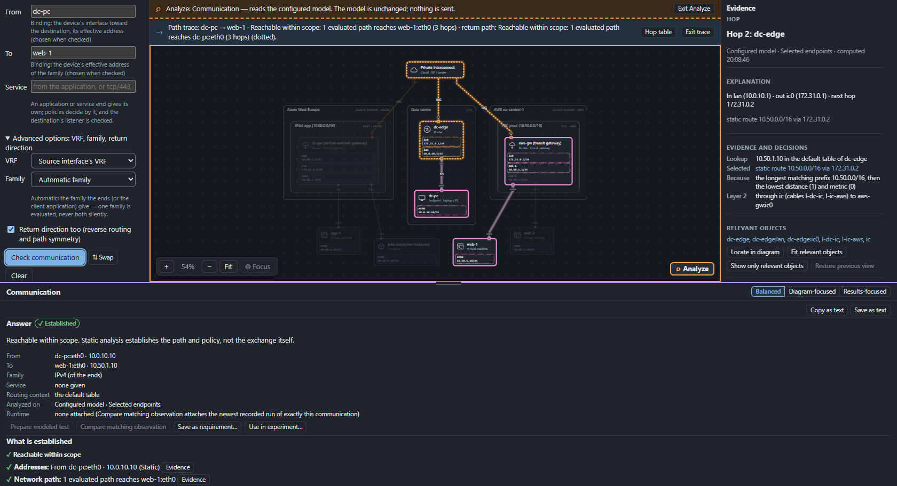

# NetAtlas

NetAtlas is a tool to create, edit and explore network architectures, from a
home network or a small office to campus, WAN and data-center networks and
embedded, IoT and industrial cells. Every architecture has two views of the
same model: a **physical** view of devices, ports, cables, non-IP
interconnects and locations, and a **logical** view of IP networks, routing,
tunnels, services and other relationships.

The whole application is one self-contained HTML file. It runs locally in a
browser, with no server, no installation and no network connection, so it can
be used on an air-gapped machine. Models are saved as portable YAML files,
but you don't need to write YAML: the graphical editor creates and changes
every part of a model, and YAML is simply what it saves.

Beyond drawing, NetAtlas can **analyze** an architecture and **simulate** it:
watch modeled protocol behaviour, trigger network actions and inspect what
happens. The simulation is a model with a documented scope, not an emulation
of real devices.


*The physical view of the built-in example `ot-network.yaml`: devices with their interfaces and addresses, cables with their speeds, zones drawn as groups.*

## What you can do

| Area | What you can do |
|---|---|
| **Model** | Build devices (15 types, from routers and switches to PLCs and VMs) with their interfaces, addresses, VLANs, routes, services and applications; cables, IP networks, relations such as routing sessions and tunnels, non-IP interconnects (USB, serial lines, buses, backplanes, fabrics) between non-IP ports, and locations from sites down to racks. |
| **Visualize** | Switch between the physical and the logical view, find and filter objects (also IP or non-IP connections), focus on a neighbourhood, and arrange a view automatically (Default, Compact or Structured). |
| **Analyze** | Ask a question and inspect its evidence: whether an application or service can communicate (Communication), what stops working when components are unavailable and whether the stated traffic still fits (Resilience), whether saved requirements hold and what the consistency checks find (Design review), and where addresses conflict or are allocated (Addressing). |
| **Simulate** | Start a protocol simulation, follow its messages and tables, send packets, join multicast groups, start streams and applications, send illustrative data over non-IP interconnects, and fail, shut or power off parts of the network; build repeatable experiments with explicit observations. |
| **Share** | Save the model as YAML, open it on any other machine, and export either view as a PNG or SVG picture in the light or dark theme. |

It is meant for anyone who designs, documents, reviews or teaches networks:

| Environment | Typical use |
|---|---|
| Home and small office | Wi-Fi with VLANs, a router with DHCP, DNS and NAT, a NAS and IoT devices |
| Campus, WAN and data center | Tiered switching, OSPF and BGP, VPN tunnels, spine/leaf fabrics with EVPN/VXLAN, virtualization |
| Embedded, IoT and industrial | Cells and zones, PLCs and HMIs, MQTT, time synchronization with NTP and PTP; racks whose boards share a backplane, with field buses and serial lines drawn next to the Ethernet side |


*The logical view of `enterprise-campus.yaml`, arranged with **Compact**: networks with their members, a Layer 3 switch's VLAN interfaces, routes and next hops.*

## IP and non-IP architectures

One model can hold two kinds of connections. They are modeled at very
different depths, and NetAtlas keeps them apart.

### IP networking

A device's **interfaces** (ports, aggregates, VLAN interfaces, tunnel
interfaces, loopbacks) are joined by **cables**; clients join an access
point's Wi-Fi networks. On them NetAtlas models a networking stack, where the device
can take part in it:

- **Layer 2**: Ethernet links, switching by VLAN (access and trunk ports,
  spanning tree, LACP and MLAG), Wi-Fi networks on access points.
- **Layer 3**: IPv4 and IPv6 addresses, networks, VRFs, static routes and
  the routing protocols of a bounded subset (OSPF, IS-IS, BGP, EIGRP, RIP),
  first-hop redundancy (VRRP, HSRP).
- **Policies and boundaries**: routers' and Layer 3 switches' ACLs,
  firewalls' rule bases, NAT, VPN gateways, IDS/IPS inspection, and
  Security gateways between two domains.
- **Tunnels and overlays**: IPsec, GRE, WireGuard, VXLAN/EVPN and others,
  each over the underlay it names.
- **Services and applications**: DHCP, DNS, NTP, PTP, syslog, AAA,
  monitoring, and applications (TCP and UDP clients and listeners,
  periodic messages, MQTT 3.1.1).
- **Virtual networking**: hypervisors and container engines, their virtual
  switches, VMs and containers bound to their hosts.

What a device does is decided by its **type** (and its mode, *Supports
Layer 3*, or a System's purpose), never by its name or icon: a Layer 2
switch bridges but never routes, even inside a routed architecture, and an
endpoint never forwards for others. The [table below](#what-each-device-type-can-do)
says what each type does.

### Non-IP components and interconnects

A port can be written as a **non-IP port** (`stack: opaque`): it has no MAC,
VLAN or IP address and never takes a cable. Non-IP ports are joined by
**interconnects**:

- **Point to point** (exactly two ports: a USB link, an RS-232 line, a PCIe
  or SRIO lane) or a **shared medium** (one bus with several attachments:
  a VME backplane, a CAN bus, a MIL-STD-1553 bus).
- A **technology** and version, an optional application protocol and a
  connector, all as text. The editor suggests common ones (USB, RS-232,
  RS-422, RS-485, CAN, I²C, SPI, VME, PCIe, SRIO, MIL-STD-1553, ARINC 429;
  Modbus RTU, CANopen, J1939 and others), but nothing about a technology is
  checked or simulated.
- **Access and roles** per attachment: peers, or controller and target
  (also *controller and target*, and *monitor*, which only receives).
- **Direction** per attachment: sends, receives, or both.
- **Transit** only where it is written: a System may pass data between
  explicitly grouped non-IP ports of one technology (`opaque_transit`, a
  fabric switch card). No other device joins two interconnects.

In the simulation, **illustrative data** moves along these connections:
started under **Network events → Send illustrative data**, or as an
interconnect's own `traffic:` while the simulation runs. It goes one way,
hop by hop, as the roles, directions, transit groups and failures (of an
interconnect, an attachment, a port or a device) allow. When it stops, it
says why. It is drawn in the physical view and listed in the packet
inspector.

What this does **not** establish: enumeration, addressing, arbitration,
collisions, framing, timing, bandwidth, acknowledgements or replies of the
technology or its protocol, conversion between technologies, or any
electrical behaviour. The data has no content, and its size is only a
label. Analyze (paths, outage impact, requirements) and the experiments
cover the IP side only. Details are in
[docs/LIMITATIONS.md](docs/LIMITATIONS.md#non-ip-interconnects) and
[docs/FORMAT.md](docs/FORMAT.md).

### Devices with both

"IP" and "non-IP" describe ports and connections, not devices. One device
can have network interfaces and non-IP ports side by side; only VMs and
containers have no ports of their own. In [`vme-rack.yaml`](examples/vme-rack.yaml),
the CPU board `cpu1` is a server with an Ethernet port over the backplane
(its IP side, reached from the operators' LAN) and a VMEbus and an SRIO
port (its non-IP side). The bus controller `mil` has an Ethernet port and
a MIL-STD-1553 port.

Having both kinds of port on one device does **not** make it a protocol
converter, a gateway or an application relay. Nothing passes between its
IP side and its non-IP side, and a non-IP failure does not affect its IP
communication (only powering the device off stops both). Drawing a
connection documents it. Only what the model and the simulation define
moves over it.

## What each device type can do

The capabilities come from one resolver (`src/model/capabilities.ts`). The
[capability matrix in docs/FORMAT.md](docs/FORMAT.md#capabilities) is
generated from it and has every mode and combination. A capability is what
a device can do; what actually passes still depends on its interfaces,
cables, VLANs, routes and policy.

| Device type (`type`) | Typical modeled role | What NetAtlas supports | Important limits |
|---|---|---|---|
| Router (`router`) | Routing between networks, WAN and internet edge | Routes with static routes and the modeled routing subset; ACLs, NAT, DHCP server or relay, tunnels | Routing databases abstracted (no LSA or BGP path details); bridges nothing |
| Switch (`switch`) | Access, distribution, core, leaf | Bridges by VLAN with spanning tree, MAC learning, LACP/MLAG and IGMP/MLD snooping; with **Supports Layer 3** also routes (VLAN interfaces, ACLs, DHCP) | A Layer 2 switch routes nothing; static path tracing does not apply spanning-tree blocking |
| Firewall (`firewall`) | Perimeter and zone boundaries | **Routed**: routes and applies its rule base with sessions, also NAT and VPN tunnels; **Transparent**: bridges its data ports with its policy | No application identification, TLS inspection, user identities or vendor rule syntax |
| Access point (`ap`) | Wi-Fi access | Bridges its Wi-Fi networks (on VLANs) to its wired side; standalone or controller-managed | No radio model (channels, coverage, roaming); WPA is a label; traffic tunneled to a controller is not simulated |
| Load balancer (`load_balancer`) | Service front end | Routes; ends client connections and passes them to its pool members; TCP health checks | Relays TCP only; one connection each way |
| IDS/IPS (`ids_ips`) | Inspection | **Inline**: passes traffic between paired ports and may block it; **Passive**: receives copies from a TAP and alerts | Matches protocols and ports only; no signatures or payload inspection |
| VPN gateway (`vpn_gateway`) | VPN termination | Terminates its VPN tunnels; forwards only to and from them | No plain transit |
| Security gateway (`security_gateway`) | Cross-domain boundary | Transfers between exactly two domains what its policy permits, as a filtering bridge, a filtering router or a protocol break | A model of a boundary, not of a product; a protocol break models HTTPS requests, DNS queries and syslog only |
| Server (`server`), Virtual machine (`vm`), Container (`container`) | Hosts, services, virtualization | End systems with applications and network services (DHCP, DNS, …); a server hosts VMs and containers; a VM may host containers, and with **Supports Layer 3** routes | VMs and containers have no ports of their own; no CPU or memory model (an inventory is only compared) |
| Storage (`storage`) | NAS, SAN, backup | An end system with applications; its storage protocols' ports are open | NFS, SMB and iSCSI themselves are not simulated |
| Endpoint (`endpoint`) | PCs, phones, printers, cameras, IoT, PLCs, HMIs | An end system with applications; sends test traffic | A kind (PLC, HMI, camera …) is an icon only, never a different behaviour |
| Cloud (`cloud`) | Internet, carrier, MPLS service, mobile network | An external network crossed as one Layer 3 hop with its latency and loss | Its inside is not modeled |
| System (`system`) | Whatever its required **purpose** says | **Host** (an end system), **Layer 2 forwarder**, **Layer 3 forwarder**, **Inline**, **Passive monitor**, **Pass-through** (a TAP or patch panel without an IP stack) or **External network**; the only type that may pass non-IP data between its own ports (`opaque_transit`) | Behaves only as its purpose says; its name, kind or icon never adds behaviour |

**Non-IP participation**: every type except VM and container can have
non-IP ports and take part in interconnects. On each interconnect an
attachment is a controller, a target, both, a peer or a receive-only
monitor, and sends, receives or both. With illustrative data only, no
technology protocol is emulated (see [above](#non-ip-components-and-interconnects)).

## Model, analyze, simulate: what each establishes

NetAtlas works at three levels, and each one establishes less than real
hardware would:

| Level | What it is | What it establishes |
|---|---|---|
| **Model and visualize** | What you draw and write: devices, connections, configuration | What the architecture *is meant to be*, with its contradictions found by validation and the consistency checks. A drawn connection is not proof that anything communicates over it. |
| **Analyze** | Static evaluation of the configured model or of a frozen simulation snapshot | Whether the configuration *allows* a communication (addresses, names, path, policy, listener, each said apart), what an outage takes away, whether requirements hold. Static feasibility is not proof that an application completes. |
| **Simulate** | Supported exchanges played over simulated time | What *that modeled exchange* observed: its messages, tables and outcome. Not what other exchanges, real implementations or real timing would do. An illustrative non-IP transfer is not proof that the real protocol would complete. |

Behaviour NetAtlas does not support is reported as a limitation. It is not
treated as permitted or successful. No result proves production
performance, availability or compliance.

**Analysis** looks at the architecture as it is written down, or at a
snapshot of a running simulation: whether a source can use an application
or service (addresses, name resolution, path, policy and listener, each said
apart), how each network's addresses are allocated, which cable, device or
LAG cuts something off or takes a service away, what changes when the
components you choose are unavailable and whether the stated traffic still
fits, whether saved requirements hold (an isolation by the policy that
enforces it), the path MTU, and which settings contradict each other. Each of
its tasks — Communication, Resilience, Design review and Addressing — puts
the question on the left, the answer and its results at the bottom and the
evidence of what you select on the right. Every result gives its verdict
with its context, coverage and limits. It never changes the model and never
sends anything.



*Analyze → Communication on `hybrid-cloud.yaml`: the question on the left, the answer once at the bottom with what is established (addresses, path, policy) and what a static check does not establish, a hop’s decision evidence on the right; the path marked in the diagram.*

**Simulation** runs the architecture over time. The network starts like a
freshly booted one, and you can watch protocol exchanges, adjacencies and
learned tables (ARP, MAC, DHCP leases, routes) as they form. Under
**Network events** you can then act on it:

| Action | What you can learn |
|---|---|
| **Send network packets** | Whether a ping, TCP or UDP exchange gets through, and where and why it doesn't |
| **Join / Leave multicast group**, **Start multicast stream** | How IGMP / MLD, snooping and PIM deliver a stream, and to whom |
| **Start application** | How an application's requests, periodic messages or MQTT publications travel |
| **Send illustrative data** | Where data may go over the non-IP interconnects under their roles, directions and transit, and where it stops |
| **Interface actions**, a device's **Power off** | How the network reacts to a failure, a shut port or a flapping link, and how it recovers |

Saved **experiments** repeat a sequence of such events from a clean start
and compare runs; an **execution scope** runs one part of a larger model.
Each message can be opened in the **packet inspector**, layer by layer.
Simulated packets exist only inside NetAtlas: nothing is sent to your real
network.


*A simulation of `private-house.yaml`: the first test ping on its way (Readable pacing holds the clock until it arrives), Send network packets in the Actions panel, the status of the protocols' sessions and the event log.*

### Protocols and services

The simulation covers a broad range of protocols, at different depths. Each
protocol, service and application profile states in the application what it
models and what it leaves out (its ⓘ note in the editor and in
**Start simulation…**). Representative examples:

| Area | Examples | Depth |
|---|---|---|
| Switching and discovery | ARP, NDP, STP/RSTP, LLDP, CDP, LACP, MLAG, VLANs, IGMP/MLD snooping | Exchanges, tables and port states |
| Addressing and network services | DHCP, DHCPv6, SLAAC, DNS, NAT, syslog, SNMP, RADIUS/TACACS+ | Requests, leases and answers; message contents simplified |
| Routing and redundancy | Static routes, OSPF, IS-IS, BGP, EIGRP, RIP and RIPng, BFD, VRRP, HSRP | Sessions, timers and routes, a bounded routing policy; databases abstracted (no LSA or BGP path details) |
| Multicast | IGMP/MLD, PIM sparse, SSM and dense mode | Membership, queriers, joins and forwarding |
| Tunnels and overlays | IPsec, GRE, WireGuard, VXLAN, EVPN, MPLS L3VPN, SD-WAN | From full exchanges (IPsec) to session or encapsulation only |
| Applications, messaging and timing | TCP/UDP application profiles, MQTT 3.1.1, NTP, PTP (IEEE 1588 default profile) | Messages and state; no measured clock accuracy |
| Non-IP interconnects | USB, serial lines, buses, backplanes, fabrics (technology as text) | Connectivity validated and drawn; illustrative data only, no technology protocol |

Some services are checked for consistency without being simulated, and a
protocol you define yourself is drawn only. Simulation timing follows the
model's parameters; it is not a measurement of real hardware.

## Get started

You need only the built file `netatlas.html`. Running it requires no build
tools.

1. **Get the file.** Download
   [`dist/netatlas.html`](https://github.com/hafnerst/netatlas/blob/main/dist/netatlas.html)
   from the default branch `main` (the latest release), or the same file at a
   [release](https://github.com/hafnerst/netatlas/releases) tag. Releases
   made with the release workflow (after 0.1.3) also attach it as a
   download, with a `SHA256SUMS` file to check it (`sha256sum -c SHA256SUMS`)
   and a small provenance file. Use this
   built file, not `src/index.html`. How to check a copy against its source
   is in [CONTRIBUTING.md](CONTRIBUTING.md#is-the-checked-in-html-current).
2. **Open it** in a current Chrome, Edge, Firefox or Safari: double-click it or
   drag it into a browser window.
3. **Start a model**: **New model**, **Open model…** for a YAML file, or
   **Load example** for one of the eleven built-in examples.
4. **Explore, analyze or simulate**: switch between **Physical** and
   **Logical** in the toolbar, select objects to edit them, and use the
   **Analyze** and **Simulate** menus.
5. **Save or export**: **File → Save model as…** writes the model as YAML;
   **Export → Export view as…** saves a picture.

Saving to a file you choose works in Chromium-based browsers; Firefox and
Safari download a copy instead.

The task-by-task guide is in the application: **Help → User Manual**. It is
part of the HTML file and works offline.

### Choose an example

All eleven are listed in [examples/README.md](examples/README.md). Three good
places to start:

| Example | What it demonstrates | What you can inspect or try | Modeling boundary |
|---|---|---|---|
| [`enterprise-wan.yaml`](examples/enterprise-wan.yaml) (IP) | HQ and two branches: IPsec, GRE and OSPF over internet uplinks, eBGP to two ISPs, VRRP, LACP, a WireGuard backup | Analyze → Communication from `hq-fw` to `hq-log` (two equal-cost paths); Resilience → Outage impact of `hq-core1`; start the simulation and watch the tunnels and adjacencies come up | Routing databases are abstracted; timing is modeled, not measured |
| [`ot-network.yaml`](examples/ot-network.yaml) (IP, industrial) | A PLC, HMI, MQTT broker, protocol gateway, TAP and passive IDS in an OT cell next to the IT side | Communication from `hmi/poll` to the PLC; the broker's outage takes the MQTT clients' dependencies; the saved experiment *Telemetry and polling while the cell cabinet is down* | Modbus TCP and other industrial protocols are application labels over TCP/UDP: their contents are not modeled |
| [`vme-rack.yaml`](examples/vme-rack.yaml) (non-IP and mixed) | A VME64x crate: boards on a shared VMEbus backplane, an SRIO fabric through a switch card (`opaque_transit`), a MIL-STD-1553 bus, a CAN bus, RS-232 and USB, next to the Ethernet side that a VME switch board gives every board | Filter the physical view to IP or non-IP; start the simulation and watch the interconnects' own illustrative traffic; **Send illustrative data** from the 1553 bus controller; fail an interconnect or a port and see where data stops; the IP side's telemetry polls | Interconnects carry illustrative data only (no bus protocol, arbitration or timing), and the IP side never uses them |

## Documentation and limitations

- **Help → User Manual** in the application: how to do each task, offline.
- [docs/FORMAT.md](docs/FORMAT.md): the YAML model format and its rules,
  with every device type and its capabilities;
  [docs/YAML-SUBSET.md](docs/YAML-SUBSET.md): the YAML that is supported.
- [examples/README.md](examples/README.md): the built-in examples.
- [docs/SUPPORT.md](docs/SUPPORT.md): what each protocol, service, analysis
  and non-IP interconnect implements and leaves out (generated from the
  application's own statements); [docs/LIMITATIONS.md](docs/LIMITATIONS.md):
  the simplifications and unsupported cases, area by area.
- [CHANGELOG.md](CHANGELOG.md): what changed in each release.

Important boundaries:

- The simulation models architecture-level behaviour. It is not an emulator
  of vendor operating systems, and its fidelity varies by protocol.
- Non-IP interconnects are drawn, validated and carry illustrative data;
  no non-IP technology or protocol is emulated, and nothing converts between
  them and the IP side.
- Modeled timing does not predict the performance of real hardware or the
  accuracy of real time synchronization.
- Analysis and checks read the model, not device configurations: they find
  contradictions in what is written down.
- Large models work, but drawing and simulating them gets slower as they grow.
- NetAtlas is still evolving. The model format is version 1 (`netatlas: 1`),
  and until NetAtlas is in production its changes are made within that
  version without backward compatibility: a file written for an earlier
  release may need changes (listed in [docs/FORMAT.md](docs/FORMAT.md) and
  [CHANGELOG.md](CHANGELOG.md)). The application version (0.1.5) and the
  model format version are independent.

## Development

Building from source needs Node.js 22 or later (CI uses 24); the only
dependency is the TypeScript compiler.

```sh
npm ci             # TypeScript only, as pinned in package-lock.json
npm run build      # writes dist/netatlas.html
npm test           # builds, then runs every test suite
npm run verify     # everything CI checks, from freshness to the browser suites
```

The browser tests need Chrome, Edge or Chromium. Branch rules, the release
procedure and the build in detail are in [CONTRIBUTING.md](CONTRIBUTING.md);
the code's structure is in [docs/ARCHITECTURE.md](docs/ARCHITECTURE.md), the
tests in [docs/TESTING.md](docs/TESTING.md).

## License

NetAtlas is licensed under the [Apache License, Version 2.0](LICENSE).
**Help → License** shows it in the application.
