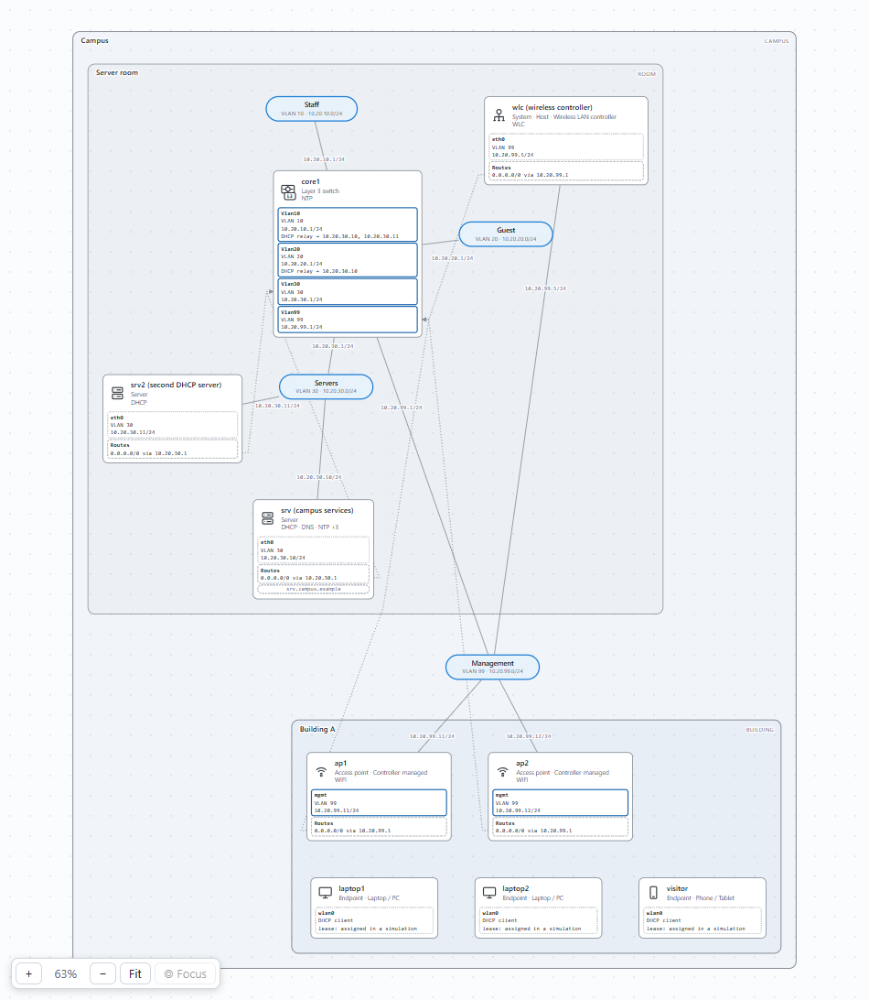
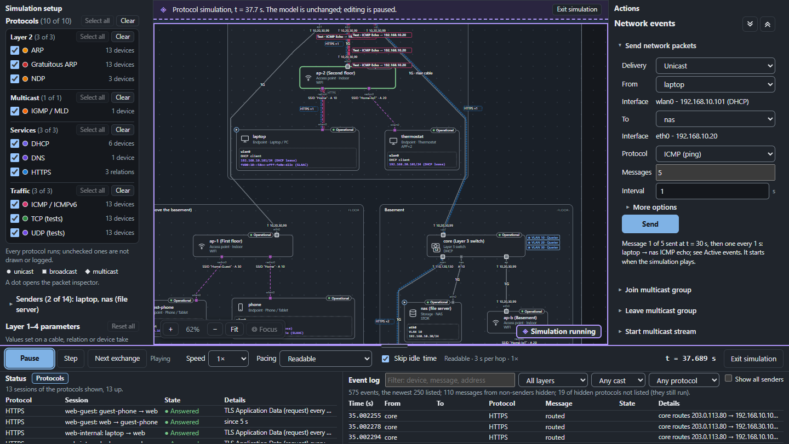

# NetAtlas

NetAtlas is a tool to create, edit and explore network architectures, from a
home network or a small office to campus, WAN and data-center networks and
embedded, IoT and industrial Ethernet cells. Every architecture has two views
of the same model: a **physical** view of devices, ports, cables and
locations, and a **logical** view of IP networks, routing, tunnels, services
and other relationships.

The whole application is one self-contained HTML file. It runs locally in a
browser, with no server, no installation and no network connection, so it can
be used on an air-gapped machine. Models are saved as portable YAML files,
but you don't need to write YAML: the graphical editor creates and changes
every part of a model, and YAML is simply what it saves.

Beyond drawing, NetAtlas can **analyze** an architecture and **simulate** it:
watch modeled protocol behaviour, trigger network actions and inspect what
happens. The simulation is a model with a documented scope, not an emulation
of real devices.


*The physical view of the built-in example `ot-network.yaml`: devices with their interfaces and addresses, cables with their speeds, zones drawn as groups.*

## What you can do

| Area | What you can do |
|---|---|
| **Model** | Build devices (15 types, from routers and switches to PLCs and VMs) with their interfaces, addresses, VLANs, routes, services and applications; cables, IP networks, relations such as routing sessions and tunnels, and locations from sites down to racks. |
| **Visualize** | Switch between the physical and the logical view, find and filter objects, focus on a neighbourhood, and arrange a view automatically (Default, Compact or Structured). |
| **Analyze** | Check whether a client can use an application or service, review how the address space is allocated, find single points of failure and what a failed rack or room takes with it, keep design requirements with the model, and see consistency findings with what follows from them. |
| **Simulate** | Start a protocol simulation, follow its messages and tables, send packets, join multicast groups, start streams and applications, and fail, shut or power off parts of the network; build repeatable experiments with explicit observations. |
| **Share** | Save the model as YAML, open it on any other machine, and export either view as a PNG or SVG picture in the light or dark theme. |

It is meant for anyone who designs, documents, reviews or teaches networks:

| Environment | Typical use |
|---|---|
| Home and small office | Wi-Fi with VLANs, a router with DHCP, DNS and NAT, a NAS and IoT devices |
| Campus, WAN and data center | Tiered switching, OSPF and BGP, VPN tunnels, spine/leaf fabrics with EVPN/VXLAN, virtualization |
| Embedded, IoT and industrial Ethernet | Cells and zones, PLCs and HMIs, MQTT, time synchronization with NTP and PTP |

Industrial and fieldbus protocols that are not IP-based are outside its scope;
the built-in examples show what is covered.



*The logical view of `enterprise-campus.yaml`, arranged with **Compact**: networks with their members, a Layer 3 switch's VLAN interfaces, routes and next hops.*

## Get started

You need only the built file `netatlas.html`. Running it requires no build
tools.

1. **Get the file.** Download
   [`dist/netatlas.html`](https://github.com/hafnerst/netatlas/blob/main/dist/netatlas.html)
   from the default branch `main` (the latest release), or the same file at a
   [release](https://github.com/hafnerst/netatlas/releases) tag; releases have
   no separate download. Use this built file, not `src/index.html`. How to
   check a copy against its source is in
   [CONTRIBUTING.md](CONTRIBUTING.md#building-and-testing).
2. **Open it** in a current Chrome, Edge, Firefox or Safari: double-click it or
   drag it into a browser window.
3. **Start a model**: **New model**, **Open model…** for a YAML file, or
   **Load example** for one of the ten built-in examples.
4. **Explore, analyze or simulate**: switch between **Physical** and
   **Logical** in the toolbar, select objects to edit them, and use the
   **Analyze** and **Simulate** menus.
5. **Save or export**: **File → Save model as…** writes the model as YAML;
   **Export → Export view as…** saves a picture.

Saving to a file you choose works in Chromium-based browsers; Firefox and
Safari download a copy instead.

The task-by-task guide is in the application: **Help → User Manual**. It is
part of the HTML file and works offline.

## Analysis and simulation

**Analysis** looks at the architecture as it is written down, or at a
snapshot of a running simulation: whether a source can use an application
or service (addresses, name resolution, path, policy and listener, each said
apart), how each network's addresses are allocated, which cable, device or
LAG cuts something off or takes a service away, what a failure domain takes
with it and whether the stated traffic still fits, whether saved
requirements hold (an isolation by the policy that enforces it), the path
MTU, and which settings contradict each other. Every result gives its verdict with its context, coverage and
limits; it never changes the model and never sends anything, and a modeled
result is no proof of production behaviour.


*Analyze → Trace path… on `hybrid-cloud.yaml`: the verdict first, then what it rests on (addresses, path, policy), what a static check does not establish, and each hop; the path marked in the diagram.*

**Simulation** runs the architecture over time. The network starts like a
freshly booted one, and you can watch protocol exchanges, adjacencies and
learned tables (ARP, MAC, DHCP leases, routes) as they form. Under
**Network events** you can then act on it:

| Action | What you can learn |
|---|---|
| **Send network packets** | Whether a ping, TCP or UDP exchange gets through, and where and why it doesn't |
| **Join / Leave multicast group**, **Start multicast stream** | How IGMP / MLD, snooping and PIM deliver a stream, and to whom |
| **Start application** | How an application's requests, periodic messages or MQTT publications travel |
| **Interface actions**, a device's **Power off** | How the network reacts to a failure, a shut port or a flapping link, and how it recovers |

Saved **experiments** repeat a sequence of such events from a clean start
and compare runs; an **execution scope** runs one part of a larger model.
Each message can be opened in the **packet inspector**, layer by layer.
Simulated packets exist only inside NetAtlas: nothing is sent to your real
network.



*A simulation of `private-house.yaml`: test pings on their way, Send network packets in the Actions panel, the status of the protocols' sessions and the event log.*

### Protocols and services

The simulation covers a broad range of protocols, at different depths. Each
protocol, service and application profile states in the application what it
models and what it leaves out (its ⓘ note in the editor and in
**Start simulation…**). Representative examples:

| Area | Examples | Depth |
|---|---|---|
| Switching and discovery | ARP, NDP, STP/RSTP, LLDP, CDP, LACP, MLAG, VLANs, IGMP/MLD snooping | Exchanges, tables and port states |
| Addressing and network services | DHCP, DHCPv6, SLAAC, DNS, NAT, syslog, SNMP, RADIUS/TACACS+ | Requests, leases and answers; message contents simplified |
| Routing and redundancy | Static routes, OSPF, IS-IS, BGP, EIGRP, RIP, BFD, VRRP, HSRP | Sessions, timers and routes; no policies or LSA details |
| Multicast | IGMP/MLD, PIM sparse, SSM and dense mode | Membership, queriers, joins and forwarding |
| Tunnels and overlays | IPsec, GRE, WireGuard, VXLAN, EVPN, MPLS L3VPN, SD-WAN | From full exchanges (IPsec) to session or encapsulation only |
| Applications, messaging and timing | TCP/UDP application profiles, MQTT 3.1.1, NTP, PTP (IEEE 1588 default profile) | Messages and state; no measured clock accuracy |

Some services are checked for consistency without being simulated, and a
protocol you define yourself is drawn only. Simulation timing follows the
model's parameters; it is not a measurement of real hardware.

## Documentation and limitations

- **Help → User Manual** in the application: how to do each task, offline.
- [docs/FORMAT.md](docs/FORMAT.md): the YAML model format and its rules;
  [docs/YAML-SUBSET.md](docs/YAML-SUBSET.md): the YAML that is supported.
- [examples/README.md](examples/README.md): the built-in examples.
- [docs/SUPPORT.md](docs/SUPPORT.md): what each protocol, service and
  analysis implements and leaves out (generated from the application's own
  statements); [docs/LIMITATIONS.md](docs/LIMITATIONS.md): the
  simplifications and unsupported cases, area by area.
- [CHANGELOG.md](CHANGELOG.md): what changed in each release.

Important boundaries:

- The simulation models architecture-level behaviour. It is not an emulator
  of vendor operating systems, and its fidelity varies by protocol.
- Modeled timing does not predict the performance of real hardware or the
  accuracy of real time synchronization.
- Analysis and checks read the model, not device configurations: they find
  contradictions in what is written down.
- Large models work, but drawing and simulating them gets slower as they grow.
- NetAtlas is still evolving. The model format is version 1 (`netatlas: 1`),
  and until NetAtlas is in production its changes are made within that
  version without backward compatibility: a file written for an earlier
  release may need changes (listed in [docs/FORMAT.md](docs/FORMAT.md) and
  [CHANGELOG.md](CHANGELOG.md)).

## Development

Building from source needs Node.js 18 or later; the only dependency is the
TypeScript compiler.

```sh
npm install        # TypeScript only
npm run build      # writes dist/netatlas.html
npm test           # builds, then runs the Node tests and the browser self-tests
```

The browser tests need Chrome, Edge or Chromium. Branch rules, the release
procedure and the build in detail are in [CONTRIBUTING.md](CONTRIBUTING.md);
the code's structure is in [docs/ARCHITECTURE.md](docs/ARCHITECTURE.md), the
tests in [docs/TESTING.md](docs/TESTING.md).

## License

NetAtlas is licensed under the [Apache License, Version 2.0](LICENSE).
**Help → License** shows it in the application.
